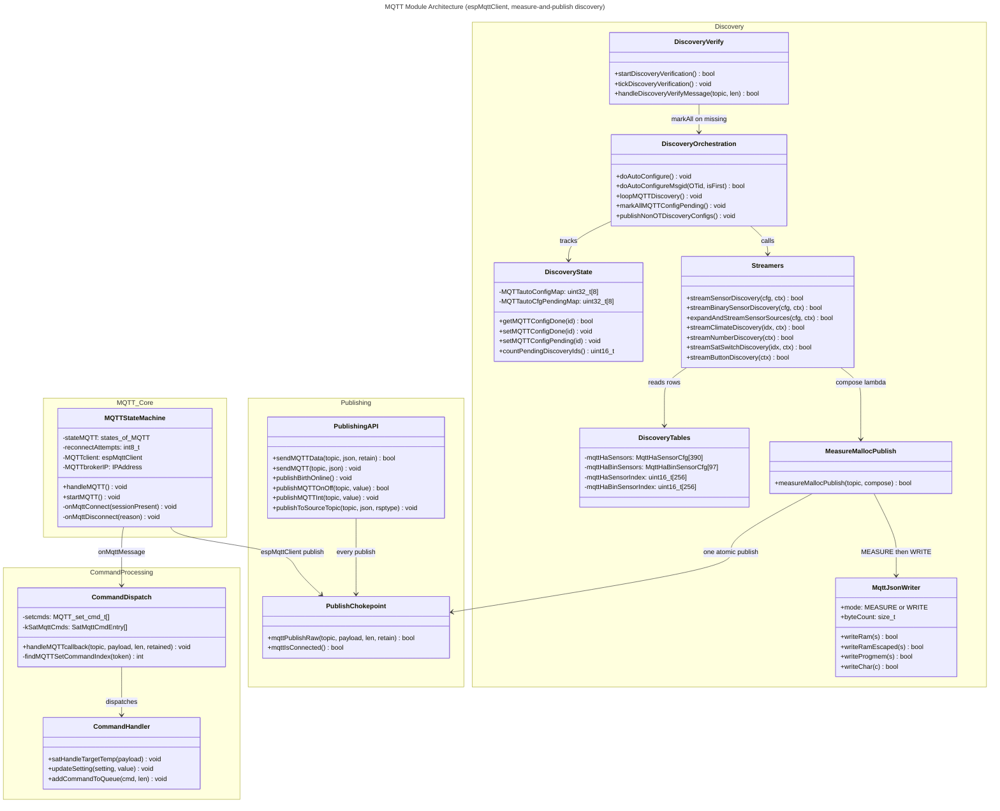

# C4 Code Level: MQTT Module

## Overview

- **Name**: MQTT Client and Home Assistant Auto-Discovery Module
- **Description**: MQTT client for the OTGW-firmware ESP32-S3 gateway, built on the async `espMqttClient` library (ADR-123 Phase 2, TASK-865.7). Provides publish/subscribe, Home Assistant auto-discovery, command handling and OpenTherm-message-to-MQTT mapping. Discovery payloads are composed twice with a dual-mode writer (MEASURE, then WRITE into an exactly sized transient heap buffer) and published as one atomic message; OT-ID discovery is queued Just-In-Time when a valid frame of an unpublished ID arrives and the drip publisher sends it (ADR-100). Value topics are flat per-value scalars (ADR-101) with self-describing names by default (ADR-106) and a legacy compatibility toggle.
- **Location**: `/src/OTGW-firmware/MQTTstuff.ino`, `/src/OTGW-firmware/MQTTstuff.h`, `/src/OTGW-firmware/MQTTHaDiscovery.cpp`, `/src/OTGW-firmware/mqtt_discovery_verify.cpp` (+ `.h`); library `src/libraries/espMqttClient/`
- **Language**: Arduino C/C++ (ESP32-S3; ESP8266 and PubSubClient are gone)
- **Purpose**: Integrates the gateway with home automation (Home Assistant): publishes OpenTherm data to configurable topics, handles MQTT commands for the gateway, SAT and settings, and manages the discovery of sensors, binary sensors, climate, number, switch, select and button entities.

## Code Elements

### Core State Management

#### Enumerations

- `enum states_of_MQTT { MQTT_STATE_INIT, MQTT_STATE_TRY_TO_CONNECT, MQTT_STATE_IS_CONNECTED, MQTT_STATE_WAIT_CONNECTION_ATTEMPT, MQTT_STATE_WAIT_FOR_RECONNECT, MQTT_STATE_ERROR }`
  - State machine for the connection lifecycle, driven by `handleMQTT()`.
- `enum class HaDevice { Boiler, Thermostat, Gateway, Esp, OtCore, Sat, Sensors }` (MQTTstuff.h)
  - Since ADR-140 there is one HA device (the bare node id). `HaDevice` only selects the entity source prefix (`haSourcePrefix` / `haSourceNamePrefix` in `MQTTHaDiscovery.cpp`), for example `pic_`/`otd_`, `esp_`, `sat_`, `sensors_`. `deviceForOTId()` in `MQTTstuff.ino` picks the route per ID (real OT IDs 0 to 127: Boiler).

#### Data Structures

- `struct MqttHaSensorCfg` (MQTTstuff.h)
  - Sensor discovery config for a single OpenTherm message ID
  - Fields: `uint8_t id` (OT message ID 0 to 255, or a pseudo-ID such as 241 to 255), `uint8_t flags` (`MQTT_HA_FLAG_*`), `PGM_P label`, `PGM_P friendlyName`, `HaDeviceClass deviceClass`, `HaUnit unit`, `HaStateClass stateClass`, `HaIcon icon`, `HaEntityCat entityCat`, `bool enabledByDefault`
  - Array: `mqttHaSensors[]` (`MQTT_HA_SENSOR_COUNT` = 390 in the current source) with `mqttHaSensorIndex[256]` (ID to first row). Hand-written tables in `MQTTHaDiscovery.cpp` (ADR-077); the runtime `mqttha.cfg` is retired.
- `struct MqttHaBinSensorCfg` (MQTTstuff.h)
  - Binary sensor discovery config: like the sensor row without unit and state class, plus `deviceClass` and `HaBinaryPayload`
  - Array: `mqttHaBinSensors[]` (`MQTT_HA_BINSENSOR_COUNT` = 97) with `mqttHaBinSensorIndex[256]`; the first `MQTT_HA_BINSENSOR_INDEXED_COUNT` (60) rows are indexed, the rest is the ADR-106 alias tail
- `MQTT_HA_INDEX_NONE` (0xFFFF): no row for this ID

#### Discovery Flag Constants (MQTTstuff.h)

- `MQTT_HA_FLAG_SOURCE_SUFFIX` (0x01), `MQTT_HA_FLAG_SOURCE_NAME` (0x02), `MQTT_HA_FLAG_SOURCE_TOPIC_SEGMENT` (0x04): source-expansion bits for `bSeparateSources`; `MQTT_HA_FLAG_ANY_SOURCE` (0x07) is the mask.
- `MQTT_HA_FLAG_IS_PIC_ENTRY` (0x08): pseudo-ID 244 entries (resetgateway button, GPIO/LED selects).
- `MQTT_HA_FLAG_IS_HA_CORE_ALIAS` (0x10): ADR-106 self-describing alias row, published in new mode (default), skipped in legacy mode.
- `MQTT_HA_FLAG_LEGACY_REPLACED_BY_ALIAS` (0x20): ADR-106 legacy OT-spec name with an alias replacement; skipped in new mode, published in legacy mode.

- `struct HaDiscoveryContext` (MQTTstuff.h)
  - Runtime context passed to the streaming discovery functions
  - Fields: `nodeId`, `hostname`, `version`, `mqttPubTopic`, `mqttSubTopic`, `haPrefix`, `manufacturer`, `model` (legacy only), `isFirstEntity` (the first drip entity carries the full device block, ADR-140), `legacyMode` (`settings.mqtt.bLegacyMode`, threaded in because `MQTTHaDiscovery.cpp` cannot see globals), `device` (`HaDevice`), `otCoreSuffix` / `otCoreName` ("pic" or "ot-direct", compile-time on fixed boards, runtime on the combo board), `sourceSuffix`, `sourceName`, `sourceTopicSegment`
  - Built by `buildDiscoveryContext(bool isFirst)` in `MQTTstuff.ino`

- `struct MqttJsonWriter` (MQTTstuff.h)
  - Dual-mode JSON writer. `MEASURE` mode only accumulates `byteCount`; the `(char *target, size_t capacity)` constructor is WRITE mode and appends into a caller-supplied heap buffer, guarding every append against the capacity.
  - Methods: `writeRam(const char*)`, `writeRamEscaped(const char*)` (JSON escaping), `writeProgmem(PGM_P)`, `writeChar(char)`, `writeRamN(const char*, size_t)`; members `byteCount`, `ok`
  - Defined in the header so Arduino's auto-prototype generator knows the type

- `struct MQTT_set_cmd_t`
  - `PGM_P setcmd` (MQTT command name), `PGM_P otgwcmd` (PIC command code), `PGM_P ottype` (value class)
  - Array: `setcmds[]` (PROGMEM, `nrcmds` entries): `command`, `setpoint`/TT, `constant`/TC, `outside`/`outside_temp`/OT, `hot_water`/HW, `gatewaymode`/GW, `setback`/SB, `maxchsetpt`/SH, `maxdhwsetpt`/SW, `maxmodulation`/MM, `ctrlsetpt`/CS, `ctrlsetpt2`/C2, `chenable`/CH, `chenable2`/H2, `ventsetpt`/VS, the function commands (TS, AA, DA, UI, KI, PM, SR, CR, RS, IT, OH, FT, VR, DP), GPIO/LED (GA, GB, LA to LF) and `resetgateway`

### Initialization & Connection

- `void startMQTT()`
  - Returns if `settings.mqtt.bEnable` is false
  - Wires the `espMqttClient` callbacks (`onConnect`, `onDisconnect`, `onMessage`); re-registering is idempotent
  - Sets the state to `MQTT_STATE_INIT`, rebuilds `NodeId`, `MQTTPubNamespace` (`<topTopic>/value/<nodeId>`) and `MQTTSubNamespace` (`<topTopic>/set/<nodeId>`) with `buildNamespace()`
  - `clearMQTTConfigDone()`, `clearMQTTConfigPending()`, then `publishNonOTDiscoveryConfigs()` (non-OT set only; OT IDs publish JIT)
  - Calls `handleMQTT()` to start the state machine

- `void handleMQTT()`
  - Main state machine, called from `doBackgroundTasks()`. It pumps `MQTTclient.loop()` on every tick (the client is created with `UseInternalTask::NO`, so this loop is the only driver of the connection handshake and outbox), then `tickDiscoveryVerification()` and `mqttV2MigrationTick()`.
  - `MQTT_STATE_INIT`: `WiFi.hostByName()` for the broker; valid IP leads to `setServer()`, `setKeepAlive(60)`, `setCleanSession(true)`, client id `<_HOSTNAME><MAC>`, last will on `MQTTPubNamespace` ("offline", retained), credentials (anonymous when `sUser` is empty); invalid IP leads to `MQTT_STATE_ERROR`
  - `MQTT_STATE_TRY_TO_CONNECT`: `MQTTclient.connect()` is asynchronous (queues the work and returns). The per-attempt wait is `3 s x attempt`; after 5 attempts the state becomes `MQTT_STATE_WAIT_FOR_RECONNECT`
  - `MQTT_STATE_WAIT_CONNECTION_ATTEMPT`: non-blocking wait; retries when `timerMQTTwaitforretry` is due
  - `MQTT_STATE_IS_CONNECTED`: stamps `state.mqtt.iLastConnectedMs`; every 60 s `publishActiveOverrides()` (ADR-118); every 300 s `publishBirthOnline()` re-assert (TASK-874)
  - `MQTT_STATE_WAIT_FOR_RECONNECT`: waits 42 s (`timerMQTTwaitforconnect`), then re-enters `MQTT_STATE_INIT` so DNS and `setServer()` re-run (TASK-873)
  - `MQTT_STATE_ERROR`: restarts the 42 s wait
  - At the end it mirrors `MQTTclient.connected()` into `state.mqtt.bConnected`

- `static void onMqttConnect(bool sessionPresent)`
  - Sets `bConnected` and `MQTT_STATE_IS_CONNECTED`, publishes the retained birth (`publishBirthOnline()`), and when the outage exceeded `MQTT_REPUBLISH_OFFLINE_THRESHOLD_MS` (300000 ms) runs `requestMQTTRepublishAll()`, `clearMQTTConfigDone()`, `clearMQTTConfigPending()`, `publishNonOTDiscoveryConfigs()`
  - Subscribes to `<MQTTSubNamespace>/#` and `homeassistant/status` (QoS 0), opens the ADR-084 retained-cleanup window (`mqttV2MigrationOnConnect()`), publishes `sendMQTTversioninfo()`, `publishAllPICsettings()` and `publishBoilerUnsupportedMsgids()`
- `static void onMqttDisconnect(DisconnectReason)`: records `lastMqttDisconnectReason`, clears `bConnected`, calls `PrintMQTTError()`. It does not drive the state machine; the next `handleMQTT()` tick observes the loss.
- `void doMqttDisconnect()`: clean disconnect for the reboot path (`prepareForReboot()`).

### Callback & Message Handling

- `static void onMqttMessage(props, topic, payload, len, index, total)`
  - Shim between `espMqttClient` and the dispatcher. The discovery-verify filter sees the topic on the first chunk even when the payload is chunked (TASK-889); commands are dispatched only for a whole single-chunk payload (`index == 0 && len == total`, TASK-875), so a partial command never executes. Passes `properties.retain` on.

- `static void handleMQTTcallback(char* topic, byte* payload, unsigned int length, bool retained)`
  - Order: deprecated-topic cleanup (`mqttV2MigrationHandleIfDeprecated()`), discovery-verify filter (`handleDiscoveryVerifyMessage()`), `homeassistant/status`, then the `<topTopic>/set/<nodeId>/...` tree
  - `homeassistant/status`: an `offline` sets `bHAcycle`; the next `online` clears it and calls `requestMQTTRepublishAll()`, so OT values re-publish as their frames arrive (ADR-174). Discovery is not touched. `online` without a preceding `offline` only logs.
  - `set/<nodeId>/sat/<cmd>`: table-driven by `kSatMqttCmds[]` (PROGMEM, ADR-078), each row either a typed handler (`target`, `indoor_temp`, `outdoor_temp`, `pv_surplus_w`, `pv_boost_enabled`, `humidity`, `sun_elevation`, `reset_integral`, `flush`, `window`, `valves_open`, ...) or a setting-key passthrough to `updateSetting()` (`enabled`, `control_mode`, `preset`, `heating_system`, `deadband`, `auto_tune`, ...). Sub-token commands `area/<idx>` and `zone/<idx>/<cmd>` stay outside the table. `dispatchSatMqttCmd()` walks the table.
  - `set/<nodeId>/otgw32/<cmd>` (`room_temp`, `room_setpoint`): rejected unless OT-direct is active
  - `set/<nodeId>/otgw/reset_water_total`: ignored when `retained`; otherwise `queueDHWWaterMeterReset()` (ADR-176, TASK-1123). It sits before the `hasOTCommandInterface()` gate, so every board accepts it. The callback runs on the loop task and only raises the flag; `loop()` applies the reset in `handlePendingDHWWaterMeterReset()`.
  - Standard gateway commands: `findMQTTSetCommandIndex()` maps the token through `setcmds[]`; the command is queued with `addCommandToQueue()` (PIC or OT-direct, `hasOTCommandInterface()`). `resetgateway` is hardened (TASK-668): only payload `1` fires, with a cooldown, and both rejection reasons surface in the default debug stream. SAT's own `CS=` goes through `satEnqueueOwnCS()` (ADR-179).
  - Anything else is forwarded to `updateSetting()` or dropped with an always-on debug line ("MQTT command [...] dropped: no matching OTGW command")
  - Runs on the loop task from `MQTTclient.loop()`, and can re-enter through `delayms()` inside `doBackgroundTasks()`

- `static int findMQTTSetCommandIndex(const char *topicToken)`: linear search of `setcmds[]` matching either `setcmd` or `otgwcmd`; -1 when not found.

### Publishing & Data Transmission

All publishes funnel through one chokepoint:

- `bool mqttPublishRaw(const char* topic, const uint8_t* payload, size_t len, bool retain)` (declared in MQTTstuff.h, defined in MQTTstuff.ino)
  - `MQTTclient.publish(topic, qos 0, retain, payload, len)`; `espMqttClient` copies topic and payload into its Outbox atomically, so the caller's buffer can be freed on return. Returns true when queued (packet id != 0). There is no streaming `beginPublish/write/endPublish` API; the old 128-byte chunker and the truncated-write guard are gone. `payload` may be null when `len == 0` (empty retained publish deletes a topic).
- `bool mqttIsConnected()`: cross-TU bridge to `MQTTclient.connected()` for `MQTTHaDiscovery.cpp`.

Per-value helpers (all return false when MQTT is disabled, `mqttPublishAllowed` is false, the client is disconnected, the broker IP is invalid, or `canPublishMQTT()` blocks):

- `bool sendMQTTData(const char* topic, const char *json, const bool retain = false)`: builds `<MQTTPubNamespace>/<topic>`, publishes through `mqttPublishRaw()`, increments `mqttSendSuccessCount` on success (ADR-104: counts publishes queued into the Outbox; the OTPublishGate commits slot updates from its delta)
- `bool sendMQTTData(const __FlashStringHelper *topic, const char *json, const bool retain)`: PROGMEM topic, RAM payload
- `bool sendMQTTData(const __FlashStringHelper *topic, const __FlashStringHelper *json, const bool retain)`: PROGMEM topic and payload (staged in a stack buffer)
- `void sendMQTTDataPic(label, value)`: publishes under the `otgw-pic/` subtree (`kPicSubtreePrefix`, ADR-065)
- `void sendMQTT(const char* topic, const char *json)`: verbatim topic (no namespace prefix), always retained
- `void publishBirthOnline()`: retained `online` on the base namespace topic (the last-will topic); deliberately bypasses the `canPublishMQTT()` gate so a low-heap moment cannot strand HA at the retained `offline` (TASK-874)
- `bool publishMQTTOnOff(topic, bool)` ("ON"/"OFF"), `void publishMQTTInt(topic, int)` (static 12-byte buffer, not re-entrant)
- `void publishToSourceTopic(const char* topic, const char* json, byte rsptype)`: with `settings.mqtt.bSeparateSources`, publishes sibling leaves `<topic>_thermostat` and `<topic>_boiler` (ADR-096 worldview routing, ADR-097 suffix shape, ADR-103 proxy answers). There is no `_gateway` variant. Skips Write-Ack frames whose data byte is undefined (`bSlaveEchoesValue`). Guarded by a static `inUse` flag.

### State Information Publishing

- `void sendMQTTuptime()`: `otgw-firmware/uptime`
- `void sendMQTTversioninfo()`: retained `otgw-firmware/hostname`, `otgw-firmware/hardware_type`, `otgw-firmware/hardware_mode`; `otgw-firmware/version`, `reboot_count`, `reboot_reason`; with a PIC: `otgw-pic/version`, `deviceid`, `firmwaretype`, `designer`. `picavailable` was removed (ADR-113).
- `void sendMQTTstateinformation()`: `boiler_connected`, `thermostat_connected`, `otgw_connected` (ADR-084: only under the generic value namespace; the `otgw-pic/*` and `otgw-otdirect/*` duplicates are gone) and `otgw-pic/gateway_mode` once known. Called from `do5minevent()`.
- `void sendMQTTheapdiag()`: hourly, retained `otgw-firmware/stats/*` topics (drops, tier entries, drip counters, heap snapshot, discovery verify telemetry including `disc_last_daily_heal_epoch`, soak watermarks and maxblock histogram)
- `void publishBoilerUnsupportedMsgids()`: retained CSV `otgw-firmware/boiler/unsupported_msgids` (for example `14W,24R`)
- `void sendDHWWaterTotal()` / `void publishDHWWaterMeter()`: DHW water total (ADR-176, ADR-182). Topic `dhw_water_total`, litres with one decimal, not retained. `publishDHWWaterMeter()` runs every 60 s from `doTaskEvery60s()`, stays silent until `dhwWaterMeterHasData()` (a MsgID 19 sample this boot), and queues faux ID 241 (`OTGWdhwmeterid`) while its done bit is unset.
- Network mode: `Ethernet.ino` publishes retained `otgw-firmware/network/mode` (`ethernet` or `wifi`) on transport switches.

### Home Assistant Auto-Discovery (Streaming Architecture)

Discovery configs are generated by functions in `MQTTHaDiscovery.cpp` from the data-driven tables (`mqttHaSensors[]`, `mqttHaBinSensors[]`) plus hardcoded streamers for climate (pseudo-ID 0), number (ID 27), SAT switches and select, the SAT zone, override sensors, Dallas sensors and PIC controls (ID 244).

**Publish scaffold**: `measureMallocPublish(topic, compose)` (static in `MQTTHaDiscovery.cpp`, TASK-865.7) runs the compose lambda in MEASURE mode to get the byte count, `malloc`s exactly that size, runs it again in WRITE mode, hands the buffer to `mqttPublishRaw(topic, buf, len, retain=true)` and frees it. Worst case about 900 B. Each `stream*Discovery()` helper increments `incPublishedTopicCount()` itself on success (ADR-062, gated by `evaluate.py::check_discovery_counter_instrumented`).

ADR-106 (self-describing topic names) splits the rows into two mutually exclusive sets: legacy OT-spec-derived names (for example `slave_member_id_code`) carry `MQTT_HA_FLAG_LEGACY_REPLACED_BY_ALIAS`; the self-describing alias rows (for example `manufacturer_code`) carry `MQTT_HA_FLAG_IS_HA_CORE_ALIAS` and live in the non-contiguous tail. `settings.mqtt.bUseLegacyOtTopics` (JSON key `MQTTuseLegacyOtTopics`) selects the set. New installs default to the new names; a settings file without the key (a 1.x upgrade) defaults to legacy. Toggling arms `armTopicCleanupOnLegacyToggle()`, an idempotent paced cleanup that publishes empty retained configs for the 37 topics of the other set (state persisted in `/topic_cleanup.bin`, drained by `runTopicCleanupStep()`).

A second axis, `settings.mqtt.bLegacyMode` (TASK-648), switches the config-topic shape between bare `<label>` (1.x compatible) and `<device>_<label>` (modern). `bLastPublishedLegacy` stamps the scheme in effect; a mismatch arms `armTopologyCleanup()` and a full republish (`runTopologyCleanupStep()`). `runThermostatDupCleanupStep()` is a one-shot clear of duplicate `thermostat_` configs left by older firmware (TASK-1201, `bThermostatDupsCleared`).

Discovery paths (ADR-100, JIT by default):

**Path B (JIT, default)**: `processOT()` (OTGW-Core.ino) sets the pending bit of an OT ID when a valid frame arrives and the ID is not yet marked published. It publishes nothing itself. `ensurePSSummaryDiscovery()` (PS=1 summary fields) and `pollSensors()` (Dallas pseudo-ID 246) queue the same way. JIT keeps the bulk publish off the boot path, but not the configs of never-seen IDs: every `markAllMQTTConfigPending()` call, the daily re-announce included, queues all table IDs.

**Path C (Drip)**: `loopMQTTDiscovery()` publishes the configs of one pending ID per timer tick (2 s normal, 10 s under heap pressure). It is the only caller of `doAutoConfigureMsgid()`. It drains the JIT IDs, the non-OT set that `publishNonOTDiscoveryConfigs()` queues at MQTT start and on a reconnect after more than 5 minutes offline, and the full set from `markAllMQTTConfigPending()`.

**Path A (Force)**: `doAutoConfigure()` calls `markAllMQTTConfigPending()` and leaves the publishing to the drip. Callers: telnet `F` and `POST /api/v2/otgw/discovery`.

**Daily heal (ADR-170)**: in `doTaskMinuteChanged()`, on a day change, when `settings.mqtt.bDiscoveryAutoVerify` (setting key `MQTTdiscoveryAutoVerify`, default true, REST `settings.mqtt.disc_verify`) and MQTT is connected, NTP is synced, uptime exceeds 3600 s, no manual verify is active, no drip is pending and `discoveryDripHeapHealthy()`, the firmware calls `markAllMQTTConfigPending()` and stamps `state.discovery.iLastDailyHealEpoch`. It is outbound-only: no wildcard subscribe and no count comparison (the readback of ADR-062 misread partial reads as "missing").

`mqtt_discovery_verify.cpp` runs the on-demand retained-discovery verify (ADR-062): a subscribe window of up to 15 s that counts retained configs and sets `VerifyOutcome` (`UNKNOWN`, `CLEAN`, `MISSING`, `ABORTED_HEAP`, `ABORTED_DISCONNECT`). When a run that was not aborted finds some missing, it calls `markAllMQTTConfigPending()` through `verifyAccessorMarkAllMQTTConfigPending()`. Only `POST /api/v2/discovery/verify` and telnet `V` start it. The verify TU reaches state through the `verifyAccessor*()` functions in `MQTTstuff.ino` (ODR-safe separate TU, TASK-363); it needs `VERIFICATION_MIN_HEAP_START` (6000 B) free heap.

Streaming functions (`MQTTHaDiscovery.cpp`; none takes a client parameter any more):

- `bool streamSensorDiscovery(const MqttHaSensorCfg &cfg, HaDiscoveryContext &ctx)` and `bool streamBinarySensorDiscovery(const MqttHaBinSensorCfg &cfg, HaDiscoveryContext &ctx)`: build the topic from `haPrefix`, domain, node id and label, compose the payload (name, unit, device class, state class, icon, value template, state topic, unique id, device block on the first entity) and publish through `measureMallocPublish()`
- `bool expandAndStreamSensorSources(cfg, ctx)`: with `bSeparateSources`, adds the `_thermostat` and `_boiler` variants (two, no `_gateway`) on top of the base entity (ADR-097: the base entity is always advertised)
- `bool streamClimateDiscovery(uint8_t climateIdx, ctx)`: 0 = Thermostat, 1 = DHW Control
- `bool streamNumberDiscovery(ctx)`: Toutside override number (ID 27)
- `bool streamOverrideSensorDiscovery(ctx, otid, label)`: active gateway override sensor for IDs 1, 8, 9, 14, 16, 39, 56, 57 (ADR-118)
- `bool streamSatSwitchDiscovery(uint8_t switchIdx, ctx)` (13 switches, index 0 to 12 via `streamSatBoolSwitch()`), `bool streamSatSelectDiscovery(uint8_t selectIdx, ctx)` (`sat_heating_system`), `bool streamSatZoneDiscovery(ctx)` (ID 255, in `MQTTstuff.ino`)
- `bool streamButtonDiscovery(ctx)` (PIC `resetgateway`), `bool streamSelectDiscovery(uint8_t selectIdx, ctx)` (0 = gpioa, 1 = gpiob, 2 to 7 = leda to ledf)
- `bool streamDallasSensorDiscovery(const char *sensorAddress, ctx)`: runtime address-based, reached through `configSensors()` / `sensorAutoConfigure()`
- `clearTopologyDiscoveryForOTId()`, `clearThermostatDupDiscoveryForOTId()`: empty retained publishes for the cleanup passes

- `void doAutoConfigure()`: returns at once when MQTT is disabled; otherwise `markAllMQTTConfigPending()`
- `bool doAutoConfigureMsgid(byte OTid, bool isFirst)`: publishes every config that belongs to one ID.
  - ID 246 (Dallas): `configSensors()`, returns true
  - Returns false when the `MQTTAutoConfigSessionLock` is taken, MQTT is disabled or disconnected, the broker IP is invalid, or free heap is below `MQTT_DISCOVERY_HEAP_MIN` (2048 B, `boards.h`)
  - Sensor rows (base entity always; source variants when `bSeparateSources`), indexed binary-sensor rows (new naming mode skips `LEGACY_REPLACED_BY_ALIAS` rows) and, in new mode, the alias tail. Real OT IDs are announced once, on the Boiler route
  - ID 0 also: both climate entities, the SAT switches (switch 12, `dhw_enable`, only when MsgID 3 reports a storage tank, TASK-516) and the SAT select; ID 27: the override number; IDs 1, 8, 9, 14, 16, 39, 56, 57: an override sensor; ID 244: the PIC button and eight selects, counted successful only when all nine published (TASK-1206); ID 255: the SAT zone
  - Does not set the done bit; the drip does that when this returns true

### Discovery State Management

Two bitmaps of 8 x uint32_t (256 bits, one per OT message ID): `MQTTautoConfigMap[8]` (published) and `MQTTautoCfgPendingMap[8]` (needs publishing).

- `bool getMQTTConfigDone(uint8_t)`, `void setMQTTConfigDone(uint8_t)`, `void clearMQTTConfigDone()` (also resets `state.discovery.iPublishedTopicCount`)
- `void setMQTTConfigPending(uint8_t)`, `void clearMQTTConfigPending()` (whole bitmap, no per-ID variant), `uint16_t countPendingDiscoveryIds()`
- `static void queueNonOTDiscoveryIds()`: the single definition of the non-bus-seen IDs (ADR-171, gated by `evaluate.py::check_non_ot_discovery_single_source`): 0, 27, 241 (only once `dhwWaterMeterHasData()`, ADR-182), 242 (hvac), 243 (OTDirect flame metrics), 244 (PIC controls), 245 (S0), 246 (Dallas), 247 (heap stats), 248 (firmware info), 249 (PIC info), 250 (PIC settings), 251 to 255 (SAT diagnostics, core, BLE/weather, binaries, zone). Sets `dripDeviceInfoPending`.
- `void publishNonOTDiscoveryConfigs()`: arms the topology migration (and calls `markAllMQTTConfigPending()`) when `bLastPublishedLegacy != bLegacyMode`; otherwise `queueNonOTDiscoveryIds()`
- `void markAllMQTTConfigPending()`: arms the topology cleanup on a scheme change, clears done and pending, sets the pending bit of every ID that has a sensor or binary-sensor index entry (skipping 241), then `queueNonOTDiscoveryIds()`. Callers: `doAutoConfigure()`, `POST /api/v2/discovery/republish`, the daily heal, a verify run that found missing configs, a `MQTTuseLegacyOtTopics`/`bLegacyMode` change. Not called on MQTT connect or a Home Assistant restart.
- `void loopMQTTDiscovery()`: the drip, called every loop iteration; owns its timer.
  - Adaptive interval: `DISCOVERY_INTERVAL_NORMAL` 2 s, `DISCOVERY_INTERVAL_SLOW` 10 s. Slow mode on heap pressure (`discoveryDripHasHeapPressure()`: free heap below 16384 B and largest block below 8192 B); restore needs `DRIP_RESTORE_K_TICKS` (2) consecutive ticks of `discoveryDripIsHeapHealthyForRestore()` (at least 18432 B free and a 9216 B block). A mode holds for at least one full interval before switching.
  - Returns without publishing when MQTT is disabled or disconnected or heap is below `MQTT_DISCOVERY_HEAP_MIN`; skips during a Status-frame burst (`isStatusBurstActive()`, counted in `iDripActiveBurstSkipCount`) and the post-burst cooldown (`STATUS_BURST_COOLDOWN_MS` = 250 ms on ESP32, `iDripCooldownSkipCount`, ADR-088)
  - Scans the pending bitmap for the next set bit; already-published IDs are cleared; ID 246 goes to `configSensors()`; otherwise `doAutoConfigureMsgid(msgId, dripDeviceInfoPending)`. Success sets the done bit and clears the pending bit; failure keeps the pending bit for the next tick (TASK-348). One attempt per tick. With nothing pending it runs `runThermostatDupCleanupStep()`.
- `bool discoveryDripHeapHealthy()`: exposes the restore predicate for the daily heal

### Status Burst Control (ADR-088)

- `beginStatusBurst()`, `endStatusBurst()`, `incrementStatusBurstPublishCount()`, `isStatusBurstActive()`: a Status-frame fanout publishes many bits within about 20 ms; the drip skips while the window is open (`STATUS_BURST_TIMEOUT_MS` 500 auto-clears a missed end) and for `STATUS_BURST_COOLDOWN_MS` afterwards, armed only if the burst published something. `dripDueWithinMs(windowMs)` lets other publishers avoid landing on a drip allocation.

### Error Handling & Debugging

- `void PrintMQTTError()`: logs `lastMqttDisconnectReason` (`espMqttClientTypes::DisconnectReason`): user disconnect, bad protocol, identifier rejected, server unavailable, malformed credentials, not authorized, TLS bad fingerprint, TCP disconnected
- `canPublishMQTT()` (helperStuff.ino): ADR-167 reduced it to blocking on `HEAP_CRITICAL` only (counts `iMqttDropsTotal`)
- `MQTTDebugTln/Tf/...` macros are gated on `state.debug.bMQTT` (telnet key `3`); dropped set commands log unconditionally

### Retained Cleanup of Deprecated Topics (ADR-084, TASK-410)

- `mqttV2MigrationOnConnect()`, `mqttV2MigrationHandleIfDeprecated(topic)`, `mqttV2MigrationTick()`: after each (re)connect the firmware subscribes briefly to six pre-2.0.0 topics (`otgw-pic/boiler_connected`, `thermostat_connected`, `otgw_connected`, `otgw-otdirect/boiler_connected`, `thermostat_connected`, `ot_online`), clears any retained payload it receives and closes the window. Temporary code; removal is tracked in TASK-409.

### Topic & Namespace Building

- `static void buildNamespace(char *dest, size_t destSize, const char *base, const char *segment, const char *node)`: `<base>/<segment>/<node>`, trailing slash of `base` removed; used by `startMQTT()` for `MQTTPubNamespace` (`value`) and `MQTTSubNamespace` (`set`)
- `static size_t copyMQTTPayloadToBuffer(...)`: copies raw payload bytes into a NUL-terminated buffer, truncating
- `static bool readMQTTTopicToken(const char *&cursor, char *token, size_t tokenSize)`: next topic segment; false at end or on overflow
- `static HaDiscoveryContext buildDiscoveryContext(bool isFirst)`, `static bool buildDiscoveryDeviceBlock(...)`

### Global State Variables

- `static espMqttClient MQTTclient(UseInternalTask::NO)`: the client; callbacks run on the loop task, which keeps the single-threaded re-entrancy assumptions valid
- `static IPAddress MQTTbrokerIP`, `static char MQTTbrokerIPchar[20]`
- `enum states_of_MQTT stateMQTT`, `int8_t reconnectAttempts`, `char lastMQTTtimestamp[15]`
- `static char MQTTclientId[MQTT_ID_MAX_LEN]`, `MQTTPubNamespace[MQTT_NAMESPACE_MAX_LEN]`, `MQTTSubNamespace[...]`, `NodeId[MQTT_ID_MAX_LEN]`
- `static bool mqttAutoConfigInProgress` guarded by the RAII `MQTTAutoConfigSessionLock` (ADR-090)
- `uint32_t MQTTautoConfigMap[8]`, `MQTTautoCfgPendingMap[8]`
- `bool bHAcycle`: Home Assistant offline/online cycle flag
- `uint32_t mqttSendSuccessCount` (ADR-104); `bool mqttPublishAllowed` (OTGW-Core.ino, managed by the OTPublishGate RAII guard)
- `const MQTT_set_cmd_t setcmds[] PROGMEM`, `kSatMqttCmds[] PROGMEM`
- `const char kPicSubtreePrefix[] PROGMEM` = "otgw-pic/"

### Constants

- `MQTT_ID_MAX_LEN` 96, `MQTT_NAMESPACE_MAX_LEN` 192, `MQTT_TOPIC_MAX_LEN` 200
- Inbound receive buffer: fixed `EMC_RX_BUFFER_SIZE` of 1440 B inside `espMqttClient` (no runtime resizing; `resetMQTTBufferSize()` and `MQTT_CLIENT_BUFFER_SIZE` are gone)
- `DISCOVERY_INTERVAL_NORMAL` 2 s, `DISCOVERY_INTERVAL_SLOW` 10 s, `DRIP_RESTORE_K_TICKS` 2
- `MQTT_DISCOVERY_HEAP_MIN` 2048 B and `STATUS_BURST_COOLDOWN_MS` 250 ms (`boards.h`)
- `MQTT_REPUBLISH_OFFLINE_THRESHOLD_MS` 300000 ms (5 minutes): a reconnect after a longer outage republishes values and resets discovery; after a shorter one nothing more happens, except that a WiFi reconnect by `loopWifi()` runs `startMQTT()`, which resets the discovery state
- `MQTT_DEFAULT_PUBLISH_INTERVAL_SEC` 60 (ADR-116)

### Settings (`settings.mqtt`, MQTTstuff.h `MQTTSettingsSection`)

`bEnable`, `bSecure`, `sBroker` (default `homeassistant.local`), `iBrokerPort` (1883), `sUser`, `sPasswd`, `sHaprefix` (`homeassistant`), `bHaRebootDetect` (deprecated, gates nothing), `bDiscoveryAutoVerify` (daily heal), `sTopTopic` (`OTGW`), `sUniqueid`, `bOTmessage`, `bOnChangePublishing` and `iInterval` (on-change publishing with a heartbeat, ADR-116), `bSeparateSources`, `bLegacyPort25238Enabled` (gates the raw TCP serial bridge on port 25238), `bUseLegacyOtTopics`, `bLegacyMode`, `bLastPublishedLegacy`, `bThermostatDupsCleared`.

## Dependencies

### Internal Dependencies

- **OTGW-Core.h / OTGW-Core.ino**: OpenTherm data, `addCommandToQueue()`, `requestMQTTRepublishAll()`, `publishActiveOverrides()`, `publishAllPICsettings()`, OTPublishGate (`mqttPublishAllowed`, `confirmMQTTPublishSlot()`)
- **safeTimers.h**: `DECLARE_TIMER_SEC`, `DUE`, `RESTART_TIMER`, `CHANGE_INTERVAL_SEC`
- **helperStuff.ino**: `canPublishMQTT()`, `getHeapHealth()`, `emergencyHeapRecovery()` (calls `clearMQTTConfigPending()`)
- **settingStuff.ino**: `updateSetting()`; **SAT*.ino**: `satHandle*()` and the `sat/*` state publishers
- **sensors_ext.ino**: `configSensors()`, `sensorAutoConfigure()`; **dhwWaterMeter.ino**: DHW total; **Ethernet.ino**: network mode publish
- Utility functions: `feedWatchDog()`, `isPICEnabled()`, `isOTDirectEnabled()`, `hasOTCommandInterface()`, `isValidIP()`, `CSTR()`, `CBOOLEAN()`, `CCONOFF()`

### External Dependencies

- **espMqttClient** (bertmelis; vendored in `src/libraries/espMqttClient`): async MQTT 3.1.1 client, used as `UseInternalTask::NO` and pumped by `MQTTclient.loop()`. `connect()`, `publish()`, `subscribe()`, `unsubscribe()`, `disconnect()`, `setServer()`, `setKeepAlive()`, `setCleanSession()`, `setClientId()`, `setWill()`, `setCredentials()`, `onConnect()`, `onDisconnect()`, `onMessage()`
- **WiFi**: `WiFi.hostByName()`, `WiFi.macAddress()`
- Arduino/ESP32 core string and PROGMEM helpers (`pgm_read_byte`, `strcasecmp_P`, `snprintf_P`, `strlcpy`)

## Key Behaviors & Patterns

### MQTT State Machine

1. **INIT**: resolve broker, configure client, will and credentials
2. **TRY_TO_CONNECT**: queue the asynchronous connect
3. **WAIT_CONNECTION_ATTEMPT**: wait `3 s x attempt` for `onMqttConnect`; retry, up to 5 attempts
4. **IS_CONNECTED**: periodic override refresh and birth re-assert
5. **WAIT_FOR_RECONNECT**: 42 s, then back to INIT (re-resolves DNS)
6. **ERROR**: invalid broker; waits 42 s, then retries via WAIT_FOR_RECONNECT

### Atomic Publishing

`espMqttClient` copies each publish into its Outbox, so every payload (including discovery) is built in RAM first and handed over once. Discovery buffers are transient `malloc` blocks of the measured size; small value payloads use stack buffers. There is no chunked write path.

### Source-Separated Topics

OpenTherm values can be attributed to the thermostat or the boiler side. With `settings.mqtt.bSeparateSources`, `publishToSourceTopic()` publishes sibling leaves `<topic>_thermostat` and `<topic>_boiler` next to the canonical topic (the canonical topic is the boiler-side worldview), and discovery adds the matching entity variants through `expandAndStreamSensorSources()`. Override visibility comes from divergence between the two leaves, not from a third topic.

### Home Assistant Status Monitoring (ADR-174)

- `offline` sets `bHAcycle`; `online` with `bHAcycle` set clears it and calls `requestMQTTRepublishAll()`. That resets the OT value trackers and forces the next Status and StatusVH publish, so every OT value, `hvac_mode` and `hvac_action` included, re-publishes as its frame arrives. Discovery is not touched, because the broker retains the configs.
- `online` without a preceding `offline` (a retained birth replayed on reconnect) only logs.
- `bHaRebootDetect` (`mqttharebootdetection`) is deprecated and gates nothing.
- SAT and BLE `sat/*` topics are outside this reset and wait for their own heartbeat.

### Re-entrance and Buffer Discipline

- `MQTTAutoConfigSessionLock` (RAII, ADR-090) prevents re-entering a discovery publish through `doBackgroundTasks()`; `feedWatchDog()` does not yield on ESP32
- `publishToSourceTopic()` and `publishMQTTInt()` use static buffers with an `inUse` flag where needed
- PROGMEM for all literals; `pgm_read_byte` access in the writers

### Command Processing

Topic structure: `<topTopic>/set/<nodeId>/<command>[/<subcommand>]`. Standard OTGW commands go through `setcmds[]` to `addCommandToQueue()`; SAT through `kSatMqttCmds[]`; `otgw32/*` and `otgw/reset_water_total` are special cases; everything else is tried as a setting name. Payloads are validated and invalid ones rejected.

### Value Topic Shape (ADR-101)

Value topics carry plain scalars, never JSON objects (`Tboiler` = `65.50`, `flame_on` = `ON`). Discovery payloads on `homeassistant/.../config` stay JSON; ADR-101 governs the value topic shape only.

### Heap Health Check

`canPublishMQTT()` refuses publishes only at `HEAP_CRITICAL` (ADR-167, which retired the LOW/WARNING tiers). Discovery additionally requires `MQTT_DISCOVERY_HEAP_MIN`.

## Relationships & Data Flows

### OpenTherm Message to MQTT Publication

```
processOT() in OTGW-Core.ino
  |
  v
  publishToSourceTopic(topic, json, rsptype)   (optional _thermostat / _boiler leaves)
  and/or sendMQTTData(topic, json, retain)
  |
  v
  Checks: MQTT enabled, mqttPublishAllowed, client connected, broker IP valid, canPublishMQTT()
  |
  v
  mqttPublishRaw(): espMqttClient copies topic + payload into its Outbox (QoS 0)
  |
  v
  ++mqttSendSuccessCount (OTPublishGate commits or discards the pending slot)
```

### MQTT Command to OTGW Queue

```
MQTTclient.loop() (inside handleMQTT())
  |
  v
  onMqttMessage(): whole single-chunk payloads only
  |
  v
  handleMQTTcallback(): deprecated-topic cleanup, verify filter, homeassistant/status, set/<nodeId>/...
  |
  v
  findMQTTSetCommandIndex() -> setcmds[]  (SAT: kSatMqttCmds[])
  |
  v
  addCommandToQueue(otgwcmd) -> PIC or OT-direct processes the command
```

### Home Assistant Discovery Publication

```
OT frame arrives: processOT() (JIT, Path B) [also: PS=1 summary field, Dallas poll]
  |
  v
  valid value, MQTT enabled, ID not yet marked published -> setMQTTConfigPending(id)
  (nothing is published here)

MQTT start (startMQTT) or reconnect after > 5 min offline
  |
  v
  clearMQTTConfigDone() + clearMQTTConfigPending()
  |
  v
  publishNonOTDiscoveryConfigs() -> queueNonOTDiscoveryIds()
  (a pending topology migration calls markAllMQTTConfigPending() instead)

Full re-queue: doAutoConfigure() [telnet F, POST /api/v2/otgw/discovery],
POST /api/v2/discovery/republish, daily heal (ADR-170), verify found missing,
MQTTuseLegacyOtTopics / bLegacyMode change
  |
  v
  markAllMQTTConfigPending()
    - clears done and pending bitmaps
    - pending bit for every ID with a sensor or binary-sensor table entry (skips 241)
    - queueNonOTDiscoveryIds()
  |
  v
  loopMQTTDiscovery() [every loop iteration]
    - timer (2 s / 10 s), burst and cooldown skips, heap floor
    - next pending ID: skip if done; ID 246 -> configSensors()
    - doAutoConfigureMsgid(id, dripDeviceInfoPending)
        - sensor / binary-sensor rows with the ADR-106 filter
        - ID 0: climate x2, SAT switches, SAT select; ID 27: number;
          IDs 1,8,9,14,16,39,56,57: override sensor; ID 244: button + 8 selects; ID 255: SAT zone
        - each stream*Discovery(): MEASURE pass, malloc exact size, WRITE pass,
          mqttPublishRaw(topic, buf, len, retain=true), free
    - success: done bit set, pending bit cleared; failure: pending bit kept
  |
  v
  Home Assistant ingests the retained configs and creates the entities
```

### Home Assistant Status to Value Republish (ADR-174)

```
homeassistant/status = "offline"  -> bHAcycle = true
homeassistant/status = "online" and bHAcycle -> bHAcycle = false; requestMQTTRepublishAll()
    - resetMqttTrackedState(): OT slot trackers, Status/StatusVH bits and bytes,
      ASF/RBP/Remote Override trackers back to unseen
    - requestMQTTStatusRepublish(): force the next master/slave Status and StatusVH publish
  |
  v
  Each OT MsgID publishes as first-seen on its next frame; discovery stays untouched
```

## Mermaid Class Diagram



---

## File Statistics

- **MQTTstuff.ino**: about 3,500 lines (state machine, publishing, command dispatch, drip, ADR-106 and topology cleanup)
- **MQTTstuff.h**: about 600 lines (state and settings sections, enums, structs, flag constants, streaming declarations)
- **MQTTHaDiscovery.cpp**: about 4,000 lines (data tables and streaming discovery functions)
- **mqtt_discovery_verify.cpp / .h**: the on-demand retained-discovery verify window (ADR-062; started only by REST and telnet `V`)
- **PROGMEM Data**: sensor and binary-sensor labels and names, `setcmds[]`, `kSatMqttCmds[]`
- **Buffer Allocations**: no global discovery buffers; discovery payloads use a transient `malloc` block of the measured size, freed right after the publish
