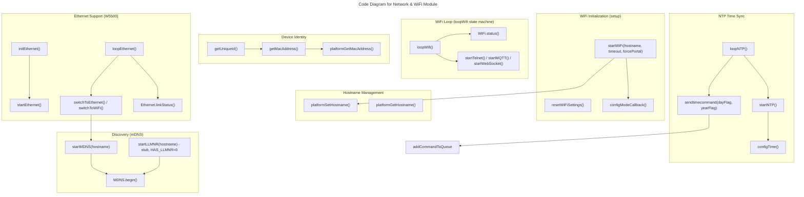

# C4 Code Level: Network & WiFi Module

## Overview

- **Name**: Network & WiFi Management Module (OTGW-firmware)
- **Description**: Network connectivity layer for the ESP32-S3 firmware: WiFi with non-blocking reconnection (ADR-047), NTP time synchronization with timezone support, mDNS hostname resolution, an AsyncTCP-based telnet debug server (`AsyncSimpleTelnet`), the shared `AsyncWebServer` instance, and runtime WiFi<->Ethernet failover (W5500, TASK-581). Per-component types are isolated in `Networktypes.h` (ADR-079 / ADR-081). The 2.0.0 line is ESP32-S3 only (ADR-128); the ESP8266 code paths are gone.
- **Location**: `/src/OTGW-firmware/` (primary files: `networkStuff.ino`, `networkStuff.h`, `Ethernet.ino`, `Networktypes.h`, `webServerCompat.h`, `OTGW-ModUpdateServer-esp32.h`); platform layer in `src/libraries/Platform/src/` (`platform.h`, `platform_esp32.h`, `boards.h`); telnet library in `src/libraries/SimpleTelnet/src/` (`AsyncSimpleTelnet.h`)
- **Language**: Arduino C/C++ (ESP32 Arduino core under the pinned pioarduino platform), templated C++ (SimpleTelnet library)
- **Purpose**: Abstracts WiFi/Ethernet connectivity, NTP time sync, hostname management and the debug telnet interface. Ensures reliable connectivity with automatic failover and a correct DHCP hostname.

## Code Elements

### WiFi Management

#### `void startWiFi(const char* hostname, int timeOut, bool forcePortal = false)`
- **Location**: `networkStuff.ino`
- **Parameters**:
  - `hostname`: Target hostname for the device (e.g., "OTGW2")
  - `timeOut`: Timeout in seconds for the config portal and the final connect wait (`setup()` passes 240)
  - `forcePortal`: Force the WiFi configuration portal (triple-reset detection); also wipes the stored credentials (ADR-043 / TASK-760)
- **Return Type**: `void`
- **Description**:
  Called from `setup()`. Sets `WIFI_STA`, calls `platformIgnoreDhcpNtp()` (TASK-1052), applies a static WiFi IP from `settings.wifi.*` when `sStaticIp` is set (TASK-725), then connects with the saved credentials. If the direct connect fails it opens the WiFiManager captive portal. The portal SSID is `<hostname>-<AA:BB:CC:DD:EE:FF>` (eFuse MAC with colons); the portal menu is reduced to `wifi` and `exit`. Blocks until connected (feeding the watchdog). Sets `WiFi.setAutoReconnect(true)`, `WiFi.persistent(true)` and `platformWifiDisableSleep()` (TASK-817), then re-applies the hostname and keeps the HTTP update credentials current via `httpUpdater.updateCredentials("admin", settings.sHTTPpasswd)`.

  **Key behaviors**:
  - Direct connect timeout is `timeOut / 2` (minimum 5 s) when credentials are saved
  - If WiFi is already connected with another hostname, only the hostname is updated; the connection is kept
  - A portal timeout restarts the device through `platformRestart()` (the one documented direct restart outside `doRestart()`)
  - Prerelease builds (`_VERSION_PRERELEASE`): with saved credentials but no WiFi at boot, `startAPFallback()` runs instead of blocking in the portal
  - No SDK DHCP stop/start calls anywhere (TASK-432): the SDK owns DHCP, only the hostname is re-applied

#### `void resetWiFiSettings(void)`
- **Location**: `networkStuff.ino`
- **Return Type**: `void`
- **Description**: Resets the saved WiFi credentials through a local `WiFiManager` instance, forcing the portal on the next boot.

#### `void loopWifi(void)`
- **Location**: `networkStuff.ino`
- **Return Type**: `void`
- **Description**:
  Non-blocking WiFi reconnection state machine, called from `doBackgroundTasks()` (skipped while `isFlashing()`). Implements ADR-047 for outages longer than the SDK auto-reconnect covers. Returns immediately when `state.net.eMode == NET_ETHERNET` (HAS_ETH_CAPABLE builds) so the reconnect logic does not fight the wired link.

  **States** (`WifiState_t`):
  - `WIFI_IDLE`: connected, monitoring for disconnection
  - `WIFI_DISCONNECTED`: just dropped; re-applies the hostname and calls `WiFi.begin()`
  - `WIFI_CONNECTING`: waits non-blocking, 30-second retry window (`timerWifiRetry`)
  - `WIFI_RECONNECTED`: restarts services (`startTelnet()`, `startMQTT()`, `startWebSocket()`), re-asserts `platformWifiDisableSleep()`
  - `WIFI_FAILED`: after 10 failed attempts calls `doRestart("WiFi: too many reconnect failures")`
  - Prerelease only: `WIFI_AP_FALLBACK` / `WIFI_AP_RETRY`. After 2 failed attempts (about 60 s) the device starts a SoftAP (`OTGW-<last 3 MAC bytes>`, passphrase `otgw1234`, `192.168.4.1`) and retries WiFi every 5 minutes with a 30 s connect wait

#### `static void configModeCallback(WiFiManager *myWiFiManager)`
- **Location**: `networkStuff.ino`
- **Description**: Invoked when WiFiManager enters the captive portal. Logs the portal SSID and soft AP IP, and paints the "how to connect" screen on the OLED through `oledShowConfigMode()` (TASK-750; no-op without an OLED).

### DNS & mDNS

#### `void startMDNS(const char *hostname)`
- **Location**: `networkStuff.ino`
- **Description**: Starts the mDNS responder as `<hostname>.local` and registers the `http` service on TCP port 80. Called from `setup()` and again from `switchToEthernet()`. On ESP32 mDNS runs on a background task, so `MDNS_NEEDS_UPDATE` is 0 and the `MDNS.update()` calls in the loop compile away.

#### `void startLLMNR(const char *hostname)`
- **Location**: `networkStuff.ino`
- **Description**: LLMNR responder, compiled only when `HAS_LLMNR` is 1. `platform_esp32.h` sets it to 0, so on this firmware the function is an empty stub kept for the shared call site.

### NTP & Time Synchronization

#### `void startNTP(void)`
- **Location**: `networkStuff.ino`
- **Description**: Returns early when `settings.ntp.bEnable` is false. Fills an empty timezone/hostname with `NTP_DEFAULT_TIMEZONE` ("Europe/Amsterdam") and `NTP_HOST_DEFAULT` ("pool.ntp.org"), calls `configTime(0, 0, settings.ntp.sHostname, nullptr, nullptr)` wrapped in `platformNtpHostnameFix()` (a no-op on ESP32), and sets `NtpStatus = TIME_WAITFORSYNC`. `setup()` skips it while the prerelease AP fallback is active.

#### `void loopNTP(void)`
- **Location**: `networkStuff.ino`
- **Description**:
  NTP state machine, called from the main loop while WiFi is up. Optional telemetry (debug key `n`, `state.debug.bNTP`) every 60 s unsynced and 300 s synced.
  - `TIME_NOTSET` / `TIME_NEEDSYNC`: stores a baseline in `NtpLastSync` only if `time()` lies inside `[EPOCH_2000_01_01, EPOCH_2038_01_19]` (else 0), then calls `startNTP()`
  - `TIME_WAITFORSYNC`: when `time()` passes both bounds and is `>= NtpLastSync`, validates the timezone via `timezoneManager.createForZoneName()` (falls back to the default on an invalid zone) and a `ZonedDateTime`, then moves to `TIME_SYNC`
  - `TIME_SYNC`: after `NTP_RESYNC_TIME` (86400 s, once per day) moves to `TIME_NEEDSYNC`

#### `bool isNTPtimeSet(void)`
- **Location**: `networkStuff.ino`
- **Description**: Returns `NtpStatus == TIME_SYNC`.

#### `void sendtimecommand(bool dayFlag, bool yearFlag)`
- **Location**: `networkStuff.ino`
- **Description**:
  Sends time and date to the gateway through `addCommandToQueue()`. The flags come pre-computed from the single dispatcher in `doTaskMinuteChanged` (ADR-086, TASK-350). It returns early unless: not in Print Summary mode, `settings.ntp.bEnable`, `settings.ntp.bSendtime`, `NtpStatus == TIME_SYNC`, `hasOTCommandInterface()` (PIC or OTDirect ready, TASK-441) and `isGatewayFirmware()`.
  - `SC=<hour>:<minute>/<day_of_week>` every call (day of week `(dayOfWeek()+6)%7+1`)
  - `SR=21:<month>,<day>` when `dayFlag`
  - `SR=22:<year_hi>,<year_lo>` when `yearFlag`

### Hostname Management

#### `void platformSetHostname(const char *hostname)` / `const char* platformGetHostname(void)` (inline)
- **Location**: `platform_esp32.h`
- **Description**: `WiFi.setHostname()` / `WiFi.getHostname()`. Called before `WiFi.begin()` so the DHCP request carries the configured name.

There is no `platformRestartDHCP()` any more: the call sites were removed in TASK-432 because stopping and starting the SDK DHCP client while connected broke DHCP on later auto-reconnects.

### MAC Address & Device Identity

#### `const char* getMacAddress(void)`
- **Location**: `networkStuff.ino`
- **Description**: MAC as 12 uppercase hex characters (e.g., "00112233AABB") in a static buffer, from `platformGetMacAddress()`.

#### `const char* getUniqueId(void)`
- **Location**: `networkStuff.ino`
- **Description**: `otgw-<MAC_HEX>`; used for MQTT and Home Assistant device identity.

#### `void platformGetMacAddress(uint8_t *mac)` (inline)
- **Location**: `platform_esp32.h`
- **Description**: Reads the eFuse MAC (`esp_efuse_mac_get_default`), valid before `WiFi.begin()`.

### Per-Component Types Header (Networktypes.h, ADR-079 / ADR-081)

`Networktypes.h` bundles the network transport types (included after `boards.h`):

- `enum OTGWNetworkMode`: `NET_WIFI`, `NET_ETHERNET`, plus prerelease-only `NET_AP_FALLBACK` (guarded by `_VERSION_PRERELEASE`, so production builds cannot enter AP fallback).
- `struct NetworkSection` (`state.net`): always present. `eMode` and `bEthernetLink` exist only on `HAS_ETH_CAPABLE` builds; `bAPFallback` and `sAPSSID[32]` exist only in prerelease builds.
- `struct EthernetSection` (`settings.eth`, `HAS_ETH_CAPABLE` only): `bStaticIP`, `sIPaddress`, `sGateway`, `sSubnet`, `sDNS` (0.0.0.0 means "use the gateway").
- `struct WifiSection` (`settings.wifi`): `sStaticIp`, `sSubnet`, `sGateway`, `sDns1`, `sDns2`; empty `sStaticIp` means DHCP.

### Ethernet Support (W5500, `HAS_ETH_CAPABLE` only)

#### `void initEthernet(void)`
- **Location**: `Ethernet.ino`
- **Description**:
  Called once from `setup()` after `startMQTT()`, and skipped when `isPICEnabled()` (ADR-127: in combo PIC mode the SPI probe would clock GPIO12, the PIC reset hole on a Classic PCB). Starts the SPI bus, derives the MAC, runs `startEthernet(1000)` and sets `state.hw.bEthernetPresent` from `Ethernet.hardwareStatus() == EthernetHardwareFound`. The driver install resets the chip and polls VERSIONR for up to 100 ms, so presence is known without a cable (TASK-1220). With link and DHCP it calls `switchToEthernet()`; otherwise it stays on WiFi.

#### `void loopEthernet(void)`
- **Location**: `Ethernet.ino`
- **Description**:
  Failover monitor called from `doBackgroundTasks()` (skipped while flashing), self-throttled to every 5 s and a no-op without a W5500. Drains the pending mode publish (`otgw-firmware/network/mode` = `ethernet`, retained) once `state.mqtt.bConnected`. On cable insert it tries `startEthernet(2000)` and `switchToEthernet()`; on cable removal it publishes `wifi` while MQTT is still up, then calls `switchToWiFi()`. Calls `Ethernet.maintain()` while on Ethernet.

#### `static bool startEthernet(uint16_t dhcpTimeoutMs)`
- **Location**: `Ethernet.ino`
- **Description**: `Ethernet.init(w5500Driver)` at 10 MHz SPI, then static IP from `settings.eth.*` when `bStaticIP` (DNS falls back to the gateway) or DHCP with the given timeout. Returns true only when an address was obtained and `Ethernet.linkStatus() == LinkON`.

#### `static void switchToEthernet()` / `static void switchToWiFi()`
- **Location**: `Ethernet.ino`
- **Description**: `switchToEthernet()` sets `state.net.eMode = NET_ETHERNET` first (so `loopWifi()` stops), then `WiFi.disconnect()` and `WiFi.mode(WIFI_OFF)`, re-registers mDNS, restarts MQTT and WebSocket, and arms the deferred mode publish. `switchToWiFi()` sets `NET_WIFI`, powers the station back up (`WIFI_STA`, auto-reconnect, `WiFi.begin()`); services restart in `loopWifi()` `WIFI_RECONNECTED`.

#### `String getEthernetIPString(void)` / `String getEthernetMACString(void)`
- **Location**: `Ethernet.ino`
- **Description**: IP and colon-separated MAC for the REST API and `getActiveIP()` when on Ethernet.

#### `static void deriveEthMAC(void)`
- **Location**: `Ethernet.ino`
- **Description**: Builds the Ethernet MAC from `ESP.getEfuseMac()` with the locally-administered bit (0x02) set, so it differs from the WiFi MAC and stays unique per device.

### Telnet Debug Server (AsyncSimpleTelnet)

#### `AsyncSimpleTelnet<1> debugTelnet(23)`
- **Location**: `networkStuff.ino` (library: `src/libraries/SimpleTelnet/src/AsyncSimpleTelnet.h`, rvdbreemen/SimpleTelnet)
- **Description**: Single-client telnet instance on port 23 over AsyncTCP: non-blocking writes with TX backpressure (TASK-866 / TASK-879). The port is fixed in the constructor.

#### `void startTelnet(void)`
- **Location**: `networkStuff.ino`
- **Description**: Registers `sendTelnetBanner()` (onConnect) and `onTelnetInput()` (onInputReceived), turns line mode off (one character per keypress) and calls `debugTelnet.begin(false)`. Called from `setup()` and from `WIFI_RECONNECTED`.

#### `static void sendTelnetBanner(const char* ip)`
- **Description**: Per-connection triage snapshot: firmware version/build and LittleFS hash check, reset reason, host/uptime/reboots, network mode (`networkModeName()`), SSID/RSSI/IP or Ethernet IP, heap and drop counters, PIC, OT bus, MQTT, NTP, SAT state, BLE status (`HAS_SAT_BLE`) and the live state of every debug toggle. Toggle keys: `1` OTmsg, `2` REST API, `3` MQTT, `4` Sensors, `5` SAT, `6` OTDirect, `7` SATBLE (HAS_SAT_BLE), `g` MQTTGate, `n` NTP, `d` simulators; `h` shows the full menu.

#### `static void onTelnetInput(const char* s)`
- **Description**: Forwards the first character to `handleDebugChar()` in `handleDebug.ino`.

### Web Server and OTA Instances

- `AsyncWebServer server(WEB_HTTP_PORT)` (port 80, `webServerCompat.h`) is defined in `networkStuff.ino`. All handlers run on the AsyncTCP task (ADR-123 Phase 3, TASK-865.9); there is no `handleClient()` pump. WebSocket and OTA attach to the same instance. The per-request bridge state (`currentRequest`, `g_restStream`, `g_responseSent`, `g_restSlotHeld`, `g_fileSlotHeld`, `g_pendingHeaders`, `g_requestBody`) is defined here once (ADR-044).
- `OTGWUpdateServer httpUpdater(true)` (`OTGW-ModUpdateServer-esp32.h`) serves `/update` with HTTP Basic Auth (user `admin`) and `POST /safeboot`. See [c4-component-network.md](./c4-component-network.md) for the OTA flow.
- `bool checkHttpAuth()` is declared in `networkStuff.h`.

### Platform Abstraction (Unified API)

All functions are inline in `src/libraries/Platform/src/platform_esp32.h` (dispatched by `platform.h`); the only target is the ESP32-S3.

| Function | Signature | Purpose |
|----------|-----------|---------|
| `platformSetHostname` / `platformGetHostname` | `void (const char*)` / `const char* ()` | WiFi hostname (propagates to DHCP) |
| `platformWifiDisableSleep` | `void ()` | `WiFi.setSleep(false)` (TASK-817) |
| `platformNtpHostnameFix` | `void (const char*)` | No-op on ESP32 (keeps `startNTP()` platform-neutral) |
| `platformIgnoreDhcpNtp` | `void ()` | Pins DHCP option 42 SNTP servers off (TASK-1052) |
| `platformWiFiIsEncrypted` / `platformWiFiClientSetSync` | | WiFi scan encryption flag; sync-mode no-op |
| `platformFSInfo` | `bool (FSInfo&)` | LittleFS totals (`FSInfo` is defined here for ESP32) |
| `platformCoreVersion` / `platformSdkVersion` / `platformCpuFreqMHz` / `platformChipId` | | Build/chip identity |
| `platformGetMacAddress` | `void (uint8_t*)` | eFuse MAC |
| `platformResetReason` / `platformGetResetReasonChar` / `platformResetCode` / `platformIsExternalReset` / `platformResetRegisterDump` / `platformResetExceptionInfo` / `platformExccause` | | Reset cause for crash logging |
| `platformFreeHeap` / `platformMinFreeHeap` / `platformMaxFreeBlock` / `platformHeapFragmentation` / `platformUpdateMinFreeHeap` | | Heap metrics |
| `platformTcpActivePcbCount` / `platformTcpTxHoldingOnPort` | | lwIP PCB diagnostics |
| `platformFlashChipRealSize` / `Size` / `Speed` / `Id` / `Mode`, `platformSketchSize`, `platformFreeSketchSpace` | | Flash and sketch info |
| `platformRestart` | `void ()` | Reboot |
| `platformHardwareRandom` | `uint32_t ()` | Hardware RNG |
| `platformRtcRead` / `platformRtcWrite` | `bool (uint32_t, uint32_t*, size_t)` | Emulated RTC user memory |
| `platformSerialHasOverrun` / `platformSerialHasRxError` | `bool (HardwareSerial&)` | Stubs returning false on ESP32 |
| `platformMutex*` / `platformQueue*` / `platformTaskCreatePinned` / `platformTaskDelay` | | FreeRTOS wrappers (`PlatformMutex`, `PlatformQueue`, `PlatformTask`) |
| `platformMuteUart0Console`, `platformPixelWrite` | | UART0 console mute (PIC link; console stays on USB-Serial-JTAG), status pixel |

**`class PlatformDir`** (`platform.h`) wraps LittleFS directory iteration: `PlatformDir(path)`, `valid()`, `next()`, `fileName()` (basename), `fileSize()`, `isDirectory()`; the destructor closes both file handles.

Feature flags in `platform_esp32.h`: `HAS_LLMNR` = 0, `MDNS_NEEDS_UPDATE` = 0, `PLATFORM_INT_DISTINCT_FROM_INT32` = 1. `OTGWWebServer` is gone (TASK-865.9).

## Global Variables & State

### Defined in `networkStuff.ino`

| Variable | Type | Purpose |
|----------|------|---------|
| `NtpStatus` | `NtpStatus_t` | NTP state (`TIME_NOTSET`, `TIME_SYNC`, `TIME_WAITFORSYNC`, `TIME_NEEDSYNC`) |
| `NtpLastSync` | `time_t` | Time of the last accepted sync / baseline for the sync check |
| `debugTelnet` | `AsyncSimpleTelnet<1>` | Debug telnet server, port 23 |
| `server` | `AsyncWebServer` | HTTP server on port 80 |
| `httpUpdater` | `OTGWUpdateServer` | OTA / safeboot handover handler |
| `LittleFSinfo` | `FSInfo` | LittleFS statistics |
| `LittleFSmounted` | `bool` | LittleFS mounted successfully |
| `wifiState` | `static WifiState_t` | `loopWifi()` state |
| `wifiRetryCount` | `static int` | Failed reconnect attempts (reboot at 10) |

### Defined in `Ethernet.ino` (`HAS_ETH_CAPABLE` only)

| Variable | Type | Purpose |
|----------|------|---------|
| `ethSPI` | `static SPIClass` | SPI bus for the W5500 (FSPI) |
| `w5500Driver` | `static W5500Driver` | Driver, pins `PIN_SPI_CS/INT/RST` from `boards.h` |
| `ethMac` | `static uint8_t[6]` | Derived locally-administered MAC |
| `ethInitialized` | `static bool` | Ethernet is the active transport |
| `ethModePubPending` | `static bool` | Mode publish waits for the MQTT reconnect |

## Dependencies

### Internal Dependencies

- **`safeTimers.h`**: `DECLARE_TIMER_SEC`, `DUE`, `RESTART_TIMER`, `CATCH_UP_MISSED_TICKS`
- **`OTGW-firmware.h`**: `settings.sHostname`, `settings.sHTTPpasswd`, `settings.ntp.*`, `settings.wifi.*`, `settings.eth.*`, `state.net.*`, `state.hw.bEthernetPresent`, `state.pic.*`, `state.otBus.*`; `networkModeName()` and `getActiveIP()` (inline)
- **`webServerCompat.h`**: ESPAsyncWebServer bridge (`server`, `WEB_HTTP_PORT`)
- **`OTGW-ModUpdateServer.h`** (dispatches to `-esp32.h`) and **`updateServerHtml.h`**: OTA server and its HTML
- **`OTGW-Core.ino`** / main loop: `feedWatchDog()`, `addCommandToQueue()`, `hasOTCommandInterface()`, `isGatewayFirmware()`
- **`MQTTstuff.ino`** / **`webSocketStuff.ino`**: `startMQTT()`, `startWebSocket()` on reconnect or transport switch
- **`OLED.ino`**: `oledShowConfigMode()`

### External Dependencies

- **WiFiManager** 2.0.17 (`WM_NODEBUG` defined before the include in `networkStuff.h`)
- **ESP32 Arduino core** (pioarduino platform 55.03.35): `WiFi`, `ESPmDNS`, `LittleFS`, `Update`, `Preferences`, `esp_ota_ops`, lwIP SNTP
- **ESPAsyncWebServer** 3.11.2 and **AsyncTCP** 3.4.10 (ESP32Async)
- **AsyncSimpleTelnet** (`src/libraries/SimpleTelnet`)
- **AceTime** 2.0.1: `timezoneManager`, `ZonedDateTime`
- **EthernetESP32** 1.0.2 / `W5500Driver` (SPI Ethernet)

## Key Behaviors & Patterns

### WiFi Auto-Reconnect Architecture (ADR-047)

1. **SDK auto-reconnect** (`WiFi.setAutoReconnect(true)`): handles brief drops transparently.
2. **`loopWifi()`** (fallback): 30-second retry windows, up to 10 attempts, then `doRestart()`. On success it re-applies the hostname and restarts Telnet, MQTT and WebSocket. In prerelease builds the AP fallback replaces the reboot after 2 attempts.

No application code stops or starts the SDK DHCP client (TASK-432).

### Hostname

The hostname reaches DHCP through `platformSetHostname()` before `WiFi.begin()` in `startWiFi()` and in `loopWifi()` `WIFI_DISCONNECTED`, and again after a successful connect. On ESP32 `configTime()` does not reset the hostname, so `platformNtpHostnameFix()` does nothing.

### NTP Bounds Guard

`time()` is accepted only inside `[EPOCH_2000_01_01 (946684800), EPOCH_2038_01_19 (2147483647)]`. The upper bound was introduced for the ESP8266 SDK's 0xFFFFFFFF initial value; it is kept as a plain sanity check. Resync interval is `NTP_RESYNC_TIME` = 86400 s. DHCP-supplied NTP servers are ignored (`platformIgnoreDhcpNtp()`).

### Port 25238 Is Not Part of This Module

The raw OT serial bridge on TCP 25238 (`OTGW_SERIAL_PORT`, `OTGWstream` in `OTGW-Core`) is gated by `settings.mqtt.bLegacyPort25238Enabled` (JSON key `LegacyPort25238Enabled`, applied through `applyLegacyPort25238Setting()`). It is documented in the OpenTherm Core component.

## Relationships & Call Graph

## Related Files & Integration Points

### Called From
- **`setup()` in `OTGW-firmware.ino`**, in this order: `startWiFi(CSTR(settings.sHostname), 240, forceWifiPortal)`, `startNTP()`, `startTelnet()`, `startMDNS()`, `startLLMNR()`, `setupFSexplorer()`, `startWebserver()`, `startWebSocket()`, `startMQTT()`, `initEthernet()` (when `HAS_ETH_CAPABLE` and not `isPICEnabled()`)
- **`doBackgroundTasks()` / `loop()`**: `loopWifi()` and `loopEthernet()` (both only when `!isFlashing()`), `loopNTP()`, `sendtimecommand()` from the minute-changed dispatcher, `MDNS.update()` only if `MDNS_NEEDS_UPDATE` (0 on ESP32)
- No `handleClient()` and no telnet pump: HTTP and telnet run on the AsyncTCP task

### Calls Out To
- **WiFiManager**: `setAPCallback()`, `setConfigPortalTimeout()`, `setShowInfoUpdate()`, `setShowInfoErase()`, `setMenu()`, `getWiFiIsSaved()`, `startConfigPortal()`, `resetSettings()`
- **WiFi stack**: `WiFi.mode()`, `WiFi.config()`, `WiFi.begin()`, `WiFi.status()`, `WiFi.setAutoReconnect()`, `WiFi.persistent()`
- **mDNS**: `MDNS.begin()`, `MDNS.addService()`
- **NTP**: `configTime()`, `time()`, `timezoneManager.createForZoneName()`, `ZonedDateTime::forUnixSeconds64()`
- **Ethernet**: `Ethernet.init()`, `begin()`, `linkStatus()`, `hardwareStatus()`, `localIP()`, `maintain()`
- **Watchdog / commands / debug**: `feedWatchDog()`, `addCommandToQueue()`, `DebugTln()`, `DebugTf()`

### Data Contracts

**Exported (`extern` in `networkStuff.h`)**: `NtpStatus`, `NtpLastSync`, `httpUpdater`, `LittleFSinfo`, `LittleFSmounted`; `server` is declared in `webServerCompat.h`.

**Settings read**: `settings.sHostname`, `settings.sHTTPpasswd`, `settings.ntp.bEnable`, `.sTimezone`, `.sHostname`, `.bSendtime`, `settings.wifi.*`, `settings.eth.*`.

**State written**: `state.net.eMode`, `state.net.bEthernetLink`, `state.net.bAPFallback` and `sAPSSID` (prerelease), `state.hw.bEthernetPresent`. Read: `state.otBus.bPSmode`, `state.mqtt.bConnected`, `state.debug.bNTP`.

## Technical Constraints & Considerations

### Memory

- Static buffers: `baseMacChr[13]`, `uniqueId[32]`
- Telnet callbacks receive `const char*`, never `String` (no heap churn)
- WiFiManager debug output disabled via `WM_NODEBUG`
- Files are streamed, never loaded whole (`v2.html` is about 50 KB)

### Ethernet Failover (W5500)

- Cable detection polled every 5 s; DHCP timeout 1 s at boot, 2 s on hot-plug
- WiFi is powered down (`WIFI_OFF`) while on Ethernet so SDK auto-reconnect cannot revive the station
- mDNS, MQTT and WebSocket are re-bound on each transition

### WiFi Credentials

- `WiFi.persistent(true)`: the SDK stores credentials in NVS; `WiFi.begin()` without arguments reuses them
- `resetWiFiSettings()` and the triple-reset gesture wipe them and force the portal

## References & ADRs

- **ADR-043**: triple-reset clears WiFi credentials and forces the portal
- **ADR-044**: single point of instantiation for globals
- **ADR-047**: non-blocking WiFi reconnect (`loopWifi`)
- **ADR-051**: settings and state architecture
- **ADR-079 / ADR-081**: per-component types headers (`Networktypes.h`)
- **ADR-086**: single dispatcher for the date/year time commands
- **ADR-123 / ADR-128**: async 2.0.0 line; ESP8266 dropped
- **ADR-127**: combo board, W5500 probe skipped in PIC mode
- **ADR-191**: safeboot OTA (see the network component doc)
- **TASK-432**: SDK DHCP calls removed; **TASK-581**: runtime Ethernet failover; **TASK-725**: WiFi static IP; **TASK-1052**: ignore DHCP option 42 NTP; **TASK-1220**: W5500 detection without a cable
- **safeTimers.h**, **webServerCompat.h**, **AsyncSimpleTelnet.h**
