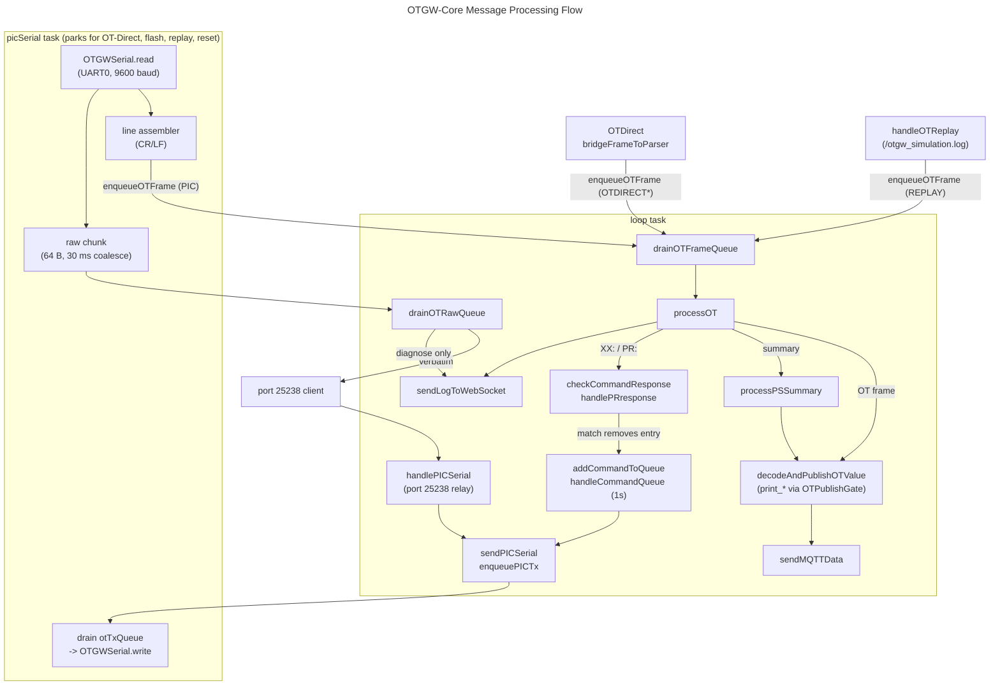

# C4 Code Level: OTGW-Core Module

## Overview

- **Name**: OTGW-Core Module
- **Description**: Core OpenTherm Gateway message processing, PIC (Programmable Intelligent Controller) communication, and OpenTherm data decoding for the OTGW firmware. Handles OpenTherm frame parsing, the dedicated PIC serial task and its queues, the PIC command queue, MQTT throttling, and real-time publishing.
- **Location**: `src/OTGW-firmware/` (OTGW-Core.ino, OTGW-Core.h, OTGW-firmware.h, OTGW-firmware.ino, dhwWaterMeter.ino)
- **Language**: Arduino C/C++ (ESP32-S3, 2.0.0 line; single translation unit)
- **Purpose**: Bridges the ESP32-S3 host and the OTGW PIC (gateway firmware), decodes OpenTherm frames from the PIC or from OT-Direct, maintains message state, publishes to MQTT and WebSocket, handles command queuing, and manages PIC firmware upgrades. Line numbers are deliberately not quoted: find a symbol with `grep`.

## Core Responsibilities

1. **OpenTherm Message Processing**: Decode OpenTherm frames, extract data fields, publish to MQTT with throttling
2. **PIC Serial Communication**: A dedicated FreeRTOS task owns the UART; the loop side feeds it through queues (ADR-123)
3. **Command Queuing**: Queue commands to the PIC, retry on timeout, drop after the retry limit
4. **MQTT Publishing**: Per-message throttle, status-bit and status-byte fan-out, republish on request
5. **WebSocket Event Streaming**: Stream OT lines and system events to `/ws` clients
6. **PIC Firmware Management**: Banner/version detection, hex validation, upgrade state machine
7. **Settings Discovery**: Cycle through PIC settings (`PR=` queries) and publish them to MQTT
8. **Transport selection**: On the combo image the PIC or OT-Direct path is chosen at boot (ADR-127); the same `processOT()` serves both

## Transport Architecture (ADR-123, ADR-127, ADR-177)

- **UART**: `OTGWSerial` (vendored library, subclass of `HardwareSerial(0)`, so UART0 on GPIO44/43) at 9600 baud, 8N1. Opened with `OTGWSerial.begin(9600, SERIAL_8N1, PIN_PIC_RX, PIN_PIC_TX)`; the IDF console on UART0 is muted as the first statement of `setup()` (`platformMuteUart0Console()`), so log output from `setup()` on never reaches the PIC; the console keeps logging on USB-Serial-JTAG, except plain `printf` (TASK-1217).
- **Boot selection (combo image, ADR-127)**: `setup()` resolves `settings.iBoardMode` (0 auto, 1 PIC, 2 OT-Direct, 3 PIC on the S3 Mini Pro). Auto runs `detectPIC()` up to 3 times; a live PIC persists a Classic verdict, no PIC runs `initOTDirect()` for that boot without persisting. A forced OT-Direct setting still probes once and corrects itself when a live PIC answers (TASK-1031). Fixed targets compile one path.
- **PIC serial task**: `startPICSerialTask()` creates the `picSerial` task (4096-byte stack). `picSerialDrainOnce()` is the sole runtime owner of `OTGWSerial` read/write: it assembles CR/LF lines into `enqueueOTFrame(..., OTFRAME_SRC_PIC)` and drains `otTxQueue` out to the UART. `picSerialTaskShouldPark()` makes it release the UART during OT-Direct, a flash, the replay simulation, and a direct `resetOTGW()`/`detectPIC()`; `waitForPICTaskParked()` is the handshake.
- **Frame queue**: `otFrameQueue` (`OT_FRAME_QUEUE_DEPTH` 16, `OTFrameMsg` with line, `suppressOutput`, `source`) carries lines from the producers (PIC task, `dispatchOTGWInputLine()` for replay, OT-Direct `bridgeFrameToParser()`) to `drainOTFrameQueue()`, called in `loop()` after `doBackgroundTasks()`. `source` is `OTFRAME_SRC_PIC`, `OTFRAME_SRC_OTDIRECT`, `OTFRAME_SRC_OTDIRECT_LOCAL` or `OTFRAME_SRC_REPLAY`.
- **TX queue**: `otTxQueue` (`OT_TX_QUEUE_DEPTH` 32); `enqueuePICTx()` is the loop-side producer, used by `sendPICSerial()` and the port 25238 relay. A chunk the UART cannot take is re-queued to the front so command bytes never interleave.
- **Raw passthrough (ADR-177)**: `picSerialDrainOnce()` copies every PIC byte, before line assembly, into `OT_RAW_CHUNK_MAX` (64) byte chunks coalesced over `OT_RAW_COALESCE_MS` (30 ms) onto `otRawQueue` (`OT_RAW_QUEUE_DEPTH` 16). `drainOTRawQueue()` forwards them verbatim to `OTGWstream` (port 25238) when `settings.mqtt.bLegacyPort25238Enabled` is on, and to the WebSocket as a `\x02DIAG`-prefixed frame (printable bytes only, `forwardDiagnoseChunk()`) while the PIC runs diagnose firmware. The chunk is produced when the port is enabled or the PIC is a diagnose build.
- **Port 25238 bridge**: `OTGWstream` is `AsyncSimpleTelnet<1>(25238)` with telnet negotiation off (raw bytes). It is off by default (`bLegacyPort25238Enabled = false`, settings key `LegacyPort25238Enabled`); `applyLegacyPort25238Setting()` starts or stops it, and a single client at a time is accepted. Bytes from the client reach the PIC through `enqueuePICTx()` in `handlePICSerial()`, which also notices `GW=R`, `PS=1` and `PS=0` to keep the firmware's own state in step and suspends the command queue for `SER2NET_QUIET_MS` after a client command.
- **Loop-side error reporting**: the task only sets volatile flags (UART overrun, framing error, line overflow, raw-queue drops, banner ready); `reportPendingPICRxErrors()` publishes them from `drainOTFrameQueue()`, and `applyPICBannerInfo()` applies the firmware banner fields (TASK-1175).
- **State lock**: `processOT()` takes `OTStateLock` (the writer side of `otStateMutex`); the lock is not recursive.

## Code Elements

### Core Data Structures

#### `OTdataStruct` (OTGW-Core.h)
- **Purpose**: Central repository for all OpenTherm state from the boiler/thermostat
- **Members**:
  - Status flags (master/slave) and configuration
  - Temperature readings: TSet, Tboiler, Tdhw, Tr, Toutside, Tret, etc.
  - Modulation and pressure: RelModLevel, CHPressure
  - Flow rates: DHWFlowRate
  - Counters: BurnerOperationHours, CHPumpStarts, etc.
  - Extended features: Solar storage, ventilation/heat recovery, RF sensors, vendor-specific, brand identification
  - Error tracking: error01-04, errorBufferOverflow
  - **Routing discriminators (ADR-103)**:
    - `bAnswerOverride` - true when the current `A`-prefix frame is a gateway answer that *substitutes* a real boiler `B` frame (genuine answer-override). False on the more common case of an `A`-prefix proxy frame (no preceding `B`).
    - `bGatewaySubstituted` - true when the gateway injected the substitution itself.
    - `bLocalAnswer` (TASK-1086) - true on a frame the gateway made itself instead of receiving it from a boiler: every OT-Direct `A`, and every `B` in OT-Direct loopback mode. `bridgeFrameToParser()` tags it as `OTFRAME_SRC_OTDIRECT_LOCAL`, `drainOTFrameQueue()` passes it to `processOT()`, and it rides the one-frame delay with its frame. Such a frame is no boiler evidence anywhere: it neither sets nor retracts a boiler-unsupported verdict (`boilerUnsupportedRead`/`boilerUnsupportedWrite`), does not mark a msgid acknowledged (`boilerAckedRead`/`boilerAckedWrite`, the acknowledged column of `GET /api/v2/otgw/ot-support`, TASK-1185), and its type-7 OT log line ends in `(gateway answer)` instead of `(boiler does not implement)` or `(boiler rejected write)`. A loopback `B` still stamps `state.otBus.tBoilerLastSeen` (TASK-1138) but does not trip `satNotifyBoilerFrameSeen()`, and on a combo board in OT-Direct mode `satBoilerHardwarePresent()` ignores `bBoilerState` and asks `otDirectBoilerPresent()`, so SAT simulation cannot switch itself off on loopback traffic (ADR-117 section 2).
    - `bReplayed` (TASK-1185) - true on a line the `/otgw_simulation.log` replay injected (`dispatchOTGWInputLine()` tags it `OTFRAME_SRC_REPLAY`). It is decoded and published like a live frame and keeps `tBoilerLastSeen` (boiler_connected), but it is no boiler evidence either: `processOT()` folds both flags into `boilerEvidence` for the four boiler bitmaps, and neither flag stamps `state.otBus.tRealBoilerLastSeen` or trips `satNotifyBoilerFrameSeen()`. SAT's availability gate reads `otRealBoilerSeenRecently()` (that stamp within 30 s) instead of `bBoilerState` on the PIC path.
    - `/ot-boiler.json` is format 2 (`"v":2`) since TASK-1185. A format-1 file, written by builds that counted these frames, is not loaded: the boiler bitmaps start empty once and `boilerFileDirty` rewrites the file as format 2 at the next save. `/ot-thermo.json` stays format 1. `loadOtSupportFiles()` restores the files at boot and `saveOtSupportFilesIfDirty()` flushes them from the 15-minute task.
- **Scope**: Global singleton `OTdataStruct OTcurrentSystemState`
- **Note**: Flame status is in SlaveStatus bit 3 (NOT MasterStatus); MasterStatus bit 3 is OTC (Outside Temperature Compensation) enabled

#### `OpenthermData_t` (OTGW-Core.h, embedded)
- **Purpose**: Typed wrapper for 16-bit OpenTherm data values
- **Methods**: `f88()` / `f88(float)` (f8.8), `u16()` / `u16(uint16_t)`, `s16()` / `s16(int16_t)`; getter and setter share a name
- **Other fields**: `id`, `rsptype` (`OTGW_BOILER`, `OTGW_ANSWER_THERMOSTAT`, ...), `time`, plus the routing discriminators above

#### `OTLibMessageID` (OTGW-Core.h)
- **Purpose**: Enum mapping OpenTherm message IDs to semantic names
- **Range**: OT_Statusflags (0), OT_TSet (1), OT_TrSet (16), OT_Tr (24), OT_Tboiler (25), OT_Tdhw (26), etc., up to OT_RemehaDetectionConnectedSCU (133)
- **Extended**: Solar storage, ventilation/heat recovery (`OT_StatusVH`, `OT_ControlSetpointVH`), RF sensors (`OT_RFstrengthbatterylevel`), brand identification (`OT_Brand`, `OT_BrandVersion`, `OT_BrandSerialNumber`)
- **Reserved ranges**: under the v4.x profile IDs 50-55 and 58-69 are reserved (56 and 57 stay valid, 1.x fix GH #538/#540); see `isLegacyPreV42CompatibilityId()`

#### `OTLibMessageType` (OTGW-Core.h)
- **Purpose**: OpenTherm frame type classification
- **Values**:
  - Master→Slave: OT_READ_DATA (0b000), OT_WRITE_DATA (0b001), OT_INVALID_DATA (0b010), OT_RESERVED (0b011)
  - Slave→Master: OT_READ_ACK (0b100), OT_WRITE_ACK (0b101), OT_DATA_INVALID (0b110), OT_UNKNOWN_DATA_ID (0b111)

#### `OTValueType` (OTGW-Core.h)
- **Purpose**: Data type classifier for formatting OpenTherm values
- **Values**: OT_VALTYPE_NONE, F88, S16, U16, U8U8, S8S8, FLAG8, FLAG8FLAG8, STATUS, DATETIME, SPECIAL

#### Global MQTT Throttle State (OTGW-Core.ino)
- `uint32_t mqttlastsent[MQTT_TRACKED_SLOT_COUNT]`: packed per-msgid throttle (high 16 bits the last published value, low 16 bits seconds since boot), a response view and a request view
- `uint16_t mqttlastsentstatusbit[16]` / `mqttlastsentstatusvhbit[16]`: per-bit timers for Statusflags and StatusVH (slots 0-7 master, 8-15 slave)
- `mqttlastsentstatusbyte[2]` / `mqttlastsentstatusvhbyte[2]`: combined status byte timers; further trackers cover ASF, RBP and Remote Override fan-out
- `TRACKED_TIME_UNSEEN` (0xFFFF) marks a slot that was never published
- `bool mqttPublishAllowed`: gate set per frame by `OTPublishGate` and checked in `sendMQTTData()`

#### Static OT Log Buffer (OTGW-Core.ino)
- `char ot_log_buffer[OT_LOG_BUFFER_SIZE]` with a tracked write position `ot_log_pos`
- **Purpose**: Build one log line without dynamic allocation for the WebSocket
- **Macros**: ClrLog(), AddLogf(), AddLogf_P(), AddLog(), AddLogln()

#### Command queue (OTGW-Core.h)
- `struct OT_cmd_t cmdqueue[CMDQUEUE_MAX]` (20 entries: `cmd`, `cmdlen`, `retrycnt`, `due`); `int cmdQueueSize` is the fill pointer

### Primary Functions

#### Message Processing

##### `void processOT(const char *buf, int len, bool suppressOutput = false, bool localAnswer = false, bool replayed = false)` (OTGW-Core.ino)
- **Purpose**: Parse one line from the PIC or OT-Direct, decode fields, publish to MQTT and WebSocket
- **Parameters**:
  - `buf`, `len`: raw line (a 9-character frame such as `T80190000`, a command response such as `PR: A=...`, a PS=1 summary, or a status token)
  - `suppressOutput`: skip the per-frame output (OT-Direct PS=1, TASK-293)
  - `localAnswer`: the frame is an answer the gateway made itself (queue source `OTFRAME_SRC_OTDIRECT_LOCAL`); stored as `OTdata.bLocalAnswer` (TASK-1086)
  - `replayed`: the line came from the `/otgw_simulation.log` replay (queue source `OTFRAME_SRC_REPLAY`); stored as `OTdata.bReplayed` (TASK-1185)
- **Flow**:
  1. Take `OTStateLock`
  2. `isvalidotmsg()` frames: leave PS mode if raw frames resume, stamp the source (`B` boiler, `T` thermostat, `R`/`A` gateway), run the one-frame delay buffer that pairs a `B` with an `A` (ADR-103), then `decodeAndPublishOTValue()` under an `OTPublishGate` driven by `shouldPublishMQTTForID()`
  3. Update `OTcurrentSystemState`, the boiler-support bitmaps and the liveness stamps; `evaluateOTBusLiveness()` derives the boiler, thermostat and bus connected flags
  4. Build the OT log line and send it with `sendLogToWebSocket()`
  5. Other lines: `PR:` and `XX:` command responses go to `checkCommandResponse()` and `handlePRresponse()`, comma-separated summaries to `processPSSummary()`, known PIC status tokens to `handlePICStatusToken()`
- **Dependencies**: decodeAndPublishOTValue(), OTPublishGate, evaluateOTBusLiveness()

##### `void processPSSummary(const char *buf, int len)`
- **Purpose**: Parse the PS=1 summary line (25 fields below firmware v5, 34 from v5; picked by comma count: 24 or 33)
- **Flow**:
  1. Enter PS mode (`enterPSMode()`)
  2. Map each field to a MsgID through `PSSUMMARY_MSGIDS_OLD[]` or `PSSUMMARY_MSGIDS_NEW[]`
  3. Parse strictly (`parseStrictFloat()`, `parsePSSummaryU8U8()`, ...) and publish through `publishPSSummaryFieldValue()` / `updatePSSummaryFloatState()` / `updatePSSummaryU16State()`
  4. `shouldPublishMQTTForPSField()` applies the throttle
- **Related**: `enterPSMode()`, `leavePSMode()`, `ensurePSSummaryDiscovery()`

#### PIC Communication

##### `void handlePICSerial()`
- **Purpose**: Loop-side half of the PIC path. The UART read loop moved to the PIC task; this function only runs the port 25238 relay (network to PIC, via `enqueuePICTx()`).
- **Guards**: returns at once when `isOTDirectEnabled()`; the relay runs only with a PIC and `bLegacyPort25238Enabled`; with the replay simulation on, relayed bytes are blocked and reported with `!` events
- **Static locals**: `sWrite[MAX_BUFFER_WRITE]` (128)

##### `void handleOTReplay()`
- **Purpose**: Feed `/otgw_simulation.log` to the decoder one line per 750 ms through `dispatchOTGWInputLine()`, independent of transport (TASK-1071); flushes the live PIC RX while it runs

##### `void sendPICSerial(const char* buf, int len)`
- **Purpose**: Queue a command for the PIC (appends CR/LF, `enqueuePICTx()`), echo it as a `>` event
- **Guards**: with no PIC it routes to `handleOTDirectCommand()` when OT-Direct is active; `satSimulationBlocksBusTx()` blocks it while a simulation runs

##### `void startPICStream()` / `stopPICStream()` / `applyLegacyPort25238Setting()`
- **Purpose**: Start or stop the raw TCP bridge on port 25238 (OTmonitor compatibility). `startPICStream()` leaves it stopped when the setting is off

#### Command Queue

##### `void addCommandToQueue(const char* buf, const int len, const bool forceQueue, const int16_t delay)`
- **Purpose**: Queue a command for the PIC (for example `GW=1`, `TT=20.0`). With no PIC it hands the command to `handleOTDirectCommand()` when OT-Direct is active (the combo OT-Direct path), otherwise it ignores it.
- **Parameters**:
  - `buf`, `len`: command text, at least `XX=`, shorter than the entry size
  - `forceQueue`: when false, a queued command with the same two-letter prefix is overwritten instead of appended; when true it always takes a new slot (the `PR=` queries use this)
  - `delay`: ms until first send (default `OTGW_DELAY_SEND_MS` 1000)
- **CS= refusal (TASK-1236, ADR-179)**: a `CS=` is refused while `satOwnsControlSetpoint()` is true unless `satCommandInFlight()` marks it as SAT's own. SAT sends its own through `satEnqueueOwnCS()`. Bytes written straight to the PIC over port 25238 do not pass this queue and stay unfiltered (ADR-177).
- **Settings re-read**: commands that change a readable PIC setting (`GW`, `GA`, `GB`, `SB`, `VR`, `TS`, `IT`, `OH`, `LA`-`LF`) call `triggerPICsettingsReadout()`
- **Queue size**: `CMDQUEUE_MAX` 20
- **Related**: `handleCommandQueue()`, `checkCommandResponse()`, `removeFromCmdQueue()`, `OT_cmd_t`

##### `void handleCommandQueue()`
- **Purpose**: Send due commands and drop exhausted ones (called every second from `doTaskEvery1s()`)
- **Flow**:
  1. Skip while a port 25238 client command is recent (`SER2NET_QUIET_MS` 2000)
  2. For each due entry: `sendPICSerial()`, count a retry, reschedule `OTGW_CMD_INTERVAL_MS` (5000) ahead
  3. After `OTGW_CMD_RETRY` (5) tries remove the entry and emit `<cmd> [dropped]` as a `!` event

##### `void checkCommandResponse(const char *buf, unsigned int len)`
- **Purpose**: Match a `XX: value` response from the PIC to a queued command (for `PR` also the register letter) and remove it from the queue

#### PIC Settings Discovery

##### `void triggerPICsettingsReadout()`
- **Purpose**: Start a cycle over the 15 `PR=` registers (O, S, W, G, I, L, T, D, P, R, B, C, Q, N, V). Ignored while a cycle runs or without a PIC
- **Triggered**: at boot, by `GET /api/v2/pic/settings`, and after setting-changing commands

##### `void queryNextPICsetting()`
- **Purpose**: Queue the next `PR=<letter>` (forced). Called every 3 s from `doTaskEvery3s()` during a cycle, so a full cycle takes about 45 s
- **Deferral**: skipped on non-gateway firmware, during a flash, during an MQTT status burst, or when a drip tick is within 500 ms; the query retries on the next tick
- **Responses**: `handlePRresponse()` stores them in `state.picSettings` and publishes changes

##### `void publishAllPICsettings()`
- **Purpose**: Publish the cached PIC settings to `otgw-pic/settings/*` (setpoint_override, setback, dhw_override, gpio, gpio_states, led, tweaks, temp_sensor, smart_power, thermostat_detect, builddate, clock_mhz, reset_cause, standalone_interval, voltage_ref). Called from `do5minevent()`

#### Gateway Mode and Firmware Version

##### `void queryOTGWgatewaymode()`
- **Purpose**: Queue `PR=M` (gateway firmware only), at most once a minute once the mode is known; `handlePRresponse()` updates `state.otBus` and publishes

##### `void getpicfwversion()`
- **Purpose**: Queue `PR=A`. The reply's register A is ignored by `handlePRresponse()`; the banner reaches `OTGWSerial`'s firmware callback (`fwreportinfo`) on the PIC task, and `applyPICBannerInfo()` applies version, type and device id loop-side and re-enables a PIC that `detectPIC()` missed
- **Retry**: `doTaskEvery60s()` repeats the probe while the version is unknown and OT-Direct is not active

#### Watchdog Management

Two shapes, selected at compile time (ADR-135):
- **`HAS_PIC_WATCHDOG` (esp32-classic and combo)**: the ESP32 Task Watchdog (30 s, panic on trigger, loop task only) is the primary safety net. The external I2C watchdog at `EXT_WD_I2C_ADDRESS` (0x26) is an optional secondary layer, probed up to 3 times in `initWatchDog()` into `s_extWdPresent`; arm and feed are both gated on that flag.
- **OTGW32 (no external chip)**: TWDT only; `WatchDogEnabled()` is a no-op.

##### `void feedWatchDog()`
- **Purpose**: Reset the TWDT (and feed 0x26 when present), at most every 100 ms, and blink LED1 once a second. A call from a task other than the loop task is a silent no-op (TASK-1131)
##### `void initWatchDog(char* reasonBuf, size_t reasonSize)` / `void WatchDogEnabled(byte stateWatchdog)`
- **Purpose**: Arm the TWDT, probe 0x26 and report "Reset by External WD" when its status flag is set; enable or disable the external chip

#### PIC Reset & Detection

##### `void resetOTGW()` (HAS_PIC only; empty on OTGW32)
- **Purpose**: Reset the PIC through `OTGWSerial.resetPic()` (GPIO pulse and `GW=R`), parked against the PIC task, and start the 15 s startup quiet period
- **Called from**: `setup()` (then `startPICStream()` and `startPICSerialTask()`), the `GW=R` relay and the MQTT reset command

##### `void detectPIC()` (HAS_PIC only)
- **Purpose**: Register the firmware callback, reset the PIC and look for ETX (the bootloader's answer, within 1 s). Sets `state.pic.bAvailable` and `state.hw.eMode` (`HW_MODE_PIC` or `HW_MODE_DEGRADED`)
- **Called from**: `setup()`, also up to 3 times in combo auto mode, and from the telnet `p` key

#### Boot Commands

##### `void sendPICBootCommands()`
- **Purpose**: When `settings.picBoot.bEnable`, split `settings.picBoot.sCommands` on `;` and queue each valid `XX=value` command with `addCommandToQueue(..., true)`. The commands are user-configured; there is no fixed default list

#### MQTT Publishing Throttle

##### `uint16_t getMsgLastUpdated(uint8_t msgId)`
- **Purpose**: Seconds since a message was last published, or `TRACKED_TIME_UNSEEN`
- Helpers: `currentTrackedSeconds()`, `elapsedTrackedSeconds()`, `setMsgLastUpdated()`, `clearMsgLastUpdated()`

##### `bool shouldPublishMQTTForID(byte id, byte masterslave, uint16_t rawValue)`
- **Purpose**: Decide per frame whether a value is published (interval and change gate); `OTPublishGate` sets `mqttPublishAllowed` from it for the duration of the decode
- **Related**: `requestMQTTRepublishAll()`, `queueMQTTRepublishAll()`, `handlePendingMQTTRepublish()` (runs in `loop()`, TASK-1176), `requestMQTTStatusRepublish()`

##### `bool canPublishMQTT()` (helperStuff.ino)
- **Purpose**: Heap gate; false only at CRITICAL heap (ADR-167)

#### Status Bit Publishing

##### `publishMasterStatusState()`, `publishSlaveStatusState()`, `publishCombinedStatusState()` (and the `...StatusVH...` set)
- **Purpose**: Publish individual status bits and the combined status byte, each with its own tracked timer (`shouldPublishStatusBit()`, `shouldPublishStatusByte()`)
- **Topics**: `status_master_*`, `status_slave_*`, `status` (combined, for example `1:255`); the HVAC mode and action are published by `publishHvacMode()` / `publishHvacAction()`

#### Data Type Formatters (Print Functions)

These functions decode OpenTherm data and emit to MQTT/WebSocket:

- `print_f88(float&)`, `print_s16(int16_t&)`, `print_s8s8(uint16_t&)`, `print_u16(uint16_t&)`, `print_u8u8(uint16_t&)`, `print_flag8u8(uint16_t&)`
- `print_status`, `print_statusVH`, `print_solar_storage_status`, `print_ASFflags`, `print_RBPflags`
- `print_slavememberid`, `print_mastermemberid`, `print_vh_configmemberid`, `print_solarstorage_slavememberid`
- `print_remoteoverridefunction`, `print_vh_remoteparametersetting`, `print_command`
- `print_daytime`, `print_date`
- `print_u8_hb`, `print_u8_lb`, `print_rf_sensor_status_information`, `print_remote_override_operating_mode`
- `print_f88()` also feeds the DHW water total (next section)

#### DHW Water Total (dhwWaterMeter.ino, ADR-176, TASK-1123)

A cumulative DHW water volume in litres, integrated from MsgID 19 (DHWFlowRate, l/min) for the Home Assistant Energy dashboard and published as `dhw_water_total` by `publishDHWWaterMeter()` (see c4-code-mqtt.md).

- `void updateDHWWaterMeter(float flowLitresPerMin, uint32_t nowMs)`: adds flow times the time since the previous sample (right-hand rectangle rule). The first sample on a boot only seeds the clock. An interval longer than `DHW_METER_MAX_GAP_MS` (60000 ms, the 1.x value) adds nothing but still moves the clock; zero or negative flow adds nothing, and so does a reading no f8.8 frame can carry: NaN, or above `DHW_METER_MAX_FLOW_LPM` (128 L/min; f8.8 ends at 127.996), infinity included. Only a malformed PS=1 summary field delivers one, because `parseStrictFloat()` (strtod) accepts `nan`, `inf` and exponents. Such a sample still moves the clock. Because the volume is time times flow, a second sample of the same exchange only splits an interval. The total is a `double`: it is persisted and keeps growing, and a float's step reaches 1/32 L at 2^18 L.
- The caller, and which frames feed the total:
  - `print_f88()`: MsgID 19 Read-Ack frames with `rsptype == OTGW_BOILER` only, inside the `validForMaster` branch. An A frame is the gateway's own answer (a PIC answer, the OT-Direct SR= table, `replyToThermostat()` with RM= modifiers, and in OT-Direct master mode `handleMasterModeSlaveFrame()` replaying `otBoilerCache`). The replay is a proxy A that is master-valid and does update `DHWFlowRate`, but it keeps serving the last cached flow after the boiler stops answering, so it must not count.
  - `updatePSSummaryFloatState()` is not a caller (ADR-181). It writes the MsgID 19 field of a PS=1 summary into `DHWFlowRate`, so the flow-rate sensor follows it, but a PIC builds its summary from stored values: after the boiler stops answering MsgID 19, every summary repeats the last flow with no age, and counting it kept adding water (80 L in 10 minutes in host case R1). A PIC gateway in PS=1 mode therefore adds no water. In OT-Direct mode the summary is `emitSummaryLine()` re-presenting `OTcurrentSystemState` after every MsgID 0 reply, which never counted either; the B frames keep reaching `print_f88()`.
- Persistence: `/dhw_water.json` (`{"litres":<x.xxx>}`), never `settings.ini`. `loadDHWWaterMeter()` restores it in `setup()` after `loadOtSupportFiles()`. `saveDHWWaterMeterIfDue()` runs on the 60 s task and writes when at least 10 L are unsaved, or when 15 minutes have passed since the last write with any unsaved water, or at once when the total is below the saved mark, which only a reset whose file write failed leaves (`dhwWaterMeterSaveDue()`); at most one write a minute, and while writes succeed none while no water is drawn. A user reset writes outside this rule, once per reset that finds something to zero. `flushDHWWaterMeter()` runs in `doRestart()` after `flushSettings()`, writes whenever the total differs from the saved mark, and also rewrites a missing file for a non-zero total, because a filesystem OTA installs an image without it. No write while `isFlashing()` or with LittleFS unmounted.
- Write verification: `writeDHWWaterMeterFile()` reads the file back after `close()` and moves the saved mark only when the content matches. The ESP32 VFS reports a small write as complete (it lands in a stdio buffer) and `close()` does not report a failed commit, so without the read-back a full filesystem would move the mark and the restart flush would skip the lost litres. While the filesystem stays full, every due tick tries again, and what a power cut loses grows with the unsaved total.
- Load bound: `loadDHWWaterMeter()` accepts only a number from 0 to `DHW_METER_MAX_LITRES` (1e10 L, more than a century at `DHW_METER_MAX_FLOW_LPM`, 128 L/min, the most the accumulator adds); anything else leaves the total at 0. `sendDHWWaterTotal()` (MQTTstuff.ino) formats with `snprintf_P` into its 24-byte buffer, so it is bounded whatever the total.
- `bool dhwWaterMeterHasData()`: true once a MsgID 19 sample was taken on this boot. The 60 s state publish (`publishDHWWaterMeter()`) waits for it; a restored total alone does not count. The discovery announcement waits for it too (ADR-182): `queueNonOTDiscoveryIds()` queues faux id 241 only when it is true, and the first 60 s publish after a sample queues it, as on the 1.x line.
- Reset (ADR-176 Q6): `queueDHWWaterMeterReset()` only raises a volatile flag. `POST /api/v2/otgw/reset_water_total` calls it on the async_tcp task, the MQTT command `set/<node>/otgw/reset_water_total` from inside `doBackgroundTasks()`, which re-enters through `delayms()`. `handlePendingDHWWaterMeterReset()` runs in `loop()` right after `handlePendingMQTTRepublish()` and before `drainOTFrameQueue()` (the TASK-1176 pattern).
  - It waits, flag still raised, while `!LittleFSmounted || isFlashing()`, so RAM, file and the published 0 change together or not at all. Both tests are needed. A filesystem upload calls `LittleFS.end()` (OTGW-ModUpdateServer-esp32.h) without clearing `LittleFSmounted`, so only `isFlashing()` covers it. A failed health probe (`updateLittleFSStatus()` from `sendHealth()`, for example on a full filesystem) clears `LittleFSmounted`.
  - Then it clears the flag and, when the total or the saved mark is not 0, sets the total to 0 and writes the file through `writeDHWWaterMeterFile()`. When both are already 0 there is nothing to write, so repeated resets cost no flash. It always publishes 0 through `sendDHWWaterTotal()`, also before the first MsgID 19 sample of the boot. That publish goes through `sendMQTTData()`, which drops it while MQTT is disconnected or `canPublishMQTT()` is false, and nothing retries it.
  - A write that fails without an error (the read-back differs) leaves the saved mark above the total, which `dhwWaterMeterSaveDue()` and `flushDHWWaterMeter()` treat as due.
  - The sample clock is kept, so the next sample adds its interval to 0; flow at the moment of the reset can put up to one sample interval of it after the reset.
  - Residual: `loop()` checks the deferred reboot (`isRebootPending() && !isFlashing()`) a few lines after the reset. When a flash ends between the two checks of one pass, the reboot can run while the reset is still pending. The request is then lost with the RAM flag, and RAM and file keep the same total.
- All of it runs on the loop task (`processOT()`, the 60 s task, `setup()`, `doRestart()` and `loop()`), except `queueDHWWaterMeterReset()`.
- Host proof: `test/host/test_dhw_water_meter.py --old-rev <commit before TASK-1123>`. It also runs the reset, the `reset_water_total` branch of `handleOtgw()` and the `otgw/` branch of `handleMQTTcallback()` in wrappers, feeds PS=1 field text through the real `parseStrictFloat()` and `updatePSSummaryFloatState()` and checks that it adds nothing (cases W2, W6 and R1; `publishPSSummaryFieldValue()` between them is not run; mutants M3 and M3b put the old summary feed back), and checks the call sites in `setup()`, `doTaskEvery60s()`, `loop()` and `doRestart()`, the branch positions and the route table statically. Not run by it: `processOT()` and the two handlers around their branches. Its frame source classification (`'B'` to `OTGW_BOILER`, `'A'` to `OTGW_ANSWER_THERMOSTAT`) and the B/A pairing are set by hand in the driver, as `processOT()` sets them.

#### Validation Helpers

##### `bool isvalidotmsg(const char *buf, int len)`
- **Purpose**: Check that a line is a 9-character OpenTherm frame (source letter `T`, `B`, `R` or `A`, then 8 hex digits)
- **Returns**: true if valid, false if malformed

#### PIC Firmware Upgrade

The REST handler `upgradepic(AsyncWebServerRequest*)` (`/pic`) validates the request and defers the work; `handlePendingUpgrade()` (called from `loop()` when not flashing) starts it. The upgrade state machine runs inside `OTGWSerial` and is ticked by `picSerialPumpUpgrade()` from the loop while the PIC task is parked.

##### `void upgradepicnow(const char *filename)`
- **Purpose**: Refuse when no PIC is present or an upgrade is already running, otherwise call `fwupgradestart()`

##### `void fwupgradestart(const char *hexfile)`
- **Purpose**: Record the file name in `state.flash`, set `bPICactive`, wait for the PIC task to park (`waitForPICTaskParked()`), start the `OTGWSerial` upgrade
- **Callbacks**: `fwupgradestep(int pct)`, `fwupgradedone(OTGWError, short errors, short retries)` and `fwreportinfo(OTGWFirmware, const char *version)` report progress to the WebSocket (`sendWebSocketJSON()`) and MQTT

##### `bool validateIntelHex(const char *filepath)`
- **Purpose**: Validate Intel HEX format before an upgrade (line format, checksums, end-of-file record)

##### `checkforupdatepic()` / `refreshpic()` / `queuePicUpdateCheck()` / `queuePicRefresh()` / `handlePendingPicHttp()`
- **Purpose**: Check the remote PIC firmware version and download a fresh hex file; the HTTP work is deferred to `loop()` (`PIC_HTTP_TIMEOUT_MS` 5 s, `PIC_HTTP_DOWNLOAD_TIMEOUT_MS` 15 s, under the 30 s TWDT)

### Logging & Event Streaming

##### `static void sendEventToWebSocket(char prefix, const char *msg, int len = -1)`
- **Purpose**: Stream a single timestamped line to the WebSocket with a prefix character
- **Prefixes**: `>` command sent, `<` command response, `!` error/warning, `*` system event
- **Uses**: `ot_log_buffer` and `sendLogToWebSocket()`; `_P` variant takes a PROGMEM message

##### `static void reportOTGWEvent(const char *eventMsg, char prefix, bool suppressDuringStartup = false)`
- **Purpose**: Fan an event out to MQTT and the WebSocket (`canFanOutOTGWEvent()`); `reportOTGWEvent_P` is the PROGMEM variant
- **Suppression**: during the 15 s startup quiet period (`scheduleOTGWStartupQuietPeriod()`, `isOTGWStartupQuietPeriodActive()`, set by `resetOTGW()` and `detectPIC()`) to keep the PIC's boot chatter out of the log

##### Connected state publishers
- `publishBoilerConnectedState()`, `publishThermostatConnectedState()`, `publishOTGWConnectedState()` (defined in MQTTstuff.ino) are called from `evaluateOTBusLiveness()`, which derives the flags from the last-seen stamps with a 30 s window. It runs from `processOT()` and from a periodic tick, and never raises a flag without a frame; during a flash it leaves the last state standing.

### OpenTherm Status Helpers

- `isCentralHeatingEnabled()` (MasterStatus bit 0), `isDomesticHotWaterEnabled()` (bit 1), `isCoolingEnabled()` (bit 2), `isOutsideTemperatureCompensationActive()` (bit 3), `isCentralHeating2enabled()` (bit 4)
- Slave side: `isFaultIndicator()` (SlaveStatus bit 0), `isCentralHeatingActive()` (1), `isDomesticHotWaterActive()` (2), `isFlameStatus()` (bit 3), `isCoolingActive()` (4), `isCentralHeating2Active()`, `isDiagnosticIndicator()`
- Flame status is SlaveStatus bit 3, not MasterStatus bit 3 (OTC enabled)

### OT Spec Profile Helpers

##### `static OTSpecCompatMode gOTSpecCompatMode`
- **Purpose**: OpenTherm spec profile. Values: `OT_SPEC_COMPAT_AUTO` (default), `OT_SPEC_COMPAT_V4X_STRICT`, `OT_SPEC_COMPAT_PRE_V42_LEGACY`
- **AUTO**: keeps pre-v4.2 compatibility until a master or slave OpenTherm version of 4.0 or higher is seen (`useV4xReservedIdRules()`), then applies the v4.x reserved-ID rules (`isMsgIdReservedInActiveProfile()`); `activeOTSpecProfileName_P()` returns "OpenTherm v4.x" or "pre-v4.2 legacy"

## Dependencies

### Internal Dependencies (OTGW-firmware)

- **OTGW-firmware.ino**: `setup()`, `loop()`, `doBackgroundTasks()` and the timed tasks
- **OTGW-firmware.h**: master header, settings/state structs, `OTGWSerial` instance
- **OTDirect.ino**: `handleOTDirectCommand()` for commands when no PIC is present, `bridgeFrameToParser()` as a frame producer (see c4-code-otdirect.md)
- **MQTTstuff.ino / MQTTHaDiscovery.cpp**: `sendMQTTData()`, `sendMQTTDataPic()`, connected-state publishers, discovery
- **restAPI.ino**: REST handlers (`/pic`, `/api/v2/otgw/*`) and the web server
- **webSocketStuff.ino**: `sendLogToWebSocket()`, `sendWebSocketJSON()`, `hasWebSocketClients()`
- **helperStuff.ino**: `canPublishMQTT()`, `canSendWebSocket()`, heap monitoring, `prepareForReboot()`
- **settingStuff.ino**: settings load/save, `applyLegacyPort25238Setting()` call site
- **SATcontrol.ino**: `satOwnsControlSetpoint()`, `satCommandInFlight()`, `satSimulationBlocksBusTx()`, `satNotifyBoilerFrameSeen()`
- **dhwWaterMeter.ino**: DHW water total (above)

### External Libraries

- **OTGWSerial** (vendored, `src/libraries/OTGWSerial`): `HardwareSerial(0)` subclass with PIC reset, bootloader upgrade state machine and firmware banner callback
- **SimpleTelnet** (vendored): `AsyncSimpleTelnet<1>` for `OTGWstream` on port 25238
- **Wire.h**: I2C for the optional external watchdog at 0x26
- **esp_task_wdt**: ESP32 Task Watchdog
- **LittleFS**: PIC hex files, `/otgw_simulation.log`, `/ot-boiler.json`, `/ot-thermo.json`, `/dhw_water.json`
- **FreeRTOS** via the Platform shims (`platformQueue*`, `platformMutex*`, `platformTaskCreatePinned`)

### Message IDs & OT Spec

- OTGW-Core.h defines the OpenTherm message ID enum (`OT_Statusflags` 0, `OT_Tboiler` 25, ...)
- Message type is the 3-bit field in the frame

## Key Architectural Patterns

### Throttled MQTT Publishing

Message IDs track their last publish in `mqttlastsent[]` (packed value and time). `shouldPublishMQTTForID()` combines the interval setting with change detection; `OTPublishGate` carries the verdict into the decode so the `print_*` functions publish or stay silent. Status bits and bytes have their own trackers so a single flag change publishes without republishing the rest.

### Producer/Consumer Frame Flow (ADR-123)

Producers (PIC task, replay, OT-Direct) only enqueue copies of lines; `drainOTFrameQueue()` is the single consumer and the only place `processOT()` runs for queued frames. Network, MQTT and `OTcurrentSystemState` writes stay on the loop task. The consumer runs after `doBackgroundTasks()` so it never nests with the re-entrant `doAutoConfigure()` path.

### Byte-Transparent PIC Stream (ADR-177)

The PIC byte stream reaches every consumer verbatim: the line assembler, port 25238 (`drainOTRawQueue()`) and the diagnose WebSocket mirror. The only transformation is the printable filter on the WebSocket copy, named in ADR-177. Nothing on the raw path rewrites, drops or synthesises line terminators.

### Command Queue with Retry

Commands queued via `addCommandToQueue()` are sent when due, re-sent every 5 s until the PIC answers (`checkCommandResponse()` removes the entry), and dropped after 5 tries. A command with the same two-letter prefix overwrites its queue slot unless `forceQueue` is set.

### Message Spec Compatibility

OpenTherm v3.x and v4.x differ in reserved message ID ranges. In AUTO mode the profile follows the OpenTherm version the master or slave reports (MsgID 124/125) and filters publishing accordingly.

### PIC Settings Discovery Cycle

Settings are queried one per 3 seconds (15 `PR=` registers, about 45 s per cycle) and published as changes arrive; `publishAllPICsettings()` republishes the whole cache every 5 minutes.

### Startup Quiet Period

After a PIC reset, event reporting is suppressed for 15 seconds to keep boot chatter out of the WebSocket log.

### Connection State Tracking

Three connected-state publishers track the bus: boiler, thermostat (30 s window each) and the combined bus (OR). They publish `boiler_connected`, `thermostat_connected` and `otgw_online` for Home Assistant. `evaluateOTBusLiveness()` only lowers flags between frames; OT-Direct also writes `bOnline` itself.

### Answer-Override vs Proxy-Answer Routing (ADR-103)

The gateway emits two flavours of `A`-prefix (gateway-answer) frames on the OT bus:

1. **Proxy answer (default)**: An `A` frame issued without any preceding `B` (boiler response). The boiler has nothing canonical to say about this MsgID - the gateway speaks for itself. Routes to MQTT and discovery exactly like a normal frame.
2. **Answer-override (substitution)**: An `A` frame issued *because* a `B` frame for that MsgID was intercepted and the gateway is replacing the canonical value. Carries `bAnswerOverride=true`.

The canonical-publish gate (ADR-096/ADR-103) blocks only answer-overrides - proxy answers are forwarded normally to preserve gateway-originated values that have no boiler-side equivalent. The pairing is tracked across the delayed-frame buffer: when an `A` arrives, the previous `B` (if any) is examined; if the `A` replaces it, `delayedOTdata.bAnswerOverride` is set during routing. TASK-665 (ported from dev) added a one-shot first-OT-message handling note in `processOT()` to document the intentional drift during the first frame after boot.

### PS=1 Summary Mode

PS=1 makes the PIC stop reporting individual frames and print one comma-separated line of its stored values each time it receives the command (gateway.asm: the PS=1 help text, `PrintSummary`, `SummaryReport`); a client that wants a steady stream sends PS=1 repeatedly. `processPSSummary()` parses the line (25 fields for firmware below v5, 34 from v5) and writes state through `updatePSSummaryFloatState()` and its siblings. OT-Direct emulates the mode: while PS=1 is on, `emitSummaryLine()` builds the same line from `OTcurrentSystemState` after every MsgID 0 reply and feeds it to `processOT()`, and the raw frames keep being decoded with `suppressOutput` set. The DHW water total counts neither the PIC's summary nor the OT-Direct echo (ADR-181, see DHW Water Total above).

## Data Flow Diagram

## State Management

### Global State Variables

| Variable | Type | Purpose | Concurrency |
|----------|------|---------|-------------|
| `OTcurrentSystemState` | OTdataStruct | All OT values from boiler/thermostat | Written by `processOT()` under `OTStateLock`; readers use the same lock |
| `otFrameQueue`, `otTxQueue`, `otRawQueue` | PlatformQueue | Frame, TX and raw passthrough queues | FreeRTOS queues, copy by value |
| `otStateMutex` | PlatformMutex | Guards the decoded state snapshot | Non-recursive |
| `picSettingsCycleActive` | bool | PIC settings discovery in progress | Loop task |
| `cmdqueue[]`, `cmdQueueSize` | OT_cmd_t[20], int | Pending PIC commands | Loop task |
| `mqttPublishAllowed` | bool | Per-frame MQTT gate set by `OTPublishGate` | Loop task |
| `gOTGWStartupQuietActive` | bool | Startup quiet period active | Loop task |
| `ot_log_buffer` | static char[] | One WebSocket log line at a time | Loop task; `ClrLog()` before use |
| `g_pic*Pending` | volatile flags/counters | RX error signals from the PIC task | Task sets, loop reads and clears |

## Error Handling

- **Serial corruption**: the command queue retries a command up to 5 times, 5 s apart, then drops it with a `!` event
- **UART faults**: overrun, framing error and line-buffer overflow are flagged in the PIC task and published loop-side (`Serial Overrun`, `Serial Rx Error`, `Error_BufferOverflow`)
- **PIC disconnect**: `isPICEnabled()` gates PIC paths; `doTaskEvery60s()` retries the `PR=A` probe while the version is unknown
- **Watchdog**: the ESP32 TWDT (30 s) resets a stuck loop task; the optional 0x26 chip resets the ESP when armed and not fed
- **Heap pressure**: `canPublishMQTT()` and `canSendWebSocket()` block only at CRITICAL (ADR-167); `emergencyHeapRecovery()` clears buffers
- **Full queues**: a full frame, TX or raw queue drops the item and counts it (`otFrameQueueDrops`, `otTxQueueDrops`, raw drops reported loop-side)
- **Malformed lines**: `isvalidotmsg()` rejects bad frames; other unknown lines are logged

## Implementation Notes

- **No ArduinoJson**: JSON is built manually with `snprintf_P()`
- **Serial reserved**: after boot the UART is for the PIC; debug goes to Telnet (port 23) and the IDF console on UART0 is muted
- **No HTTPS/WSS**: HTTP/WS only; trusted LAN
- **Throttle-driven publishing**: publish rate follows the throttle, not the event rate
- **Flame detection**: flame status is SlaveStatus bit 3; MasterStatus bit 3 is OTC enabled
- **MaxTSet/TdhwSet under v4.x**: IDs 56 and 57 stay valid under the v4.x profile
- **`addOTWGcmdtoqueue()`** is the pre-1.3.5 name of `addCommandToQueue()`

## PROGMEM & Memory Notes

- Format strings use `PSTR()` and `snprintf_P()`
- OT log buffer is static and reused for every WebSocket line
- Command queue: 20 entries; frame queue 16, TX queue 32, raw queue 16
- Binary data comparisons use `memcmp_P()` (not `strncmp_P()`, which crashes on binary data)
