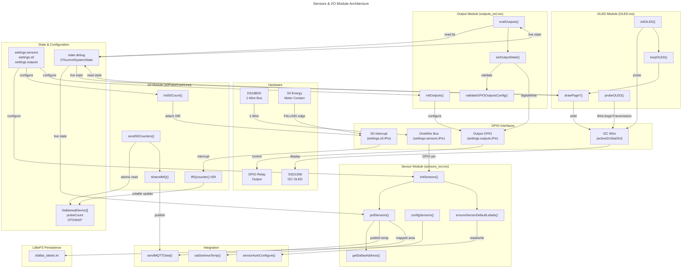

# C4 Code Level: Sensors & I/O Module

## Overview

- **Name**: Sensors & I/O Module (OTGW-firmware)
- **Description**: Hardware input/output layer for the OpenTherm Gateway. Manages Dallas DS18B20 temperature sensors via 1-Wire bus, S0 pulse counter for energy metering, GPIO relay output, and the optional SSD1306 OLED display. Publishes sensor data via MQTT with Home Assistant auto-discovery.
- **Location**: [src/OTGW-firmware/](../../src/OTGW-firmware/)
- **Language**: Arduino C/C++ (single translation unit `.ino` files)
- **Purpose**: Provide unified sensor and I/O control for auxiliary heating-system hardware on the ESP32-S3 boards (esp32 / esp32-classic / esp32-combo). Board-specific pins (I2C, button, LEDs) come from `boards.h` in the Platform library (`src/libraries/Platform/src/`); the Dallas, S0 and relay pins are user settings.

## Code Elements

### Dallas DS18B20 Temperature Sensors (`sensors_ext.ino`)

**Module Purpose**: Manages 1-Wire temperature sensor bus, auto-discovery, label persistence, MQTT publishing and routing of sensor temperatures into SAT areas.

#### Functions

- `void initSensors(void)`
  - **Location**: `sensors_ext.ino:134`
  - **Signature**: Initializes OneWire bus and Dallas Temperature library
  - **Description**: Resets `bSensorsDetected`. Returns early (counts set to 0) when `settings.sensors.bEnabled` is false and `state.debug.bSensorSim` is off. In simulation mode calls `initSimulatedDallasSensors()` and `ensureSensorDefaultLabels()` and counts as detected. Otherwise binds `oneWire.begin(settings.sensors.iPin)`, calls `sensors.begin()`, sets `setWaitForConversion(false)`, reads `getDeviceCount()`, clamps to `MAXDALLASDEVICES` (16, logs an error), stores each device address in `DallasrealDevice[]`, then calls `ensureSensorDefaultLabels()`. `bSensorsDetected` stays false when no sensor is found (separate from `settings.sensors.bEnabled`). Called from `setup()` (after MQTT is up, before `initSAT()`) and from the telnet `d` key.
  - **Acceptance Criteria Met**:
    - Configures `oneWire.begin()` only after settings are loaded (ADR-020)
    - Non-blocking async DS18B20 conversion via `setWaitForConversion(false)`
    - Enforces `MAXDALLASDEVICES` limit gracefully
  - **Dependencies**:
    - `OneWire oneWire`, `DallasTemperature sensors(&oneWire)`
    - `ensureSensorDefaultLabels()`
    - `settings.sensors.bEnabled`, `settings.sensors.iPin`
    - `state.debug.bSensorSim`, `state.debug.bSensors`

- `void ensureSensorDefaultLabels(void)`
  - **Location**: `sensors_ext.ino:32`
  - **Signature**: Ensures all discovered sensors have default labels in `/dallas_labels.ini`
  - **Description**: Two-pass algorithm. Pass 1 reads existing address/label pairs (address 17 chars, label 24 chars) from the LittleFS JSON object via `readJsonStringPair()`. If every detected sensor already has a label it returns without writing. Pass 2 rewrites the file, preserving existing labels and appending defaults ("Sensor N", or "Sim Sensor N" in simulation mode) for new addresses via `writeJsonStringPair()`. Uses a stack array of `MAXDALLASDEVICES` entries.
  - **Acceptance Criteria Met**:
    - Reads and preserves user labels across reboots
    - Generates sensible defaults for new sensors
    - Minimal file writes (compare-before-write)
  - **Dependencies**:
    - `DallasrealDeviceCount`, `DallasrealDevice[]`
    - `getDallasAddress()`
    - `readJsonStringPair()`, `writeJsonStringPair()` (both in `jsonStuff.ino`)
    - `state.debug.bSensorSim` (label prefix)
    - LittleFS `/dallas_labels.ini`

- `void initSimulatedDallasSensors(void)`
  - **Location**: `sensors_ext.ino:105`
  - **Signature**: Initializes virtual sensor array for testing/demo without a physical 1-Wire bus
  - **Description**: Creates `SIM_SENSOR_COUNT` (3) simulated devices with fake ROM addresses (`DallasSimDeviceAddresses[]`, `28D0000000000001..3`). Starting temperatures are 30.0 + i*5.0 degC. Resets `simLastUpdateTime` so the first update is immediate. Sets `numberOfDevices` and `DallasrealDeviceCount`.
  - **Dependencies**:
    - `DallasSimDeviceAddresses[3][8]`
    - `simLastUpdateTime`

- `void configSensors(void)`
  - **Location**: `sensors_ext.ino:205`
  - **Signature**: Publishes Home Assistant MQTT discovery for all detected sensors
  - **Description**: Early return if MQTT is disabled. Loops through `DallasrealDeviceCount` sensors and calls `sensorAutoConfigure(OTGWdallasdataid, false, strDeviceAddress)` for each (this streams the Dallas discovery config via `streamDallasSensorDiscovery()` in `MQTTHaDiscovery.cpp`, device group Sensors). After the last sensor calls `setMQTTConfigDone(OTGWdallasdataid)`. Reached from the discovery drip (`loopMQTTDiscovery()` and `doAutoConfigureMsgid()` in `MQTTstuff.ino`, which special-case id 246) rather than directly from `pollSensors()`.
  - **Dependencies**:
    - `settings.mqtt.bEnable`
    - `DallasrealDevice[]`, `DallasrealDeviceCount`
    - `sensorAutoConfigure()`, `setMQTTConfigDone()`
    - `OTGWdallasdataid = 246` (pseudo-dataid, `OTGW-firmware.h`)

- `void pollSensors(void)`
  - **Location**: `sensors_ext.ino:222`
  - **Signature**: `void pollSensors(void)`. Called from `loop()` when `DUE(timerpollsensor)` (interval `settings.sensors.iInterval`, 1..3600 s, default 20)
  - **Description**: Returns immediately unless `bSensorsDetected`. In real mode calls `sensors.requestTemperatures()` (non-blocking because of `setWaitForConversion(false)`), then reads each device with `getTempC()`; a `DEVICE_DISCONNECTED_C` result is skipped and the previous value kept (Finding #29). In simulation mode a random walk (+/-0.5 degC, clamped 20..60) is applied at most every `SIM_SENSOR_UPDATE_INTERVAL_SECONDS` (10 s). Stores `tempC` and `lasttime`. If MQTT is enabled and discovery is not done it queues `setMQTTConfigPending(OTGWdallasdataid)`, and publishes `%4.1f` via `sendMQTTData(strDeviceAddress, _msg)`. After publishing it routes the reading to SAT: for each of the 4 SAT areas whose `settings.sat.sSensorArea[i]` equals the sensor address (case-insensitive) it calls `satSetAreaTemp(i, tempC)` (TASK-587).
  - **Acceptance Criteria Met**:
    - Non-blocking (async conversion)
    - Graceful disconnect handling (skips stale reads, preserves last known value)
    - Simulation with its own update interval
    - Auto-routing of mapped sensors into SAT areas
  - **Dependencies**:
    - `sensors.requestTemperatures()`, `sensors.getTempC(DeviceAddress)`
    - `getDallasAddress()`
    - `sendMQTTData()`, `getMQTTConfigDone()`, `setMQTTConfigPending()`
    - `satSetAreaTemp()` (`SATcontrol.ino`), `settings.sat.sSensorArea[4][18]`
    - `DallasrealDevice[]`, `DallasrealDeviceCount`, `bSensorsDetected`
    - Simulation: `SIM_SENSOR_MIN/MAX`, `SIM_SENSOR_UPDATE_INTERVAL_SECONDS`, `simLastUpdateTime`

- `char* getDallasAddress(DeviceAddress deviceAddress)`
  - **Location**: `sensors_ext.ino:318`
  - **Signature**: `char* getDallasAddress(DeviceAddress deviceAddress)`. Converts 8-byte ROM address to hex string
  - **Description**: Returns a shared static 17-byte buffer (overwritten by every call, so consumers must use or copy it immediately). Standard mode: 16 uppercase hex chars, e.g. `"28D0000000000001"`. Legacy mode (`settings.sensors.bLegacyFormat = true`): reproduces the compressed ID of ~v0.10.x (each byte written at offset `i`, overwriting the previous tail) so existing Home Assistant automations keep working.
  - **Dependencies**:
    - `settings.sensors.bLegacyFormat`

#### Global State

- `OneWire oneWire` (`sensors_ext.ino:128`): default constructor (no pin) per ADR-020; pin binding deferred to `initSensors()`.
- `DallasTemperature sensors(&oneWire)` (`sensors_ext.ino:131`): DS18B20 layer (async conversion, temperature reads).
- `int numberOfDevices` (`sensors_ext.ino:15`): devices found by the last `initSensors()` (real or simulated).
- `static time_t simLastUpdateTime` (`sensors_ext.ino:22`): throttle for simulated updates.
- `const uint32_t SIM_SENSOR_UPDATE_INTERVAL_SECONDS = 10`, `const float SIM_SENSOR_MIN = 20.0f, SIM_SENSOR_MAX = 60.0f`, `const int SIM_SENSOR_COUNT = 3`.
- Defined in `OTGW-firmware.h`: `DallasrealDevice[MAXDALLASDEVICES]` (anonymous struct `{id, addr, tempC, lasttime}`), `DallasrealDeviceCount`, `bSensorsDetected`, `MAXDALLASDEVICES` (16), `OTGWdallasdataid` (246).

---

### S0 Pulse Counter (`s0PulseCount.ino`)

**Module Purpose**: Counts energy meter S0 pulses via GPIO interrupt, calculates instantaneous power, publishes via MQTT.

#### Functions

- `void initS0Count(void)`
  - **Location**: `s0PulseCount.ino:39`
  - **Signature**: Initializes the S0 pulse counter interrupt and pin
  - **Description**: Early return if `settings.s0.bEnabled` is false. Configures the pin as `INPUT_PULLUP`, resets `OTGWs0pulseCount = 0` and attaches `IRQcounter` on the `FALLING` edge. Called from `setup()`.
  - **Dependencies**:
    - `settings.s0.bEnabled`, `settings.s0.iPin`
    - `IRQcounter()`

- `void IRAM_ATTR IRQcounter(void)`
  - **Location**: `s0PulseCount.ino:24`
  - **Signature**: ISR for S0 pulse detection (FALLING edge)
  - **Description**: Increments `pulseCount` only if the time since the previous interrupt exceeds `settings.s0.iDebounceTime` (default 80 ms) and stores that interval in `last_pulse_duration`. Always updates the static `last_interrupt_time`.
  - **Dependencies**:
    - `settings.s0.iDebounceTime`
    - `pulseCount`, `last_pulse_duration` (volatile)

- `void sendS0Counters(void)`
  - **Location**: `s0PulseCount.ino:50`
  - **Signature**: Publishes S0 counter metrics to MQTT and updates global state. Called from `loop()` when `DUE(timers0counter)` (interval `settings.s0.iInterval`, 1..3600 s, default 60)
  - **Description**: Returns early if S0 is disabled. Inside `noInterrupts()/interrupts()` it copies `pulseCount` and `last_pulse_duration`; if the count is non-zero it sets `OTGWs0pulseCount` to the interval count (assignment, not accumulate), adds it to `OTGWs0pulseCountTot` and zeroes `pulseCount`. When pulses were seen (otherwise silent) it computes `OTGWs0powerkw = 3600000 / iPulsekw / localPulseDuration`, stamps `OTGWs0lasttime`, and, if MQTT is enabled, calls `sensorAutoConfigure(OTGWs0dataid, true, "")` and `s0sendMQ()`. Note: `sensorAutoConfigure()` returns immediately for an empty sensor id (it only handles Dallas discovery), so that call is a no-op; the S0 discovery entries (id 245) are published through the generic discovery drip (`setMQTTConfigPending(OTGWs0dataid)` in `MQTTstuff.ino`, table in `MQTTHaDiscovery.cpp`).
  - **Power Formula**: `OTGWs0powerkw = 3600000 / settings.s0.iPulsekw / last_pulse_duration`. Example: `iPulsekw=1000`, pulses 1000 ms apart gives 3.6 kW.
  - **Dependencies**:
    - `pulseCount`, `last_pulse_duration` (volatile ISR state)
    - `OTGWs0pulseCount`, `OTGWs0pulseCountTot`, `OTGWs0powerkw`, `OTGWs0lasttime`
    - `settings.s0.*`, `settings.mqtt.bEnable`
    - `s0sendMQ()`, `sensorAutoConfigure()`, `OTGWs0dataid = 245`

- `void s0sendMQ(void)`
  - **Location**: `s0PulseCount.ino:77`
  - **Signature**: Publishes four S0 metrics to MQTT
  - **Description**: Publishes `s0pulsecount` (pulses this interval), `s0pulsecounttot` (lifetime total since boot), `s0pulsetime` (last pulse interval in ms) and `s0powerkw` (`%4.3f`) through `sendMQTTData()`, using the shared `otTopic[]` scratch buffer and a 15-byte stack `_msg`.
  - **Dependencies**:
    - `OTGWs0pulseCount`, `OTGWs0pulseCountTot`, `last_pulse_duration`, `OTGWs0powerkw`
    - `sendMQTTData()`, `otTopic[]`

#### Global State

- `volatile uint16_t pulseCount` (`s0PulseCount.ino:20`): pulses since the last read; written by the ISR.
- `volatile uint32_t last_pulse_duration` (`s0PulseCount.ino:21`): ms between the last two valid pulses.
- Defined in `OTGW-firmware.h`: `OTGWs0pulseCount`, `OTGWs0pulseCountTot`, `OTGWs0powerkw`, `OTGWs0lasttime`, `OTGWs0dataid` (245).

---

### OLED Display Support (`OLED.ino`)

**Module Purpose**: SSD1306 128x64 I2C OLED driver with five button-cycled status pages. Text-only via SSD1306Ascii (no framebuffer, saves ~1 KB RAM versus Adafruit_SSD1306). Presence is detected at runtime; the code is always compiled (there is no `#if` around it; `HAS_OLED_CAPABLE` is defined in `boards.h` but not referenced by `OLED.ino`).

#### Functions

- `void initOLED(void)`
  - **Location**: `OLED.ino:466`
  - **Signature**: Initializes the display at I2C address 0x3C
  - **Description**: Probes 0x3C via `probeOLED()`; if absent logs and leaves `oledPresent = false`. Otherwise begins the driver (`Adafruit128x64`, System5x7 font), sets `oledPresent`, `oledPage = 1`, `state.hw.bOLEDPresent = true` (ADR-114) and draws the boot splash: a 16x16 flame bitmap (raw GDDRAM writes via `oledDrawFlame()`), the title ("OTGW32" when `isOTDirectEnabled()`, else "OTGW"), "OpenTherm Gateway", "Press button for info" and "Triple-reset = config". Configures the button pin `OLED_BUTTON_PIN` (`BUTTON` alias) as `INPUT_PULLUP`. Called from `setup()` before `startWiFi()` (so the config portal screen can be shown) and again from `applyResolvedComboPins()` after combo hardware-mode resolution (re-probe and re-pin).
  - **Dependencies**:
    - `Wire` (I2C started earlier in `setup()` on `activeI2cSda()/activeI2cScl()`)
    - `SSD1306Ascii`, `SSD1306AsciiWire`
    - `BUTTON` (= `activeButton()` on combo, `PIN_BUTTON` elsewhere)
    - `isOTDirectEnabled()`

- `void loopOLED(void)`
  - **Location**: `OLED.ino:527`
  - **Signature**: Non-blocking OLED main loop, called from `loop()` every pass (inside the `!isFlashing()` block)
  - **Description**: Returns if no display. Polls the button level (HIGH to LOW edge) with a 300 ms software debounce (`OLED_DEBOUNCE_MS`); there is no ISR (TASK-758). Wake from off goes to page 1; otherwise `oledPage = (oledPage + 1) % OLED_NUM_PAGES` (6, so page 5 wraps to 0 = display off, using `0xAE`/`0xAF` commands). Refreshes the cached WiFi SSID, auto-offs after `OLED_TIMEOUT_MS` (30 s) unless the prerelease AP-fallback screen is active, throttles redraws to `OLED_REFRESH_MS` (5 s), calls `clear()` only on a page change, and dispatches to the page renderer. In prerelease builds (`_VERSION_PRERELEASE`) with `state.net.bAPFallback` it always draws `drawPageConfig()`.
  - **Dependencies**:
    - `oledPage`, `oledLastActivity`, `oledLastRefresh`, `oledLastRenderedPage`, `oledLastBtnLevel`, `oledLastBtnEdge`
    - the `drawPage*()` renderers

- `void oledShowConfigMode(const char* ssid, const char* pw, const char* url)`
  - **Location**: `OLED.ino:628`
  - **Signature**: One-shot "how to connect" screen for the blocking WiFiManager config portal
  - **Description**: No-op without a display. Turns the display on, draws the WiFi Setup header and body, and resets activity state. Called synchronously from `configModeCallback()` in `networkStuff.ino` (the portal never returns to `loopOLED()`).

- `static bool probeOLED(void)` (`OLED.ino:150`): `Wire.beginTransmission(OLED_ADDR)` and `endTransmission() == 0`.

- Helpers (module scope): `oledRow(row)` (position and `clearToEOL()` so shorter text does not leave a stale tail, TASK-1151), `oledClearRow(row)`, `fmtFloatOrDash(float)` ("---" for NaN), `oledDrawFlame(col, row)`, `drawHeader(title)` (title plus "n/5" page indicator and a dash separator), `drawConfigHeader()`, `drawConfigBody(ssid, pw, url)`.

#### Page Renderers (module scope)

- `drawPageNetwork()` (`OLED.ino:239`): Page 1. WiFi SSID or "Ethernet" (`HAS_ETH_CAPABLE` and `state.net.eMode == NET_ETHERNET`), IP (`getActiveIP()`), RSSI (WiFi only), MQTT connected/offline, broker name.
- `drawPageOTStatus()` (`OLED.ino:294`): Page 2. `hardwareModeName()`, OT bus online/offline (`state.otBus.bOnline`), flame and modulation, CH/DHW flags, setpoint and boiler temp. Flame/CH/DHW come from `OTcurrentSystemState.SlaveStatus` bits 3 / 1 / 2.
- `drawPageDevice()` (`OLED.ino:346`): Page 3. Firmware version (`_VERSION_MAJOR.MINOR.PATCH-<prerelease>`), hostname, uptime (`state.uptime.iSeconds`), `platformFreeHeap()`, `state.uptime.iRebootCount`.
- `drawPageDashboard()` (`OLED.ino:383`): Page 4. Flame/modulation, CH/DHW, TSet, Tboiler, Tret, Tdhw, CH pressure, Toutside.
- `drawPageHeating()` (`OLED.ino:433`): Page 5. HC1 (TrSet, Tr, Tboiler as flow, Tret) and HC2 (TrSetCH2, TRoomCH2, TflowCH2).
- `drawPageConfig()` (`OLED.ino:230`, only when `_VERSION_PRERELEASE` is defined): AP-fallback "WiFi Setup" screen using `state.net.sAPSSID`, a hard-coded password string and `http://192.168.4.1/`.

#### Display Characteristics

- **Hardware**: 128x64 SSD1306 I2C
- **Font**: System5x7 (6x8 px) gives 21 columns x 8 rows (`OLED_COLS`, `OLED_ROWS`)
- **I2C Address**: 0x3C (`OLED_ADDR`, probed)
- **Refresh**: 5 s (`OLED_REFRESH_MS`), cooperative
- **Auto-off**: 30 s inactivity (`OLED_TIMEOUT_MS`)
- **Button**: `BUTTON` (active LOW), polled, 300 ms debounce
- **Pages**: 0 = off, 1 Network, 2 OT Status, 3 Device, 4 Dashboard, 5 Heating (`OLED_NUM_PAGES = 6`)

#### Global Display State (module scope)

- `static SSD1306AsciiWire oledDisplay`
- `static bool oledPresent`
- `static uint8_t oledPage` (0 = off, 1-5 content), `oledLastRenderedPage`
- `static uint32_t oledLastActivity, oledLastRefresh, oledLastBtnEdge`; `static uint8_t oledLastBtnLevel`
- `static char oledCachedSSID[33]`, `static char oledBuf[22]`

---

### GPIO Relay Outputs (`outputs_ext.ino`)

**Module Purpose**: Drives one GPIO digital output (relay) from a configurable OpenTherm status bit. Not to be confused with the OTGW32 bypass relay (`PIN_BYPASS_RELAY`), which `OTDirect.ino` drives directly.

#### Functions

- `void initOutputs(void)`
  - **Location**: `outputs_ext.ino:30`
  - **Description**: Returns if outputs are disabled or `validateGPIOOutputsConfig()` fails. Sets the pin to `OUTPUT`, `outputsInitialized = true`, and the initial state to OFF. Called from `setup()` and the telnet `i` key.
  - **Validation Ranges**: pin 0..16, trigger bit 0..15 (the same 0..16 range is enforced in `updateSetting()` and the REST settings schema, so higher ESP32-S3 GPIO numbers cannot be selected).

- `static bool validateGPIOOutputsConfig(void)` (`outputs_ext.ino:18`): range checks, logs the invalid value. Called by `initOutputs()`, `setOutputState(bool)` and `evalOutputs()`.

- `void setOutputState(uint8_t status = ON)` (`outputs_ext.ino:47`): overload mapping `ON` to `true`, anything else to `false`.

- `void setOutputState(bool set_HIGH = true)` (`outputs_ext.ino:51`): guards on `settings.outputs.bEnabled` and validation, lazily configures the pin, `digitalWrite`s it and logs the read-back state.

- `void evalOutputs(void)`
  - **Location**: `outputs_ext.ino:62`
  - **Description**: Returns if disabled or invalid. Reads bit `settings.outputs.iTriggerBit` of `OTcurrentSystemState.Statusflags` and passes it to `setOutputState()`. When `settings.bMyDEBUG` is set it logs once and clears the flag (telnet `l` key). Called from `loop()` (`OTGW-firmware.ino`, every pass).
  - **OT Status Bit Reference** (bit index into `Statusflags = (MasterStatus << 8) | SlaveStatus`, see source comment for the full list): slave (boiler) bits 0 fault, 1 CH active, 2 DHW active, 3 flame, 4 cooling, 5 CH2 active, 6 diagnostic; master (thermostat) bits 8 CH enable, 9 DHW enable, 10 cooling enable, 11 OTC active, 12 CH2 enable. The v2 settings select offers 0 to 3 under these names (TASK-1295); the REST API accepts 0 to 15.
  - **Dependencies**:
    - `OTcurrentSystemState.Statusflags`
    - `settings.outputs.iTriggerBit`, `settings.outputs.bEnabled`, `settings.bMyDEBUG`

#### Global Output State (module scope)

- `static bool outputsInitialized` (`outputs_ext.ino:16`)

---

## Dependencies

### Internal Dependencies

| Module | Function/Variable | Purpose |
|--------|-------------------|---------|
| `MQTTstuff.ino` | `sendMQTTData()` | Publish sensor/counter data to the broker (prefix `{topTopic}/value/{nodeId}/`) |
| `MQTTstuff.ino` | `sensorAutoConfigure()` | Dallas discovery (empty sensor id returns immediately) |
| `MQTTstuff.ino` | `setMQTTConfigDone()`, `getMQTTConfigDone()`, `setMQTTConfigPending()` | Per-id discovery bookkeeping |
| `MQTTHaDiscovery.cpp` | `streamDallasSensorDiscovery()`, id-245 table entries | Streaming discovery payloads |
| `OTGW-Core.ino` | `OTcurrentSystemState` | Global OpenTherm state (temps, status flags) |
| `OTGW-firmware.ino` | `loop()`, timers `timerpollsensor`, `timers0counter` | Calls `pollSensors()`, `sendS0Counters()`, `evalOutputs()`, `loopOLED()` |
| `jsonStuff.ino` | `readJsonStringPair()`, `writeJsonStringPair()` | Label file I/O |
| `SATcontrol.ino` | `satSetAreaTemp()` | Route a Dallas reading into a SAT area |
| `networkStuff.ino` | `isNetworkUp()`, `networkModeName()`, `getActiveIP()`, `oledShowConfigMode()` caller | Network status for the OLED |
| Settings (`Sensorstypes.h`, `S0types.h`, `Outputstypes.h`) | `settings.sensors.*`, `settings.s0.*`, `settings.outputs.*` | Configuration structs |
| State (`debugStuff.h`, `Hardwaretypes.h`) | `state.debug.bSensors`, `state.debug.bSensorSim`, `state.hw.bOLEDPresent` | Runtime flags |
| Global (`OTGW-firmware.h`) | `otTopic[]`, `cMsg[]`, `BUTTON`, `activeI2cSda()/activeI2cScl()` | Shared scratch buffers and board pin resolution |

### External Dependencies (Libraries)

| Library | Used In | Purpose |
|---------|---------|---------|
| `OneWire` | `sensors_ext.ino` | 1-Wire protocol (DS18B20 bus) |
| `DallasTemperature` (Miles Burton) | `sensors_ext.ino` | DS18B20 temperature reading |
| `SSD1306Ascii` ([Greiman/SSD1306Ascii](https://github.com/greiman/SSD1306Ascii)) | `OLED.ino` | Text-only OLED driver |
| `SSD1306AsciiWire` (part of SSD1306Ascii) | `OLED.ino` | I2C transport |
| `Wire` (I2C) | `OLED.ino` | I2C master, shared with the 0x26 watchdog, the S3 Mini Pro IMU probe and others |
| `Arduino.h` | All `.ino` files | GPIO, `millis()`, interrupts |

### Home Assistant Integration

| Sensor Type | Data ID | MQTT Topic | Auto-Discovery |
|-------------|---------|------------|----------------|
| Dallas DS18B20 | 246 | `{topTopic}/value/{nodeId}/{deviceAddress}` (address from `getDallasAddress()`) | `configSensors()` via the discovery drip, `streamDallasSensorDiscovery()` |
| S0 Pulse Counter | 245 | `s0pulsecount`, `s0pulsecounttot`, `s0pulsetime`, `s0powerkw` under the same `value/{nodeId}/` prefix | Generic discovery drip, id 245 table entries (`MQTTHaDiscovery.cpp`) |

REST: `GET /api/v2/sensors` (or `/status`) returns Dallas (`dallas_enabled`, `dallas_detected`, `dallas_count`, `dallas_gpio`, `dallas_poll_sec`, `simulated`, per-address `temp`/`epoch`) and S0 (`enabled`, `gpio`, `poll_sec`, `pulses`, `total`, `power_kw`, `epoch`) via `sendSensorStatus()`; `GET|POST|PUT /api/v2/sensors/labels` via `getDallasLabels()` / `updateAllDallasLabels()` (`restAPI.ino`).

---

## Hardware Configuration

### Dallas DS18B20 Sensors (1-Wire)

| Parameter | Setting | Notes |
|-----------|---------|-------|
| **GPIO Pin** | `settings.sensors.iPin` (struct default 10) | User setting, range 0..16; bound after settings load (ADR-020). `boards.h` defines `PIN_1WIRE` (4) for the OTGW32 PCB but no code reads it, so the pin must be set in settings |
| **Bus Topology** | Standard 3.3 V pull-up | DS18B20 wiring |
| **Max Devices** | 16 (`MAXDALLASDEVICES`) | Enforced in `initSensors()` |
| **Async Conversion** | `setWaitForConversion(false)` | Non-blocking |
| **Poll interval** | `settings.sensors.iInterval` (default 20 s, 1..3600) | `timerpollsensor` |
| **Disconnect Handling** | Graceful skip, retain prior value | Finding #29 |

### S0 Pulse Counter

| Parameter | Setting | Notes |
|-----------|---------|-------|
| **GPIO Pin** | `settings.s0.iPin` (default 12) | Must be interrupt-capable; range 0..16 in `updateSetting()` (REST schema 1..16) |
| **Trigger** | FALLING edge | Meter pulls the pin LOW |
| **Pull-up** | `INPUT_PULLUP` | Normally-open contact |
| **Debounce** | `settings.s0.iDebounceTime` (default 80 ms, 0..1000) | Checked inside the ISR |
| **Pulses per kW** | `settings.s0.iPulsekw` (default 1000, 1..65535) | Meter calibration (field is named `iPulsekw` in the code) |
| **Report Interval** | `settings.s0.iInterval` (default 60 s, 1..3600) | `timers0counter`; publishes only when pulses were counted |

### GPIO Relay Output

| Parameter | Setting | Notes |
|-----------|---------|-------|
| **GPIO Pin** | `settings.outputs.iPin` (default 16) | Range 0..16 |
| **Logic** | Active-HIGH | `digitalWrite(pin, bit ? HIGH : LOW)` |
| **Trigger Bit** | `settings.outputs.iTriggerBit` (default 0) | Index 0..15 into `OTcurrentSystemState.Statusflags` |

### OLED Display (optional, SSD1306 I2C)

| Parameter | Setting | Notes |
|-----------|---------|-------|
| **Hardware** | 128x64 SSD1306 | Runtime-detected, no error if absent |
| **I2C Address** | 0x3C (fixed, probed) | `OLED_ADDR` |
| **I2C Bus** | `Wire` on `activeI2cSda()/activeI2cScl()` | OTGW32: SDA 18 / SCL 17. Classic on LOLIN S3 Mini: SDA 35 / SCL 36. Classic on S3 Mini Pro: SDA 12 / SCL 11. On the combo build the live pair follows `settings.iBoardMode` and the boot-time hardware mode (ADR-127, ADR-158) |
| **Button** | `BUTTON` (active LOW) | OTGW32 GPIO 0, Classic S3 Mini GPIO 18, Classic S3 Mini Pro GPIO 13 |
| **Power Saving** | Auto-off after 30 s | Button press wakes |

### Board context (from `boards.h` and `OTGW-firmware.ino`)

- Targets: `esp32` (OTGW32, OTDirect, `HAS_DIRECT_OT=1`, `HAS_ETH_CAPABLE=1`), `esp32-classic` (PIC, LOLIN S3 Mini), `esp32-combo` (both, boot-detected, `HAS_RUNTIME_HW_DETECT=1`).
- `state.hw` (`Hardwaretypes.h`): `eMode` (`HW_MODE_UNKNOWN/PIC/OT_DIRECT/DEGRADED`), `bOLEDPresent` (runtime I2C probe, ADR-114), `bEthernetPresent` (`HAS_ETH_CAPABLE`), `bClassicPro` (`HAS_RUNTIME_HW_DETECT`).
- S3 Mini Pro detection (ADR-158): `probeProImu()` in `OTGW-firmware.ino` reads WHO_AM_I (reg 0x00, expected 0x05) of the on-board QMI8658C at I2C 0x6A / 0x6B on GPIO 12/11 before the 0x26 watchdog disarm; the result sets `state.hw.bClassicPro`, and when a PIC is detected `settings.iBoardMode` is cached as 3 (Pro) or 1 (Mini).
- LOLIN RGB status pixel (`HAS_STATUS_PIXEL`, Classic and combo targets only): `startStatusPixel()` drives GPIO 47 (S3 Mini, RGB order) or GPIO 8 (Mini Pro, GRB, power enable GPIO 7); skipped when `psramFound()` is false (OTGW32).

---

## Data Flows

### Temperature Sensor Pipeline

```
Hardware (DS18B20)
    |
OneWire bus (settings.sensors.iPin)
    |
DallasTemperature.requestTemperatures() [non-blocking]
    | (DUE(timerpollsensor), every settings.sensors.iInterval s)
pollSensors()
    +- sensors.getTempC(DeviceAddress) -> DallasrealDevice[].tempC
    +- getDallasAddress() -> 16-char hex string (or legacy format)
    +- sendMQTTData(address, "NN.N") -> {topTopic}/value/{nodeId}/{address}
    +- satSetAreaTemp(i, tempC) when settings.sat.sSensorArea[i] matches
    +- setMQTTConfigPending(246) until discovery is done
         -> loopMQTTDiscovery() -> configSensors() -> sensorAutoConfigure()
/dallas_labels.ini (labels, written by ensureSensorDefaultLabels and the REST labels endpoint)
```

### S0 Pulse Pipeline

```
Hardware (Energy Meter S0 Contact)
    | (FALLING edge)
IRQcounter() ISR [debounced]
    +- pulseCount++
    +- last_pulse_duration = time_delta
    | (DUE(timers0counter), every settings.s0.iInterval s)
sendS0Counters()
    +- atomic read (noInterrupts/interrupts), zero pulseCount
    +- OTGWs0pulseCount = count; OTGWs0pulseCountTot += count
    +- OTGWs0powerkw = 3600000 / iPulsekw / duration
    +- s0sendMQ() -> s0pulsecount, s0pulsecounttot, s0pulsetime, s0powerkw
```

### GPIO Output Control Pipeline

```
OpenTherm status (PIC serial or OTDirect)
    |
OTcurrentSystemState.Statusflags
    |
evalOutputs() [every loop() pass]
    +- bit settings.outputs.iTriggerBit -> setOutputState(bitState)
    |
GPIO Output Pin -> relay
```

### OLED Display Refresh Loop

```
loopOLED() [every loop() pass]
    +- poll button, debounce 300 ms, cycle page 1..5 -> 0 (off)
    +- auto-off after 30 s
    +- every 5 s: clear() on page change, then
         drawPageNetwork / drawPageOTStatus / drawPageDevice / drawPageDashboard / drawPageHeating
         (or drawPageConfig during prerelease AP fallback)
    +- I2C writes to SSD1306
```

---

## Settings & Configuration

### Persistent Settings (`Sensorstypes.h`, `S0types.h`, `Outputstypes.h`)

```c
struct SensorsSection {
  bool    bEnabled       = false;      // Enable Dallas sensor monitoring
  bool    bLegacyFormat  = false;      // Backward compat: legacy address format
  int8_t  iPin           = 10;         // GPIO pin for the 1-Wire bus
  int16_t iInterval      = 20;         // Poll interval (seconds)
};

struct S0Section {
  bool     bEnabled      = false;      // Enable S0 pulse counter
  uint8_t  iPin          = 12;         // GPIO pin for the S0 interrupt
  uint16_t iDebounceTime = 80;         // Debounce window (milliseconds)
  uint16_t iPulsekw      = 1000;       // Pulses per kW (meter calibration)
  uint16_t iInterval     = 60;         // Reporting interval (seconds)
};

struct OutputsSection {
  bool   bEnabled    = false;          // Enable GPIO relay output
  int8_t iPin        = 16;             // GPIO pin for the relay
  int8_t iTriggerBit = 0;              // Status bit to monitor (0-15)
};
```

Persisted keys in `/settings.ini`: `GPIOSENSORSenabled`, `GPIOSENSORSlegacyformat`, `GPIOSENSORSpin`, `GPIOSENSORSinterval`, `S0COUNTERenabled`, `S0COUNTERpin`, `S0COUNTERdebouncetime`, `S0COUNTERpulsekw`, `S0COUNTERinterval`, `GPIOOUTPUTSenabled`, `GPIOOUTPUTSpin`, `GPIOOUTPUTStriggerBit`. Enabling and pin changes need a reboot to take effect; interval changes apply immediately (`CHANGE_INTERVAL_SEC`).

### Runtime State (`OTGW-firmware.h`)

```c
// Dallas
byte      OTGWdallasdataid = 246;
int       DallasrealDeviceCount = 0;
bool      bSensorsDetected = false;     // true if sensors initialized this boot
#define   MAXDALLASDEVICES 16
struct { int id; DeviceAddress addr; float tempC; time_t lasttime; } DallasrealDevice[MAXDALLASDEVICES];

// S0 (pulseCount and last_pulse_duration are in s0PulseCount.ino)
uint16_t  OTGWs0pulseCount;             // Pulses this interval
uint32_t  OTGWs0pulseCountTot = 0;      // Total since boot
float     OTGWs0powerkw = 0.0f;         // Instantaneous power (kW)
time_t    OTGWs0lasttime = 0;           // Timestamp of last non-empty read
byte      OTGWs0dataid = 245;
```

---

## Important Design Notes

### ADR-020: Deferred OneWire Initialization
The `OneWire` object uses the default constructor (no pin argument), deferring bus initialization to `initSensors()` after `readSettings()` loads the GPIO pin.

### Finding #29: Graceful Sensor Disconnect Handling
If `getTempC()` returns `DEVICE_DISCONNECTED_C`, the sensor is skipped in `pollSensors()` and the previous value is retained; monitoring continues on the remaining sensors.

### Simulation Mode
Dallas sensors can be simulated without a 1-Wire bus:
- Toggle `state.debug.bSensorSim` with the telnet `d` key (runtime flag, not persisted); this re-runs `initSensors()` and polls once.
- Three virtual sensors start at 30, 35 and 40 degC and drift randomly (+/-0.5 degC per step) within 20..60 degC.
- Updates every 10 s, independent of `settings.sensors.iInterval`.

---

## Testing & Debugging

### Telnet Debug Output
Toggle `state.debug.bSensors` (telnet key `4`) or `state.debug.bSensorSim` (key `d`):
- DS18B20: `"Sensor device no[N] addr[HEX] TempC: X.X"`; simulated: `"[SIM] Sensor device no[N] ..."`
- S0: `"*** S0PulseCount(N) S0PulseCountTot(M)"` and `"*** S0LastPulsetime(Nms) S0Pulsekw:(X.XXX)"`
- Outputs: telnet keys `i` (init), `u` (ON), `o` (OFF), `j` (read), `l` (toggle `bMyDEBUG` for one `evalOutputs()` trace).

### Configuration Validation
- **Sensors / S0 / Outputs pins**: `updateSetting()` accepts 0..16 only (out of range is ignored with a warning) and logs, but does not block, a conflict reported by `checkGPIOConflict()`.
- **Outputs**: `validateGPIOOutputsConfig()` runs again on every `setOutputState()` and `evalOutputs()`.
- **OLED**: probed at 0x3C; silently disabled if absent.

### Common Issues

| Issue | Root Cause | Fix |
|-------|-----------|-----|
| No sensor readings | `settings.sensors.bEnabled = false`, no sensors on the bus, or wrong pin (needs reboot after change) | Check settings, wiring and `GET /api/v2/sensors` (`dallas_detected`) |
| S0 pulses not counted | Wrong pin or debounce too high; enabling needs a reboot | Check pin and `GET /api/v2/sensors` (`s0`) |
| Output always OFF | `settings.outputs.bEnabled = false` or wrong trigger bit | Enable in the web UI and verify the status bit |
| OLED blank | No device at 0x3C, or I2C pins wrong for the active board mode | Check the wiring and `state.hw.bOLEDPresent` (`oledpresent` in `GET /api/v2/device/info`) |

---

## File Locations Summary

| File | Functions | Purpose |
|------|-----------|---------|
| `src/OTGW-firmware/sensors_ext.ino` | `initSensors()`, `pollSensors()`, `configSensors()`, `ensureSensorDefaultLabels()`, `getDallasAddress()`, `initSimulatedDallasSensors()` | DS18B20 1-Wire sensor management |
| `src/OTGW-firmware/s0PulseCount.ino` | `initS0Count()`, `sendS0Counters()`, `s0sendMQ()`, `IRQcounter()` | S0 energy meter pulse counting |
| `src/OTGW-firmware/OLED.ino` | `initOLED()`, `loopOLED()`, `oledShowConfigMode()`, `drawPage*()` | SSD1306 I2C OLED display driver |
| `src/OTGW-firmware/outputs_ext.ino` | `initOutputs()`, `setOutputState()`, `evalOutputs()`, `validateGPIOOutputsConfig()` | GPIO relay output control |
| `src/OTGW-firmware/Sensorstypes.h`, `S0types.h`, `Outputstypes.h`, `Hardwaretypes.h` | Settings and hardware-state structs | ADR-079 per-component types |
| `src/OTGW-firmware/OTGW-firmware.h` | Dallas and S0 globals, `activeI2c*()`/`activeButton()` accessors | Shared state |
| `src/libraries/Platform/src/boards.h` | Pin maps, `HAS_*` flags | Board definitions |

---

## Mermaid Diagram: Sensor & I/O Architecture



---

## Summary

1. **Dallas DS18B20 Temperature Sensors** (`sensors_ext.ino`): 1-Wire bus management, async non-blocking reads, label persistence, graceful disconnect handling, Home Assistant discovery, SAT area routing, simulation mode.
2. **S0 Energy Meter Counter** (`s0PulseCount.ino`): interrupt-driven pulse counting with debounce, power calculation, atomic state reads, MQTT publishing.
3. **GPIO Relay Outputs** (`outputs_ext.ino`): OT status bit monitoring, GPIO control, configuration validation.
4. **OLED Display** (`OLED.ino`): runtime I2C detection, text-only rendering, five button-cycled pages, 30 s auto-off, config-portal and AP-fallback screens.

All modules integrate with MQTT for Home Assistant, use persistent settings, and log through the telnet debug port. Optional hardware is detected at runtime and its absence is not an error.
