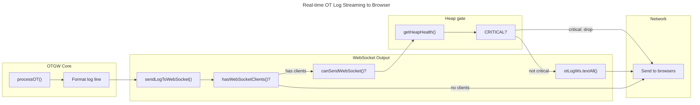
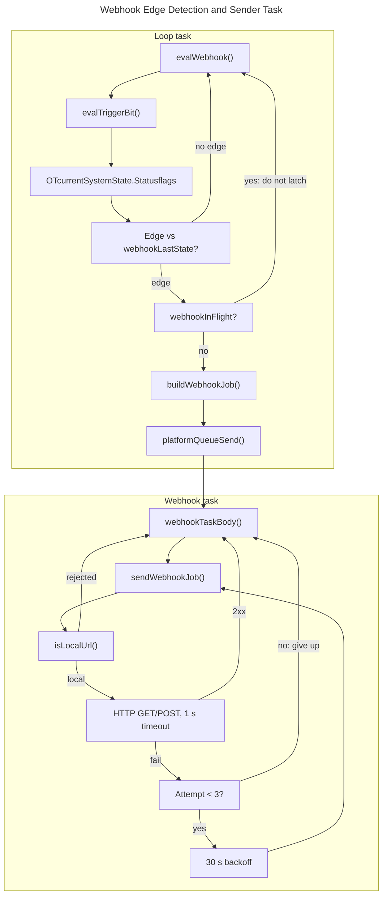

# C4 Code Level: Utilities & WebSocket Module

## Overview

- **Name**: Utilities & WebSocket Module
- **Description**: Foundational utilities, telnet debug server, and real-time WebSocket streaming for the OTGW firmware. Provides helper functions for timestamp formatting, file management, system diagnostics, heap monitoring with a CRITICAL-only gate, reboot orchestration, and WebSocket broadcasting for the live OT log viewer.
- **Location**: `src/OTGW-firmware/` (multiple files)
- **Language**: Arduino C++ (.ino/.h) on ESP32-S3
- **Purpose**:
  - Unified debug output via telnet (port 23, `AsyncSimpleTelnet<1> debugTelnet`)
  - Cooperative scheduling with safe timer macros handling `millis()` rollover
  - Real-time WebSocket streaming of OpenTherm messages to the Web UI (`AsyncWebSocket` at path `/ws` on the port-80 server)
  - HTTP webhook triggering on OT status bit changes with local-network security, sent by a dedicated FreeRTOS task
  - System monitoring, version reporting, heap diagnostics, deferred and instrumented reboots
  - PROGMEM-safe string and data handling (ADR-004: no String in hot paths)

## Code Elements

### Core Utilities (helperStuff.ino / helperStuff.h)

#### PROGMEM_readAnything: Flash Memory Safe Copy
- **Signature**: `#define PROGMEM_readAnything(src, dest) memcpy_P(&(dest), (src), sizeof(dest))`
- **Location**: `helperStuff.h:23`
- **Purpose**: Macro for copying PROGMEM structures into RAM (used for `OTmap[]` lookups in `OTGW-Core.ino`). `sizeof(dest)` bounds the copy. A macro rather than a template so ctags does not generate a broken forward declaration.

#### Timestamp Helpers

##### getOTLogTimestamp()
- **Signature**: `const char* getOTLogTimestamp()`
- **Location**: `helperStuff.ino:19`
- **Returns**: Pointer to static char[16] "HH:MM:SS.mmmmmm" (6-digit microsecond resolution)
- **Purpose**: High-resolution log timestamps with timezone awareness using the AceTime `timezoneManager`.
- **Details**:
  - Microsecond precision from `gettimeofday()`
  - Creates the zone from `settings.ntp.sTimezone` on each call; falls back to UTC on timezone error
  - Static buffer pattern (ADR-004: no heap allocation)

##### yearChanged() / dayChanged() / minuteChanged() / hourChanged()
- **Signature**: `bool yearChanged()`, `bool dayChanged()`, `bool minuteChanged()`, `bool hourChanged()`
- **Location**: `helperStuff.ino:674`, `687`, `700`, `712`
- **Purpose**: Detect local-time calendar rollover using function-static last-seen values (timezone from `settings.ntp.sTimezone`).
- **Returns**: true on the first call after a transition (and on the very first call), false otherwise.
- **Usage**: `minuteChanged()` is the single gate in `loop()` (`doTaskMinuteChanged()`); hour, day and year dispatch happens inside it (ADR-086).

##### upTime()
- **Signature**: `String upTime()`
- **Location**: `helperStuff.ino:661`
- **Returns**: Formatted string "D(d)-HH:MM(H:m)" from `state.uptime.iSeconds`
- **Note**: Returns String (acceptable for display, not hot paths per ADR-004).

#### Reboot Tracking

##### updateRebootCount()
- **Signature**: `uint32_t updateRebootCount()`
- **Location**: `helperStuff.ino:137`
- **Returns**: Incremented reboot count
- **Purpose**: Persist the reboot counter to LittleFS file `/reboot_count.txt` (one number). Called once from `setup()`.
- **Details**: Read-increment-write; uses a static char[12] buffer (ADR-004).

##### readLatestCrashLog() / updateRebootLog()
- **Signature**:
  - `bool readLatestCrashLog(char* summary, size_t summarySize, char* details, size_t detailsSize)`
  - `bool updateRebootLog(String text)`
- **Location**: `helperStuff.ino:244`, `helperStuff.ino:296`
- **Purpose**: Crash/reboot log persistence in `/reboot_log.txt`.
- **Details**:
  - `updateRebootLog()` calls `loopNTP()` first, then writes a new entry at the top of a temp file `/reboot_log.t.txt` (timestamp, "reboot cause", platform reset code, exception info, register dump from `platformResetRegisterDump()`, and the external watchdog reason when `platformIsExternalReset()`), appends older lines up to `LOG_LINES` (20) and renames the temp file over the log
  - `readLatestCrashLog()` returns the newest summary line that is directly followed by a register-dump or external-reason line; it uses the `LittleFSmounted` flag instead of calling `LittleFS.begin()` again
  - Uses static or stack char buffers for line formatting (ADR-004)

##### Deferred reboot and instrumentation
- **Functions**: `requestDeferredReboot(const char*)` (`helperStuff.ino:472`), `isRebootPending()` (`468`), `performDeferredReboot()` (`491`), `doRestart(const char*)` (`627`), `prepareForReboot()` (static, `541`), `logBootSignature(const char*)` (`594`), `maybeWarnFlashMismatch()` (`512`)
- **Purpose**: Intentional reboots go through `doRestart()`. `requestDeferredReboot()` sets a pending flag (HTTP/timer callbacks), and the main loop calls `performDeferredReboot()` when not flashing, so the HTTP response can flush first.
- **`doRestart()` sequence**: logs state, `safebootMarkAppValid()` (ADR-191), `flushSettings()`, `flushDHWWaterMeter()`, `prepareForReboot()` (MQTT disconnect via `doMqttDisconnect()`, WebSocket close via `doWebSocketClose()`, `OTGWstream.stop()`), a 2 s delay for TCP FINs, then `platformRestart()`. The `debugTelnet.stop()` call in `prepareForReboot()` is commented out.
- **`maybeWarnFlashMismatch()`**: informational WARN lines when flash real size differs from the mapped size or is below 4 MB; the flash-mode check is skipped when the platform shim reports "unknown" (ESP32).

#### Filesystem Monitoring

##### updateLittleFSStatus() / checklittlefshash()
- **Signature**:
  - `bool updateLittleFSStatus(const char *probePath)`
  - `bool updateLittleFSStatus(const __FlashStringHelper *probePath)` (PROGMEM overload)
  - `bool checklittlefshash()`
- **Location**: `helperStuff.ino:174`, `213`, `731`
- **Purpose**:
  - `updateLittleFSStatus()`: refresh `LittleFSinfo` via `platformFSInfo()`, write a health probe file (default `/.health`) and track the mount status in `LittleFSmounted`
  - `checklittlefshash()`: compare `/version.hash` with `_VERSION_GITHASH`; sets `state.statusMessage = StatusMessage::LittleFSMismatch` on mismatch and clears it on a match
- **Details**: Probe path buffer is `FS_PROBE_PATH_MAX` (32 bytes); the hash is read into a char[16].

##### getStatusMessageText() / getFilesystemHash()
- **Location**: `helperStuff.ino:763`, `780`
- `const __FlashStringHelper* getStatusMessageText()` maps `state.statusMessage` (`None`, `LittleFSMismatch`, `PSModeActive`) to a PROGMEM string.
- `const char* getFilesystemHash()` returns a function-static char[16] cache of `/version.hash`, read once; empty when the file is missing.

#### String / IP / Signal Utilities

##### trimwhitespace()
- **Signature**: `char* trimwhitespace(char *str)`
- **Location**: `helperStuff.ino:49`
- **Purpose**: In-place trim of leading/trailing whitespace. Returns a pointer into the original string (never free it).

##### isValidIP()
- **Signature**: `boolean isValidIP(IPAddress ip)`
- **Location**: `helperStuff.ino:72`
- **Purpose**: Sanity-check a resolved IPv4 address. Rejects any address whose first or last octet is 0, `255.255.255.255`, `127.0.0.1`, and anything with a first octet >= 224. It does not check private ranges (that is done by the webhook `isLocalUrl()`).

##### signal_quality_perc_quad() / dBmtoQuality()
- **Signature**: `int signal_quality_perc_quad(int rssi)`, `String dBmtoQuality(int dBm)`
- **Location**: `helperStuff.ino:810`, `831`
- **Purpose**: WiFi signal strength conversion (dBm to percentage via a quadratic fit, or to a quality string).

##### replaceAll()
- **Signature**: `bool replaceAll(char *buffer, const size_t bufSize, const char *token, const char *replacement)`
- **Location**: `helperStuff.ino:844`
- **Purpose**: In-place substring replacement with bounds checking. Returns false if the replacement would overflow the buffer.

---

### Heap Diagnostics, Gate and Recovery (helperStuff.ino)

**Rationale**: The per-consumer throttling ladder of ADR-089 / ADR-121 was removed on the ESP32-S3 branch (ADR-167): soak runs never entered the LOW/WARNING tiers. What remains is ADR-030's original thresholds, kept for the emergency-recovery trigger, a CRITICAL-only send gate, and tier-entry telemetry.

#### Heap Health Tracking

##### getHeapHealth()
- **Signature**: `HeapHealthLevel getHeapHealth()`
- **Location**: `helperStuff.ino:909` (enum `HeapHealthLevel` is in `OTGW-firmware.h`)
- **Returns**: `HEAP_HEALTHY`, `HEAP_LOW`, `HEAP_WARNING` or `HEAP_CRITICAL` from `platformFreeHeap()` only (no fragmentation promotion)
- **Thresholds** (`helperStuff.ino:877-879`): `HEAP_CRITICAL_THRESHOLD` 3072, `HEAP_WARNING_THRESHOLD` 5120, `HEAP_LOW_THRESHOLD` 8192 bytes
- **Side effect**: entering a stricter tier increments `state.heapdiag.iEnteredLowCount/WarningCount/CriticalCount` (telemetry only)

##### getHeapFragmentation()
- **Signature**: `uint8_t getHeapFragmentation()`; **Location**: `helperStuff.ino:942`; delegates to `platformHeapFragmentation()` (observability only)

##### canSendWebSocket()
- **Signature**: `bool canSendWebSocket()`
- **Location**: `helperStuff.ino:956`
- **Logic**: returns true unless the heap is CRITICAL. When blocking it counts `state.heapdiag.iWsDropsTotal` and logs at most every `WARNING_LOG_INTERVAL_MS` (10 s).

##### canPublishMQTT()
- **Signature**: `bool canPublishMQTT()`
- **Location**: `helperStuff.ino:976`
- **Logic**: same CRITICAL-only gate for MQTT (`state.heapdiag.iMqttDropsTotal`); called from `sendMQTTData()`.

##### logHeapStats()
- **Signature**: `void logHeapStats()`; **Location**: `helperStuff.ino:995`
- **Purpose**: Debug line with free heap, max block, tier name and WS/MQTT drop counts.

##### emergencyHeapRecovery()
- **Signature**: `void emergencyHeapRecovery()`; **Location**: `helperStuff.ino:1025`
- **Purpose**: Called from `doBackgroundTasks()` when `getHeapHealth() == HEAP_CRITICAL`. Rate-limited to once per `EMERGENCY_RECOVERY_INTERVAL_MS` (30 s). Actions (ADR-107): (1) `doWebSocketDisconnectAll()` if clients exist, (2) `OTGWstream.stop()` then `startPICStream()`, (3) `clearMQTTConfigPending()`. Telnet and the MQTT connection are intentionally left alone. Logs `[heap-recovery] before/after/actions`.

#### Soak instrumentation (TASK-934 / TASK-1017)
- `sampleHeapWatermark()` (`helperStuff.ino:422`, called at 1 Hz from `doTaskEvery1s()`): tracks `state.heapdiag.iMinMaxBlock`, a 5-bucket max-block histogram (<2k, <4k, <8k, <16k, >=16k) and `iTcpActivePcbs`.
- `resetHeapWatermark()` (`:445`, telnet `z`): zeroes the watermark, histogram and pressure/gate counters, then re-seeds. `min_free_heap` is the native ESP32 allocator watermark and cannot be reset.
- `getMinFreeHeap()` (`:412`) and `rebootHeapWatermarkTick()` (`:404`) are thin wrappers over `platformMinFreeHeap()` / `platformUpdateMinFreeHeap()`.

---

### Debug Output (debugStuff.h / debugStuff.ino)

**Design**: The telnet server (port 23) receives all debug output. `Serial` is reserved for the PIC link. `debugStuff.h` is pure interface (macros and declarations) and also holds `DebugSection` (`state.debug`, ADR-081); bodies live in `debugStuff.ino`.

#### Debug Macros

##### Basic Output
- **Macros**: `Debug()`, `Debugln()`, `Debugf()`, `DebugFlush()`
- **Location**: `debugStuff.h` (macro block)
- **Transport**: `debugTelnet` (`AsyncSimpleTelnet<1>` on port 23, defined in `networkStuff.ino`, vendored library `src/libraries/SimpleTelnet`)

##### Timestamped Output (BOL, "Beginning Of Line")
- **Macros**: `DebugT()`, `DebugTln()`, `DebugTf()`
- **Pattern**: Call `_debugBOL(__FUNCTION__, __LINE__)` then print the arguments
- **Prefix Format**: "HH:MM:SS.uuuuuu (freeHeap|maxBlock) function(line): "

##### _debugPrintf_P() / _debugBOL() / enableDebugForPrerelease()
- **Location**: `debugStuff.ino:34`, `:43`, `:116`
- `void _debugPrintf_P(PGM_P fmt, ...)`: `vsnprintf_P` into a 256-byte stack buffer, then `debugTelnet.print()`; longer output is truncated.
- `void _debugBOL(const char *fn, int line)`: static `_bol[160]` buffer; caches the timezone object (refreshed every 300 s, keeps the old one on failure) and a pre-formatted `HH:MM:SS` + heap/max-block prefix once per second, so only microseconds, function name and line are formatted per call (keeps high-volume flags such as `bMQTTGate` cheap).
- `void enableDebugForPrerelease()`: for prerelease builds turns on `bRestAPI`, `bMQTT`, `bMQTTGate`, `bSensors`, `bSATBLE`.

##### Module-Specific Conditional Debug (ADR-051)
- **Pattern**: Each .ino/.cpp defines local conditional macros gated on a `state.debug.b*` flag
- **Modules**: `OTDebug*`, `MQTTDebug*`, `RESTDebug*`, `SensorDebug*`, `SATDebug*`, `OTDDebug*`, `SATBLEDebug*`

#### DebugSection (`state.debug`)
`bOTmsg` (default on), `bRestAPI`, `bMQTT`, `bMQTTGate`, `bSensors`, `bNTP` (default on), `bSensorSim`, `bOTGWSimulation`, `bSAT` (default on), `bOTDirect` (default on), `bSATBLE`, `iOTGWSimulationIntervalMs` (750), `iOTGWSimulationNextDueMs`.

---

### Telnet Debug Console (handleDebug.ino)

**Purpose**: Interactive debug menu on the telnet port. `startTelnet()` (`networkStuff.ino`) sets line mode off, so each keypress reaches `onTelnetInput()` and then `handleDebugChar(char c)`.

#### handleDebug() / handleDebugChar() / handleOTGWstream()
- **Signatures**: `void handleDebug()` (`handleDebug.ino:499`, just `debugTelnet.loop()`), `void handleDebugChar(char c)` (`:301`), `void handleOTGWstream()` (`:507`, `OTGWstream.loop()` when `settings.mqtt.bLegacyPort25238Enabled`)
- `handleDebug()` and `handleOTGWstream()` run from `doBackgroundTasks()` while the network is up.
- The welcome banner (`sendTelnetBanner()` in `networkStuff.ino`) prints version, network, MQTT and toggle state.

| Key | Action |
|-----|--------|
| h | Help menu |
| 1-6 | Toggle debug flags: OT messages, REST API, MQTT, sensors, SAT, OTDirect |
| 7 | Toggle SAT BLE trace (`HAS_SAT_BLE`) |
| g / n | Toggle MQTT interval-gating trace / NTP trace |
| d | Toggle Dallas sensor simulation (re-runs `initSensors()`) |
| D | Dump full debug info (build, runtime, settings, state sections) via `dumpDebugInfo()` |
| s / S | Toggle OTGW serial-simulation replay |
| p | Manual PIC reset (`detectPIC()`; skipped in OT-Direct mode) |
| a | Send PR=A to identify PIC firmware (`HAS_PIC` and `isPICEnabled()`) |
| q | Force read settings (`readSettings(true)`) |
| F | Force MQTT discovery for all message IDs (`doAutoConfigure()`) |
| V | Trigger MQTT discovery verification (`startDiscoveryVerification()`) |
| r | Reconnect WiFi, telnet, PIC stream and MQTT |
| w | Trigger an Open-Meteo weather fetch (`weatherFetchOpenMeteoNow()`) |
| z | Reset heap soak diagnostics |
| b | Blink LED 1 (5x) |
| i / u / o / j | GPIO output: init / ON / OFF / read |
| l / f | Toggle / show `settings.bMyDEBUG` |

**Design**: Cooperative; one character per dispatch; no blocking waits.

---

### Version & System Info (versionStuff.ino)

#### GetVersion()
- **Signature**: `void GetVersion(const char* hexfile, char* version, size_t destSize)`
- **Location**: `versionStuff.ino:10`
- **Purpose**: Parse a PIC firmware hex file on LittleFS and extract the version string that follows the embedded "OpenTherm Gateway " banner. Called from `FSexplorer.ino`.
- **Process**:
  1. Parse Intel HEX file line-by-line, collecting data memory regions (0x4200-0x4300 and 0xE000-0xE100) into a 256-byte `datamem` buffer
  2. Scan `datamem` for the PROGMEM banner using `memcmp_P` (binary safe)
  3. Copy the trailing printable characters into the caller's buffer (stops at NUL, non-printable or buffer end)
- **Safety**: bounds checks on the `datamem` index and on the version copy; never `strstr_P` on binary data.

---

### WebSocket Server (webSocketStuff.ino)

**Security Model**: Unauthenticated WebSocket for trusted local networks only. No authentication; relays all OpenTherm log messages to connected browsers.

#### WebSocket Configuration

- **Endpoint**: `ws://<host>/ws` on the shared port-80 `AsyncWebServer` (TASK-865.10, ADR-123 Phase 3). There is no separate port 81 and no per-loop library poll.
- **Object**: `AsyncWebSocket otLogWs("/ws")`, attached once by `startWebSocket()` via `server.addHandler(&otLogWs)`
- **Max Clients**: 3 (`MAX_WEBSOCKET_CLIENTS`); the cap test is `otLogWs.count() > MAX` because the new client is already counted when `WS_EVT_CONNECT` fires
- **Heartbeat**: library ping/pong plus an application keepalive `{"type":"keepalive"}` every 30 s when clients are connected (`KEEPALIVE_INTERVAL_MS`)
- **Connection cap interplay**: `webSocketClientCount()` lets the web connection cap (ADR-188) subtract `/ws` clients from its port-80 count

#### WebSocket Event Handler

##### webSocketEvent()
- **Signature**: `void webSocketEvent(AsyncWebSocket *server, AsyncWebSocketClient *client, AwsEventType type, void *arg, uint8_t *data, size_t len)`
- **Location**: `webSocketStuff.ino:157`
- **Events**:
  - **WS_EVT_CONNECT**: close the connection if over the client cap or if `platformFreeHeap() < HEAP_WARNING_THRESHOLD`; otherwise log the remote IP
  - **WS_EVT_DISCONNECT / ERROR / PING / PONG**: logged; client list is maintained by the library
  - **WS_EVT_DATA**: logged (unused)
- **Burst logging**: `noteWebSocketBurstEvent()` counts connect/disconnect/reject/error events in a 5 s window and logs once when 3 or more occur.

##### sendWebSocketJSON()
- **Signature**: `void sendWebSocketJSON(const char *json)`; **Location**: `webSocketStuff.ino:221`
- **Purpose**: Broadcast JSON to all connected clients (firmware upgrade progress notifications).

##### sendLogToWebSocket()
- **Signature**: `void sendLogToWebSocket(const char* logMessage)`; **Location**: `webSocketStuff.ino:279`
- **Purpose**: Broadcast a raw OT log line to all clients. Sends only if the endpoint is initialized, clients exist and `canSendWebSocket()` allows it (blocked only at CRITICAL heap).

#### WebSocket Lifecycle

##### startWebSocket()
- **Signature**: `void startWebSocket()`; **Location**: `webSocketStuff.ino:239`
- **Actions**: idempotent; registers `webSocketEvent` and attaches `otLogWs` to the port-80 server, sets `wsInitialized = true`. Called from `setup()` and again on every WiFi/Ethernet transition (a no-op after the first call because those transitions do not rebuild the AsyncWebServer).

##### handleWebSocket()
- **Signature**: `void handleWebSocket()`; **Location**: `webSocketStuff.ino:258`
- **Called From**: `doBackgroundTasks()` on a 1 s timer (`timerWsHousekeeping`)
- **Actions**: `otLogWs.cleanupClients(MAX_WEBSOCKET_CLIENTS)` and the 30 s application keepalive

##### hasWebSocketClients() / webSocketClientCount() / doWebSocketClose() / doWebSocketDisconnectAll()
- **Location**: `webSocketStuff.ino:139`, `:145`, `:45`, `:53`
- Client presence and count; `closeAll()` wrappers used by `prepareForReboot()` and `emergencyHeapRecovery()` (kept here so `helperStuff.ino` needs no ESPAsyncWebServer include chain).

---

### HTTP Webhook (webhook.ino)

**Purpose**: Sends an HTTP GET or POST to a configured URL when an OpenTherm status bit changes state. Edge detection runs on the loop task; the blocking send runs on a dedicated FreeRTOS task (ADR-123 Phase-4, TASK-865.13), which replaced the cooperative WH_IDLE / WH_PENDING / WH_RETRY_WAIT state machine of ADR-048. Retry contract: ADR-057.

**Security**: Local-network-only enforcement (ADR-003 / ADR-032). Prevents SSRF and outbound calls to the public internet.

#### Webhook Security & URL Validation

##### isLocalUrl()
- **Signature**: `static bool isLocalUrl(const char* url)`; **Location**: `webhook.ino:31`
- **Rules**:
  1. Scheme must be `http://`
  2. Dotted-decimal IPv4 host must be RFC1918 (10/8, 172.16/12, 192.168/16) or link-local (169.254/16); loopback and public addresses are rejected
  3. A hostname is resolved with `WiFi.hostByName()` and the resulting address must pass the same test (DNS-rebinding protection); a failed lookup rejects the URL
- Enforced before every send in `sendWebhookJob()`; a policy block is reported as non-retryable success.

#### Webhook Payload Expansion

##### expandPayload()
- **Signature**: `static bool expandPayload(const char* tmpl, char* out, size_t outLen, bool stateOn)`; **Location**: `webhook.ino:122` (extracted verbatim by the host test `test/host/build_and_run.ps1` via sentinel comments)
- **Purpose**: Replace `{variable}` placeholders with live OpenTherm values.
- **Supported Variables**: `{state}` ("ON"/"OFF"), `{tboiler}`, `{tr}` (JSON literal `null` while Tr is NaN), `{tset}`, `{tdhw}` (all `%.1f`), `{relmod}` (`%.0f`), `{chpressure}` (`%.2f`), `{flameon}`, `{chmode}`, `{dhwmode}` ("true"/"false" from slave status bits 3 / 1 / 2)
- **Unknown variables**: passed through unchanged
- **Returns**: true if the output was truncated

#### Webhook Job, Queue and Sender Task

- `WebhookJob` (in `Webhooktypes.h`): value-copyable item `{stateOn, hasPayload, sURL[101], sPayloadExpanded[CMSG_SIZE], sContentType[32]}`; the sender touches nothing but the job.
- `buildWebhookJob(bool stateOn, WebhookJob&)` (`webhook.ino:201`): picks `sURLon` / `sURLoff`, expands the payload and content type at enqueue time; returns false when no URL is configured for that state.
- `sendWebhookJob(const WebhookJob&)` (`:246`): `isLocalUrl()` check, `HTTPClient` with 1000 ms timeout; GET when no payload (Shelly-style), otherwise POST; true on HTTP 2xx.
- `webhookTaskBody()` (`:299`): task loop that blocks on the queue, then up to 3 attempts with a 30 s `platformTaskDelay()` backoff between attempts, then clears `webhookInFlight`.
- `startWebhookTask()` (`:327`, called once from `setup()`): creates the queue (`WEBHOOK_QUEUE_DEPTH` 2) and the pinned task `"webhook"` (8192-byte stack, priority 1).

#### Edge Detection (loop task)

##### evalTriggerBit()
- **Signature**: `static bool evalTriggerBit()`; **Location**: `webhook.ino:381`
- **Purpose**: Boolean state of `settings.webhook.iTriggerBit` (clamped to 0-15, with a log and write-back on clamp) in `OTcurrentSystemState.Statusflags`.

##### evalWebhook()
- **Signature**: `void evalWebhook()`; **Location**: `webhook.ino:416`; called from `loop()`
- **Logic**:
  - Returns if disabled, if both URLs are empty, or before the task exists
  - First observation primes `webhookLastState` without firing
  - Fires only on an edge versus the last acted-on state; while `webhookInFlight` is set it does not latch, so the next tick re-detects the live bit and converges (latest state supersedes)
  - Builds the job, sets `webhookInFlight`, enqueues; on a full queue it clears the flag

##### testWebhook()
- **Signature**: `void testWebhook(bool testOn)`; **Location**: `webhook.ino:356`
- **Purpose**: Manual fire from `POST|PUT /api/v2/webhook/test` (`state=on|off|1|0`, `handleWebhook()` in `restAPI.ino`). Runs on the AsyncTCP task: builds the job under a bounded `OTStateLock(OT_STATE_READ_LOCK_MS)` and enqueues; the send itself happens on the webhook task.

---

### Safe Timers & Cooperative Scheduling (safeTimers.h)

**Purpose**: Timer macros handling `millis()` rollover (32-bit, ~49 days) using signed arithmetic. Prevents timer deadlocks.

#### Timer Declaration

##### DECLARE_TIMER_MIN / DECLARE_TIMER_SEC / DECLARE_TIMER_MS (DECLARE_TIMER = MS)
- **Signature**: `DECLARE_TIMER_SEC(timerName, interval, timerType[, jitterMin, jitterMax])`
- **Location**: `safeTimers.h:102-123`
- **Creates Three Static Variables**: `timerName##_interval` (ms), `timerName##_due`, `timerName##_type`. The first due time is `millis() + interval` plus an optional random jitter in `[jitterMin, jitterMax)` ms via `__JitterOffset__()` (used, for example, to desynchronise `timer5min` from `timer60s`). The macros pad `getParam()` with trailing zeros so omitted jitter arguments are safe (TASK-789).
- **Timer Types** (`safeTimers.h:96-99`):
  - `SKIP_MISSED_TICKS` (0): next due = now + interval
  - `CATCH_UP_MISSED_TICKS` (1): next due += interval
  - `SKIP_MISSED_TICKS_WITH_SYNC` (2): skip missed ticks, stay aligned to the original grid (O(1) math)
  - `TIMER_TYPE_4` (3): if executed >= 5 % of an interval late, skip this execution and align to the next slot; otherwise execute and align
- **Example**: `DECLARE_TIMER_SEC(myTimer, 5, SKIP_MISSED_TICKS)` gives a 5-second timer

#### Timer Queries & Control

##### DUE()
- **Signature**: `DUE(timerName)` expands to `__Due__(timerName##_due, timerName##_interval, timerName##_type)`
- **Location**: `safeTimers.h:161` (`__Due__` at `:178`)
- **Returns**: non-zero (the new due time) if the timer fired, 0 if not; advances `timer_due` according to the type
- **Rollover safe**: `(int32_t)(now - timer_due) >= 0`
- **Spiral-of-death protection**: if the timer is more than 10 intervals behind, it is re-armed to `now + interval` and returns 0

##### TIME_LEFT() / TIME_LEFT_SEC() / TIME_LEFT_MIN() / TIME_LEFT_MS()
- **Location**: `safeTimers.h:144-147` (`__TimeLeft__` at `:229`)
- **Safe**: returns 0 once the timer is due (no negative values)

##### TIME_PAST() / TIME_PAST_SEC() / TIME_PAST_MIN() / TIME_PAST_MS()
- **Location**: `safeTimers.h:154-157`; elapsed time within the current interval

##### ONCE() / ONCE_MS() / ONCE_SEC() / ONCE_MIN()
- **Location**: `safeTimers.h:149-152` (`__Once__` at `:239`); non-zero when the timer is due, without re-arming it

##### RESTART_TIMER()
- **Signature**: `RESTART_TIMER(timerName)`; **Location**: `safeTimers.h:159`
- **Effect**: `timerName##_due = millis() + timerName##_interval`

##### CHANGE_INTERVAL_SEC() / CHANGE_INTERVAL_MS() / CHANGE_INTERVAL_MIN()
- **Signature**: `CHANGE_INTERVAL_SEC(timerName, newInterval, timerType)`
- **Location**: `safeTimers.h:126-142`
- **Effect**: change interval and type and restart the timer

Note: `timerFlushSettings` (2000 ms, `SKIP_MISSED_TICKS`) is declared by hand as plain globals in `OTGW-firmware.h` rather than with `DECLARE_TIMER_MS`, but is used with the same `DUE()` / `RESTART_TIMER()` macros.

---

## Dependencies

### Internal Dependencies

- `OTGW-firmware.h`: global state, settings, `OTcurrentSystemState`, `HeapHealthLevel`
- `platform.h` / `platform_esp32.h` (Platform library): `platformFreeHeap`, `platformMaxFreeBlock`, `platformMinFreeHeap`, `platformHeapFragmentation`, `platformRestart`, `platformResetCode`, `platformFSInfo`, `platformQueue*`, `platformTaskCreatePinned`, `platformTaskDelay`
- `networkStuff.ino`: `debugTelnet` (`AsyncSimpleTelnet<1>`), `startTelnet()`, `sendTelnetBanner()`, `OTGWstream` (declared in `OTGW-Core.h`)
- `webServerCompat.h`: `extern AsyncWebServer server` (port 80) for the WebSocket handler
- `time.h` / `sys/time.h`: Unix time, `gettimeofday`
- AceTime `timezoneManager`: timezone-aware timestamps
- `state.debug.*` flags (module-specific conditional logging); `settings.webhook.*`; `OTStateLock` (OT state mutex)

### External Dependencies

- **ESPAsyncWebServer** (`AsyncWebSocket`): WebSocket server on the shared HTTP server
- **SimpleTelnet** (vendored in `src/libraries/SimpleTelnet`): debug telnet (port 23) and OTGW stream (port 25238)
- **HTTPClient / WiFiClient** (Arduino-ESP32): webhook requests
- **FreeRTOS** (through the Platform shims): webhook task and queue
- **LittleFS**: persistence for reboot count, reboot log, hash file
- **AceTime**: timezone-aware date and time

---

## Relationships

### Module Interaction Diagram

```mermaid
---
title: Utilities & WebSocket Module Architecture
---
classDiagram
    namespace "Debug & Output" {
        class DebugMacros {
            <<interface>>
            +Debug()/Debugln()/Debugf()
            +DebugT()/DebugTln()/DebugTf()
            -_debugBOL()
        }
        class TelnetDebug {
            <<module>>
            +handleDebug() void
            +handleDebugChar(c) void
            +handleOTGWstream() void
        }
    }

    namespace "Timers" {
        class SafeTimers {
            <<module>>
            +DECLARE_TIMER_SEC() macro
            +DUE() macro
            +TIME_LEFT_SEC() macro
            +RESTART_TIMER() macro
            -__Due__() impl
            -__TimeLeft__() impl
        }
    }

    namespace "WebSocket" {
        class WebSocketServer {
            +startWebSocket() void
            +handleWebSocket() void
            +sendLogToWebSocket() string
            +sendWebSocketJSON() string
            +hasWebSocketClients() bool
            -webSocketEvent() handler
        }
    }

    namespace "Webhook" {
        class WebhookEdgeDetect {
            +evalWebhook() void
            +testWebhook() void
            -evalTriggerBit() bool
            -buildWebhookJob() bool
        }
        class WebhookSenderTask {
            +startWebhookTask() void
            -webhookTaskBody() void
            -sendWebhookJob() bool
            -isLocalUrl() bool
            -expandPayload() bool
        }
    }

    namespace "System Utilities" {
        class Timestamps {
            +getOTLogTimestamp() string
            +yearChanged() bool
            +dayChanged() bool
            +hourChanged() bool
            +minuteChanged() bool
        }
        class RebootTracking {
            +updateRebootCount() uint32_t
            +updateRebootLog() bool
            +readLatestCrashLog() bool
            +requestDeferredReboot() void
            +doRestart() void
        }
        class FileSystemHealth {
            +updateLittleFSStatus() bool
            +checklittlefshash() bool
            +getFilesystemHash() string
        }
        class HeapMonitoring {
            +getHeapHealth() enum
            +canSendWebSocket() bool
            +canPublishMQTT() bool
            +logHeapStats() void
            +emergencyHeapRecovery() void
            +sampleHeapWatermark() void
        }
        class VersionInfo {
            +GetVersion() void
            +getStatusMessageText() string
        }
    }

    TelnetDebug --> DebugMacros
    WebSocketServer --> HeapMonitoring
    WebhookEdgeDetect --> WebhookSenderTask
    RebootTracking --> FileSystemHealth
    VersionInfo --> Timestamps
```

### Data Flow: WebSocket Log Streaming



### Data Flow: Webhook Trigger on Status Change



---

## Key Patterns & Design Decisions

### 1. PROGMEM String Handling
All string literals use PROGMEM-safe forms:
- `F("string")` for Arduino print methods supporting `__FlashStringHelper`
- `PSTR("format")` for printf-style functions (`snprintf_P`)
- `memcmp_P(ramPtr, PROGMEM_ptr, len)` for binary data comparison (never `strstr_P` on binary)
- `PROGMEM_readAnything(flashStruct, ramVar)` for struct copying

### 2. Static Buffer Pattern (ADR-004)
Helper functions use static or stack char buffers instead of heap allocations:
- Eliminates heap fragmentation risk and gives a predictable footprint
- Safe in re-entrant contexts (`doBackgroundTasks()` can interrupt file I/O)
- Example: `static char _githash[16]` in `getFilesystemHash()`

### 3. Cooperative Scheduling with Safe Timers
`safeTimers.h` macros handle `millis()` rollover without blocking:
- Signed integer arithmetic `(int32_t)(now - timer_due) >= 0`
- Spiral-of-death protection after 10 missed intervals
- Used for `loop()` tasks, WebSocket housekeeping (1 s), settings flush (2 s), sensor and S0 polling

### 4. CRITICAL-only Heap Gate (ADR-167)
- **CRITICAL (<3072 B)**: `canSendWebSocket()` / `canPublishMQTT()` return false and `emergencyHeapRecovery()` runs (rate-limited to 30 s)
- LOW (<8192) and WARNING (<5120) are observability tiers only: they feed the `state.heapdiag.iEntered*` counters and the `enter_*` MQTT stats, with no throttling
- Supersedes the throttle ladder of ADR-089 and ADR-121

### 5. Off-loop Webhook Sender (ADR-123 Phase-4)
- Edge detection and job building run on the loop task; the blocking HTTP round trip and the retry backoff run on a dedicated task
- One pending transition at a time (`webhookInFlight`, ADR-057 section 5); latest state converges because `webhookLastState` is latched only when a job is enqueued
- 1 s HTTP timeout, up to 3 attempts, 30 s backoff

### 6. Local-Network-Only Security (ADR-003, ADR-032)
- Rejects HTTPS and public or loopback IPs; hostnames must resolve to a private or link-local address (DNS-rebinding protection)
- Enables use of local Home Assistant, Node-RED or custom automation

### 7. Timezone Caching in Debug Output
`_debugBOL()` caches the timezone object (300 s refresh) and the per-second prefix; a failed refresh keeps the previous zone.

### 8. Signed Arithmetic for Timer Rollover
```c
if ((int32_t)(now - timer_due) >= 0) {  // Safe across rollover
```
Handles the 49-day `millis()` wrap without branches.

### 9. Binary-Safe String Comparison
Critical for PIC firmware version parsing:
```c
if (memcmp_P((char *)datamem + ptr, banner, bannerLen) == 0) {  // Binary safe
```
Never use `strstr_P()` or `strncmp_P()` on binary data (Exception (2) crash risk).

---

## Module Responsibilities Matrix

| Module | Input | Process | Output | Owned State |
|--------|-------|---------|--------|------------|
| Debug/Telnet | `debugTelnet` keypresses, `state.debug.*` | Format timestamps, dispatch commands | Telnet output | `_debugBOL` caches |
| WebSocket | OT log lines | Broadcast to clients, enforce cap, keepalive | `/ws` on port 80 | `wsInitialized`, `lastKeepaliveMs`, burst counters |
| Webhook | `OTcurrentSystemState`, `settings.webhook.*` | Detect trigger-bit edge, expand payload, send HTTP on a task | HTTP GET/POST | `webhookLastState`, `webhookInitialized`, `webhookInFlight`, queue, task |
| Heap monitor | `platformFreeHeap()` | Classify tier, gate at CRITICAL, recover, sample watermark | `canSendWebSocket()`, `canPublishMQTT()`, `state.heapdiag.*` | `webSocketDropCount`, `mqttDropCount`, warning timestamps |
| Timers | `millis()` | Track interval, detect DUE, handle rollover | `DUE()` return value | `*_due`, `*_interval`, `*_type` (per timer) |
| Timestamps | system time, `settings.ntp.sTimezone` | Format `HH:MM:SS.uuuuuu`, detect rollovers | Telnet/logs | function-static last-seen values |
| Filesystem | LittleFS | Probe health, compare hash, count reboots, keep reboot log | `LittleFSmounted`, `state.statusMessage` | `LittleFSmounted` |
| Reboot | Callers | Deferred request, flush, graceful shutdown, restart | `platformRestart()` | `g_rebootPending`, `g_rebootReason` |

---

## Critical Dependencies & Constraints

1. **Serial Reserved**: `Serial` is exclusively for the PIC link (OpenTherm protocol). All debug goes to the telnet port.
2. **RAM Budget**: ESP32-S3 has far more RAM than the old target, but the char-buffer discipline (ADR-004, ADR-180) still applies in hot paths; the heap gate protects against runaway queues.
3. **Stack Depth**: Large buffers (more than ~512 bytes) must be static or heap, not on the loop-task stack. The webhook task has its own 8192-byte stack.
4. **Millis() Rollover**: Happens every 49 days. All timer comparisons must use signed int32 arithmetic.
5. **No HTTPS**: ADR-003. Webhook is limited to `http://` and local addresses.
6. **Cooperative Scheduling**: `yield()`/`feedWatchDog()` in long loops. `doBackgroundTasks()` can re-enter.
7. **Timezone Handoff**: AceTime `timezoneManager` must be usable before timestamps are meaningful; formatting falls back to UTC.
8. **Cross-task access**: the WebSocket and REST handlers run on the AsyncTCP task; webhook sending runs on its own task; everything else here runs on the loop task.

---

## Configuration & Tuning

### Heap Thresholds (helperStuff.ino:877-879)
- `HEAP_CRITICAL_THRESHOLD`: 3072 bytes
- `HEAP_WARNING_THRESHOLD`: 5120 bytes (also the WebSocket accept floor)
- `HEAP_LOW_THRESHOLD`: 8192 bytes

### WebSocket Settings (webSocketStuff.ino)
- `MAX_WEBSOCKET_CLIENTS`: 3
- `KEEPALIVE_INTERVAL_MS`: 30000
- `WS_BURST_WINDOW_MS`: 5000, `WS_BURST_LOG_THRESHOLD`: 3
- Housekeeping timer: 1 s (`timerWsHousekeeping` in `doBackgroundTasks()`)

### Webhook (webhook.ino)
- `WEBHOOK_QUEUE_DEPTH`: 2
- Attempts: 3, backoff 30 s (`platformTaskDelay(30000)`)
- HTTP timeout: 1000 ms
- Task: name `"webhook"`, 8192-byte stack, priority 1

### Logging and Recovery Intervals (helperStuff.ino:888-889)
- `WARNING_LOG_INTERVAL_MS`: 10000 (drop warnings at most every 10 s)
- `EMERGENCY_RECOVERY_INTERVAL_MS`: 30000 (recovery at most every 30 s)

---

## Testing & Debugging

### Debug Commands (telnet port 23)

```
telnet <device> 23
> h                    # Help menu
> 1..6 (7)             # Toggle OT msg / REST / MQTT / sensors / SAT / OTDirect (/ SAT BLE) debug
> D                    # Dump full debug info
> d                    # Toggle Dallas sensor simulation
> s                    # Toggle OTGW serial replay
> r                    # Reconnect WiFi/MQTT
> F                    # Force MQTT discovery
> V                    # Verify MQTT discovery
> z                    # Reset heap soak diagnostics
> l / f                # Toggle / show MyDEBUG
> p                    # Manual PIC reset
> q                    # Force reload settings
```

### WebSocket Connection Test

```bash
# Browser console on the Web UI
new WebSocket("ws://<device>/ws")   # same port 80 as HTTP
# Watch OT log streaming in real time
```

### Debug line format

```
"HH:MM:SS.uuuuuu (freeHeap|maxBlock) function(line): message"
Example: "14:32:01.123456 ( 189012| 98304) doBackgroundTasks( 352): Processing..."
```

### Webhook Testing (REST API)

```
POST /api/v2/webhook/test?state=on
POST /api/v2/webhook/test?state=off
```

Enqueues a send of the configured webhook URL for manual verification (`state` accepts `on|off|1|0`; POST/PUT pass the central mutating-method `checkHttpAuth()` gate of the v2 router, ADR-057).

---

## Files & Locations

| File | Purpose | Key Elements |
|------|---------|--------------|
| helperStuff.ino | Core utilities, heap gate, reboot orchestration | `getHeapHealth()`, `canSendWebSocket()`, `canPublishMQTT()`, `doRestart()`, `requestDeferredReboot()`, timestamps, reboot tracking |
| helperStuff.h | Template macro | `PROGMEM_readAnything` |
| debugStuff.h / debugStuff.ino | Debug macros and implementation, `DebugSection` | `DebugT()`, `DebugTln()`, `DebugTf()`, `_debugBOL()`, `_debugPrintf_P()` |
| handleDebug.ino | Telnet debug console, port 25238 service loop | `handleDebugChar()`, `dumpDebugInfo()`, `handleDebug()`, `handleOTGWstream()` |
| versionStuff.ino | PIC hex version parsing | `GetVersion()` |
| webSocketStuff.ino | WebSocket endpoint (`/ws`) | `startWebSocket()`, `handleWebSocket()`, `sendLogToWebSocket()` |
| webhook.ino | Webhook edge detection and sender task | `evalWebhook()`, `startWebhookTask()`, `expandPayload()`, `isLocalUrl()` |
| Webhooktypes.h | `WebhookSection` and `WebhookJob` | settings and queue item |
| safeTimers.h | Timer macros with rollover safety | `DECLARE_TIMER_SEC()`, `DUE()`, `RESTART_TIMER()` |
| version.h | Semantic versioning | `_VERSION_MAJOR`, `_VERSION_MINOR`, `_VERSION_PATCH`, `_VERSION_PRERELEASE`, `_VERSION_GITHASH` |

---

## Notes

- **ADR References**: ADR-003 (no HTTPS), ADR-004 (no String in hot paths), ADR-030 and ADR-107 (heap thresholds and emergency recovery), ADR-032 (local network only), ADR-048 and ADR-057 (webhook semantics; the state machine itself was replaced by the task design), ADR-051 (module debug flags), ADR-123 (async and FreeRTOS), ADR-167 (heap tier gating removed), ADR-191 (safeboot, `safebootMarkAppValid()` in `doRestart()`)
- **Performance**: Debug output via telnet is non-blocking; the WebSocket is serviced by the AsyncTCP task; the webhook HTTP call never blocks the loop
- **Memory**: Every debug line includes heap stats for rapid diagnosis (cached once per second); static buffers prevent heap thrashing
- **Reliability**: Timer macros handle `millis()` rollover, spiral-of-death protection prevents runaway loops, the CRITICAL gate prevents the log or MQTT from tipping a starving device over
- **Security**: Webhook enforces local-network-only delivery; the WebSocket is unauthenticated but assumes a trusted LAN
