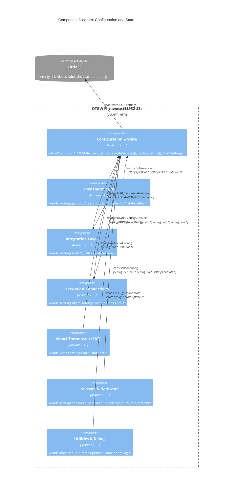

# C4 Component: Configuration and State

## Overview

- **Name**: Configuration and State
- **Description**: The firmware's single source of truth for both persistent configuration and transient runtime state. Manages reading, writing, and validating all device settings in LittleFS JSON, coordinates deferred flash writes to reduce wear, and applies validated side-effects (service restarts) in a controlled batch pattern.
- **Type**: Application Component
- **Technology**: Arduino C/C++ on ESP32-S3, LittleFS, custom lightweight JSON parser (no ArduinoJson, ADR-146)

## Purpose

Every configurable aspect of the firmware (WiFi static IP, MQTT broker, NTP timezone, GPIO pin assignments, SAT thermostat parameters (~100 fields), OTDirect mode, Ethernet static IP, combo board mode) lives in a single `OTGWSettings settings` global struct. The Settings module loads that struct from `/settings.ini` on boot, persists it back to flash on change, and validates every incoming field update (range checks, GPIO conflict detection, placeholder password detection, type conversion).

The companion `OTGWState state` global struct tracks transient runtime information that is never persisted: detected hardware, network mode, PIC and OT bus status, MQTT connection, SAT controller outputs, debug flags, heap diagnostics, uptime counters. Together, `settings` and `state` decouple the rest of the firmware from storage and validation concerns: any component can read `settings.mqtt.sBroker` or `state.sat.fFinalSetpoint` without needing to know about JSON parsing or flash wear.

The deferred-write pattern (`settingsDirty` + `timerFlushSettings`) coalesces rapid REST API updates (a settings form submission sends multiple fields) into a single flash write and one restart per affected service, protecting both flash lifespan and MQTT connection stability.

## Software Features

- **JSON settings file**: Reads and writes `/settings.ini` (`SETTINGS_FILE`) as hand-formatted JSON without ArduinoJson; custom `parseJsonKVLine()` handles quoted strings, unquoted numbers, and JSON escape sequences
- **Deferred write with 2-second debounce**: `settingsDirty` flag + `timerFlushSettings` coalesces multiple `updateSetting()` calls into one `writeSettings()` + side-effect application pass. `doRestart()` calls `flushSettings()` synchronously before rebooting
- **Server-side validation**: `updateSetting()` validates every field: range clamps, GPIO conflict checks, placeholder detection for the HTTP password and the weather API key, hostname auto-generation, type conversion for booleans/integers/floats
- **GPIO conflict detection**: `checkGPIOConflict()` warns when two features claim the same pin (Dallas sensor pin vs S0 counter pin vs relay output pin); it does not block the change
- **Side-effect coordination**: Sets the `pendingSideEffects` bitmask (`SIDE_EFFECT_MQTT`, `SIDE_EFFECT_NTP`, `SIDE_EFFECT_MDNS`, `SIDE_EFFECT_OTGWSTREAM`) instead of an immediate service restart; `flushSettings()` applies each effect exactly once per batch
- **Settings sub-sections** (ADR-051): Two-level named sub-sections with Hungarian prefixes; `settings.mqtt.sBroker`, `settings.ntp.sTimezone`, `settings.sat.fTargetTemp`, etc.
- **Per-component types headers** (ADR-079 / ADR-081): each sub-section's struct definition lives in its own `*types.h` header next to the firmware sources (`Devicetypes.h`, `Networktypes.h`, `NTPtypes.h`, `Sensorstypes.h`, `S0types.h`, `Outputstypes.h`, `Webhooktypes.h`, `UItypes.h`, `PICtypes.h`, `OTBustypes.h`, `OTDirecttypes.h`, `Flashtypes.h`, `Uptimetypes.h`, `SATtypes.h`, `Hardwaretypes.h`). The MQTT sections live in `MQTTstuff.h` and `DebugSection` in `debugStuff.h` (their `stuff.h` siblings, per ADR-081). `OTGW-firmware.h` includes them in dependency order.
- **Per-field no-op detection** (TASK-564): `updateSetting()` snapshots the struct (`platformSettingsNoopCapture()`) and skips dirty-flagging and the debounce-timer restart when nothing changed. Cosmetic UI saves no longer cost a flash write or service restart.
- **Settings sub-sections in the struct**: device, wifi, mqtt, ntp, sensors, s0, outputs, webhook, ui (onboarding flags), picBoot, sat (~100 fields), otd (`HAS_DIRECT_OT` only), eth (`HAS_ETH_CAPABLE` only), plus device-level fields (hostname, HTTP password, LED blink, dark theme, nightly restart, `iBoardMode`)
- **Load-time migrations** (`readSettings()`): 1.x.x upgrade keeps legacy OT topic names (TASK-648), existing installs are marked onboarded (TASK-997), `MQTTinterval` 0 becomes 60 with on-change publishing (ADR-116); all are persisted through the deferred flush
- **Safeboot NVS mirror** (ADR-191): `readSettings()` and `writeSettings()` call `safebootSyncNvs()` so the safeboot updater can authenticate with the current hostname and HTTP password
- **Runtime state struct**: `OTGWState state` aggregates `hw`, `net`, `pic`, `otd` (`HAS_DIRECT_OT`), `otBus`, `mqtt`, `flash`, `debug`, `uptime`, `heapdiag`, `restperf`, `discovery`, `picSettings`, `sat`, `statusMessage`, `bSetupComplete`; never persisted, reset to defaults on each boot
- **SAT PID state persistence**: the SAT module persists its integral, derivative, filtered derivative and error (`/sat_pid_state.json`) separately, and discards the state if older than 30 minutes

## Code Modules

| Module | File | Description |
|--------|------|-------------|
| Settings Module | [c4-code-settings.md](./c4-code-settings.md) | readSettings(), writeSettings(), updateSetting(), flushSettings(), OTGWSettings struct, OTGWState struct |

## Interfaces

### Settings Read/Write API

- **Protocol**: In-process C++ API
- **Description**: Load and persist the full settings struct.
- **Operations**:
  - `readSettings(show)` - load `/settings.ini` into `settings`; creates the file with defaults if missing; clears the dirty flag on completion (migrations may set it again for the deferred flush)
  - `writeSettings(show)` - serialize the entire `settings` struct to `/settings.ini` as JSON
  - `flushSettings()` - deferred-write endpoint: calls `writeSettings()` if dirty, then applies pending side-effects
  - `settingsMarkClean()` - clear dirty flag and pending side-effects without writing (used during the OTA reboot window)

### Settings Update API

- **Protocol**: In-process C++ API, called by the REST handler (`POST|PUT /api/v2/settings`, `postSettings()`), the MQTT set-command dispatch, `OTDirect.ino` and `SATble.ino`
- **Description**: Validate and apply a single field update. Entry point for all external configuration changes. `GET /api/v2/settings` (`sendDeviceSettings()`) reads the struct back. Both are behind `checkHttpAuth()`.
- **Operations**:
  - `updateSetting(field, newValue)` - case-insensitive field dispatch, validation, type conversion, GPIO conflict check, sets `settingsDirty=true`, queues side-effects
  - `checkGPIOConflict(pin, caller)` - returns true if the pin is already claimed by another enabled feature (`GPIOConflictCaller::Sensor|S0|Output`)

### Settings Global State

- **Protocol**: C global variables (accessed directly by all components)
- **Description**: Canonical configuration and runtime state.
- **Key settings fields**:
  - `settings.sHostname[41]` - device hostname
  - `settings.sHTTPpasswd[41]` - HTTP Basic Auth password (empty = no authentication)
  - `settings.iBoardMode` - combo board selector (0 auto, 1 force PIC, 2 force OTDirect, 3 force PIC on S3 Mini Pro)
  - `settings.wifi.sStaticIp[16]`, `.sSubnet`, `.sGateway`, `.sDns1`, `.sDns2` - empty IP means DHCP
  - `settings.mqtt.bEnable`, `.sBroker[65]`, `.iBrokerPort`, `.sUser[41]`, `.sPasswd[41]`, `.sTopTopic[41]`, `.sHaprefix[41]`, `.sUniqueid[41]`, `.bOnChangePublishing`, `.iInterval`
  - `settings.ntp.bEnable`, `.sTimezone[65]`, `.sHostname[65]`, `.bSendtime`
  - `settings.sensors.bEnabled`, `.iPin`, `.bLegacyFormat`, `.iInterval`
  - `settings.s0.bEnabled`, `.iPin`, `.iDebounceTime`, `.iPulsekw`, `.iInterval`
  - `settings.outputs.bEnabled`, `.iPin`, `.iTriggerBit`
  - `settings.webhook.bEnabled`, `.sURLon`, `.sURLoff`, `.iTriggerBit`, `.sPayload`, `.sContentType`
  - `settings.ui.bOnboarded`, `.bSatOnboarded`
  - `settings.sat.*` - ~100 fields: `bEnabled`, `iHeatingSystem`, `iHeatingSource`, `fTargetTemp`, `fHeatingCurveCoeff`, `sSensorArea[4][18]`, BLE roster, etc.
  - `settings.otd.*` (`HAS_DIRECT_OT`) - `iMode`, `bAutoDetect`, `bHasBypassRelay`, `fSetbackTemp`, `bRoomCompEnabled`, heating curve, hysteresis, ventilation
  - `settings.eth.*` (`HAS_ETH_CAPABLE`) - `bStaticIP`, `sIPaddress[16]`, `sGateway[16]`, `sSubnet[16]`, `sDNS[16]`
- **Key state fields**:
  - `state.hw.eMode`, `.bOLEDPresent`, `.bClassicPro` (combo only), `.bEthernetPresent` (`HAS_ETH_CAPABLE`)
  - `state.net.eMode` - `NET_WIFI` or `NET_ETHERNET` (`HAS_ETH_CAPABLE`); prerelease builds add `bAPFallback` and `sAPSSID`
  - `state.pic.bAvailable`, `.sDeviceid[32]`, `.sType[32]`, `.sFwversion[32]`
  - `state.otBus.bOnline`, `.bPSmode`, `.bGatewayMode`, `.bBoilerState`, `.bThermostatState`
  - `state.mqtt.bConnected`
  - `state.sat.bActive`, `.eControlMode`, `.eBoilerStatus`, `.fPidOutput`, `.fFinalSetpoint`, `.fError`
  - `state.debug.bOTmsg`, `.bSensors`, `.bSensorSim`, `.bOTGWSimulation`, `.bSAT`, `.bOTDirect`, `.bSATBLE`
  - `state.uptime.iSeconds`, `.iRebootCount`
  - `state.heapdiag.*`, `state.restperf`, `state.discovery.*` - diagnostics (reset on reboot)

### JSON Serialization API

- **Protocol**: File I/O (LittleFS)
- **Description**: Low-level JSON helpers used internally by `writeSettings()` / `readSettings()`.
- **Operations**:
  - `writeJsonStringKV(file, key_P, value, comma)` - write quoted string KV pair
  - `writeJsonBoolKV(file, key_P, value, comma)` - write boolean KV pair
  - `writeJsonIntKV(file, key_P, value, comma)` - write integer KV pair
  - `writeJsonFloatKV(file, key_P, value, comma)` - write float KV pair (2 decimal places)
  - `parseJsonKVLine(line, keyOut, keyOutSize, valueOut, valueOutSize)` - parse a single JSON line into key and value

## Dependencies

### Components Used

- **Network and Connectivity**: calls `startMDNS()`, `startLLMNR()` as side-effects of a hostname change; `startNTP()` for NTP settings; `applyLegacyPort25238Setting()` for the legacy stream port
- **Integration Layer (MQTT)**: calls `startMQTT()` as side-effect of MQTT settings change
- **Smart Thermostat (SAT)**: `satDisable()` when SAT is switched off through settings

### External Systems

- **LittleFS**: `/settings.ini` (primary settings file), `/dallas_labels.ini` (sensor labels), `/reboot_count.txt`, `/reboot_log.txt`, `/version.hash`, `/sat_pid_state.json` (SAT PID persistence), `/dhw_water.json` (DHW water total), other SAT files (`/sat_hcr.json`, `/sat_energy.json`, `/sat_markers.json`)
- **NVS**: hostname and HTTP password mirror for the safeboot updater (ADR-191)

## Component Diagram

