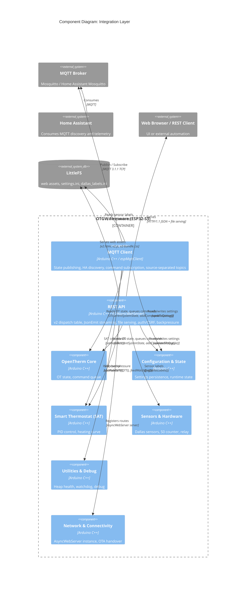

# C4 Component: Integration Layer

## Overview

- **Name**: Integration Layer
- **Description**: The firmware's outward-facing integration surface. Combines two tightly coupled sub-systems: the MQTT client (including Home Assistant auto-discovery) and the REST API (v2 dispatch table with a streaming JSON writer and file serving). Together they provide all external access to OpenTherm state, device configuration, and control functions.
- **Type**: Application Component
- **Technology**: Arduino C/C++ on ESP32-S3, espMqttClient (vendored, async), ESPAsyncWebServer / AsyncTCP, `JsonEmit` streaming JSON (no ArduinoJson, ADR-146)

## Purpose

The Integration Layer translates internal firmware state into the protocols that home automation systems understand. The MQTT sub-system publishes OpenTherm telemetry to a broker and processes commands arriving on subscribed topics, including Home Assistant MQTT Discovery for hundreds of sensor, binary_sensor, climate, number, switch, select and button entities defined in PROGMEM tables in `MQTTHaDiscovery.cpp` (393 sensor rows and 97 binary-sensor rows in the current source). The REST API sub-system exposes a versioned HTTP API consumed by the Web Interface component and by external clients such as Telegraf, Node-RED, and Home Assistant REST integrations.

Both sub-systems avoid whole-document allocations on a heap-constrained device: REST responses are written field by field by `JsonEmit` (the largest ones through pull-based chunked responses, `restSendChunked()`), and MQTT discovery payloads are composed in two passes (measure, then write into an exactly sized transient buffer). Concurrency is bounded: at most 2 REST requests and 2 file serves in flight (ADR-165), a port-80 connection cap (ADR-188), and a poll rate limit with 429 on the timer-driven endpoints (ADR-172).

## Software Features

- **MQTT state machine**: Six-state connection lifecycle (INIT, TRY_CONNECT, CONNECTED, WAIT_ATTEMPT, WAIT_RECONNECT, ERROR). The connect is asynchronous (`espMqttClient`, `UseInternalTask::NO`, pumped by `handleMQTT()`); retry backoff is 3 s x attempt for up to 5 attempts, then a 42 s wait that re-enters INIT so DNS is resolved again. Birth message `online` (retained) is re-asserted every 5 minutes; the last will publishes `offline`.
- **Atomic MQTT publishing**: every publish funnels through `mqttPublishRaw()`; `espMqttClient` copies topic and payload into its Outbox, so there is no chunked/streamed publish path. `canPublishMQTT()` blocks only on `HEAP_CRITICAL` (ADR-167).
- **Home Assistant auto-discovery**: Data-driven tables in `MQTTHaDiscovery.cpp` plus hardcoded stream functions for climate (pseudo-ID 0), number (ID 27), override sensors (ADR-118), SAT switches / select / zone, Dallas sensors, and PIC pseudo-ID 244 controls (`streamButtonDiscovery` for `resetgateway`, `streamSelectDiscovery` for GPIO/LED selects). Two-pass `MqttJsonWriter` (MEASURE then WRITE) via `measureMallocPublish()` avoids large static discovery buffers. Publishes retained configs to `homeassistant/<domain>/<node_id>/<entity>/config`. One HA device per gateway (ADR-140).
- **Just-In-Time (JIT) MQTT discovery, the default** (ADR-100): `processOT()` queues an OT message ID when a valid frame arrives and its config is not yet marked published; the drip publishes it on a later tick. At MQTT start only the non-OT set is queued (unless a topology migration is pending), so boot does not bulk-publish every table ID.
- **Drip discovery**: `loopMQTTDiscovery()` publishes one queued ID per tick (2 s normal, 10 s under heap pressure) and is the only caller of `doAutoConfigureMsgid()`. It drains the JIT IDs, the non-OT set (IDs 0, 27 and 241 to 255; 241 only after a MsgID 19 sample) that MQTT start and a reconnect after more than 5 minutes offline queue, and the full set that `markAllMQTTConfigPending()` queues.
- **Daily discovery heal** (ADR-170): when `settings.mqtt.bDiscoveryAutoVerify` (key `MQTTdiscoveryAutoVerify`, default on) is set, a day change after NTP sync and 1 hour of uptime calls `markAllMQTTConfigPending()` so the drip re-announces every config once a day (outbound only, no readback). `state.discovery.iLastDailyHealEpoch` records it. The manual verify window (`POST /api/v2/discovery/verify`, telnet `V`) is separate.
- **Flat per-value MQTT topics** (ADR-101): Value topics carry plain scalars, never aggregated JSON. Discovery payloads on `homeassistant/.../config` remain JSON.
- **Self-describing topic names** (ADR-106): `settings.mqtt.bUseLegacyOtTopics=false` publishes self-describing names (e.g. `manufacturer_code`); `=true` uses legacy OT-spec-derived names (e.g. `slave_member_id_code`). A settings file without the key (a 1.x upgrade) defaults to legacy. Toggling arms a paced cleanup that empties the other set's 37 retained discovery topics. `settings.mqtt.bLegacyMode` (TASK-648) separately selects the 1.x-compatible config-topic shape and arms a topology cleanup.
- **`resetgateway` hardening** (TASK-668): MQTT command only fires on payload `"1"`; a cooldown rate-limits rapid PIC resets; both rejection reasons surface in the default debug stream.
- **Silently-dropped MQTT set commands surface in default debug**: integration issues are observable without per-module debug flags.
- **Source-separated MQTT topics**: with `bSeparateSources`, `<topic>_thermostat` and `<topic>_boiler` sibling leaves next to the canonical topic (ADR-096 / ADR-097); no `_gateway` leaf.
- **MQTT command dispatch**: `{topTopic}/set/{nodeId}/{command}` is routed through the PROGMEM `setcmds[]` table to the command queue, through `kSatMqttCmds[]` for `sat/*` (ADR-078), or to `updateSetting()` for settings.
- **Home Assistant restart detection** (ADR-174): subscribes to `homeassistant/status`; an `offline` followed by `online` calls `requestMQTTRepublishAll()`, so current OT values re-publish as their frames arrive. Discovery is not re-published: the broker retains it. `mqttharebootdetection` is deprecated and gates nothing.
- **REST API v2 dispatch table**: single `processAPI()` entry point; URI tokenized and matched against `kV2Routes[]`; adding an endpoint takes one handler and one table row.
- **Backpressure and rate limiting**: REST in-flight cap 2 (ADR-165, tightens to 1 when the largest free block is small), file-serve cap 2 (ADR-147), connection cap (ADR-188), 503 with `Retry-After: 1`; GCRA poll budgets on `GET /otgw/otmonitor` (and its `telegraf` alias) and `GET /device/time` answer 429 `application/problem+json` (ADR-172).
- **Admin protection and CSRF** (ADR-056): `checkHttpAuth()` validates Basic Auth (user `admin`) and the Origin/Referer host for POST, PUT, PATCH and DELETE on `/api/v2/*`, and for the admin routes; it only engages when an admin password is set.
- **ETag asset caching** (ADR-139): `v2.html`, `v2.js`, `v2-bundle.css` and `fsexplorer.css` are served from LittleFS with `ETag: "<fsHash>-<path>"` and `Cache-Control: no-cache` (304 when unchanged); fonts get a one-year immutable cache.
- **Streaming JSON**: `JsonEmit` over an `AsyncResponseStream` (`restBeginStream()` / `restFinalize()`), or `restSendChunked()` with a frozen snapshot for the biggest responses.
- **LittleFS file explorer**: upload (`POST /upload`), download, delete and listing in `FSexplorer.ino`; `FSexplorer.html` doubles as the recovery page.
- **PIC firmware update orchestration**: `/pic` route and `/api/v2/pic/*` endpoints for PIC hex transfer (never over OTmonitor on WiFi).

## Code Modules

| Module | File | Description |
|--------|------|-------------|
| MQTT Client | [c4-code-mqtt.md](./c4-code-mqtt.md) | espMqttClient integration, HA auto-discovery, command routing, topic publishing |
| REST API | [c4-code-rest-api.md](./c4-code-rest-api.md) | Versioned HTTP REST API (v2), route dispatch, JsonEmit, file serving, backpressure, CSRF/auth |

## Interfaces

### MQTT Publish Interface

- **Protocol**: MQTT 3.1.1 (espMqttClient over TCP, QoS 0)
- **Description**: Publishes decoded OpenTherm values, gateway status, SAT state, and sensor readings to a configurable topic namespace.
- **Key topics published** (prefix = `<settings.mqtt.sTopTopic>/value/<nodeId>`, default top topic `OTGW`):
  - `<prefix>` - availability: retained `online` (birth), `offline` (last will)
  - `<prefix>/<label>` - decoded OT values (Tboiler, Tr, TSet, ...); with `bSeparateSources` also `<label>_thermostat` and `<label>_boiler`
  - `<prefix>/boiler_connected`, `thermostat_connected`, `otgw_connected`
  - `<prefix>/otgw-firmware/uptime`, `version`, `reboot_count`, `reboot_reason`, `hostname`, `hardware_type`, `hardware_mode`, `network/mode` (Ethernet boards), `boiler/unsupported_msgids`
  - `<prefix>/otgw-firmware/stats/*` - hourly heap, drop and discovery counters (retained)
  - `<prefix>/otgw-pic/version`, `deviceid`, `firmwaretype`, `designer`, `gateway_mode`, `settings/*` (PIC boards)
  - `<prefix>/dhw_water_total` - DHW water total in litres (ADR-176)
  - `<prefix>/sat/*` - SAT state, for example `sat/target`, `sat/room_temp`, `sat/pid_output`, `sat/duty_ratio`, `sat/energy_total`, `sat/boiler_status`, `sat/cycle_class`
  - `homeassistant/<domain>/<node_id>/<entity>/config` - HA discovery payloads (retained)
- **Operations**:
  - `sendMQTTData(topic, json, retain)` - publish under the namespace (RAM or PROGMEM topic/payload overloads, return bool)
  - `sendMQTT(topic, json)` - publish a verbatim topic, retained
  - `publishMQTTOnOff(topic, bool)` - publish "ON"/"OFF"
  - `publishMQTTInt(topic, int)` - publish an integer
  - `publishToSourceTopic(topic, json, rsptype)` - publish the `_thermostat` / `_boiler` leaves
  - `mqttPublishRaw(topic, payload, len, retain)` - the single publish chokepoint

### MQTT Subscribe / Command Interface

- **Protocol**: MQTT 3.1.1 subscription (`<topTopic>/set/<nodeId>/#` and `homeassistant/status`)
- **Description**: Receives commands and settings updates from home automation systems. Commands are dispatched only for whole single-chunk payloads.
- **Subscribed topics**:
  - `{topTopic}/set/{nodeId}/setpoint` (TT), `constant` (TC), `outside_temp` (OT), `hot_water` (HW), `gatewaymode` (GW), `maxchsetpt` (SH), `maxmodulation` (MM), and the other `setcmds[]` entries (see c4-code-mqtt.md)
  - `{topTopic}/set/{nodeId}/resetgateway` - payload `1` only
  - `{topTopic}/set/{nodeId}/sat/*` - SAT commands (`target`, `indoor_temp`, `outdoor_temp`, `enabled`, `control_mode`, `preset`, `humidity`, `window`, ...)
  - `{topTopic}/set/{nodeId}/otgw/reset_water_total` - live (non-retained) message only
  - `{topTopic}/set/{nodeId}/otgw32/*` - OT-direct room temperature and setpoint
  - `{topTopic}/set/{nodeId}/<setting>` - any `updateSetting()` field name
  - `homeassistant/status` - HA online/offline detection

### Home Assistant Discovery Interface

- **Protocol**: MQTT Discovery (HA convention)
- **Description**: Publishes retained JSON discovery payloads to `homeassistant/<domain>/<node_id>/<entity>/config`.
- **Operations**:
  - `doAutoConfigure()`: manual force; calls `markAllMQTTConfigPending()` so the drip re-announces every table ID
  - `processOT()` (OTGW-Core.ino): JIT; sets the pending bit of an OT ID when a valid frame arrives and the ID is not yet marked published
  - `loopMQTTDiscovery()`: the drip; publishes one pending ID per tick through `doAutoConfigureMsgid(OTid, isFirst)`. Pseudo-ID 246 (Dallas) goes through `configSensors()`
  - `startDiscoveryVerification()`: on-demand verify window (ADR-062)

### REST API v2

- **Protocol**: HTTP/1.1 (plain, no HTTPS per design constraint)
- **Description**: Versioned JSON API on port 80. All routes under `/api/v2/`. Route segments in `kV2Routes[]`: `health`, `settings`, `sensors`, `device`, `flash`, `pic`, `otdirect` (OT-direct boards), `firmware`, `filesystem`, `simulate`, `otgw`, `webhook`, `sat`, `discovery`, `debug`, `network`, `mqtt`.
- **Endpoint groups**:
  - `GET /api/v2/health` - system health metrics (heap, uptime, network mode, RSSI, connectivity flags)
  - `GET|POST|PUT /api/v2/settings` - read all settings with type metadata / update one setting (`{"name","value"}`); auth required
  - `GET /api/v2/sensors[/status]`, `GET|POST|PUT /api/v2/sensors/labels` - Dallas and S0 readings, Dallas labels
  - `GET /api/v2/device/info|time|crashlog` - device metadata (includes the OTA flags `app_ota_available` and `safeboot_available`); `device/time` is rate limited
  - `GET /api/v2/flash/status` - flash metrics
  - `GET /api/v2/pic/flash-status|update-check|settings` - PIC firmware status
  - `GET /api/v2/otgw/otmonitor|telegraf|messages/{id}|id/{id}|label/{label}|boiler-support|ot-support|overrides` - OT state (`otmonitor` and `telegraf` share a rate-limit budget)
  - `POST|PUT /api/v2/otgw/commands|command/{cmd}|diagnose|discovery|autoconfigure`, `POST /api/v2/otgw/reset_water_total` - command injection, PIC diagnostic menu keystrokes, discovery re-announce, DHW total reset
  - `GET|POST|PUT|PATCH|DELETE /api/v2/sat/*` - SAT status, control, markers, sensor areas, weather onboarding gate, BLE roster (`HAS_SAT_BLE`); all methods authenticated
  - `GET|POST|PUT /api/v2/otdirect/*` - OTDirect mode/settings/overrides (OT-direct boards only)
  - `GET /api/v2/firmware/files`, `GET /api/v2/filesystem/files|hash-check` - firmware inventory, LittleFS listing and hash
  - `GET|POST|PUT /api/v2/simulate[/start|/stop]` - frame replay control
  - `POST|PUT /api/v2/webhook/test` - webhook test trigger
  - `GET /api/v2/discovery`, `POST /api/v2/discovery/verify|republish` - discovery status, verify window, full re-announce (60 s cooldown)
  - `POST /api/v2/mqtt/republish` - re-publish OT values (60 s cooldown)
  - `GET /api/v2/debug` - snapshot of debug flags and telemetry
  - `GET /api/v2/network/scan` - asynchronous WiFi scan for the Settings page
- **Error format**: `{"error":{"status":N,"message":"..."}}`; rate-limit responses are `application/problem+json` with `retry_after`

### File Serving Interface

- **Protocol**: HTTP/1.1
- **Description**: Serves web UI assets from LittleFS with ETag validation, streamed from flash.
- **Routes**:
  - `GET /`, `/index`, `/index.html` - `v2.html` (auth guard, ETag); falls back to `FSexplorer.html` when `v2.html` is missing
  - `GET /v2.html|/v2.js|/v2-bundle.css|/fsexplorer.css` - ETag + `no-cache`
  - `GET /fonts/*.woff2` - one-year immutable cache
  - `GET /FSexplorer.html`, `/FSexplorer` - LittleFS file explorer / recovery page
  - `POST /upload` - file upload; `ANY /ReBoot`, `/ResetWireless` - admin actions
  - `POST /update`, `POST /safeboot` - firmware / filesystem OTA (see the Network component)

## Dependencies

### Components Used

- **OpenTherm Core**: reads `OTcurrentSystemState` for OT values; calls `addCommandToQueue()` to deliver MQTT- and REST-sourced commands; `processOT()` sets the discovery pending bit (`setMQTTConfigPending()`) when a valid frame of a not-yet-published OT ID arrives; the drip publishes it
- **Configuration and State**: reads all `settings.*` fields; calls `updateSetting()` for MQTT and REST settings updates; reads `state.*` for health, status, and version reporting
- **Smart Thermostat (SAT)**: calls `satHandle*()` functions from MQTT and REST command handlers; reads `state.sat.*` for status responses; SAT's own `CS=` goes through `satEnqueueOwnCS()`
- **Sensors and Hardware**: calls `configSensors()` for Dallas sensor discovery; reads the Dallas device list and labels for the REST API
- **Network**: registers all routes on `AsyncWebServer server` and relies on `httpUpdater` for `/update` and `/safeboot`
- **Utilities and Debug**: `canPublishMQTT()`, `feedWatchDog()`, `getHeapHealth()`, `emergencyHeapRecovery()` (clears pending discovery)

### External Systems

- **espMqttClient** (bertmelis, vendored under `src/libraries/espMqttClient`, ADR-186 / ADR-187): async MQTT 3.1.1 client
- **ESPAsyncWebServer / AsyncTCP**: HTTP transport for REST, files, WebSocket and OTA
- **LittleFS**: `dallas_labels.ini`, `/sat_markers.json` (TASK-586), `/sat_pid_state.json`, `/topic_cleanup.bin`, `v2.html`, `v2.js`, `v2-bundle.css`, `fsexplorer.css`, `FSexplorer.html`, `fonts/`, PIC hex files. There is no runtime `mqttha.cfg`: discovery is published from PROGMEM tables in `MQTTHaDiscovery.cpp`.
- **MQTT Broker**: external broker (Mosquitto, Home Assistant Mosquitto add-on, etc.)
- **Home Assistant**: consumes MQTT discovery payloads and published OT telemetry

## Component Diagram

