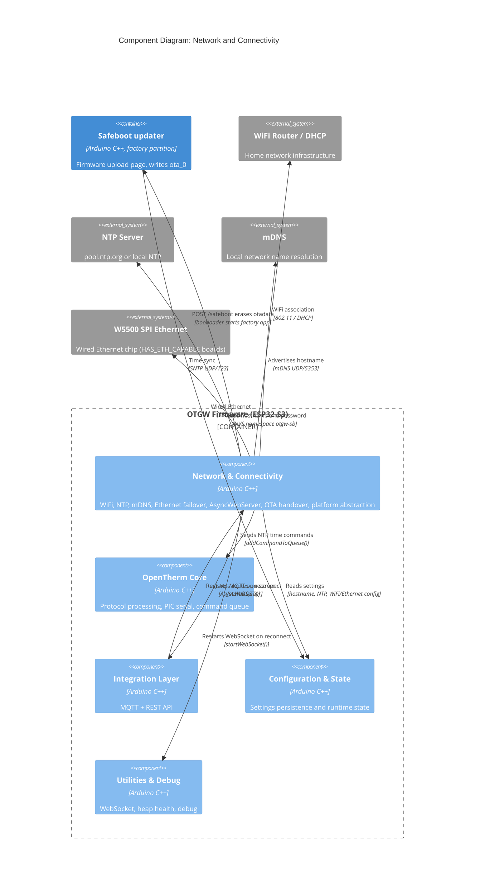

# C4 Component: Network and Connectivity

## Overview

- **Name**: Network and Connectivity
- **Description**: Network transport layer for the ESP32-S3 firmware: WiFi with auto-reconnect, NTP time synchronization, mDNS hostname resolution, the telnet debug server, the shared `AsyncWebServer`, optional Ethernet failover (W5500), and firmware update over WiFi (safeboot updater on 4MB boards, ADR-191). Platform differences are hidden behind the Platform library (`platform.h`, `platform_esp32.h`, `boards.h`); the 2.0.0 line has no ESP8266 target (ADR-128).
- **Type**: Application Component
- **Technology**: Arduino C/C++ on the ESP32 Arduino core, WiFiManager 2.0.17, AceTime 2.0.1, ESPAsyncWebServer 3.11.2 / AsyncTCP 3.4.10, AsyncSimpleTelnet, EthernetESP32 1.0.2 (W5500)

## Purpose

This component owns the firmware's relationship with the network. It handles the full lifecycle from initial WiFi association (via captive portal if credentials are not saved) through DHCP hostname negotiation, NTP synchronization, mDNS advertisement, and recovery from connectivity loss. On boards fitted with a W5500 SPI Ethernet controller it also provides cable-detect failover between WiFi and wired Ethernet. It defines the single HTTP server instance on port 80 that the REST API, file serving, WebSocket and OTA components register routes on.

A secondary responsibility is platform abstraction. The Platform library exposes inline `platformXxx()` shims and `HAS_*` capability flags (hostname, MAC, filesystem info, heap, reset reason, hardware RNG, FreeRTOS wrappers) so application code carries no raw `#ifdef ESP32` (enforced by `evaluate.py::check_esp_abstraction_boundary()`).

## Software Features

- **WiFi initialization with captive portal**: Attempts saved credentials; falls back to the WiFiManager portal with a MAC-suffixed SSID (`<hostname>-AA:BB:CC:DD:EE:FF`); optional static IP from `settings.wifi.*`; triple-reset clears credentials and forces the portal (ADR-043)
- **Two-tier WiFi recovery** (ADR-047): SDK auto-reconnect handles momentary blips; the `loopWifi()` state machine catches extended outages (30 s windows, 10 retries, then `doRestart()`). Prerelease builds enter a SoftAP fallback (`OTGW-<MAC3>`) after 2 retries instead
- **NTP synchronization**: Configures SNTP through `configTime()`; accepts only times in [2000-01-01, 2038-01-19]; resyncs daily (`NTP_RESYNC_TIME` = 86400 s); ignores DHCP option 42 servers (TASK-1052)
- **OpenTherm time commands**: Sends `SC=`, `SR=21:` and `SR=22:` to the gateway on NTP sync (PIC or OTDirect), keeping the boiler clock accurate
- **mDNS hostname resolution**: Registers `<hostname>.local` and an `http` service on port 80. LLMNR is compiled out (`HAS_LLMNR` = 0)
- **Runtime WiFi<->Ethernet failover** (W5500, TASK-581): Detects the chip at boot through the driver install (`Ethernet.hardwareStatus()`); DHCP with 1 s timeout at boot, 2 s on hot-plug; link polled every 5 s; `switchToEthernet()` powers WiFi off, `switchToWiFi()` restarts it. The mode publish (`otgw-firmware/network/mode`) is deferred until the MQTT client reconnects. Skipped in combo PIC mode (ADR-127)
- **Per-component types header** (`Networktypes.h`, ADR-079 / ADR-081): `OTGWNetworkMode`, `NetworkSection`, `EthernetSection`, `WifiSection`. `NET_AP_FALLBACK` exists only when `_VERSION_PRERELEASE` is defined
- **Firmware OTA via the safeboot updater** (ADR-191, 4MB boards): the main firmware never overwrites its own app slot; `POST /safeboot` hands over to a small updater in the factory partition (see Interfaces)
- **Platform abstraction**: Platform library shims for hostname, MAC, heap, flash, reset info, RTC emulation, FreeRTOS mutex/queue/task wrappers
- **Telnet debug server**: `AsyncSimpleTelnet<1>` on port 23 (AsyncTCP, non-blocking writes) with a triage banner and single-key debug toggles
- **AsyncWebServer**: one `AsyncWebServer server(80)`; every handler runs on the AsyncTCP task (ADR-123); WebSocket and OTA attach to it

## Code Modules

| Module | File | Description |
|--------|------|-------------|
| Network & WiFi | [c4-code-network.md](./c4-code-network.md) | WiFi management, NTP, mDNS, Ethernet failover, telnet, platform abstraction |

## Interfaces

### WiFi Management API

- **Protocol**: In-process C++ API / WiFiManager
- **Description**: Initialization and runtime management of WiFi connectivity.
- **Operations**:
  - `startWiFi(hostname, timeOut, forcePortal)` - full WiFi init, captive portal fallback
  - `resetWiFiSettings()` - wipe saved credentials, force the portal on next boot
  - `loopWifi()` - non-blocking reconnection state machine (called from `doBackgroundTasks()`)
  - `getMacAddress()` - MAC as hex string e.g. "00112233AABB"
  - `getUniqueId()` - unique device ID e.g. "otgw-00112233AABB"

### NTP & Time API

- **Protocol**: SNTP (UDP port 123), in-process C++ API
- **Description**: Manages time synchronization state; exports `NtpStatus` and `NtpLastSync`.
- **Operations**:
  - `startNTP()` - configure SNTP
  - `loopNTP()` - state machine NOTSET -> WAITFORSYNC -> SYNC -> NEEDSYNC
  - `isNTPtimeSet()` - true when `NtpStatus == TIME_SYNC`
  - `sendtimecommand(dayFlag, yearFlag)` - sends `SC=<H>:<MM>/<DOW>`, plus `SR=21:` / `SR=22:` when the flags are set

### mDNS

- **Protocol**: mDNS (UDP 5353)
- **Description**: Hostname advertisement so clients can reach the device by name.
- **Operations**:
  - `startMDNS(hostname)` - registers `<hostname>.local`, HTTP service on port 80
  - `startLLMNR(hostname)` - empty stub on this firmware (`HAS_LLMNR` = 0)

### Ethernet Interface (W5500, `HAS_ETH_CAPABLE`)

- **Protocol**: SPI (W5500 driver), DHCP or static IP
- **Description**: Optional wired Ethernet with automatic WiFi fallback.
- **Operations**:
  - `initEthernet()` - probe the W5500, DHCP with 1 s timeout, switch WiFi off on success
  - `loopEthernet()` - poll the cable every 5 s, trigger DHCP and service restarts on plug events
  - `getEthernetIPString()` / `getEthernetMACString()` - used by the REST API to report network info

### HTTP Server and Firmware Update (OTA)

- **Protocol**: HTTP/1.1 on port 80 (plain, no HTTPS by design)
- **Description**: `AsyncWebServer server` is shared by REST, file serving, WebSocket and OTA. The OTA handler is `OTGWUpdateServer httpUpdater` (`OTGW-ModUpdateServer-esp32.h`), registered once from `setupFSexplorer()`; `startWiFi()` only refreshes its Basic Auth credentials (user `admin`, password `settings.sHTTPpasswd`).
- **Routes**:
  - `POST /update` - upload handler. A filesystem image (`cmd=100`, or a `littlefs.bin` / `filesystem.bin` name) is written to the LittleFS partition from the main firmware. An app image is refused in `_handleUploadStart` unless a spare OTA slot exists (`hasSpareAppOtaSlot()`); on a safeboot board the error text points to the safeboot updater (the old single-slot behaviour would overwrite the running app, TASK-959)
  - `POST /safeboot` - admin-protected (`checkHttpAuth()`). `safebootHandover()` erases the whole `otadata` partition, replies 200, then `requestDeferredReboot()`; the bootloader then starts the factory app. Returns 409 "No safeboot updater on this board" when `hasSafeboot()` is false
- **Safeboot updater** (separate project `safeboot/`, `safeboot/src/main.cpp`, version `SAFEBOOT_VERSION` 1.0.0, budget 960K): joins WiFi with the stored credentials (30 s, else a `<hostname>-safeboot` AP), reads hostname and admin password from the NVS namespace `otgw-sb` (mirrored by `safebootSyncNvs()` on every settings write), and serves `GET /`, `GET /update`, `GET /info`, `POST /update` (upload to `ota_0`, then restart) and `POST /reboot`. Admin Basic Auth plus a same-origin check apply only when a password is set. On start it points the boot partition back at `ota_0`, except when `ota_0` was rolled back (it then stays in safeboot until a new image is uploaded)
- **Rollback**: `verifyRollbackLater()` (in `OTGW-firmware.ino`) keeps a new image `PENDING_VERIFY` while a factory partition exists. `safebootMarkAppValid()` confirms it after 30 s of healthy `loop()` and before any planned restart (`doRestart()`); a crash before that returns the unit to safeboot
- **Partition table** (`partitions_otgw_esp32.csv`, all 4MB targets): `nvs` 0x9000, `otadata` 0xE000, `safeboot` (app/factory) 0x10000 960K, `app0` (app/ota_0) 0x100000 2240K, `spiffs` (LittleFS) 0x330000 768K, `coredump` 0x3F0000 64K. Units on the old layout (app0 at 0x10000) need one USB `flash_otgw --migrate`

### Platform Abstraction API

- **Protocol**: In-process C++ inline functions (`platform_esp32.h`) and `HAS_*` flags (`boards.h`)
- **Key functions**:
  - `platformSetHostname(hostname)` / `platformGetHostname()` - hostname for DHCP
  - `platformFreeHeap()` / `platformMaxFreeBlock()` / `platformHeapFragmentation()` - heap metrics for MQTT/WebSocket backpressure
  - `platformResetReason(buf, size)` - human-readable reset cause for crash logging
  - `platformRestart()` - device reboot (application code uses `doRestart()`)
  - `platformGetMacAddress(mac)` - 6-byte eFuse MAC
  - `platformWifiDisableSleep()`, `platformIgnoreDhcpNtp()`, `platformNtpHostnameFix()`
  - `PlatformDir` class (`platform.h`) - LittleFS directory iteration

### Exported State

- **Protocol**: C extern variables
- **Variables**:
  - `NtpStatus` (`NtpStatus_t`) - current sync state
  - `NtpLastSync` (`time_t`) - time of the last accepted sync
  - `server` (`AsyncWebServer`) - HTTP server on port 80 (declared in `webServerCompat.h`, defined in `networkStuff.ino`)
  - `httpUpdater` (`OTGWUpdateServer`) - OTA / safeboot handover handler
  - `debugTelnet` (`AsyncSimpleTelnet<1>`) - debug telnet instance

## Dependencies

### Components Used

- **Configuration and State**: reads `settings.sHostname`, `settings.ntp.*`, `settings.wifi.*`, `settings.eth.*`, `settings.sHTTPpasswd`; writes `state.net.eMode`, `state.net.bEthernetLink`, `state.hw.bEthernetPresent`; mirrors hostname and password to NVS for safeboot
- **OpenTherm Core**: calls `feedWatchDog()` during blocking operations; calls `addCommandToQueue()` to send NTP time commands
- **Integration Layer (MQTT)**: calls `startMQTT()` on WiFi reconnection and Ethernet switch; publishes `otgw-firmware/network/mode`
- **Utilities and Debug**: calls `startWebSocket()` on reconnection; uses `DebugTln()`, `DebugTf()`; `doRestart()` for planned restarts

### External Systems

- **WiFiManager** 2.0.17: captive portal for WiFi credentials
- **ESP32 Arduino core WiFi / ESPmDNS / Update / Preferences**: SDK stack, mDNS responder, flash writer, NVS
- **ESPAsyncWebServer** 3.11.2 and **AsyncTCP** 3.4.10: HTTP server transport
- **AceTime** 2.0.1: `timezoneManager`, `ZonedDateTime` for POSIX-to-local-time conversion
- **EthernetESP32 / W5500Driver**: wired Ethernet
- **AsyncSimpleTelnet** (`src/libraries/SimpleTelnet`): debug output server on port 23

## Component Diagram

