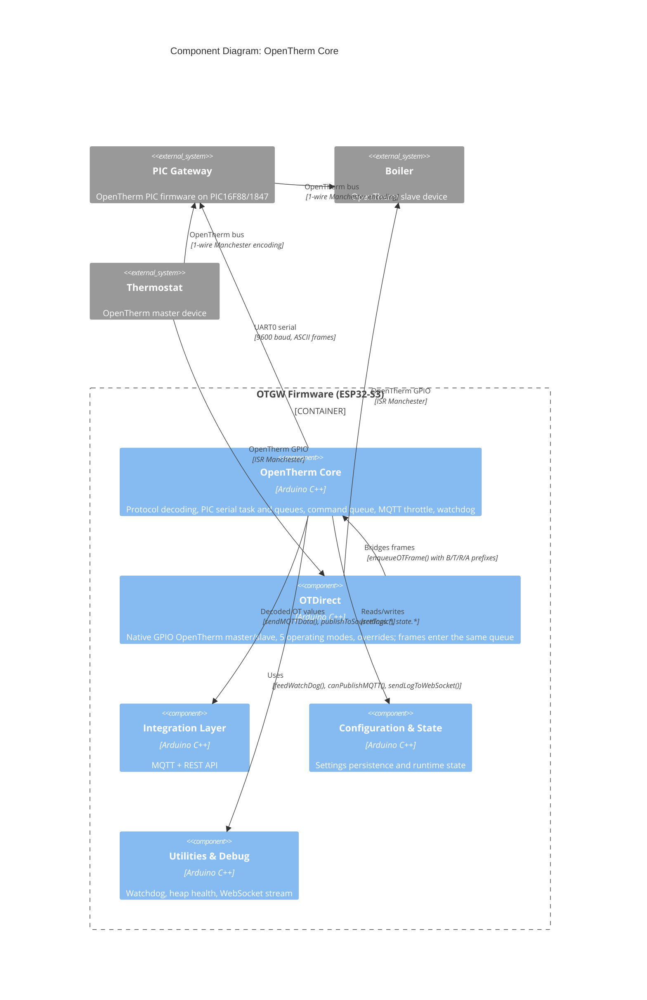

# C4 Component: OpenTherm Core

## Overview

- **Name**: OpenTherm Core
- **Description**: The central OpenTherm protocol processing engine. Decodes OpenTherm bus frames, manages PIC gateway serial communication, maintains the canonical OpenTherm state model, and drives MQTT/WebSocket publishing. Also includes a direct GPIO-based OpenTherm stack (OTDirect) that replaces the PIC gateway on OTGW32 hardware. On the combo image the PIC or OT-Direct path is chosen at boot (ADR-127).
- **Type**: Application Component
- **Technology**: Arduino C/C++ on ESP32-S3 (FreeRTOS), vendored OTGWSerial library, OpenTherm library

## Purpose

This component is the protocol heart of the firmware. Every OpenTherm message that flows between a thermostat and a boiler passes through here: received over serial from the PIC gateway (a dedicated PIC task owns the UART) or directly over GPIO via ISR-driven Manchester encoding (OTDirect). Both paths enqueue lines onto one frame queue; the loop task decodes each line in `processOT()`, stores it in `OTcurrentSystemState`, throttle-checks it, and publishes it.

The component also owns PIC lifecycle management: detecting presence, sending boot commands, cycling through configuration settings, managing firmware upgrades, and feeding the ESP32 Task Watchdog (plus the optional external I2C watchdog on PIC boards). The OTDirect sub-module provides five operating modes (gateway, monitor, bypass, master, loopback) with ring-buffer command queuing, response overrides, and a PI room compensation controller.

## Software Features

- **OpenTherm frame decoding**: Parses all 256 OT message IDs with typed value extraction (f8.8 float, s16, u16, u8/u8, flag8, status, datetime)
- **PIC serial task and queues** (ADR-123): the `picSerial` FreeRTOS task is the only owner of the UART (`OTGWSerial`, a `HardwareSerial(0)` subclass, UART0, 9600 baud). It assembles lines onto `otFrameQueue`, drains `otTxQueue` out to the PIC and parks itself during OT-Direct, flashing, replay and reset. `drainOTFrameQueue()` is the single consumer in `loop()`
- **Byte-transparent PIC stream** (ADR-177): every PIC byte reaches port 25238 and the diagnose mirror verbatim through `otRawQueue`. The port 25238 bridge for OTmonitor is off by default (`legacyport25238enabled` setting); one client at a time, raw bytes (no telnet negotiation)
- **Transport selection** (ADR-127): on the combo image `settings.iBoardMode` (auto, PIC, OT-Direct) decides at boot; auto probes for a PIC (ETX after reset), falls back to OT-Direct for that boot and persists only a positive PIC verdict
- **Command queue**: 20 entries; an entry with the same two-letter prefix is overwritten unless forced; each is sent when due, re-sent every 5 s until the PIC answers and dropped after 5 tries. `addCommandToQueue()` refuses an external `CS=` while SAT owns MsgID 1 (ADR-179, TASK-1236); SAT's own `CS=` passes via `satEnqueueOwnCS()`. With no PIC it routes the command to OTDirect
- **MQTT throttle tracking**: Per-message-ID timestamp array (256 entries) prevents flooding; per-bit status flag tracking (16 entries) for fine-grained status publish
- **PS=1 summary mode**: Parses the PIC's comma-separated summary line (25 or 34 fields) and publishes the values; OTDirect emulates the mode with `emitSummaryLine()`
- **PIC settings discovery**: one `PR=` query every 3 seconds over 15 registers (O, S, W, G, I, L, T, D, P, R, B, C, Q, N, V), published to `otgw-pic/settings/*`; the cache is republished every 5 minutes
- **PIC firmware upgrade**: Intel HEX validation, upgrade state machine inside `OTGWSerial` (the PIC task parks), progress reporting via WebSocket and MQTT
- **Startup quiet period**: 15-second suppression of event logging after PIC reset to prevent burst noise
- **OT spec compatibility**: Auto-detects v3.x vs v4.x PIC banner; applies version-appropriate reserved ID filtering
- **DHW water total** (ADR-176): cumulative litres integrated from MsgID 19 boiler Read-Acks, persisted in `/dhw_water.json`, published as `dhw_water_total`; details in c4-code-otgw-core.md
- **OT frame replay** (TASK-1071): `handleOTReplay()` runs from the main loop on every transport and feeds `/otgw_simulation.log` to the decoder, one line every 750 ms, through `dispatchOTGWInputLine()` → `enqueueOTFrame()` → `processOT()`, the queue live frames take. While it runs, PIC commands and OT-Direct master requests are blocked (`satSimulationBlocksBusTx()`), and on a PIC board live PIC input is discarded. Controlled over REST at `/api/v2/simulate` (status), `/simulate/start` and `/simulate/stop`
- **OTDirect**: Native ISR-driven OpenTherm master/slave using GPIO (OTGW32, or a combo booted without a PIC); five operating modes; 3-strike auto-blacklist for non-responsive message IDs; thermostat timeout fail-safe; PI room compensation; flame ratio tracking. Command queue uses **coalesce-by-MsgID** (TASK-494): repeated set commands for the same MsgID overwrite the pending entry instead of stacking, with a high-water diagnostic to distinguish genuine saturation from stale-value churn.
- **TT=/TC= PIC-parity remote-override state machine** (OTDirect, TASK-466): MsgID 16 setpoint inject paired with a MsgID 100 (`RemoteOverrideFunction`) priority-bit hint to the thermostat. TT (priority 0x02) auto-clears on next thermostat broadcast; TC (priority 0x01) persists until cleared. The boiler ignores MsgID 100; it is purely a UX hint to the thermostat.
- **ADR-103 proxy-answer vs answer-override routing**: `A`-prefix frames issued without a preceding `B` are *proxy answers* (gateway speaks for itself) and are published normally. `A` frames that substitute an intercepted `B` are *answer-overrides* (`OTdata.bAnswerOverride=true`) and are blocked by the canonical-publish gate. Tracked through the delayed-frame buffer; TASK-665 (ported from dev) documents the intentional one-shot drift on the first OT message after boot.

## Code Modules

| Module | File | Description |
|--------|------|-------------|
| OTGW-Core | [c4-code-otgw-core.md](./c4-code-otgw-core.md) | Protocol frame parsing, PIC serial comm, command queue, MQTT throttle, watchdog, PIC firmware upgrade |
| OTDirect | [c4-code-otdirect.md](./c4-code-otdirect.md) | Direct OpenTherm hardware interface (OTGW32 / combo without PIC): ISR handlers, 5 operating modes, schedule table, overrides |

## Interfaces

### PIC Serial Interface

- **Protocol**: UART0 (vendored OTGWSerial, 9600 baud, 8N1)
- **Description**: Exclusive serial link to PIC gateway. All OpenTherm bus frames arrive prefixed with direction (T=thermostat, B=boiler, R=gateway request, A=gateway answer). Commands sent as ASCII strings (e.g., `CS=1`, `TT=20.00`, `PR=A`).
- **Operations**:
  - `picSerialDrainOnce()` - PIC task: UART read, line assembly, TX drain
  - `drainOTFrameQueue()` - loop task: dequeue lines and call `processOT()`
  - `handlePICSerial()` - loop task: port 25238 to PIC relay
  - `addCommandToQueue(cmd, len, force, delay)` - enqueue command for delivery
  - `sendPICSerial(buf, len)` - send now through the TX queue (the retry queue calls it; with no PIC it routes to OTDirect)
  - `resetOTGW()` - GPIO-driven PIC reset (PIC boards only)
  - `detectPIC()` - probe for PIC presence via PR=A query
  - Boot commands: user-configured `settings.picBoot.sCommands` (`;` separated), queued by `sendPICBootCommands()`

### OpenTherm State API

- **Protocol**: In-process C++ API
- **Description**: Global `OTcurrentSystemState` (type `OTdataStruct`) is the canonical source of all decoded OpenTherm values. Read by SAT, REST API, MQTT, and sensors.
- **Operations**:
  - `OTcurrentSystemState.Tboiler`, `.TSet`, `.Tr`, `.Toutside`, etc. - direct field access
  - `isCentralHeatingEnabled()`, `isDomesticHotWaterEnabled()`, `isCoolingEnabled()` - status flag helpers
  - `getMsgLastUpdated(msgId)` - seconds since last MQTT publish for a message ID

### MQTT Publishing Interface

- **Protocol**: MQTT (via MQTTstuff component)
- **Description**: Publishes decoded OpenTherm values as flat per-value topics under `<top>/value/<nodeId>/<label>` (ADR-101; top topic `OTGW` by default). Where ADR-097 applies, `_thermostat` and `_boiler` leaves carry each side's view next to the canonical value. A per-MsgID throttle (`mqttlastsent`) prevents flooding the broker. The full list is in [docs/api/MQTT.md](../api/MQTT.md).
- **Key topics published** (relative to `<top>/value/<nodeId>/`):
  - `TSet`, `TSet_thermostat`, `TSet_boiler`, and the other OT values by label
  - `status_master`, `status_slave` and the individual flag topics (`chenable`, `dhwenable`, ...)
  - `otgw-pic/gateway_mode`, `otgw-pic/settings/*`
  - `otgw-firmware/version`, `otgw-pic/version`, `otgw-pic/deviceid`

### WebSocket Event Stream

- **Protocol**: WebSocket text frames (via Utilities component)
- **Description**: Real-time OT log stream to connected browser clients. Each event is a single prefixed line.
- **Operations**:
  - `sendEventToWebSocket(prefix, msg, len)` (static helper in OTGW-Core.ino) - prefix '>' sent, '<' received, '!' error, '*' system event
  - `reportOTGWEvent(msg, prefix, suppressDuringStartup)` - fan-out to MQTT + WebSocket

### OTDirect REST Interface (ESP32 only)

- **Protocol**: HTTP REST (consumed by REST API component)
- **Description**: Exposes operating mode control, override tables, and status for the direct OpenTherm stack.
- **Operations**:
  - `GET /api/v2/otdirect/status` - current mode, bus online, flame ratio (503 without OT-Direct hardware)
  - `POST /api/v2/otdirect/mode?mode=gateway|monitor|bypass|master|loopback` - change mode
  - `GET/POST /api/v2/otdirect/settings` - read/write OTDirect configuration
  - `GET/POST /api/v2/otdirect/overrides?action=sr|cr|rm|cm|ui|ki` - manage stored responses, response modifiers and unknown-ID marks

## Dependencies

### Components Used

- **Configuration and State**: reads `settings.otgw.*`, `settings.pic.*`, `settings.otd.*`; writes `state.pic.*`, `state.otBus.*`, `state.otd.*`
- **Integration Layer (MQTT)**: calls `sendMQTTData()`, `sendMQTT()`, `publishToSourceTopic()`, `doAutoConfigureMsgid()`
- **Utilities and Debug**: calls `feedWatchDog()`, `canPublishMQTT()`, `canSendWebSocket()`, debug macros `DebugTln()`, `DebugTf()`
- **Smart Thermostat (SAT)**: `satOwnsControlSetpoint()`, `satCommandInFlight()`, `satNotifyBoilerFrameSeen()`, `satSimulationBlocksBusTx()`; SAT sends its `CS=` through this component's queue
- **Network and Connectivity**: `addCommandToQueue()` receives NTP time commands from the Network component

### External Systems

- **OTGWSerial library** (vendored): UART driver with PIC reset, bootloader upgrade and firmware-banner callback (PIC boards)
- **OpenTherm library**: ISR-driven Manchester encoding/decoding for direct GPIO OT interface
- **ESP32 Task Watchdog** (30 s, loop task) is the primary safety net; **Wire.h / I2C**: optional external watchdog at address 0x26 on PIC boards, used only when it answers at boot
- **LittleFS**: PIC hex files for firmware upgrade, OT frame replay file `/otgw_simulation.log`
- **SimpleTelnet** (vendored): `AsyncSimpleTelnet<1>` serves port 25238

## Component Diagram

