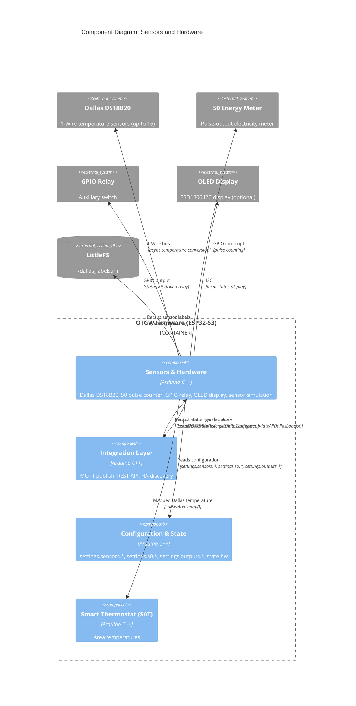

# C4 Component: Sensors and Hardware

## Overview

- **Name**: Sensors and Hardware
- **Description**: Hardware input/output layer managing the physical peripherals attached to the ESP32-S3 GPIO and I2C buses: Dallas DS18B20 temperature sensors (1-Wire bus), S0 pulse energy meter, a GPIO relay output driven by an OpenTherm status bit, and an optional SSD1306 OLED display. Publishes sensor data via MQTT with Home Assistant auto-discovery and provides a REST API for sensor status and label management. Board-level hardware facts (pin maps, `HAS_*` flags, S3 Mini Pro detection, combo boot detection) are described under "Board and Hardware Detection".
- **Type**: Application Component
- **Technology**: Arduino C/C++ on ESP32-S3, OneWire library, DallasTemperature library (Miles Burton), SSD1306Ascii (I2C OLED)

## Purpose

This component bridges the physical world to the firmware's data model. Dallas DS18B20 sensors (up to 16 devices, identified by unique ROM address) measure temperatures at arbitrary points in the heating system: flow, return, DHW tank, outside. The S0 pulse counter provides energy metering from any S0-compatible electricity meter. The GPIO relay output switches an external device based on a configurable OpenTherm status bit. The optional OLED display provides a local status readout without requiring a browser.

Auto-discovery for Dallas sensors integrates with the MQTT discovery system of the Integration Layer, publishing per-sensor Home Assistant discovery payloads with unique sensor IDs derived from the 8-byte ROM address. Labels (user-friendly names like "Boiler flow" instead of raw hex addresses) are persisted in `/dallas_labels.ini` on LittleFS. A Dallas reading can also be mapped to one of the four SAT areas (`settings.sat.sSensorArea[]`), in which case `pollSensors()` feeds it to the thermostat controller.

A simulation mode (`state.debug.bSensorSim`, telnet key `d`) allows testing without physical hardware by generating synthetic sensor readings.

## Software Features

- **Dallas DS18B20 1-Wire bus**: Auto-discovers up to 16 sensors; async non-blocking temperature conversion (`setWaitForConversion(false)`); enforces `MAXDALLASDEVICES` gracefully; the GPIO pin is a runtime setting bound after settings load (ADR-020); pin and enable changes need a reboot
- **Sensor label persistence**: Two-pass algorithm reads existing `/dallas_labels.ini`, appends auto-generated defaults ("Sensor N") for newly discovered addresses, writes back only on change
- **Legacy address format**: `settings.sensors.bLegacyFormat` reproduces the v0.10.x address formatting bug for Home Assistant automation backward compatibility
- **Disconnected sensor handling**: If `getTempC()` returns `DEVICE_DISCONNECTED_C`, the last known value is preserved and the sensor is skipped
- **SAT area routing**: A Dallas address configured in `settings.sat.sSensorArea[0..3]` is passed to `satSetAreaTemp()` on every poll (TASK-587)
- **S0 pulse counter**: Interrupt-driven pulse counting on a configurable GPIO; configurable debounce (0..1000 ms); `iPulsekw` pulses-per-kW calibration; publishes interval pulse count, lifetime count, last pulse time and instantaneous power (kW) when pulses were seen
- **GPIO relay output**: Follows one OpenTherm status bit (`iTriggerBit`, 0..15) of `OTcurrentSystemState.Statusflags`; drives the GPIO HIGH when the bit is set (active-HIGH only)
- **OLED display**: SSD1306 128x64 over I2C at 0x3C, runtime-detected. Five pages cycled by the board button (Network, OT Status, Device, Dashboard, Heating), 5 s refresh, 30 s auto-off, boot splash, plus the WiFi config-portal and (prerelease) AP-fallback "how to connect" screens
- **Sensor simulation mode**: Three synthetic DS18B20 sensors (starting at 30, 35 and 40 degC, random walk within 20..60 degC, update every 10 s)
- **MQTT auto-discovery for sensors**: Dallas discovery is drained by the discovery loop (`loopMQTTDiscovery()`) calling `configSensors()`, which calls `sensorAutoConfigure()` per detected device; the S0 entries (id 245) are published by the generic discovery drip

## Code Modules

| Module | File | Description |
|--------|------|-------------|
| Sensors & I/O | [c4-code-sensors.md](./c4-code-sensors.md) | Dallas DS18B20, S0 pulse counter, GPIO relay, OLED display, sensor simulation |

## Interfaces

### Dallas Sensor Read API

- **Protocol**: In-process C++ API
- **Description**: Functions called from `setup()`, `loop()`, the discovery loop and the REST layer.
- **Operations**:
  - `initSensors()` - probe the 1-Wire bus, store ROM addresses, initialize the labels file
  - `pollSensors()` - non-blocking conversion cycle every `settings.sensors.iInterval` seconds; publishes via `sendMQTTData()`; routes mapped sensors to SAT; queues discovery if pending
  - `configSensors()` - publish HA discovery for all detected sensors
  - `getDallasAddress(DeviceAddress)` - convert an 8-byte ROM to a hex string (standard or legacy format; shared static buffer)
  - `initSimulatedDallasSensors()` - initialize 3 synthetic sensors for simulation mode

### Sensor Status and Label REST API

- **Protocol**: HTTP REST (via the Integration Layer REST API component, `handleSensors()` in `restAPI.ino`)
- **Endpoints**:
  - `GET /api/v2/sensors` (or `/api/v2/sensors/status`) - Dallas state (`dallas_enabled`, `dallas_detected`, `dallas_count`, `dallas_gpio`, `dallas_poll_sec`, `simulated`, per-address `temp` and `epoch`) and S0 state (`enabled`, `gpio`, `poll_sec`, `pulses`, `total`, `power_kw`, `epoch`)
  - `GET /api/v2/sensors/labels` - returns the `/dallas_labels.ini` JSON object (address to label)
  - `POST|PUT /api/v2/sensors/labels` - replace all sensor labels (body: JSON object)

### MQTT Sensor Data Topics

- **Protocol**: MQTT (published through `sendMQTTData()` of the Integration Layer MQTT component, which prefixes `{topTopic}/value/{nodeId}/`)
- **Topics published**:
  - `{topTopic}/value/{nodeId}/<hex_address>` - temperature in degC for each DS18B20 (e.g. `.../28D0000000000001`)
  - `{topTopic}/value/{nodeId}/s0pulsecount`, `s0pulsecounttot`, `s0pulsetime`, `s0powerkw`
  - HA discovery: Dallas via `streamDallasSensorDiscovery()` (device group Sensors), S0 via the id-245 table entries in `MQTTHaDiscovery.cpp`

### GPIO Relay Output

- **Protocol**: GPIO (`digitalWrite`)
- **Description**: Follows one OpenTherm status bit with a relay GPIO. (The OTGW32 bypass relay, `PIN_BYPASS_RELAY`, is a different output owned by OTDirect.)
- **Configuration** (`settings.outputs`, persisted as `GPIOOUTPUTSenabled`, `GPIOOUTPUTSpin`, `GPIOOUTPUTStriggerBit`):
  - `bEnabled` - enable the relay output
  - `iPin` - GPIO number (0..16, default 16)
  - `iTriggerBit` - status bit index 0..15 (default 0)

### S0 Pulse Counter

- **Protocol**: GPIO interrupt (FALLING edge), MQTT publish
- **Description**: Counts S0 pulses from an energy meter and publishes counts and power.
- **Configuration** (`settings.s0`, persisted as `S0COUNTER*`):
  - `bEnabled`, `iPin` (default 12), `iDebounceTime` (default 80 ms), `iPulsekw` (default 1000 pulses per kW), `iInterval` (default 60 s)

### OLED Display

- **Protocol**: I2C (SSD1306 at 0x3C), board button polled with a 300 ms debounce
- **Operations**: `initOLED()` (from `setup()` before WiFi start, and again after combo pin resolution), `loopOLED()` (from `loop()`), `oledShowConfigMode(ssid, pw, url)` (from `configModeCallback()` in `networkStuff.ino`)
- **State exposed**: `state.hw.bOLEDPresent` (reported as `oledpresent` in device info)

## Board and Hardware Detection

Board definitions live in the Platform library (`src/libraries/Platform/src/boards.h`); the `HAS_*` flags decide which subsystems exist and application code never reads raw board macros.

| Target | Flags (from `boards.h`) | Notes |
|--------|-------------------------|-------|
| `esp32` (OTGW32 / OT-Thing PCB) | `HAS_PIC=0`, `HAS_DIRECT_OT=1`, `HAS_ETH_CAPABLE=1` | OTDirect owns the OT bus; I2C SDA 18 / SCL 17; boot button GPIO 0; W5500 on SPI; bypass relay GPIO 47 |
| `esp32-classic` (OTGW Classic + LOLIN S3 Mini) | `HAS_PIC=1`, `HAS_PIC_WATCHDOG=1`, `HAS_STATUS_PIXEL=1` | I2C SDA 35 / SCL 36 (0x26 watchdog and OLED); button GPIO 18 |
| `esp32-combo` (one binary for both, ADR-127) | all of the above plus `HAS_RUNTIME_HW_DETECT=1` | PIC vs OTDirect decided at boot; pins resolved at runtime by `activeI2cSda()`, `activeI2cScl()`, `activeButton()`, `activeLed1()`, `activeLed2()`, `activePicRst()` from `settings.iBoardMode` and `state.hw` |

Common flags on all targets: `HAS_OLED_CAPABLE=1` (defined but not referenced by `OLED.ino`; OLED presence is a runtime I2C probe, ADR-114), `HAS_SAT`, `HAS_SAT_BLE`, `HAS_WEATHER_FORECAST`, `HAS_LEDC_LED`.

- **Hardware mode** (`state.hw.eMode`, `Hardwaretypes.h`): `HW_MODE_UNKNOWN`, `HW_MODE_PIC`, `HW_MODE_OT_DIRECT`, `HW_MODE_DEGRADED`. `settings.iBoardMode` persists the combo choice: 0 auto, 1 force PIC (S3 Mini), 2 force OTDirect, 3 force PIC (S3 Mini Pro).
- **S3 Mini Pro detection** (ADR-158, `HAS_RUNTIME_HW_DETECT` only): `probeProImu()` in `OTGW-firmware.ino` checks for the on-board QMI8658C IMU (I2C 0x6A or 0x6B, WHO_AM_I register 0x00 returning 0x05) on the Pro's I2C pair (SDA 12 / SCL 11) at the start of `setup()`, before the 0x26 watchdog disarm; the result is `state.hw.bClassicPro`. The Pro uses a different Classic pin map (`PIN_CLASSIC_PRO_*`: button 13, LED1 14, LED2 41, PIC reset 40).
- **Status pixel** (`HAS_STATUS_PIXEL`): `startStatusPixel()` drives the LOLIN RGB pixel as WiFi status (GPIO 47 on the Mini, GPIO 8 with power enable GPIO 7 on the Mini Pro); it is skipped when no PSRAM is found, which excludes the OTGW32.
- **BLE room sensors** are handled by the Smart Thermostat component (`SATble.ino`, `HAS_SAT_BLE`), not by this component.

## Dependencies

### Components Used

- **Configuration and State**: reads `settings.sensors.*`, `settings.s0.*`, `settings.outputs.*`, `settings.sat.sSensorArea[]`; reads `state.debug.bSensors` / `bSensorSim` and `state.hw`
- **Integration Layer (MQTT)**: `sendMQTTData()`, `sensorAutoConfigure()`, `setMQTTConfigDone()` / `setMQTTConfigPending()`, `streamDallasSensorDiscovery()`
- **Smart Thermostat (SAT)**: `satSetAreaTemp()` receives mapped Dallas readings
- **OpenTherm Core**: `OTcurrentSystemState` (status flags and temperatures read by the relay logic and the OLED pages)
- **Network**: `isNetworkUp()`, `getActiveIP()`, `networkModeName()` for the OLED Network page

### External Systems

- **OneWire library**: 1-Wire bus protocol
- **DallasTemperature library** (Miles Burton): DS18B20 layer, async conversion
- **LittleFS**: `/dallas_labels.ini` sensor label persistence
- **SSD1306Ascii / Wire**: optional OLED over I2C (address 0x3C)
- **GPIO hardware**: DS18B20 data pin, S0 counter pin and relay output pin are runtime settings; I2C, button and LEDs come from the board pin map

## Component Diagram

