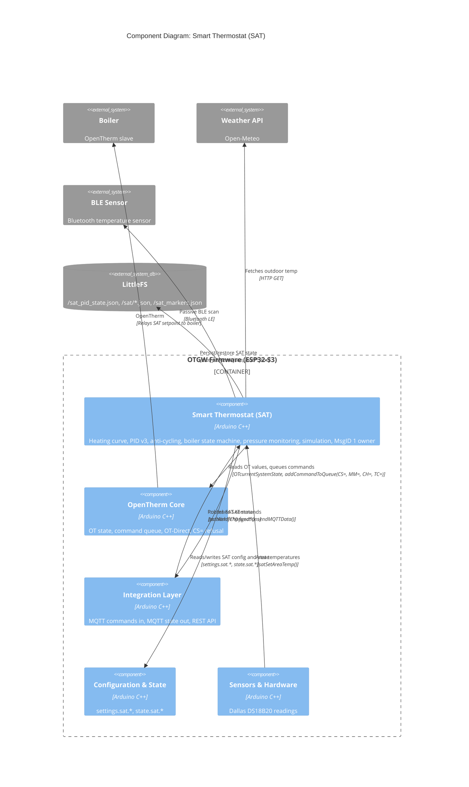

# C4 Component: Smart Thermostat (SAT)

## Overview

- **Name**: Smart Thermostat (SAT)
- **Description**: An autonomous adaptive heating controller embedded in the firmware. Regulates room temperature by computing a boiler flow temperature setpoint using a configurable heating curve, a PID controller (version 3 with deadband and solar gain compensation), duty-cycle anti-cycling logic, multi-source temperature input, weather compensation, PV-surplus boost, boiler pressure health monitoring, and a boiler-less simulation mode.
- **Type**: Application Component
- **Technology**: Arduino C/C++ on ESP32-S3, LittleFS state persistence, NimBLE-Arduino 2.x BLE temperature sensing (`HAS_SAT_BLE`)

## Purpose

SAT turns the OpenTherm Gateway from a transparent protocol bridge into an active heating controller. Instead of simply forwarding thermostat setpoints to the boiler, SAT takes over the control setpoint: it reads room temperature (from a BLE sensor, a Dallas or BLE area sensor, an MQTT/REST push, or OT MsgID 24), computes how hot the boiler water needs to be (heating curve + PID correction), and injects that setpoint into the OpenTherm stream via `CS=` (with `MM=`, `CH=` and optional `TC=`) commands.

While SAT is enabled it owns MsgID 1 (ADR-179, `satOwnsControlSetpoint()`): an external `CS=` is refused on both transports (OT-Direct answers `NG`, the PIC command queue drops it), the OT-Direct heating curve and thermostat MsgID 1 writes are suppressed, and SAT's own `CS=` is marked through `satEnqueueOwnCS()` / `satCommandInFlight()` so it is the only one let through. The OT-Direct thermostat-timeout setback is the one fail-safe that outranks this ownership. On PIC boards `satPicCSKeepalive()` re-sends the last CS every 30 s, because the PIC drops a CS 63-126 s after the last one; OT-Direct needs no keepalive.

The design targets low-temperature heating systems (underfloor, heat pumps, and radiators) where over-shoot wastes energy and cycling frequency is a key efficiency metric. SAT tracks boiler state across a 16-value status model (`SATBoilerStatus`: OFF, IDLE, PREHEATING, AT_SETPOINT, MODULATING_UP/DOWN, IGNITION_SURGE, STALLED_IGNITION, ANTI_CYCLING, PUMP_STARTING, WAITING_FLAME, OVERSHOOT_COOLING, POST_CYCLE, HEATING, COOLING, HEATING_HOT_WATER) and enforces maximum cycles-per-hour limits.

External inputs arrive via MQTT set commands (`sat/target`, `sat/indoor_temp`, `sat/outdoor_temp`, etc.) or REST API (`POST /api/v2/sat/*`), all routed through the Integration Layer. SAT state is published to MQTT on change with a jittered heartbeat (ADR-111) and exposed via the REST API for dashboard display.

## Software Features

- **Heating curve**: `baseOffset + (coeff/4) * [4*(target-20) + 0.03*(outside-20)^2 - 0.4*(outside-20)]`; base offset 27.2 (radiators) or 20.0 (underfloor), configurable coefficient
- **PID controller (v3)**: Auto-calculated Kp/Ki/Kd from heating curve value; deadband-gated integral (accumulates only within +-0.1 C of target, default `fDeadband`); temperature-based derivative with adaptive low-pass filter timed by sensor change (TASK-1195); manual gain override mode; 45 s time-constant EMA on the raw room sensor before control (TASK-894)
- **Heating system and source**: heating system (auto/radiators/underfloor) and heating source (auto/gas_boiler/heat_pump/hybrid, TASK-891.8) are independent settings; heat-pump source forces MM=100 today (entry 113, Q54 B, decides the configured maximum; TASK-1426 To Do) and has no hourly PWM start limit (entry 81, TASK-1419)
- **Anti-cycling**: Enforces minimum OFF time (180 s) and max cycles/hour (no hourly limit for a heat pump, whose PWM period is 1800 or 2400 s; otherwise `iCyclesPerHour` 2-6, default 3; fallback 3 underfloor / 4 radiators)
- **COLD_SETPOINT cutoff** (ADR-150, TASK-891.2): when the requested setpoint falls below 28.2 C (radiators) or 21 C (underfloor) the boiler is commanded off (`CS` to minimum, `CH=0`)
- **Command emission**: write-on-change for CS/MM/CH/TC (TASK-565), refreshed every `SAT_CMD_REFRESH_MS` (300 s) or after an OT-bus offline-to-online edge
- **Boiler status state machine**: 16 status values tracking flame on/off transitions, ignition surges, pump starts, and modulation ramp-up; cycle classification (good/overshoot/underheat etc.) and rolling 4 h and 24 h cycle statistics
- **Multi-source temperature**: Room temperature priority is simulation, BLE, multi-area weighted average, MQTT/REST external, OT MsgID 24; staleness tracking per source; thermal estimation fallback for up to 2 h then a fixed safe flow
- **Weather compensation**: Outdoor temperature from OT MsgID 27, MQTT push, or the weather fetcher (Open-Meteo); 24-hour forecast; solar gain compensation from sun elevation
- **Preset management**: away, eco, comfort, sleep, activity, home (temperatures in `settings.sat.fPreset*`), applied via MQTT or REST; setting a target equal to a preset temperature activates that preset
- **Window detection**: Pause heating on open-window signal; auto-resume after configurable timeout
- **CH pressure monitoring**: Exponential moving average smoothing, drop-rate detection, alarm confirmation with hysteresis; `ok`/`low`/`high` status
- **Manufacturer detection**: Auto-identifies boiler brand from OT MsgID 3 slave MemberID (18 table entries); applies per-manufacturer quirks (`SAT_QUIRK_NO_REL_MOD` for Geminox/Ideal/Intergas/Nefit, `SAT_QUIRK_MI_500_BOOT`, Geminox minimum modulation, Immergas `TP=` and modulation cap)
- **Multi-area temperature** (Task #25, TASK-587, ADR-178): up to 4 weighted areas, each fed by a Dallas DS18B20 (16-hex address) or a BLE sensor (17-char MAC) mapped through `/api/v2/sat/sensor-areas`, or by an MQTT/REST push; the value's shape decides which source owns the area
- **Multi-zone PID** (Task #233): up to 4 zones with their own room temperature and setpoint, folded into the requested setpoint as in thermo-nova area.py (TASK-1440): the zones output (P75 index, capped at the highest output and at P75 plus headroom) can only raise the main PID output, and an overshooting zone caps the result at `cold + 10 - 4 x degrees over`; ECO follows the main PID only
- **PV-surplus boost** (TASK-640, ADR-110): raises the effective target by a configured delta while PV surplus stays above a threshold, bounded by indoor maximum and duration
- **Simulation mode** (Task #37, TASK-795): synthetic boiler and room model that blocks all bus transmit (`satSimulationBlocksBusTx`), accepts injected scenarios (`POST /api/v2/sat/sim/event`) and switches itself off permanently when a real boiler answers
- **Heating-curve calibration markers** (TASK-586): Up to 20 (outside, flow) markers persisted to `/sat_markers.json` and rendered on the SAT dashboard for empirical curve tuning; heating curve recommendation from daily median error (Task #228)
- **PID state persistence**: Saves last error, integral, and derivative to `/sat_pid_state.json`; restores on restart to avoid cold-start integral reset; energy totals persisted separately
- **BLE temperature sensing** (`SATble.ino`, `HAS_SAT_BLE`): Continuous NimBLE-Arduino 2.x passive scanning (ADR-092, TASK-487/488/494). Settings-backed roster of up to 8 MACs; self-discovering with labels, pinned sensor with failover (TASK-762), ATC/pvvx, BTHome v2 and Xiaomi MiBeacon (plaintext and bindkey-decrypted) formats. Independent of SAT: BLE scanning, HA discovery and `sat/ble/<mac>/*` publishing run with SAT disabled

## Code Modules

| Module | File | Description |
|--------|------|-------------|
| SAT Control | [c4-code-sat.md](./c4-code-sat.md) | Main control loop, heating curve, SAT-owned OT command emission, boiler status state machine, MQTT publishing, input handlers, preset management, simulation, multi-area and multi-zone inputs, PV boost, pressure monitoring, PID, cycles, weather, BLE |

## Interfaces

### Control Input Interface (MQTT)

- **Protocol**: MQTT (via Integration Layer MQTT component, `kSatMqttCmds[]` dispatch table, ADR-078)
- **Description**: Receives SAT control commands from home automation systems.
- **Subscribed topics** (routed by Integration Layer, `set/<nodeId>/sat/<sub-command>`):
  - `sat/target` - room target temperature (5-30 C)
  - `sat/indoor_temp`, `sat/outdoor_temp`, `sat/humidity`, `sat/sun_elevation` - external sensor pushes
  - `sat/enabled`, `sat/control_mode`, `sat/heating_mode`, `sat/preset`, `sat/window`, `sat/valves_open`
  - `sat/area/<0-3>` - multi-area temperature
  - `sat/zone/<idx>/room_temp`, `sat/zone/<idx>/setpoint` - multi-zone inputs
  - `sat/pv_surplus_w`, `sat/pv_boost_enabled` plus the `pv_boost_*` numeric settings (TASK-640)
  - `sat/reset_integral`, `sat/flush`
  - About 60 further sub-commands that pass straight to `updateSetting()` (presets, PID/auto-tune, pressure limits, DHW, solar, summer simmer, comfort, simulation, BLE, zones)
- **Handler functions**: `satHandleTargetTemp()`, `satHandleExternalTemp()`, `satHandleExternalOutdoor()`, `satHandleHumidity()`, `satHandlePreset()`, `satHandleWindow()`, `satHandleAreaTemp()`, `satHandleSunElevation()`, `satHandleEnabled()`, `satHandleControlMode()`, `satHandlePvSurplus()`, `satHandleZoneRoomTemp()`, `satHandleZoneSetpoint()`

### Control Input Interface (REST)

- **Protocol**: HTTP REST (via Integration Layer REST API)
- **Description**: REST equivalent of MQTT SAT commands plus diagnostic endpoints.
- **Endpoints** (handled by `handleSAT()` in restAPI.ino):
  - `GET /api/v2/sat/status` - full SAT state JSON
  - `GET /api/v2/sat/status?detail=full` - extended diagnostics (PID, pressure, cycle, auto-tune)
  - `POST /api/v2/sat/target` - set target temperature
  - `POST /api/v2/sat/enable` - enable or disable SAT (clears a safety trip)
  - `POST /api/v2/sat/mode` - control mode (continuous/pwm)
  - `POST /api/v2/sat/externaltemp` - push indoor temperature
  - `POST /api/v2/sat/externaloutdoor` - push outdoor temperature
  - `POST /api/v2/sat/pvsurplus` - push PV-surplus power in W (TASK-640)
  - `POST /api/v2/sat/humidity` - push humidity
  - `POST /api/v2/sat/area/<0-3>` - push area temperature
  - `POST /api/v2/sat/flush` - flush transient state (PID integral + cycle window)
  - `POST /api/v2/sat/window` - set window state
  - `POST /api/v2/sat/preset` - apply preset
  - `POST /api/v2/sat/reset_integral` - reset PID integral
  - `POST /api/v2/sat/settings/<name>` - update individual SAT settings field
  - `POST /api/v2/sat/sim/event` - inject a simulation scenario (409 when simulation is off)
  - `POST /api/v2/sat/force-boiler` - test-only boiler-present override (TASK-802, transient)
  - `GET|POST|DELETE /api/v2/sat/markers[/<id>]` - heating-curve calibration markers (TASK-586)
  - `GET|PATCH /api/v2/sat/sensor-areas` - area to sensor mapping, Dallas address or BLE MAC (TASK-587, ADR-178)
  - `GET /api/v2/sat/weather`, `GET /api/v2/sat/weather/needs-setup` - weather status and frontend onboarding gate
  - `GET /api/v2/sat/ble/discovery`, `GET|PUT|DELETE /api/v2/sat/ble/roster`, `POST /api/v2/sat/ble/{select,label,bindkey,forget,rescan}` - BLE roster management (`HAS_SAT_BLE`; bindkeys are write-only)

### SAT State Output (MQTT)

- **Protocol**: MQTT (published via Integration Layer MQTT component)
- **Description**: Publishes SAT control state and diagnostics on change with a jittered 7-11 min heartbeat (ADR-111, `SATmqttPublish.h`).
- **Topics published** (prefix `sat/`, about 150 topics; main groups):
  - Control: `sat/target`, `sat/mode`, `sat/active`, `sat/room_temp`, `sat/outside_temp`, `sat/setpoint`, `sat/requested_setpoint`, `sat/heating_curve`, `sat/boiler_status`, `sat/safety_tripped`
  - PID: `sat/pid_output`, `sat/pid_p`, `sat/pid_i`, `sat/pid_d`, `sat/error`, `sat/raw_derivative`, `sat/kp`, `sat/ki`, `sat/kd`
  - Pressure: `sat/ch_pressure`, `sat/ch_pressure_status`, `sat/pressure_alarm`
  - Cycles and energy: `sat/cycles_this_hour`, `sat/duty_ratio`, `sat/4h_*`, `sat/energy_total`, `sat/energy_estimated_kwh`
  - Inputs: `sat/area/<0-3>`, `sat/zone/<idx>/*`, `sat/pv_*`, `sat/sim/last_cmd`
  - BLE sensors: `sat/ble/<mac>/{temp,rh,bat,rssi}`

### Boiler Command Output

- **Protocol**: OpenTherm command queue (via OpenTherm Core component, `addCommandToQueue()`)
- **Description**: Injects computed setpoints into the OpenTherm stream. Skipped (traced only) while simulation mode is on.
- **Commands issued**:
  - `CS=<setpoint>` - control setpoint override (MsgID 1), always via `satEnqueueOwnCS()`; `CS=0` releases control on disable and at boot
  - `MM=<0-100>` - max relative modulation
  - `CH=<0|1>` - central heating enable
  - `TC=<temp>` - push the SAT target to the thermostat display (`bPushSetpoint`)
  - `SW=<temp>` - DHW setpoint on entering DHW mode
  - `PM=3`, `PM=15`, `PM=48`, `MI=500` (quirk) - boot-time priority messages and polling interval
  - `TP=11:12=<setpoint>` - Immergas quirk

## Dependencies

### Components Used

- **OpenTherm Core**: reads `OTcurrentSystemState` for boiler temperature, modulation level, CH pressure (MsgIDs 0, 17, 18, 24, 25, 27); calls `addCommandToQueue()` to inject commands; implements the external `CS=` refusal; `OTDirect.ino` gates its heating curve, thermostat MsgID 1 writes and CS heartbeat on `satOwnsControlSetpoint()`; supplies boiler presence (`otRealBoilerSeenRecently()`, `otDirectBoilerPresent()`) for simulation
- **Configuration and State**: reads all `settings.sat.*` (100+ fields); reads `state.otBus.*` for bus availability; writes `state.sat.*` output fields; calls `updateSetting()` for SAT settings fields from REST/MQTT
- **Integration Layer (MQTT/REST)**: publishes SAT state through the ADR-111 helpers on top of `sendMQTTData()`; receives input via `handleMQTTcallback()` dispatch and `handleSAT()`
- **Sensors and Hardware**: `sensors_ext.ino` routes mapped Dallas readings into `satSetAreaTemp()`

### External Systems

- **LittleFS**: `/sat_pid_state.json`, `/sat_energy.json`, `/sat_energy_estimate.json`, `/sat/sat_preset.json` (preset state, TASK-1487), `/sat/sat_cycles.json`, `/sat/sat_hcr.json`, `/sat_markers.json` (calibration markers, TASK-586)
- **Open-Meteo API** (`SATweather.ino`): Free HTTP weather service (no API key); fetched for outdoor temperature + 24-hour forecast when not provided via MQTT or OT MsgID 27.
- **NimBLE-Arduino 2.x** (`SATble.ino`, ADR-092): Continuous passive BLE scanning, callback-only mode, roster-backed by settings

## Component Diagram

