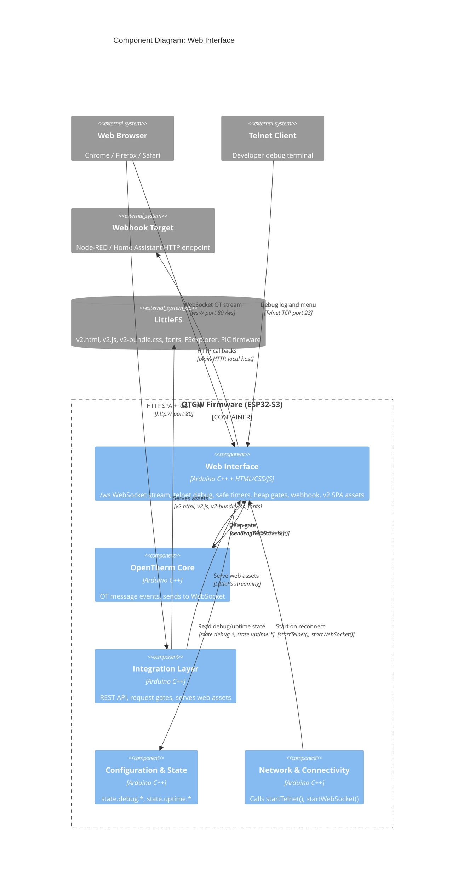

# C4 Component: Web Interface

## Overview

- **Name**: Web Interface
- **Description**: The complete user-facing layer of the firmware. Combines a browser-delivered single-page application (the v2 bundle: `v2.html`, `v2.js`, `v2-bundle.css`, served from LittleFS) with the server-side infrastructure that supports it: an AsyncWebSocket live-log endpoint, heap health gates, the request gates that keep the web server alive under load, webhook HTTP callbacks to external systems, safe cooperative-scheduler timers, and the telnet debug server. Together these provide the operational surface for configuration, monitoring and control without a separate server.
- **Type**: Application Component
- **Technology**: HTML5/CSS3/ES5+ JavaScript (no external scripts, no chart library), ESPAsyncWebServer + AsyncWebSocket, AsyncSimpleTelnet (SimpleTelnet library), LittleFS

## Purpose

The Web Interface component has two coupled halves. The server side provides the real-time infrastructure the browser UI depends on: the `/ws` WebSocket that streams OT log lines to the live log viewer, the heap-health gates (`canSendWebSocket()`, `canPublishMQTT()`), the in-flight and connection gates that bound web-server concurrency (ADR-165, ADR-147, ADR-188), the poll rate limit (ADR-172), safe timer macros that handle `millis()` rollover, and the telnet debug server on port 23.

The client side (Web Assets) is the v2 single-page app. It is the only UI on the 2.0.0 line (ADR-192): the classic UI (`index.html`, `index.js`, `graph.js`, `sat.js`, ...) was removed with TASK-1223.12. `v2.js` is one IIFE of about 5,200 lines that handles page navigation, WebSocket reconnection, REST polling, settings, the SAT dashboard, the file browser, firmware update and the inline-SVG graph. `FSexplorer.html` (with its own `fsexplorer.css`) is the recovery page, served at `/` when `v2.html` is missing. The webhook module delivers HTTP callbacks to external systems (for example Node-RED or Home Assistant) when a configured OpenTherm status bit changes. Asset-level detail is in [c4-code-web-assets.md](./c4-code-web-assets.md).

## Software Features

### Server-Side Infrastructure (Utilities)

- **WebSocket endpoint `/ws` on port 80**: an `AsyncWebSocket` (`otLogWs`) attached to the shared AsyncWebServer by `startWebSocket()` (idempotent, ADR-123 Phase 3); there is no separate port. `handleWebSocket()` runs `cleanupClients(MAX_WEBSOCKET_CLIENTS)` (3 clients) and sends a `{"type":"keepalive"}` text frame every 30 s while clients are connected. The endpoint is unauthenticated by design (trusted LAN)
- **Heap health tracking**: `getHeapHealth()` classifies free heap as HEALTHY, LOW (below 8192 bytes), WARNING (below 5120) or CRITICAL (below 3072) and counts tier entries for telemetry. Since ADR-167 only CRITICAL gates anything: `canSendWebSocket()` and `canPublishMQTT()` return false (and count a drop) at CRITICAL and true otherwise
- **Emergency heap recovery**: `emergencyHeapRecovery()` runs at most once per 30 s. It closes all WebSocket clients, stops and restarts the port 25238 listener (`startPICStream()`, which leaves it stopped when the legacy port is disabled) and clears the MQTT discovery pending bitmap. Telnet and MQTT stay connected
- **Request gates**: REST responses (`REST_MAX_INFLIGHT`) and static-file serves (`WEB_FILE_MAX_INFLIGHT`) each admit at most 2 in flight (ADR-165, ADR-147). The caps tighten when the largest free block shrinks: the file gate to 1 below 16000 bytes, the REST gate to 2 below 24000 and 1 below 16000 (`restEffectiveInflightCap()`, `webFileGateTryAdmit()` in `restAPI.ino`). A connection cap (`WEB_MAX_TX_CONNECTIONS` 4, ADR-188) refuses new requests while more than 4 non-WebSocket connections hold send data. All refusals are a cheap `503`
- **Poll rate limit (ADR-172)**: GCRA budgets, global per endpoint, on `GET /api/v2/otgw/otmonitor` and its alias `/telegraf` (one shared budget, 1500 ms window, burst 2) and `GET /api/v2/device/time` (4000 ms window, burst 2). Over budget answers `429` with a problem+json body carrying `retry_after`. `evaluate.py::check_poll_window_coupling` ties the windows to the poll intervals in `v2.js`
- **Safe timer macros** (`safeTimers.h`): `DECLARE_TIMER_MIN/SEC/MS()`, `DUE()`, `RESTART_TIMER()`, `CHANGE_INTERVAL_MIN/SEC/MS()`; the optional timer type is `SKIP_MISSED_TICKS`, `CATCH_UP_MISSED_TICKS` or `SKIP_MISSED_TICKS_WITH_SYNC`. All handle `millis()` rollover
- **Telnet debug server** (port 23): `AsyncSimpleTelnet<1> debugTelnet(23)` (`networkStuff.ino`). `startTelnet()` registers a welcome banner (firmware identity, network, heap, PIC, OT bus, MQTT, NTP, SAT and the state of every debug toggle) and a one-key-per-press input callback into `handleDebugChar()` (`handleDebug.ino`), an interactive debug menu (`h` lists it: digit and letter keys toggle debug flags, upper-case and other keys run actions such as dump info, force discovery or reset the PIC). All firmware debug macros (`DebugTln`, `DebugTf`, `DebugT`) write here; `Serial` is reserved for the PIC
- **Timestamped debug output**: `_debugBOL()` prefixes each line with `HH:MM:SS.uuuuuu (freeHeap|maxBlock) function(line):`; microseconds come from `gettimeofday()`; timezone, time and heap figures are cached and refreshed once per second
- **Module-scoped conditional debug**: each `.ino` file defines module debug macros (`OTDebugTln`, `MQTTDebugTln`, `RESTDebugTln`, ...) gated by `state.debug.b*` flags (ADR-051)
- **Webhook callbacks**: `evalWebhook()` (loop context) detects an edge on the configured bit of the OT status flags and enqueues a job. A dedicated `webhook` FreeRTOS task (`startWebhookTask()`, 8192-byte stack) does the blocking HTTP send with up to 3 attempts and a 30 s backoff (ADR-057). Plain HTTP only, and the URL must be `http://` to a local host (`isLocalUrl()`). An empty payload template sends GET, otherwise POST with the configured content type
- **Reboot tracking**: `/reboot_count.txt` holds the reboot count; `updateRebootLog()` keeps `/reboot_log.txt` (reset reason, register dump, exception info) to the last 20 entries
- **LittleFS health monitoring**: `updateLittleFSStatus()` writes a probe file; `checklittlefshash()` compares `/version.hash` with the firmware git hash and sets `StatusMessage::LittleFSMismatch` for the banner; `getFilesystemHash()` supplies the ETag base for static assets
- **System utility functions**: `trimwhitespace()`, `isValidIP()`, `replaceAll()`, `signal_quality_perc_quad()`, `dBmtoQuality()`, `upTime()`, `getOTLogTimestamp()`, `yearChanged()` / `dayChanged()` / `minuteChanged()`

### Browser-Side SPA (Web Assets, v2)

- **Pages**: Home, Monitor, SAT, Settings, Advanced, and Diagnose (shown only when the PIC runs diagnose firmware). Monitor sub-tabs: log, values, statistics, OT support, graph, connection. Advanced sub-tabs: PIC, debug, file system, system. One WebSocket is shared across pages
- **Live OT log**: `/ws` text frames feed a bounded log buffer with pause and stream-to-file; JSON frames (keepalive) are dropped. `connectWs` reconnects 5 s after a close
- **Live graph**: inline SVG polylines over a 1800-sample buffer (`renderGraph`); no ECharts
- **SAT dashboard and onboarding**: reads `/api/v2/sat/status`; first-time setup and SAT onboarding wizards are gated on `ui_onboarded` / `sat_onboarded`
- **Settings management**: curated categories over `/api/v2/settings`; passwords are never echoed
- **Firmware update**: PIC `.hex` flashing from Advanced > PIC. ESP firmware on 4MB boards goes through the safeboot updater (`POST /safeboot`, ADR-191, offered by the `/update` page); filesystem OTA is served by the update server at `/update`
- **File browser**: Advanced > File System mirrors `FSexplorer.html` against `/api/v2/filesystem/files`
- **Client request queue (ADR-184)**: `v2.js` wraps `window.fetch` so every same-origin `/api/` request waits in one FIFO queue with at most 2 in flight, matching the device gates. Mutating calls should still be written one at a time
- **Poll pacing (ADR-172/173)**: `OTMON_POLL_MS` 2000 and `DEVTIME_POLL_MS` 10000; a `429` pauses the caller for the `retry_after` the device sends
- **Light/dark theme**: design tokens as CSS variables, choice stored in `localStorage` key `otgw-theme`
- **Browser compatibility**: Chrome, Firefox, Safari (latest + 2 versions)

## Code Modules

| Module | File | Description |
|--------|------|-------------|
| Utilities & WebSocket | [c4-code-utilities.md](./c4-code-utilities.md) | Telnet debug, WebSocket stream, heap health, safe timers, webhook, system utilities |
| Web Assets | [c4-code-web-assets.md](./c4-code-web-assets.md) | v2 SPA bundle, FSexplorer recovery page, fonts, PIC firmware files |

## Interfaces

### WebSocket Stream Interface

- **Protocol**: WebSocket (`ws://<host>/ws`, port 80, shared with the HTTP server)
- **Description**: Real-time OpenTherm event stream to browser clients. At most 3 clients (`MAX_WEBSOCKET_CLIENTS`).
- **Operations**:
  - `startWebSocket()` - attach the `/ws` handler to the AsyncWebServer (idempotent; called from `setup()` and on network transitions)
  - `handleWebSocket()` - periodic housekeeping: reap stale clients, 30 s keepalive
  - `sendLogToWebSocket(const char *logMessage)` - broadcast one line to all clients, gated by `hasWebSocketClients()` and `canSendWebSocket()`
  - `sendWebSocketJSON(const char *json)` - broadcast a JSON message (firmware-upgrade progress)
- **Frame format**: single text line `<timestamp> <prefix> <message>`, produced by `sendEventToWebSocket()` in OTGW-Core (a static helper, not part of this interface) and by the OT-Direct and PIC frame paths. Event prefix: `>` command sent, `<` command response, `!` error or warning, `*` system event

### Debug Telnet Interface

- **Protocol**: Telnet (TCP port 23, `AsyncSimpleTelnet<1>`)
- **Description**: Real-time firmware debug log plus an interactive single-key debug menu (`handleDebugChar()`; the keys toggle debug flags).
- **Operations**:
  - `startTelnet()` - start the server, banner and input callback
  - `Debug()`, `Debugln()`, `Debugf()` - raw output macros
  - `DebugT()`, `DebugTln()`, `DebugTf()` - timestamped output macros (prefix with heap stats)
  - Module-specific: `OTDebugTln()`, `MQTTDebugTln()`, `RESTDebugTln()`, etc.

### Safe Timer API

- **Protocol**: In-process C++ macros (`safeTimers.h`)
- **Description**: `millis()`-rollover-safe timers used throughout the firmware.
- **Operations**:
  - `DECLARE_TIMER_MIN/SEC/MS(name, interval[, type])` - declare a named timer
  - `DUE(name)` - true (and re-armed) when the interval has elapsed
  - `RESTART_TIMER(name)` - reset the timer without checking
  - `CHANGE_INTERVAL_MIN/SEC/MS(name, interval)` - change the interval of an existing timer
  - Timer types: `SKIP_MISSED_TICKS`, `CATCH_UP_MISSED_TICKS`, `SKIP_MISSED_TICKS_WITH_SYNC`

### Webhook Interface

- **Protocol**: HTTP GET/POST (outbound, plain HTTP, local hosts only)
- **Description**: Triggers an HTTP callback when an OpenTherm status bit changes.
- **Configuration**: `settings.webhook.bEnabled`, `.sURLon`, `.sURLoff`, `.iTriggerBit` (0-15), `.sPayload`, `.sContentType`
- **Operations**:
  - `evalWebhook()` - edge detection, enqueue
  - `testWebhook(bool testOn)` - enqueue a test job, via `POST /api/v2/webhook/test?state=on|off` (`1`/`0` also accepted)

### Heap Health API

- **Protocol**: In-process C++ API
- **Description**: Heap monitoring with a CRITICAL-only gate for MQTT and WebSocket (ADR-167).
- **Operations**:
  - `getHeapHealth()` - returns `HeapHealthLevel` (HEALTHY/LOW/WARNING/CRITICAL)
  - `canSendWebSocket()` / `canPublishMQTT()` - false only at CRITICAL
  - `emergencyHeapRecovery()` - last-resort memory reclaim, at most once per 30 s

### Web UI Served Assets

- **Protocol**: HTTP/1.1 (routes registered by `startWebserver()` in `FSexplorer.ino`; assets read from LittleFS)
- **Description**: Static assets served to browser clients with ETag revalidation (ADR-163); fonts are immutable-cached.
- **Routes**:
  - `/`, `/index`, `/index.html` - `v2.html`, or `FSexplorer.html` when `v2.html` is missing
  - `/v2.html`, `/v2.js`, `/v2-bundle.css`, `/fsexplorer.css` - the UI assets
  - `/fonts/inter-400.woff2`, `/fonts/inter-700.woff2`, `/fonts/jetbrains-mono-400.woff2`
  - `/FSexplorer.html`, `/FSexplorer` - the recovery page; `/upload` (POST) stores a file, `/ReBoot`, `/ResetWireless`
  - `/update` (firmware/filesystem OTA page) and `/safeboot` (POST, hand-over to the safeboot updater)
  - `/pic16f88/*`, `/pic16f1847/*` - PIC firmware binaries, via the `onNotFound` file handler; `/api/*` goes to the REST dispatcher
- **Build**: the LittleFS image is built from a minified staging copy of `data/` (ADR-190). `ds-tokens.css` and `v2.css` are build inputs of `v2-bundle.css` and are not in the image
- **Not served any more**: `index.html`, `index.js`, `sat.js`, `sat-slider.js`, `graph.js`, `theme-toggle.js`, `echarts-theme.js`, `components.css`, `design.html`. HA MQTT discovery is published from PROGMEM tables, not a runtime `mqttha.cfg` (ADR-077)

## Dependencies

### Components Used

- **OpenTherm Core**: calls `sendLogToWebSocket()` for each decoded frame and event; this component provides the `canSendWebSocket()` gate
- **Integration Layer (REST API)**: registers the `/api` routes and the request/connection gates; this component provides helpers (`getFilesystemHash()`, `updateLittleFSStatus()`) used by the file server
- **Configuration and State**: reads `state.debug.b*` flags for conditional debug macros, `state.uptime.*` for `upTime()` and `state.statusMessage` for the banner
- **Network and Connectivity**: calls `startWebSocket()` and `startTelnet()` on connect and reconnect

### External Systems

- **SimpleTelnet** (vendored library, `AsyncSimpleTelnet`): telnet server on port 23
- **ESPAsyncWebServer / AsyncWebSocket**: HTTP server and `/ws` endpoint, serviced on the AsyncTCP task
- **LittleFS**: web assets, `/version.hash`, `/reboot_count.txt`, `/reboot_log.txt`, `/otgw_simulation.log`

## Component Diagram

