# C4 Component Level: OTGW-Firmware System Overview

## System Components

The OTGW-firmware (2.0.0 line, ESP32-S3 only) synthesizes 10 code-level modules into 7 logical components. The grouping follows domain boundaries: protocol, transport, integration, configuration, thermostat control, physical I/O, and UI infrastructure.

| Component | Type | Description | Documentation |
|-----------|------|-------------|---------------|
| OpenTherm Core | Application Component | PIC serial task and frame queues, byte-transparent PIC stream (ADR-177), command queue with SAT setpoint ownership (ADR-179), OT decoding, OTDirect GPIO stack for boards without a PIC, combo board selection at boot (ADR-127) | [c4-component-opentherm-core.md](./c4-component-opentherm-core.md) |
| Network and Connectivity | Application Component | WiFi with portal and static IP, NTP, mDNS, WiFi/Ethernet failover (W5500), platform abstraction, firmware OTA through the safeboot updater (ADR-191) | [c4-component-network.md](./c4-component-network.md) |
| Integration Layer | Application Component | MQTT client (espMqttClient) with HA discovery from PROGMEM tables (ADR-077, JIT per ADR-100, flat per-value topics per ADR-101), daily discovery heal, REST API v2 with in-flight gates and 429 rate limiting (ADR-165, ADR-172), JsonEmit streaming JSON (ADR-146), file serving, auth/CSRF | [c4-component-integration-layer.md](./c4-component-integration-layer.md) |
| Configuration and State | Application Component | Persistent settings (OTGWSettings), runtime state (OTGWState), LittleFS JSON, deferred write, side-effect coordination, NVS mirror for the safeboot updater | [c4-component-configuration-state.md](./c4-component-configuration-state.md) |
| Smart Thermostat (SAT) | Application Component | Heating curve, PID with deadband, multi-zone, anti-cycling, 16-state boiler status machine, write-on-change commands with a 30 s CS keepalive on PIC boards (TASK-1236), simulation mode, weather (Open-Meteo or OpenWeatherMap), BLE room sensors and area sensors (ADR-178) | [c4-component-smart-thermostat.md](./c4-component-smart-thermostat.md) |
| Sensors and Hardware | Application Component | Dallas DS18B20 (1-Wire, up to 16), S0 pulse counter, GPIO output relay, OLED status pages, board and hardware detection (ADR-127, ADR-158) | [c4-component-sensors-hardware.md](./c4-component-sensors-hardware.md) |
| Web Interface | Application Component | v2 single-page UI (ADR-192) plus FSexplorer recovery page, WebSocket `/ws`, telnet debug menu, heap health (ADR-167), safe timers, webhook task | [c4-component-web-interface.md](./c4-component-web-interface.md) |

## Code Module to Component Mapping

| Code Module File | Component |
|-----------------|-----------|
| [c4-code-otgw-core.md](./c4-code-otgw-core.md) | OpenTherm Core |
| [c4-code-otdirect.md](./c4-code-otdirect.md) | OpenTherm Core |
| [c4-code-network.md](./c4-code-network.md) | Network and Connectivity |
| [c4-code-mqtt.md](./c4-code-mqtt.md) | Integration Layer |
| [c4-code-rest-api.md](./c4-code-rest-api.md) | Integration Layer |
| [c4-code-settings.md](./c4-code-settings.md) | Configuration and State |
| [c4-code-sat.md](./c4-code-sat.md) | Smart Thermostat (SAT) |
| [c4-code-sensors.md](./c4-code-sensors.md) | Sensors and Hardware |
| [c4-code-utilities.md](./c4-code-utilities.md) | Web Interface |
| [c4-code-web-assets.md](./c4-code-web-assets.md) | Web Interface |

## Component Architecture

### Design Rationale

**OpenTherm Core + OTDirect as one component**: OTDirect is the ESP32-native replacement for the PIC gateway. From the rest of the firmware's perspective, both paths produce the same output: decoded OT frames passed to `processOT()`. One path decodes serial lines from a PIC, the other drives the OpenTherm bus from GPIO directly. On the combo build the board picks one of the two at boot (ADR-127). The Integration Layer, SAT and REST API do not need to know which path is active, with one shared rule: while SAT is enabled it owns MsgID 1, and both paths refuse an external `CS=` (ADR-179, TASK-1236).

**Integration Layer combining MQTT + REST API**: Both sub-systems consume the same data sources (OpenTherm state, settings, SAT state), share the same JSON infrastructure (JsonEmit and `jsonStuff.ino`), and expose overlapping functionality (SAT can be controlled through MQTT topics or REST endpoints). Separating them would document the shared JSON layer twice without adding clarity.

**Web Interface combining Utilities + Web Assets**: The Utilities code (WebSocket server, heap health, safe timers, telnet, webhook) exists mainly to support the browser UI. There is no useful boundary between the WebSocket server and the JavaScript that connects to it: they are co-designed and evolve together.

**Configuration and State as a standalone component**: `OTGWSettings` and `OTGWState` are accessed by every other component. Making them a first-class component keeps that central role explicit and prevents settings from being treated as a detail of whichever module touches them first.

### Component Dependency Rules

- **Configuration and State is the stable base**: it depends on LittleFS (and NVS for the safeboot mirror), not on other firmware components.
- **OpenTherm Core asks SAT only who owns MsgID 1**: Core calls `satOwnsControlSetpoint()` and `satCommandInFlight()` to refuse an external `CS=`. Otherwise SAT reads Core's state and Core does not call into SAT logic.
- **Integration Layer reaches the home automation systems** (broker, HA). Two other outbound paths exist: the webhook task (local HTTP only) and SAT's weather fetch.
- **Web Interface is infrastructure**: other components call into it (WebSocket events, timers, heap gates); it does not depend on SAT, Sensors or the Integration Layer on the server side.

## Component Relationships Diagram

```mermaid
C4Component
    title OTGW-Firmware: All Components and Relationships

    Container_Boundary(fw, "OTGW-Firmware (ESP32-S3)") {
        Component(otcore, "OpenTherm Core", "Arduino C++, FreeRTOS task", "PIC serial task, frame queues, command queue, OTDirect GPIO")
        Component(network, "Network & Connectivity", "Arduino C++", "WiFi, NTP, mDNS, Ethernet failover, safeboot OTA")
        Component(integlayer, "Integration Layer", "Arduino C++", "MQTT + HA discovery, REST API v2, JsonEmit, file serving")
        Component(cfgstate, "Configuration & State", "Arduino C++", "OTGWSettings, OTGWState, LittleFS JSON, deferred write")
        Component(sat, "Smart Thermostat (SAT)", "Arduino C++", "Heating curve, PID, boiler state machine, CS keepalive")
        Component(sensors, "Sensors & Hardware", "Arduino C++", "Dallas DS18B20, S0 pulse counter, GPIO relay, OLED, board detection")
        Component(webui, "Web Interface", "Arduino C++ + HTML/CSS/JS", "v2 UI, WebSocket /ws, telnet, heap health, timers, webhook")
    }

    System_Ext(pic, "PIC Gateway", "OpenTherm PIC on the Classic board")
    System_Ext(boiler, "Boiler", "OpenTherm slave")
    System_Ext(thermostat, "Thermostat", "OpenTherm master")
    System_Ext(broker, "MQTT Broker", "Mosquitto / Home Assistant MQTT")
    System_Ext(ha, "Home Assistant", "Consumes MQTT telemetry and discovery")
    System_Ext(browser, "Web Browser", "Chrome / Firefox / Safari")
    System_Ext(router, "WiFi / Network", "Home LAN, DHCP, NTP server")
    SystemDb_Ext(lfs, "LittleFS", "Settings, web assets, sensor labels, SAT state")

    Rel(otcore, pic, "UART0 serial 9600 baud", "commands out, OT lines in")
    Rel(pic, boiler, "OpenTherm bus", "Manchester")
    Rel(thermostat, pic, "OpenTherm bus", "Manchester")
    Rel(otcore, boiler, "OpenTherm GPIO (OTDirect)", "Manchester")
    Rel(thermostat, otcore, "OpenTherm GPIO (OTDirect)", "Manchester")

    Rel(network, router, "WiFi / Ethernet, DHCP, NTP", "802.11 / W5500 + SNTP")

    Rel(integlayer, broker, "MQTT 3.1.1", "publish + subscribe")
    Rel(ha, broker, "MQTT", "consume telemetry and discovery")
    Rel(browser, integlayer, "HTTP REST + file serving", "port 80")
    Rel(browser, webui, "WebSocket OT stream", "ws:// port 80 /ws")

    Rel(otcore, cfgstate, "Read settings, write state", "settings.*, state.pic.*")
    Rel(network, cfgstate, "Read settings, write state", "settings.ntp.*, settings.wifi.*")
    Rel(integlayer, cfgstate, "Read/write settings and state", "updateSetting(), settings.mqtt.*")
    Rel(sat, cfgstate, "Read/write SAT settings and state", "settings.sat.*, state.sat.*")
    Rel(sensors, cfgstate, "Read sensor settings, write hardware state", "settings.sensors.*, state.hw.*")
    Rel(webui, cfgstate, "Read debug/uptime state", "state.debug.*, state.uptime.*")

    Rel(otcore, integlayer, "Decoded OT values", "sendMQTTData(), publishToSourceTopic()")
    Rel(otcore, webui, "OT frame events", "WebSocket log")
    Rel(otcore, sat, "Setpoint ownership check", "satOwnsControlSetpoint(), satCommandInFlight()")
    Rel(integlayer, sat, "SAT commands in/out", "REST /api/v2/sat, MQTT set/<node>/sat/*")
    Rel(integlayer, sensors, "Sensor label REST API", "dallas labels")
    Rel(sensors, integlayer, "Sensor MQTT publish", "sendMQTTData(), discovery drip")
    Rel(sensors, sat, "Area temperatures", "satSetAreaTemp()")
    Rel(sat, otcore, "Send setpoints", "satEnqueueOwnCS(), addCommandToQueue(CS=, MM=, CH=)")
    Rel(network, integlayer, "Restarts MQTT on reconnect", "startMQTT()")
    Rel(network, webui, "Restarts services on reconnect", "startTelnet(), startWebSocket()")
    Rel(cfgstate, network, "Side-effects: MDNS, NTP", "startMDNS(), startNTP()")
    Rel(cfgstate, integlayer, "Side-effect: MQTT restart", "startMQTT()")
    Rel(integlayer, webui, "Heap gate", "canPublishMQTT()")

    Rel(cfgstate, lfs, "Read/write settings.ini", "JSON file I/O")
    Rel(integlayer, lfs, "Serve v2 assets", "HTTP streaming")
    Rel(sensors, lfs, "Persist sensor labels", "/dallas_labels.ini")
    Rel(sat, lfs, "Persist PID, energy and cycle state", "/sat_pid_state.json, /sat/*")
```

## Key Data Flows

### OpenTherm Message to MQTT (PIC board)

1. The thermostat and boiler exchange an OT frame; the PIC prints it as an ASCII line over UART0 (for example `B40190A00`).
2. **OpenTherm Core** `picSerialTaskBody()` (a FreeRTOS task) reads the bytes, sends them verbatim to the raw stream consumers (port 25238 when enabled, ADR-177) and posts complete lines to `otFrameQueue`.
3. The main loop drains the queue and calls `processOT()`, which decodes the frame type, message ID and typed value (f8.8, s16, flags).
4. `processOT()` updates `OTcurrentSystemState` and checks the per-ID `mqttlastsent` throttle.
5. **Integration Layer** publishes the value to `<top>/value/<nodeId>/<label>` (plus source-specific `_thermostat`/`_boiler` leaves where ADR-097 applies). Every publish goes through `mqttPublishRaw()`.
6. The broker delivers to **Home Assistant** and other subscribers.

On an OTDirect board step 2 is replaced by the GPIO OpenTherm stack, which hands decoded frames to `processOT()` through the same queue path.

### SAT Setpoint Control

1. **SAT** control loop runs every `settings.sat.iControlInterval` seconds (default 30, range 10 to 300).
2. It reads room temperature (simulation, BLE, area sensors, external, or OT MsgID 24, in that priority), outdoor temperature and boiler state.
3. It computes the heating curve plus PID correction.
4. It sends `CS=<setpoint>`, `MM=` and `CH=` through `satEnqueueIfChanged*()` (write-on-change, refreshed every 300 s). SAT's own `CS=` goes through `satEnqueueOwnCS()`, so the ownership gate lets it pass.
5. On a PIC board `satPicCSKeepalive()` re-sends the last CS every 30 s, because the PIC drops a CS 63 to 126 s after the last one (gateway.asm CommandExpiry, TASK-1236).
6. The PIC (or OTDirect) writes the setpoint into MsgID 1 towards the boiler; the boiler modulates.

### Settings Update via Web UI

1. Browser `POST /api/v2/settings` with `{"name":"mqttbroker","value":"192.168.1.10"}`.
2. **Integration Layer** `handleSettings()` checks the name against the known-settings list.
3. It calls `updateSetting()` in **Configuration and State**, which validates the value, stores it in `settings.mqtt.sBroker`, marks `settingsDirty` and sets the `SIDE_EFFECT_MQTT` bit.
4. `timerFlushSettings` fires in the main loop and `flushSettings()` writes `/settings.ini` to LittleFS.
5. The side effect calls **Integration Layer** `startMQTT()` to reconnect with the new broker.
