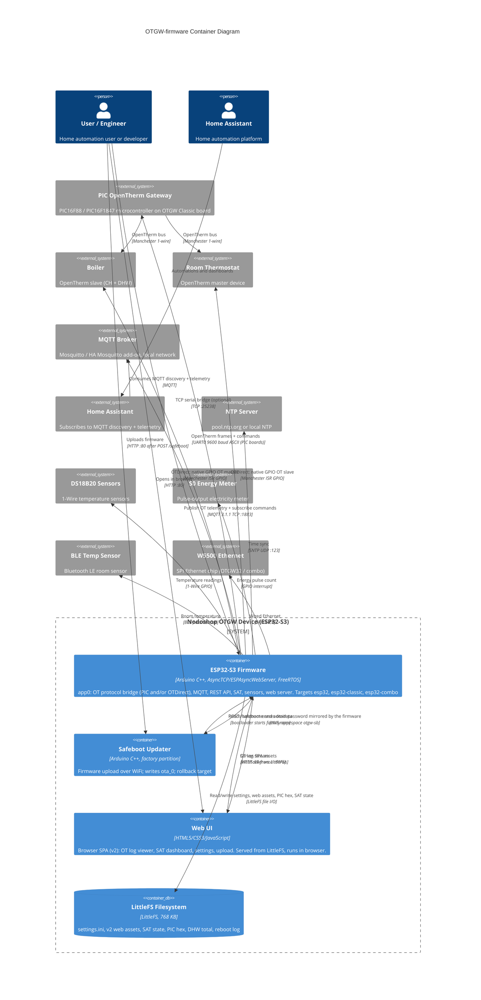

# C4 Container Diagram: OTGW-firmware

## System Overview

OTGW-firmware (2.0.0 line) runs on an ESP32-S3 module in a Nodoshop OpenTherm Gateway board. The device sits on the local network between a central heating thermostat and a boiler, bridging the OpenTherm bus to WiFi- or Ethernet-based home automation systems. ESP8266 support was dropped on this line (ADR-128); the ESP8266 firmware lives on the `otgw-1.x.x` maintenance branch.

One codebase builds three firmware images for the same chip, selected by a PlatformIO environment and a board macro (see `platformio.ini`, `boards.h`). All three share one 4 MB partition table (`partitions_otgw_esp32.csv`, ADR-191) and carry a small separate updater, the safeboot app, in a factory partition. The browser-side SPA (Web UI) is a separate logical deployment unit: it lives in the LittleFS filesystem image, is flashed alongside the firmware, and executes in the user's browser after being served over HTTP.

All containers live on a single physical device. There is no Docker, no Kubernetes, no cloud. The "containers" here are deployment units in the C4 sense: things that need to be running (or present) for the system to work.

---

## Containers

### ESP32-S3 Firmware (main app, partition `app0`)

- **Type**: Embedded Firmware (single monolithic Arduino sketch, one translation unit)
- **Technology**: Arduino C/C++, Arduino-ESP32 (pioarduino platform 55.03.35), PlatformIO; async stack (AsyncTCP 3.4.10, ESPAsyncWebServer 3.11.2, vendored espMqttClient) on FreeRTOS (ADR-123); no ArduinoJson (ADR-146)
- **Platform**: ESP32-S3 @ 240 MHz, 4 MB flash
- **Description**: The production firmware. HTTP, WebSocket and MQTT run on event-driven tasks; the cooperative `loop()` runs `doBackgroundTasks()`. Includes all components below. A task-watchdog (ADR-135) is the primary watchdog; on Classic boards the external I2C watchdog at 0x26 is an optional secondary layer.
- **Build targets** (`build.py --target`, `build.bat` / `build.sh` are the sanctioned entrypoints):

| Target | PlatformIO env | Board macro | Hardware | Asset token |
|---|---|---|---|---|
| `esp32` | `esp32` | `BOARD_NODOSHOP_ESP32` | OTGW32 / OT-Thing PCB: OTDirect, W5500 Ethernet, OLED, no PIC | `esp32-otgw32` |
| `esp32-classic` | `esp32-classic` | `BOARD_NODOSHOP_ESP32_CLASSIC` | OTGW Classic PCB with a LOLIN S3 Mini: PIC gateway, no OTDirect | `esp32-classic` |
| `esp32-combo` | `esp32-combo` | `BOARD_NODOSHOP_ESP32_COMBO` | One image for both boards, PIC or OTDirect picked at boot (ADR-127); the default for S3 builds | `esp32-combo` |

- **Capability flags** (`boards.h`): `HAS_PIC`, `HAS_DIRECT_OT`, `HAS_ETH_CAPABLE`, `HAS_OLED_CAPABLE`, `HAS_SAT`, `HAS_SAT_BLE`, `HAS_WEATHER_FORECAST`, `HAS_RUNTIME_HW_DETECT` (combo only), `HAS_STATUS_PIXEL` (combo: LOLIN RGB pixel as WiFi status). Application code gates on these flags, never on the board macros.
- **Components** (all run within this binary):
  - OpenTherm Core (PIC path and/or OTDirect): [c4-component-opentherm-core.md](./c4-component-opentherm-core.md)
  - Network and Connectivity (WiFi, NTP, mDNS, W5500 Ethernet, OTA handover): [c4-component-network.md](./c4-component-network.md)
  - Integration Layer (MQTT + REST API): [c4-component-integration-layer.md](./c4-component-integration-layer.md)
  - Configuration and State: [c4-component-configuration-state.md](./c4-component-configuration-state.md)
  - Smart Thermostat (SAT + BLE temperature sensing): [c4-component-smart-thermostat.md](./c4-component-smart-thermostat.md)
  - Sensors and Hardware (DS18B20, S0, GPIO relay, OLED): [c4-component-sensors-hardware.md](./c4-component-sensors-hardware.md)
  - Web Interface (WebSocket, telnet, heap health, webhook): [c4-component-web-interface.md](./c4-component-web-interface.md)
- **Hardware interfaces** (pin maps in `boards.h`):
  - Classic and combo (PIC mode): UART0 to the PIC (GPIO44 RX, GPIO43 TX, 9600 baud 8N1), PIC reset GPIO12, I2C GPIO35/36 for the 0x26 watchdog and optional OLED, config button GPIO18, LEDs GPIO16/4. LOLIN S3 Mini Pro variants use the pin set `PIN_CLASSIC_PRO_*` (ADR-158)
  - OTGW32 (and combo in OTDirect mode): OT master in/out GPIO21/GPIO1, OT slave in/out GPIO6/GPIO7, step-up enable GPIO10 (18 V bus power), bypass relay GPIO47, W5500 on SPI (SCK 12, MISO 13, MOSI 11, CS 14, INT 15, RST 16), I2C SCL 17 / SDA 18 for the OLED, 1-Wire GPIO4
  - 1-Wire GPIO for DS18B20 sensors (runtime-configurable pin), GPIO interrupt for the S0 pulse counter, optional GPIO outputs
  - BLE radio for passive advertisement scanning (NimBLE-Arduino 2.5.1)
  - The Arduino console is routed to the S3 native USB-Serial-JTAG (`ARDUINO_USB_CDC_ON_BOOT=1`) because UART0 is the PIC link
- **Network interfaces**: HTTP port 80, WebSocket on the same port (`/ws`), Telnet port 23, optional TCP serial bridge port 25238 (off by default)
- **Firmware update**: see "Safeboot updater" below. Filesystem images can still be uploaded to `/update` from the running firmware.

---

### Safeboot Updater (partition `safeboot`, app/factory)

- **Type**: Embedded Firmware (small second app, ADR-191)
- **Technology**: Arduino C/C++ (`safeboot/src/main.cpp`, separate PlatformIO project `safeboot/`), sync `WebServer`, `Update`, `Preferences`; budget 960K
- **Description**: Performs firmware OTA over WiFi on the 4 MB boards. A single OTA slot cannot be overwritten by the app that is running from it, so the main firmware never writes `app0` itself (`_handleUploadStart` in `OTGW-ModUpdateServer-esp32.h` refuses an app image; TASK-959). Instead, `POST /safeboot` (admin-protected) erases the whole `otadata` partition and reboots, so the bootloader starts the factory app. Safeboot joins WiFi with the stored credentials (30 s, else an AP named `<hostname>-safeboot`), reads hostname and admin password from NVS namespace `otgw-sb` (mirrored by the main firmware on every settings write, `safebootSyncNvs()`), and serves an upload page: `GET /`, `GET /update`, `GET /info`, `POST /update` (writes `ota_0`, then restarts), `POST /reboot`. Admin Basic Auth and a same-origin check apply when a password is set. On start it points the boot partition back at `ota_0`, unless `ota_0` was rolled back, in which case it stays until a new image is uploaded.
- **Rollback**: bootloader app rollback is on. `verifyRollbackLater()` keeps a new image `PENDING_VERIFY`; `safebootMarkAppValid()` confirms it after 30 s of healthy `loop()` or before any planned restart (`doRestart()`). A crash before that returns the unit to safeboot.
- **Partition table** (`partitions_otgw_esp32.csv`, flash 4 MB):

| Partition | Type | Offset | Size |
|---|---|---|---|
| `nvs` | data/nvs | 0x9000 | 20 KB |
| `otadata` | data/ota | 0xE000 | 8 KB |
| `safeboot` | app/factory | 0x10000 | 960 KB |
| `app0` | app/ota_0 | 0x100000 | 2240 KB |
| `spiffs` (LittleFS) | data/spiffs | 0x330000 | 768 KB |
| `coredump` | data/coredump | 0x3F0000 | 64 KB |

- **Migration**: a unit on the old layout (app0 at 0x10000, LittleFS at 0x270000) needs one USB `flash_otgw --migrate`; `flash_otgw --update` reads the unit's partition table and refuses a layout mismatch. The offsets are mirrored in `build.py`, `flash_otgw.bat/.sh` and `flash_esp.py`; `tests/test_build_safeboot.py` fails when they drift.
- **Dual-slot boards**: an 8 MB module with a spare OTA slot can still take a direct app upload (`hasSpareAppOtaSlot()`).

---

### Web UI (Browser SPA)

- **Type**: Web Application (single-page application, runs in the user's browser)
- **Technology**: HTML5, CSS3, plain JavaScript (no external scripts or chart library), WebSocket API
- **Platform**: Modern browser (Chrome, Firefox, Safari: latest + 2 versions back)
- **Description**: The v2 UI is the only Web UI on the 2.0.0 line (ADR-192). The browser loads `v2.html` (about 51 KB source) from port 80, which pulls in `v2.js` (about 344 KB source, one IIFE) and `v2-bundle.css` (`ds-tokens.css` and `v2.css` concatenated at build time) plus three `.woff2` fonts, all served from LittleFS. The LittleFS image is built from a minified staging copy (ADR-190). The SPA is English-only. It communicates with the firmware through the REST API and the `/ws` WebSocket; a queue around `window.fetch` keeps at most 2 API calls in flight (ADR-184). There is no server-side rendering.
- **Components delivered**:
  - Web Assets (`v2.js`, `v2-bundle.css`, `v2.html`): [c4-component-web-interface.md](./c4-component-web-interface.md)
- **Capabilities**:
  - Live OpenTherm log viewer (WebSocket feed, search/filter, export)
  - SAT thermostat dashboard (heating curve, PID, presets, BLE sensors)
  - Settings pages (all device settings through the REST API)
  - Firmware and filesystem upload via `/update` (PIC firmware via the `/pic` flow)
  - LittleFS file explorer (`FSexplorer.html` with its own `fsexplorer.css`, independent of the v2 assets; also the recovery page)
  - Light/dark theme

---

### LittleFS Filesystem

- **Type**: On-device Flash Storage
- **Technology**: LittleFS (POSIX-like filesystem in SPI flash)
- **Platform**: 768 KB `spiffs`-labelled partition at 0x330000 (label kept for `begin()` compatibility)
- **Description**: The flash partition that stores persistent data and web assets. The image is built by `build.py` (filesystem artifact `*.littlefs.bin`) and flashed separately from the app; writing a filesystem image resets all settings. Provides the POSIX-like file API used for settings persistence, web asset serving and PIC firmware storage.
- **Contents**:

| File / Path | Purpose |
|---|---|
| `/settings.ini` | Device configuration (all `OTGWSettings` fields as JSON); holds the admin and MQTT passwords in cleartext, so reads sit behind `checkHttpAuth()` |
| `/v2.html`, `/v2.js`, `/v2-bundle.css` | The Web UI (ETag-validated assets) |
| `/fonts/inter-400.woff2`, `inter-700.woff2`, `jetbrains-mono-400.woff2` | UI fonts (immutable cache) |
| `/FSexplorer.html`, `/fsexplorer.css`, `/FSexplorer.png` | File explorer / recovery page |
| `/dallas_labels.ini` | DS18B20 sensor address-to-label mappings |
| `/sat_markers.json`, `/sat_pid_state.json`, `/sat_energy.json`, `/sat_energy_estimate.json`, `/sat_hcr.json` | SAT calibration markers, PID state, energy and heating-curve data |
| `/dhw_water.json` | Persisted DHW water total (ADR-176) |
| `/ot-thermo.json`, `/ot-boiler.json` | Learned OT support maps (flushed at most every 15 min) |
| `/topic_cleanup.bin` | ADR-106 topic-cleanup resume state |
| `/reboot_count.txt`, `/reboot_log.txt` | Reboot counter and reboot log (served as the crash log) |
| `/bootdetect.log` | Combo board hardware-detection log |
| `/pic16f88/`, `/pic16f1847/` (and `<deviceid>` directories) | PIC firmware hex files |
| `/otgw_simulation.log` | Optional OT frame replay file for `/api/v2/simulate/start` |
| `/version.hash` | Filesystem version hash (ETag key, mismatch detection) |

Note: the `/mqttha.cfg` LittleFS file is retired; HA MQTT discovery is published from PROGMEM tables in `MQTTHaDiscovery.cpp` (ADR-077). Default discovery semantics: JIT (ADR-100), flat per-value scalar topics (ADR-101), self-describing names (ADR-106), a daily re-announce (ADR-170).

---

## Container Interfaces

### HTTP Web Server (port 80)

- **From**: Web Browser, REST API clients (Home Assistant, Node-RED, Telegraf)
- **To**: ESP32-S3 Firmware
- **Protocol**: HTTP/1.1 (plain only; HTTPS is explicitly out of scope)
- **Port**: 80
- **Description**: The primary inbound interface (`AsyncWebServer`, handlers on the AsyncTCP task). Serves the Web UI from LittleFS and handles all REST API requests. HTTP Basic Auth (user `admin`) and a same-origin check are required for mutating `/api/v2` calls and the admin routes when a password is set. Backpressure: at most 2 REST requests and 2 static-file serves in flight (ADR-165, ADR-147), a port-80 connection cap (ADR-188), and 429 rate limits on the polled endpoints (ADR-172).
- **Key operations**: See the [REST API](#rest-api) section below.

### WebSocket OT Log Stream (port 80, path /ws)

- **From**: Web Browser (`v2.js`)
- **To**: ESP32-S3 Firmware
- **Protocol**: WebSocket (ws://, text frames)
- **Port**: 80 (path `/ws`; there is no separate port)
- **Description**: Real-time push stream of decoded OpenTherm log lines to connected browsers. At most 3 clients (`MAX_WEBSOCKET_CLIENTS`); a keepalive text frame is sent every 30 s. Frames are gated by `canSendWebSocket()`, which blocks only at `HEAP_CRITICAL` (ADR-167). The endpoint is unauthenticated by design (trusted LAN).
- **Frame format**: a single text line `<timestamp> <prefix> <message>`; event prefix `>` command sent, `<` command response, `!` error or warning, `*` system event. Details in [c4-component-web-interface.md](./c4-component-web-interface.md).

### MQTT Client Connection

- **From**: ESP32-S3 Firmware
- **To**: MQTT Broker (external)
- **Protocol**: MQTT 3.1.1 over TCP (espMqttClient, QoS 0)
- **Port**: 1883 (default, configurable)
- **Description**: Outbound persistent TCP connection to the configured broker. The firmware publishes OpenTherm telemetry (OT values, SAT state, sensor readings), retained availability (`online` birth, `offline` last will) and HA discovery, and subscribes to command topics. A six-state machine drives the asynchronous connect with a 3 s x attempt backoff, up to 5 attempts, then a 42 s wait that re-resolves DNS.
- **Key operations**: See the [MQTT API](#mqtt-api) section below.

### PIC UART Serial Link (PIC boards)

- **From**: ESP32-S3 Firmware
- **To**: OpenTherm Gateway PIC (external hardware)
- **Protocol**: UART, 9600 baud, 8N1, ASCII line-oriented
- **Connection**: UART0 on GPIO44 (RX) / GPIO43 (TX); PIC reset on GPIO12 (Classic pin map)
- **Description**: The exclusive serial link to the PIC16F88 or PIC16F1847 on the OTGW board. OpenTherm bus traffic arrives as ASCII-framed lines; commands go out as ASCII strings, always through the command queue (`addCommandToQueue()`). The firmware never writes to `Serial` after initialization. The byte stream is kept verbatim from the serial task to every consumer (ADR-177).
- **Key operations**:
  - PIC to ESP: `T<hex>` (thermostat frame), `B<hex>` (boiler frame), `R<hex>` (gateway request), `A<hex>` (gateway answer)
  - ESP to PIC: `GW=1`, `PS=1`, `TT=<setpoint>`, `TC=<setpoint>`, `OT=<temp>`, `SC=<HH>:<MM>/<DOW>`, `SR=21:<m>,<d>`, `SR=22:<hi>,<lo>`, `PR=A`, `CS=` (SAT's own through `satEnqueueOwnCS()`, ADR-179)

### OTDirect GPIO OpenTherm Interface (OTGW32 and combo in OTDirect mode)

- **From**: ESP32-S3 Firmware (OTDirect component)
- **To**: OpenTherm Bus (boiler and/or thermostat directly)
- **Protocol**: OpenTherm (Manchester-encoded 1-wire, ISR-driven, 3.3 V logic with the 18 V step-up on the OTGW32 board)
- **Connection**: GPIO21/GPIO1 (master in/out), GPIO6/GPIO7 (slave in/out), GPIO10 (step-up enable)
- **Description**: Native OpenTherm master/slave interface bypassing the PIC. Available with `HAS_DIRECT_OT=1`. Modes: gateway, monitor, bypass, master, loopback. OTDirect translates PIC-style commands (`HW=`, `CS=`, `MM=`, `SR=`, ...) natively.

### TCP Serial Bridge (port 25238, optional)

- **From**: OTmonitor software, custom TCP clients
- **To**: ESP32-S3 Firmware
- **Protocol**: Raw TCP, byte-transparent (`OTGWstream`, `AsyncSimpleTelnet<1>` on `OTGW_SERIAL_PORT`)
- **Port**: 25238
- **Description**: Exposes the PIC stream to the local network in both directions so tools like OTmonitor can connect as if to a serial port. Disabled by default: `settings.mqtt.bLegacyPort25238Enabled` (JSON key `LegacyPort25238Enabled`) starts or stops the listener through `applyLegacyPort25238Setting()`. Flashing the PIC through OTmonitor is discouraged; the supported route is the firmware's `/pic` flow.

### Telnet Debug Server (port 23)

- **From**: Developer terminal (telnet client)
- **To**: ESP32-S3 Firmware
- **Protocol**: Telnet (raw TCP over AsyncTCP, `AsyncSimpleTelnet<1>`, single client)
- **Port**: 23
- **Description**: Real-time firmware debug log. Every `DebugTln()` / `DebugTf()` call writes a timestamped line (format: `HH:MM:SS.uuuuuu (freeHeap|maxBlock) function(line):`). On connect it prints a triage banner (version, reset reason, network, heap, PIC, OT bus, MQTT, NTP, SAT) and the debug toggles. Single keypresses toggle debug flags or run actions (`1` OTmsg, `2` REST API, `3` MQTT, `4` Sensors, `5` SAT, `6` OTDirect, `g` MQTT gating, `n` NTP, `h` menu, `F` discovery re-announce, `V` discovery verify, `z` zero heap counters).

### NTP Time Synchronization

- **From**: ESP32-S3 Firmware
- **To**: NTP Server (external)
- **Protocol**: SNTP (UDP)
- **Port**: 123
- **Description**: Outbound SNTP requests to `pool.ntp.org` (configurable). Re-syncs once a day (`NTP_RESYNC_TIME` = 86400 s); DHCP-supplied NTP servers are ignored. On a successful sync the firmware sends `SC=`, `SR=21:`, `SR=22:` to the gateway (PIC or OTDirect) to keep the boiler clock accurate.

### mDNS Hostname Advertisement

- **From**: ESP32-S3 Firmware
- **To**: Local network name resolution
- **Protocol**: mDNS (UDP/5353); LLMNR is compiled out (`HAS_LLMNR` = 0)
- **Description**: Registers `<hostname>.local` and the HTTP service on port 80 so browsers can reach the device by name (e.g., `http://otgw.local`).

### Ethernet (W5500, `HAS_ETH_CAPABLE` boards)

- **From**: ESP32-S3 Firmware
- **To**: Local network switch / router
- **Protocol**: Ethernet, DHCP or static IP (`settings.eth.*`)
- **Connection**: SPI bus to a W5500 chip (OTGW32 pin map above)
- **Description**: Optional wired Ethernet. The chip is detected at boot by the driver install (`Ethernet.hardwareStatus()`); skipped in combo PIC mode (ADR-127). With a link and an address, WiFi is powered down; cable hot-plug is polled every 5 s and falls back to WiFi on removal.

### Webhook HTTP Callback

- **From**: ESP32-S3 Firmware
- **To**: Webhook target on the local network (Node-RED, Home Assistant, custom HTTP endpoint)
- **Protocol**: HTTP (outbound, plain `http://` only; the URL must be a local-network host)
- **Description**: Outbound callback when a configured OpenTherm status bit changes state. HTTP POST with the configured payload when a payload is set, otherwise HTTP GET; separate on/off URLs are supported.

### Weather API (SAT, outbound)

- **From**: ESP32-S3 Firmware (SAT component)
- **To**: Open-Meteo API (`http://api.open-meteo.com/v1/forecast`) or OpenWeatherMap (`http://api.openweathermap.org/data/2.5/weather`, API key required)
- **Protocol**: HTTP GET (plain HTTP, no TLS)
- **Description**: Optional outdoor temperature and (with `HAS_WEATHER_FORECAST`) 24-hour forecast for the SAT heating curve. Latitude/longitude and source are configurable in SAT settings. The response is stream-parsed without heap allocation.

### BLE Sensor Scanning (SAT)

- **From**: ESP32-S3 Firmware (SAT BLE component)
- **To**: BLE temperature sensor (external device)
- **Protocol**: Bluetooth LE (passive advertisement scanning, NimBLE stack; keep passive-continuous scan)
- **Description**: Scans advertisements for room-temperature beacons (an 8-slot roster; encrypted MiBeacon bindkeys supported); the temperature feeds the SAT PID controller. Independent of whether SAT is enabled.

---

## Container Diagram



> Note: the three firmware variants are mutually exclusive; only one app image runs on a given device, next to the safeboot updater. The combo image detects at boot whether it sits on a PIC board or an OTDirect board. The Web UI container runs in the user's browser after being served by the firmware.

---

## External Dependencies

### OpenTherm Gateway PIC

- **Type**: Microcontroller (co-processor on the OTGW Classic PCB)
- **Protocol**: UART, 9600 baud, ASCII OpenTherm framing
- **Purpose**: Hardware OpenTherm bus interface. Handles the Manchester encoding/decoding and bus power, presenting decoded frames as ASCII lines.
- **Required**: Yes on `esp32-classic`; detected at boot on `esp32-combo`; not present on `esp32` (OTDirect replaces it)
- **Versions**: PIC16F88 and PIC16F1847 (`picfwtype` in `device/info` is the authority for the running firmware type)

### MQTT Broker

- **Type**: Software service (external, on local network)
- **Protocol**: MQTT 3.1.1, TCP
- **Default port**: 1883
- **Purpose**: Message bus for home automation integration. Receives OT telemetry, HA discovery payloads, SAT state, and sensor readings. Forwards commands back to the firmware.
- **Required**: No (the gateway works without MQTT)
- **Typical implementations**: Mosquitto, Home Assistant Mosquitto add-on

### Home Assistant

- **Type**: Home automation platform (external)
- **Protocol**: MQTT (subscribes to the broker); can also poll the REST API
- **Purpose**: Primary integration target. Consumes MQTT discovery payloads to auto-create the entities of one HA device per gateway (ADR-140).
- **Required**: No

### NTP Server

- **Type**: Time service (external, internet or LAN)
- **Protocol**: SNTP, UDP
- **Default**: `pool.ntp.org`
- **Port**: 123
- **Purpose**: Wall-clock time for boiler clock synchronization (`SC=`), debug log timestamps, and SAT sun elevation calculations.
- **Required**: No (timestamps degrade to relative uptime)

### DS18B20 Temperature Sensors

- **Type**: Hardware (1-Wire sensors, attached to GPIO)
- **Protocol**: 1-Wire (Dallas/Maxim protocol)
- **Purpose**: Measure temperatures at points not covered by OpenTherm. Runtime-configurable GPIO pin.
- **Required**: No

### S0 Pulse Energy Meter

- **Type**: Hardware (pulse-output electricity meter)
- **Protocol**: GPIO interrupt (S0 standard pulse interface)
- **Purpose**: Counts pulses and publishes cumulative energy and instantaneous power.
- **Required**: No

### BLE Temperature Sensor

- **Type**: Hardware (Bluetooth LE device)
- **Protocol**: Bluetooth LE (passive advertisement)
- **Purpose**: Room-temperature input to the SAT PID controller.
- **Required**: No (optional SAT input source)

### W5500 SPI Ethernet Module

- **Type**: Hardware (SPI peripheral on OTGW32 boards)
- **Protocol**: SPI, DHCP
- **Purpose**: Wired Ethernet. When a link is present WiFi is disabled; WiFi is the fallback.
- **Required**: No (auto-detected at boot)

### Weather Services

- **Type**: Web services (internet): Open-Meteo (`api.open-meteo.com`, no key) or OpenWeatherMap (key required)
- **Protocol**: HTTP GET (plain HTTP only)
- **Purpose**: Outdoor temperature (and forecast) source for the SAT heating curve.
- **Required**: No (SAT falls back to MQTT/REST-pushed outdoor temperature or the OT outdoor value)
- **Privacy note**: needs latitude and longitude in the SAT settings.

---

## API Documentation

### REST API

The firmware exposes a versioned HTTP REST API on port 80. All responses are JSON. Mutating calls require HTTP Basic Auth when a password is set. Plain HTTP only. The route table `kV2Routes[]` in `restAPI.ino` is authoritative; the full list with methods and auth is in [c4-code-rest-api.md](./c4-code-rest-api.md).

**Error format**: `{"error":{"status":<code>,"message":"<text>"}}`. Over-budget polls get `429` as `application/problem+json`; transient load gets `503` with `Retry-After: 1`.

#### v2 Endpoints (current)

**System and Device**

| Method | Path | Description |
|---|---|---|
| `GET` | `/api/v2/health` | System health: uptime, heap, network mode, RSSI, connectivity flags |
| `GET` | `/api/v2/device/info` | Device metadata: hostname, version, chip, MAC, IP, OTA flags (`app_ota_available`, `safeboot_available`) |
| `GET` | `/api/v2/device/time` | Device time and NTP status (rate limited) |
| `GET` | `/api/v2/device/crashlog` | Reboot / crash log |
| `GET` | `/api/v2/flash/status` | Flash and filesystem metrics |
| `GET` | `/api/v2/debug` | Debug flags and telemetry snapshot |
| `GET` | `/api/v2/network/scan` | Asynchronous WiFi scan |

**Settings**

| Method | Path | Description |
|---|---|---|
| `GET` | `/api/v2/settings` | All settings with type metadata (auth required) |
| `POST` / `PUT` | `/api/v2/settings` | Update one setting: `{"name":"...","value":...}` (auth required) |

**OpenTherm Gateway**

| Method | Path | Description |
|---|---|---|
| `GET` | `/api/v2/otgw/otmonitor` (alias `/telegraf`) | All decoded OT values (rate limited) |
| `GET` | `/api/v2/otgw/messages/{id}`, `/id/{id}`, `/label/{label}` | Single OT value |
| `GET` | `/api/v2/otgw/boiler-support`, `/ot-support`, `/overrides` | Support maps and active overrides |
| `POST` / `PUT` | `/api/v2/otgw/commands`, `/command/{cmd}` | Queue a gateway command (202) |
| `POST` / `PUT` | `/api/v2/otgw/diagnose` | Keystrokes for the PIC diagnostic menu |
| `POST` / `PUT` | `/api/v2/otgw/discovery`, `/autoconfigure` | Re-announce HA discovery |
| `POST` | `/api/v2/otgw/reset_water_total` | Reset the DHW water total (ADR-176) |
| `GET` | `/api/v2/pic/flash-status`, `/pic/update-check`, `/pic/settings` | PIC firmware info |
| `GET` / `POST` / `PUT` | `/api/v2/simulate`, `/simulate/start`, `/simulate/stop` | OT frame replay |

**Smart Thermostat (SAT)**

| Method | Path | Description |
|---|---|---|
| `GET` | `/api/v2/sat`, `/sat/status[?detail=full]` | SAT state, extended diagnostics |
| `POST` / `PUT` | `/api/v2/sat/{target,externaltemp,externaloutdoor,humidity,pvsurplus,window,preset,enable,mode,flush,reset_integral}` | SAT inputs and control |
| `POST` / `PUT` | `/api/v2/sat/area/<0-3>`, `/sat/settings/<name>` | Zone temperature, SAT setting |
| `GET` / `POST` / `DELETE` | `/api/v2/sat/markers[/<id>]` | Heating-curve calibration markers |
| `GET` / `PATCH` | `/api/v2/sat/sensor-areas` | Area to DS18B20 mapping |
| `GET` | `/api/v2/sat/weather/needs-setup` | Weather onboarding gate |
| `GET` / `POST` / `PUT` / `DELETE` | `/api/v2/sat/ble/{discovery,select,label,bindkey,forget,rescan,roster}` | BLE sensor roster |

**Sensors, Filesystem, Firmware**

| Method | Path | Description |
|---|---|---|
| `GET` | `/api/v2/sensors`, `/sensors/status` | Dallas and S0 readings |
| `GET` / `POST` / `PUT` | `/api/v2/sensors/labels` | Dallas labels |
| `GET` | `/api/v2/filesystem/files`, `/filesystem/hash-check` | LittleFS listing, asset hash |
| `GET` | `/api/v2/firmware/files` | Firmware file inventory on LittleFS |
| `POST` | `/update` | Filesystem image upload (and direct app upload on boards with a spare OTA slot) |
| `POST` | `/safeboot` | Hand over to the safeboot updater (auth required) |

**MQTT and Discovery**

| Method | Path | Description |
|---|---|---|
| `GET` | `/api/v2/discovery` | Discovery verification status and counters |
| `POST` | `/api/v2/discovery/verify` | Start the verify window |
| `POST` | `/api/v2/discovery/republish` | Re-announce all discovery configs (60 s cooldown) |
| `POST` | `/api/v2/mqtt/republish` | Re-publish OT values (60 s cooldown) |

**OTDirect (OTGW32 and combo)**

| Method | Path | Description |
|---|---|---|
| `GET` | `/api/v2/otdirect/status`, `/settings`, `/overrides` | OTDirect state |
| `POST` / `PUT` | `/api/v2/otdirect/mode`, `/settings`, `/overrides` | Mode, settings, response overrides |

**Webhook**

| Method | Path | Description |
|---|---|---|
| `POST` / `PUT` | `/api/v2/webhook/test?state=on\|off` | Send a test webhook |

#### Retired Endpoints

`/api/v0/` and `/api/v1/` return 410 Gone. The unversioned `/api/firmwarefilelist` and `/api/listfiles` remain as deprecated aliases (ADR-035).

---

### MQTT API

All value topics sit under `<top topic>/value/<node id>` (top topic default `OTGW`, setting `settings.mqtt.sTopTopic`; node id default `otgw-<MAC>`, setting `settings.mqtt.sUniqueid`). Value topics carry plain scalars (ADR-101). Full detail in [c4-code-mqtt.md](./c4-code-mqtt.md).

#### Published Topics

**OpenTherm Values** (published on change with a heartbeat, ADR-116)

| Topic pattern | Example | Description |
|---|---|---|
| `{prefix}/{label}` | `OTGW/value/otgw-AABBCCDDEEFF/Tboiler` | Decoded OT value (canonical, boiler-side worldview) |
| `{prefix}/{label}_thermostat` | `.../TSet_thermostat` | Value as the thermostat side sees it (with `bSeparateSources`) |
| `{prefix}/{label}_boiler` | `.../TSet_boiler` | Value as the boiler side sees it (with `bSeparateSources`) |

Names are the self-describing set by default (ADR-106); `settings.mqtt.bUseLegacyOtTopics` switches to the legacy OT-spec names.

**Gateway and Firmware Status**

| Topic (under `{prefix}`) | Description |
|---|---|
| (the prefix itself) | Availability: retained `online` / `offline` (last will) |
| `boiler_connected`, `thermostat_connected`, `otgw_connected` | OT bus presence (`ON` / `OFF`) |
| `otgw-firmware/version`, `uptime`, `reboot_count`, `reboot_reason`, `hostname` | Firmware identity |
| `otgw-firmware/hardware_type`, `hardware_mode` | Board class and runtime OT engine (retained) |
| `otgw-firmware/network/mode` | `wifi` / `ethernet` (Ethernet boards, retained) |
| `otgw-firmware/stats/*` | Hourly heap, drop and discovery counters (retained) |
| `otgw-firmware/boiler/unsupported_msgids` | CSV of Unknown-Data-Id responses (retained) |
| `otgw-pic/version`, `deviceid`, `firmwaretype`, `designer`, `gateway_mode`, `settings/*` | PIC information (PIC boards) |
| `dhw_water_total` | DHW water total in litres (ADR-176) |

**SAT (Smart Thermostat)**

| Topic (under `{prefix}`) | Description |
|---|---|
| `sat/target`, `sat/room_temp` | Target and current room temperature |
| `sat/pid_output`, `sat/duty_ratio` | Controller output, duty ratio |
| `sat/boiler_status`, `sat/cycle_class`, `sat/cycle_health` | Boiler state and cycle classification |
| `sat/energy_total`, `sat/energy_estimated_kwh` | Energy figures |
| `sat/active`, `sat/*` | Further state, published on change with a heartbeat |

**Sensors**: Dallas and S0 values are published through their own discovery IDs (245 S0, 246 Dallas) under the same prefix.

**Home Assistant Discovery**

| Topic pattern | Description |
|---|---|
| `{ha_prefix}/{domain}/{node_id}/{entity}/config` | Retained discovery payload; domains: sensor, binary_sensor, climate, number, switch, select, button |

Default HA prefix: `homeassistant` (setting `settings.mqtt.sHaprefix`).

#### Subscribed Topics (Commands)

All under `{top topic}/set/{nodeId}/`:

| Topic | Payload | Effect |
|---|---|---|
| `setpoint`, `constant`, `outside_temp`, `maxchsetpt`, `maxdhwsetpt`, ... | Temperature | `TT=`, `TC=`, `OT=`, `SH=`, `SW=` |
| `hot_water`, `gatewaymode`, `chenable`, ... | Mode / on-off | `HW=`, `GW=`, `CH=` |
| `resetgateway` | `1` only | Hardware PIC reset (cooldown, TASK-668) |
| `sat/<cmd>` | Value | SAT commands (`target`, `indoor_temp`, `outdoor_temp`, `enabled`, `control_mode`, `preset`, `humidity`, `window`, ...) |
| `otgw/reset_water_total` | any (live only) | Reset the DHW total (ignored when retained) |
| `otgw32/room_temp`, `otgw32/room_setpoint` | Temperature | OT-direct room inputs |
| `<setting>` | Value | Settings update (any `updateSetting()` field) |
| (`homeassistant/status`) | `online` / `offline` | An `offline` then `online` re-publishes current OT values, not discovery (ADR-174) |

---

### WebSocket API

**Connection**: `ws://<hostname>/ws` (port 80 only)

The WebSocket carries a stream from the firmware to the browser; each message is a single text line. A `{"type":"keepalive"}` text frame arrives every 30 s. At most 3 clients are accepted.

| Prefix | Meaning |
|---|---|
| `>` | Command sent |
| `<` | Command response |
| `!` | Error or warning from firmware |
| `*` | System event (boot, reconnect, PIC detected, ...) |

**Backpressure**: frames are dropped only while heap health is `HEAP_CRITICAL` (ADR-167). `v2.js` reconnects 5 s after a close.

---

### TCP Serial Bridge

**Connection**: `tcp://<hostname>:25238` (when `LegacyPort25238Enabled` is on)

Byte-transparent bridge between TCP clients and the PIC stream, in both directions, with no framing or negotiation.

**Line format** (same as the PIC UART):
```
T<8-hex-digits>   # Thermostat message
B<8-hex-digits>   # Boiler message
R<8-hex-digits>   # Gateway-generated request
A<8-hex-digits>   # Gateway-modified answer
```

Commands are ASCII lines (`PR=A`, `TT=20.50`, `OT=-5.0`, `HW=1`, ...) sent to the PIC through the same command path as MQTT and REST commands.

**Important**: flashing the PIC through OTmonitor over this bridge is discouraged (a failed flash can brick the PIC); use the firmware's `/pic` flow.

---

## Build and Deployment Notes

Use the wrappers: `build.bat` (Windows) or `./build.sh` (macOS/Linux). They bootstrap the Python venv and the PlatformIO toolchain. Do not call `python build.py` directly (the host Python may be too new for the espressif32 platform). `build.py --target esp32 | esp32-classic | esp32-combo | all` selects the image; `--firmware` builds the app only. Each target produces `OTGW-firmware-<token>-<semver>+<githash>` artifacts: `.ino.bin` (app), `.littlefs.bin`, a merged image, a flash zip and an `.elf`; the safeboot updater builds as `OTGW-safeboot-<semver>+<githash>.bin`.

| Artifact | Flash offset (4 MB table) | Flash tool |
|---|---|---|
| Bootloader | 0x0 | `flash_otgw.bat` / `flash_otgw.sh` (esptool-only) |
| Partition table | 0x8000 | same |
| Safeboot updater | 0x10000 | same |
| App (`.ino.bin`) | 0x100000 | same (`--update --app <bin>` keeps settings) |
| LittleFS (`.littlefs.bin`) | 0x330000 | same (`--fs`; resets all settings) |

Update paths:

- **First flash or layout migration**: USB, full image via `flash_otgw` (`--migrate` once for units on the old layout).
- **Firmware over WiFi**: web UI `/update` page, "Restart into the firmware updater" (`POST /safeboot`), then upload the `.ino.bin` in the safeboot page.
- **Filesystem over WiFi**: upload the `.littlefs.bin` to `/update` from the running firmware; this replaces the web assets and resets settings.
- **PIC firmware**: the `/pic` flow of the running firmware (never over OTmonitor on WiFi).
