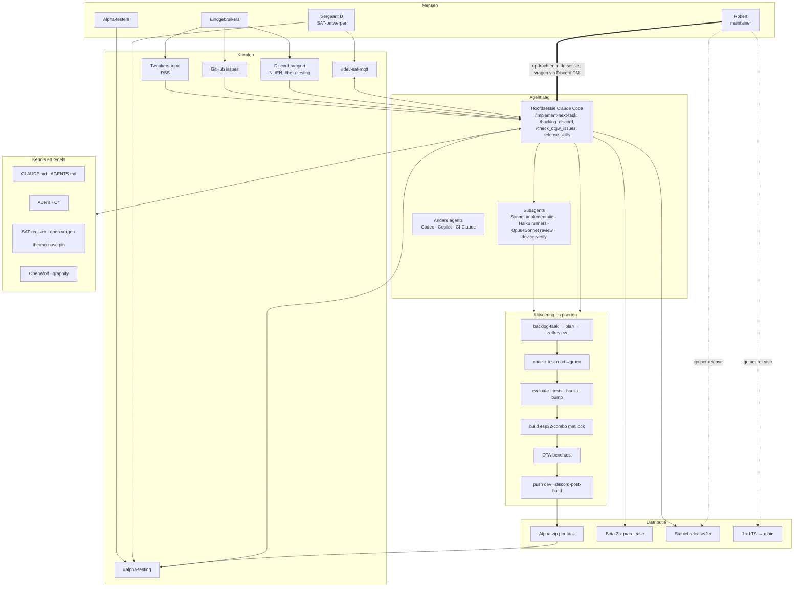
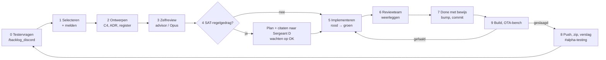
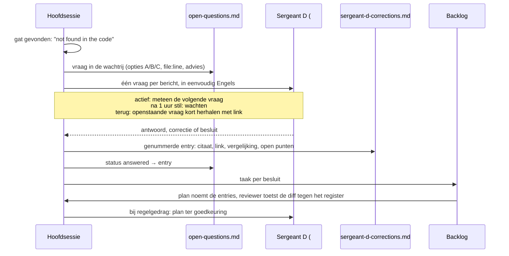

# OTGW agentic werkplaats: functionele architectuur van de ontwikkelomgeving

| | |
|---|---|
| Status | Vastgelegde momentopname, bedoeld om op voort te bouwen |
| Peildatum | 2026-11-04, `dev` @ 19e318b, firmware 2.0.0-beta.79 |
| Taak | TASK-1624 (verbetertaken TASK-1625 t/m TASK-1636) |
| Visuele versie | [`agentic-setup.html`](agentic-setup.html): open lokaal in een browser |
| Uitvoering | [`agentic-improvements-handoff-2026-11-04.md`](agentic-improvements-handoff-2026-11-04.md) |
| Opgesteld door | Claude Code (cloudsessie) in opdracht van Robert |

Dit document beschrijft hoe het OTGW-firmwareproject wordt ontwikkeld: welke mensen en agents erbij betrokken zijn, welke regels gelden, langs welke kanalen informatie binnenkomt en naar buiten gaat, en welke poorten een wijziging passeert. Het is geschreven in functionele termen. Het "wat en waarom" staat voorop en verwijst naar de bestanden waar het "hoe" staat. Hoofdstuk 9 legt uit hoe je dit document bijwerkt.

---

## 1. Kernpunten

1. **Eén coördinerende AI-sessie draait een continue ontwikkelcyclus.** De skill `/implement-next-task` kiest de volgende taak, ontwerpt, laat het plan kritisch reviewen, delegeert code naar subagents en zet een taak alleen op Done met bewijs uit dezelfde sessie. Daarna volgen een build, een benchtest en publicatie aan testers.
2. **Robert (maintainer) is de enige met beslismacht over scope, prioriteit en vrijgave.** Testers leveren input en bewijs maar sturen niets. Hun verzoeken krijgen het label `needs-maintainer-ok`.
3. **Sergeant D is de eerste bron van waarheid voor SAT-gedrag.** Daarna komt de vastgepinde thermo-nova-code. De firmware zelf telt nooit als bron. Elke uitspraak van Sergeant D wordt eerst vastgelegd in een genummerd register (269 entries) en pas daarna uitgevoerd.
4. **Kwaliteit is ingebed in de werkwijze, niet in CI.** De poorten zijn git-hooks, `evaluate.py`, een build-lock voor de hele machine, een benchtest per taak en een post-script dat weigert bij twijfel. De GitHub-CI draait alleen op pull requests, en die worden op `dev` niet gebruikt.
5. **De grootste risico's zijn drift en concentratie.** Instructies per agent lopen uiteen, regels groeien als lagen bij, en kritieke state en infrastructuur staan op één Windows-werkplek.

---

## 2. Definities

Waar het project zelf een term vastlegt (CLAUDE.md, ADR's, skills), volgt deze definitie die bron.

### 2.1 Rollen

| Term | Definitie | Vastgelegd in |
|---|---|---|
| **Maintainer** | Robert. Bezit scope, prioriteit, waivers en elke onomkeerbare of naar buiten gerichte actie: PIC flashen, release, push naar `main`, force-push. Agents leggen open beslissingen aan hem voor als één interactieve vraag per beslissing, met opties en een gewogen advies. | CLAUDE.md, Design Principles en Git push policy |
| **SAT-ontwerper** | Sergeant D (George). Ontwierp SAT (Smart Autotune Thermostat) op papier, Alex (Alexwijn) schreef de code. Zijn vastgelegde uitspraken staan boven alle code. | CLAUDE.md, SAT ground truth |
| **Tester (alpha-tester)** | Deelnemer in #alpha-testing die alpha-builds flasht en captures levert. Heeft geen beheersrechten. Bewijs van een tester mag een bestaande taak sluiten. Een verzoek van een tester wordt een taak met `needs-maintainer-ok`. | `.claude/commands/backlog_discord.md` |
| **Read-only lid** | Discord-lid van wie niets tot actie leidt. Krijgt één keer het antwoord "Changes go through Robert." | idem |
| **Eindgebruiker** | Gebruiker van een releaseversie die via support-kanalen, GitHub-issues of Tweakers meldt. | `.claude/commands/check_otgw_issues.md` |
| **Hoofdsessie** | De Claude Code-sessie die de cyclus draait. Ontwerpt, roept advisor of reviewers aan, beoordeelt het ruwe bewijs zelf, en is de enige die post op Discord, bumpt, commit en pusht. | `.claude/skills/implement-next-task/SKILL.md` |
| **Coördinerende 2.0.0-sessie** | Bij meerdere gelijktijdige sessies de sessie die builds aankondigt, het verslag in #alpha-testing schrijft en het alpha-ledger bijhoudt. | CLAUDE.md, Build Commands |
| **Subagent** | Een door de hoofdsessie gestarte agent met een smalle opdracht: implementeren (Sonnet), mechanisch uitvoeren en output letterlijk citeren (Haiku), reviewen (Opus voor correctheid plus Sonnet-lenzen) of op het apparaat verifiëren (`otgw-device-verify`). Bumpt, commit en pusht nooit. | skill, `.claude/agents/otgw-device-verify.md` |
| **Andere agents** | Codex (instructies in `AGENTS.md`), GitHub Copilot (`.github/copilot-instructions.md`, `.github/agents/*`) en de Claude-GitHub-workflows (`claude.yml`, `claude-code-review.yml`). Ze werken elk met een eigen instructiebestand. | |

### 2.2 Werkeenheden en bewijs

| Term | Definitie |
|---|---|
| **Backlog-taak** | De eenheid van werk in Backlog.md (`TASK-NNN`, met subtaken als `TASK-1412.7`). Elke wijziging begint met een taak. Agents gebruiken altijd de `backlog`-CLI, nooit de MCP-server en nooit een directe bestandsbewerking. `.claude/hooks/backlog-mcp-guard.py` blokkeert directe bewerkingen. |
| **AC / DoD** | Acceptatiecriteria en Definition of Done per taak. Een AC mag alleen worden afgevinkt met bewijs uit dezelfde sessie: build-output, capture, curl-respons, screenshot of benchlog. |
| **Oud-tegen-fix-bewijs** | Dezelfde reproductie gefaald op de oude code en geslaagd op de fix. Een groene run op alleen de fix telt niet. Een hosttest die de code nabouwt in plaats van aanroept, bewijst niets over die code. |
| **Poort (gate)** | Een geautomatiseerde controle die een stap kan weigeren (zie hoofdstuk 6). |
| **Bench** | Fysieke testunits (OTGW32 met OT-Direct, OTGW Classic met S3 Mini en PIC) op Roberts werkplek. Ze worden over WiFi-OTA geflasht via safeboot. USB alleen als OTA niet kan, en dan met `flash_otgw --migrate`. |
| **Plan-checkpoint** | Een moment waarop de maintainer het plan moet goedkeuren. Binnen `/implement-next-task` vervangen een zelfreview en een melding in #alpha-testing dit checkpoint (besluit 2026-10-20), behalve bij SAT-regelgedrag (dan is een OK van Sergeant D nodig) en bij acties die altijd toestemming vragen. |

### 2.3 Versies, lijnen en distributie

| Term | Definitie |
|---|---|
| **Alpha-tag** | De unieke waarde van `_VERSION_PRERELEASE` per firmwarecommit, zodat een tester twee builds kan vergelijken (A/B). `.githooks/pre-commit` dwingt het af. `bin/bump-prerelease.sh` bumpt de tag en synchroniseert alle versiebanners. |
| **Build-stempel** | Wijzigingen van `_VERSION_BUILD` en `_VERSION_GITHASH` die een build in `version.h` en `data/version.hash` zet. Dit is geen bump: je zet het terug met `git checkout --`. |
| **Alpha-zip** | `build/OTGW-firmware-esp32-combo-<versie>+<hash>-flash.zip`, met de complete flashset. Wordt per getest taakresultaat in #alpha-testing gepost via `scripts/discord-post-build.sh`. |
| **Alpha-ledger** | `.claude/alpha-build-ledger.local.md`, lokaal en gitignored, bijgehouden door de coördinator. Legt vast welke tags zijn gepost of door een latere zip zijn gedekt. Voor elke post wordt het vergeleken met de git-log. |
| **Lijnen** | `dev` is de 2.x-werklijn (ESP32-S3, async en FreeRTOS). `release/2.x` is stabiel 2.x. `otgw-1.x.x` is de 1.x-LTS-lijn. `main` is de laatste publieke 1.x-release. |

### 2.4 Kennis

| Term | Definitie |
|---|---|
| **ADR, binding** | Een architectuurbesluit dat een patroon vastlegt en een CI- of testpoort heeft (ADR-080). Er zijn er nu 7, en `tests/test_adr_governance.py` bewaakt de lijst. **Structurele ADR's** worden alleen bij review gecontroleerd. |
| **Ground truth (SAT)** | De rangorde voor SAT-gedrag: (1) het register van Sergeant D, (2) de thermo-nova-code op commit `7beaaf5`, (3) `docs/sat/thermo-nova-spec.md`, (4) de firmware en haar specs, die alleen beschrijven wat de port nu doet. Elke uitspraak citeert `file:line` en is in de huidige sessie geopend. |
| **Beslisregister** | `docs/sat/sergeant-d-corrections.md`: genummerde, onveranderlijke entries met letterlijk citaat, Discord-link, vergelijking met thermo-nova en de firmware, de taak die eruit volgt en wat open blijft. Een latere entry die een eerdere wijzigt, noemt die eerdere. |
| **Open-vragenwachtrij** | `docs/sat/open-questions.md`: de SAT-vragen die het port-team niet zelf mag beantwoorden, met de status queued, asked, answered of dropped. |
| **C4-documentatie** | `docs/c4/`: context, containers, componenten en code. Bepaalt welk component welke code bezit. |
| **OpenWolf** | Contextlaag in `.wolf/`: `anatomy.md` (bestandsindex), `cerebrum.md` (lessen en Do-Not-Repeat), `buglog.json` en `memory.md`. Hooks rond Read en Write houden die bij. |
| **graphify** | Kennisgraaf van `src/` in `graphify-out/` voor structuurvragen ("wat roept X aan"). |

---

## 3. Architectuur in lagen

### 3.1 Mensen

Er zijn vier rollen met een strikt verschil in zeggenschap (zie de matrix in 5.1). Robert stuurt vooral rechtstreeks via de Claude Code-sessie. Hij praat ook op Discord, maar de agentlaag behandelt hem daar alleen als opdrachtgever als hij de bot direct aanspreekt.

### 3.2 Kanalen

| Kanaal | Functie | Hoe de agent het bereikt | Richting |
|---|---|---|---|
| #alpha-testing (`1514720723980259460`) | Distributie van alpha-zips, aankondiging en verslag per taak, SAT-dialoog met Sergeant D, testerfeedback | `discord-mcp` (lezen en posten), webhook (zip) | beide |
| #dev-sat-mqtt (`1105556725714649128`) | Backlog-bot (list, show, move, note), SAT-simulatierondes | `discord-mcp` | beide |
| Discord support (NL, EN, #beta-testing, #devs-esp-firmware) | Gebruikersmeldingen | `discord-mcp`, alleen lezen via `/check_otgw_issues` | in |
| GitHub issues | Gebruikersmeldingen | `gh issue list/view` | in |
| Tweakers-topic | Nederlandstalige gebruikersmeldingen | RSS via `curl` | in |
| Claude Code-sessie | Opdrachten van Robert | direct in de sessie; vragen aan Robert alleen via Discord DM (zonder DM-kanaal asynchroon in de sessie), nooit een interactieve CLI-vraag (TASK-1829) | beide |

De Discord-MCP is een native Java-proces (`saseq/discord-mcp`) op `localhost:8085` op Roberts werkplek. Het start bij inloggen en mag maar één keer de bottoken vasthouden. De zip-post loopt via een webhook-URL in `%LOCALAPPDATA%\OTGW-capture\` en wordt nooit gelogd.

### 3.3 Agentlaag

De **hoofdsessie** is het enige orkestratiepunt. Ze draait skills (procedures die in de sessie laden) en commands:

| Skill / command | Functie |
|---|---|
| `/implement-next-task` | De continue ontwikkelcyclus (hoofdstuk 4) |
| `/backlog_discord` | Onbeantwoorde Discord-berichten afhandelen, backlog-commando's uit #dev-sat-mqtt uitvoeren |
| `/check_otgw_issues` | Discord-support, GitHub en Tweakers scannen, triage, taken voorstellen |
| `/beta-release-2x`, `/release-2x` | Beta- en stabiele releases van 2.x |
| `/beta-prerelease`, `/release` | Releases van de 1.x-lijn |
| `/update-docs-2x`, `/update-docs` | Documentatie bijwerken binnen scope (`scripts/docs-scope-2x.sh`) |
| `/flash`, `firmware-design-handoff` | Flashen, en een designsysteem-pakket voor de web-UI |

**Modelverdeling** (uit de skill): de hoofdsessie (door Robert gekozen model) doet ontwerp, oordeel en communicatie. Sonnet implementeert, Haiku voert uit en citeert, Opus reviewt op correctheid. Uitgangspunt: een zwakker model claimt sneller PASS, dus de hoofdsessie leest het ruwe bewijs altijd zelf.

**Andere agents.** Codex gebruikt `AGENTS.md`, Copilot gebruikt `.github/copilot-instructions.md` en dertien agentprofielen in `.github/agents/`. In CI draaien `claude.yml` (op commentaar) en `claude-code-review.yml` (op PR's). Deze agents delen niet automatisch dezelfde regels (bevinding F1).

### 3.4 Kennis en regels

| Bron | Omvang | Functie |
|---|---|---|
| `CLAUDE.md` | 673 regels, 14 gedateerde maintainer-directives | Projectregels voor Claude, laadt elke sessie |
| `AGENTS.md` | 918 regels | Projectregels voor Codex, afgeleid van CLAUDE.md |
| `docs/adr/` | ±210 ADR's, 7 binding | Architectuurbesluiten |
| `docs/c4/` | context t/m code | Eigenaarschap van componenten |
| `docs/sat/sergeant-d-corrections.md` | 269 entries, 6.013 regels | SAT-beslisregister |
| `docs/sat/open-questions.md` | ±86 vragen | SAT-wachtrij |
| `docs/sat/thermo-nova-spec.md` | | Specificatie afgeleid van de gepinde thermo-nova-code |
| `other-projects/` | alleen lezen | Referentie-implementaties (otgw, otmonitor, OT-Thing, SAT thermo-nova) |
| `.wolf/` | | OpenWolf-geheugen, buglog, Do-Not-Repeat |
| `graphify-out/` | 1.628 nodes | Codegraaf van `src/` |

### 3.5 Uitvoering en poorten

Zie hoofdstuk 4 voor de volgorde en hoofdstuk 6 voor de poorten.

### 3.6 Distributie

| Product | Lijn | Gebouwd | Vrijgave |
|---|---|---|---|
| Alpha-zip | `dev` | lokaal, esp32-combo | per getest taakresultaat, automatisch na een geslaagde benchtest |
| Beta 2.x | `dev` | lokaal, upload met `gh` (eerst als draft), `--latest=false` | `/beta-release-2x` |
| Stabiel 2.x | `release/2.x` | lokaal | `/release-2x`, alleen na Roberts go |
| 1.x | `otgw-1.x.x` → `main` | CI | `/release`, elke push naar `main` per keer bevestigd |

---

## 4. De ontwikkelcyclus

Bron: `.claude/skills/implement-next-task/SKILL.md`. CLAUDE.md blijft leidend. De skill ordent de regels tot een lus.

| Stap | Wat gebeurt er | Belangrijke regels |
|---|---|---|
| 0 Testervragen | Onbeantwoorde berichten van Sergeant D, testers of Robert worden eerst beantwoord | Phase 0 negeert de 5-minutenregel. Technische claims worden met `file:line` onderbouwd. |
| 1 Selecteren | Eerst taken In Progress van `@claude` die nu af te ronden zijn, dan To Do op prioriteit en daarna op nummer | Overslaan bij ontbrekende hardware, een ontbrekend besluit, wachten op Sergeant D of het label `needs-maintainer-ok`. Eerste actie: `-s "In Progress" -a @claude`. Melding in #alpha-testing. |
| 2 Ontwerpen | Taak, notes, C4, `/adr-kit:context` en bij SAT het register lezen. Open source zoeken. Reproductie bepalen. | Plan met de vraag of het ook op de andere lijn hoort |
| 3 Zelfreview | Plan kritisch toetsen, advisor of Opus-reviewer | Afgewezen bevindingen met reden. Architectuurwijziging: een Proposed ADR, nooit zelf geaccepteerd. |
| 4 Plan melden | Melding, geen goedkeuringsverzoek | Uitzondering SAT-regelgedrag: plan met thermo-nova-citaten naar Sergeant D, niets bouwen tot zijn OK |
| 5 Implementeren | Sonnet-subagent. Bug eerst rood reproduceren, dan groen. Build en gates. | Eén build tegelijk op de machine, maximaal 4 jobs, alleen esp32-combo. Exit 0 alleen is geen bewijs. |
| 6 Reviewteam | Parallel: correctheid (Opus), projectregels, echtheid van tests, extra lenzen, bij SAT het register | Reviewers moeten weerleggen. Bevindingen worden zelf gecontroleerd. |
| 7 Done | Final summary met bewijs per AC, bump, één commit per taak met expliciete paden | Nooit `--no-verify`. Graphify, buglog en cerebrum bijwerken. |
| 9 Build en bench | esp32-combo-build, OTA naar een benchunit, test van het gedrag van deze taak | Mislukt: niets publiceren. Maximaal 3 uur tussen builds. Na een rebase opnieuw bouwen. |
| 8 Publiceren | Push naar `dev`, `discord-post-build.sh -m "TASK-NNN: ..."`, verslag in gewone taal | Engels, het antwoord eerst, OTGW32 niet bij naam noemen, Sergeant D niet taggen bij builds |

**Stopcriteria:** niets uitvoerbaar, Robert zegt stop, twee mislukte reviewrondes op dezelfde taak, of een rate limit.

---

## 5. Interactie met mensen

### 5.1 Zeggenschapsmatrix

| Actor | Taak laten aanmaken | Prioriteit en selectie | SAT-gedrag bepalen | Code laten wijzigen | Push naar dev | Release en main |
|---|---|---|---|---|---|---|
| Robert | ja | ja | beslist mee* | ja | staand mandaat | per keer |
| Sergeant D | ja | nee | ja, eerste bron | via register → taak | nee | nee |
| Alpha-tester | met label `needs-maintainer-ok` | nee | nee | nee | nee | nee |
| Read-only lid | nee | nee | nee | nee | nee | nee |
| Hoofdsessie | ja | binnen de regels | nee, vraagt | ja | na de poorten | nee |
| Subagent | nee | nee | nee | bewerkt alleen | nee | nee |

\* Robert neemt ook SAT-besluiten. Ze staan als "maintainer decision" in hetzelfde register (minstens 18 entries), soms achteraf door Sergeant D bevestigd (entry 265 bevestigt 257-264).

### 5.2 Omgangsregels op Discord

- Elk antwoord aan een persoon gebruikt de echte `<@ID>`-mention.
- #alpha-testing: Engels, het antwoord eerst, zeggen wat nog niet geverifieerd is.
- In Phase 0 krijgt elk bericht dat een antwoord nodig heeft er een, van oud naar nieuw. Kan een antwoord niet in deze run worden afgerond, dan volgt een kort tussenbericht met de taak. Berichten ouder dan 7 dagen gaan naar Robert in plaats van naar het kanaal.
- Bijlagen worden alleen opgehaald bij bugsignalen (zuinigheidsregels B1-B5 en O1-O7).
- De lijst met mensen en hun regels staat in `.claude/discord-people.local.md`: lokaal, bewust niet in de publieke repo.

### 5.3 De SAT-beslisketen met Sergeant D

Kernregels (CLAUDE.md, SAT ground truth):

- **Vastleggen vóór uitvoeren.** Een korte of dubbelzinnige reactie wordt expliciet als interpretatie vastgelegd.
- **Een conflict wordt nooit stil opgelost.** Als code en Sergeant D verschillen, gaan beide met citaat naar hem.
- **Volgorde van het advies** (sinds 2026-10-30): (1) beste regelresultaat, (2) zijn eerdere antwoorden, (3) thermo-nova als geteste referentie. Dit bepaalt alleen de volgorde van het advies, niet de rangorde van de ground truth.
- **Uitzonderingen op "één vraag tegelijk"** zijn door Robert gegeven en gedocumenteerd (2026-10-24 overzicht Q2-Q28, 2026-10-30 dertien vragen in één keer).
- Het pinnen van een nieuwe thermo-nova-commit gebeurt alleen bewust, in één commit met een nieuwe diff van de spec.

### 5.4 Instroom van eindgebruikers

`/check_otgw_issues` stopt als alle bronnen korter dan 2 uur geleden zijn bekeken. Daarna leest het Discord-support (25 berichten per kanaal), GitHub (eerst alleen de body, commentaar alleen bij bugs) en Tweakers (eerst de omschrijving, keyword-filter). Bijlagen gaan in twee rondes (metadata, dan een gerichte `Grep`). Triage-output gaat naar `.tmp/triage_result.json`. Er komt een backlog-taak na akkoord van de ontwikkelaar.

---

## 6. Kwaliteits- en vertrouwensmechanismen

| Poort | Waar | Weigert bij | Omzeilbaar |
|---|---|---|---|
| backlog-guard | `.claude/hooks/backlog-mcp-guard.py` (PreToolUse) | directe bewerking van `backlog/tasks/*.md` | nee |
| evaluate na edit | PostToolUse in `.claude/settings.json` | geeft nu geen signaal, zie F3 | ja (`|| true`) |
| pre-commit: adr-judge | `.githooks/pre-commit` | schending van Enforcement-blokken in ADR's | `ADR_KIT_HOOK_DISABLE=1` |
| pre-commit: bump | `.githooks/pre-commit` | firmwarepad gestaged zonder nieuwe `_VERSION_PRERELEASE` | `OTGW_BUMP_HOOK_DISABLE=1` |
| commit-msg | `.githooks/commit-msg` | geen TASK-verwijzing, of taakbestand niet gestaged | `--no-verify` (verboden in de cyclus) |
| evaluate.py | handmatig of in de cyclus | 42 checks: PROGMEM, abstractiegrens (baseline-ratchet), ArduinoJson, MQTT-burst, design drift, ... | n.v.t. |
| Testsuite | `scripts/run_tests.py` | 125 Python-tests, 43 MSVC-host-harnassen (alleen Windows) | n.v.t. |
| Build-lock | `build.py` | tweede gelijktijdige build op de machine | `OTGW_BUILD_LOCK_WAIT` |
| Benchtest | handmatig of `otgw-device-verify` | gedrag niet aangetoond op hardware | n.v.t. |
| Post-script | `scripts/discord-post-build.sh` | githash van de zip niet gelijk aan HEAD, `src/` niet schoon, zip groter dan 10 MB | nee (omweg verboden) |
| CI | `.github/workflows/` | alleen op pull_request, zie F2 | n.v.t. op `dev` |

Let op: de git-hooks zijn alleen actief als `git config core.hooksPath .githooks` per clone is gezet.

---

## 7. Cijfers

| Meetpunt | Waarde | Meetwijze |
|---|---|---|
| Entries in het SAT-register | 269 (6.013 regels) | `grep -c '^## [0-9]'` |
| Waarvan maintainer decisions | ≥ 18 | `grep -c 'maintainer decision'` |
| Rijen in de SAT-wachtrij | ±86 | rijen die beginnen met `\| Q` |
| Actieve taken (vóór TASK-1624) | 115: 36 To Do, 14 In Progress, 65 Done | frontmatter-status |
| Gearchiveerde taken | 1.321 | `backlog/archive/tasks` |
| ADR-bestanden | ±210 (217 bestanden inclusief index en rapporten) | `ls docs/adr` |
| Checks in evaluate.py | 42 | `def check` |
| Tests | 125 Python + 43 host-harnassen | `tests/test_*.py`, `test/host/test_*` |
| Skills / commands / eigen subagents | 9 / 2 / 1 | `.claude/` |
| Scripts | 84, waarvan 45 `sat_*` | `scripts/` |

Deze checkout was een shallow clone van 50 commits (allemaal van 2026-11-04). Doorlooptijden en commitfrequentie zijn daarom niet gemeten. Daar is TASK-1633 voor.

---

## 8. Bevindingen

Wat goed werkt: het bewijsregime (oud tegen fix, Done alleen met bewijs, reviewers die moeten weerleggen) is streng en concreet. De SAT-rangorde met verplichte `file:line`-citaten is een sterke maatregel tegen hallucinatie. Dat elke firmwarecommit een eigen tag krijgt, maakt testerfeedback goed toe te wijzen. Dat testers geen beheersrechten hebben, beschermt de prioritering. De risico's hieronder gaan over beheersbaarheid op termijn.

| # | Ernst | Bevinding | Bewijs | Taak |
|---|---|---|---|---|
| F1 | Hoog | **Instructies lopen uiteen tussen agents.** CLAUDE.md: backlog alleen via de CLI. AGENTS.md: de MCP is primair. Copilot-instructies: ESP8266 en ArduinoJson (in strijd met ADR-146). De bridge-doc beschrijft een npx-`mcp-discord`, "OTGW bot#0128" en alleen #dev-sat-mqtt. Alleen het blok met binding ADR's wordt op drift getest. | `AGENTS.md:11`, `.github/copilot-instructions.md:5-12`, `.claude/docs/discord-backlog-bridge.md:18-82` | TASK-1625 (opgelost in TASK-1625, 2026-11-05: gedeeld AGENT-CORE-blok met drifttest `tests/test_agent_core_block.py`; bridge-doc vervangen door `docs/guides/discord-mcp-server.md`, dat CLAUDE.md al noemde maar ontbrak) |
| F2 | Hoog | **CI ziet de hoofdlijn niet.** build, evaluate en adr-governance draaien alleen op `pull_request`, terwijl `dev` directe pushes krijgt. De hooks zijn opt-in per clone. | `.github/workflows/*.yml` `on:` | TASK-1626, TASK-1627 (opgelost in TASK-1626, 2026-11-05: evaluate, ADR governance en build draaien op push naar dev, build niet bij docs-only; de eerste push-run vond meteen een verborgen rode ADR-lint, opgelost in TASK-1638) |
| F3 | Middel | **De omgeving zit vast aan één werkplek.** De evaluate-hook heeft `cd 'D:/...'` en `|| true`. Bench-IP en COM4, webhook, Discord-MCP, people-file en ledger zijn lokaal. Alles draait met `bypassPermissions` en `Bash(*)`. | `.claude/settings.json` | TASK-1627, TASK-1632 (deels opgelost in TASK-1627, 2026-11-05: evaluate-hook draagbaar en meldt FAIL, hooksPath bij sessiestart; rest opgelost in TASK-1632: `scripts/alpha_ledger.py` herbouwt het ledger, postlog in `discord-post-build.sh`, sjabloon `.claude/discord-people.example.md`, runbook `docs/guides/second-machine-setup.md`) |
| F3b | Middel | **Builds door hooks laten een build-stempel achter**, waardoor de stop-hook om een commit vraagt. | waargenomen 2026-11-04 | TASK-1628 |
| F4 | Middel | **Regels groeien als lagen bij.** 673 regels, 14 directives, vervangen regels blijven staan, workarounds voor bugs op meerdere plekken. | `CLAUDE.md` | TASK-1631, TASK-1635 |
| F5 | Middel | **Het SAT-register en de wachtrij zijn ongestructureerd.** Er is geen machineleesbare herkomst, maintainer-besluiten staan tussen die van Sergeant D, de statuskolom loopt achter (Q-1519b, -d, -e, Q-1531a, Q-1537a) en de geschiedenis is in "Update"-alinea's opgestapeld. | `docs/sat/open-questions.md` | TASK-1629, TASK-1630 (deel 1 opgelost in TASK-1629, 2026-11-05: statuskolom genormaliseerd, Live queue gegenereerd door `scripts/sat_open_questions.py`; deel 2 opgelost in TASK-1630, 2026-11-05: JSON-index `docs/sat/sergeant-d-corrections.index.json` met bron per entry (sergeant-d 222, maintainer 31, port-team 16) en bevestigingen) |
| F6 | Laag | **Doorvoer is bewust geserialiseerd**: één build tegelijk, een benchtest per taak, maximaal 3 uur tussen builds. Waar de bottleneck zit is niet gemeten. | CLAUDE.md, Build Commands | TASK-1633, TASK-1636 |
| F7 | Laag | **Onderzoek staat tussen gereedschap.** 45 `sat_*`-studies in `scripts/` worden veel vanuit `docs/sat/` aangeroepen. | `scripts/` | TASK-1634 |
| F8 | Laag | **"`backlog task list` is leeg" lijkt niet (meer) universeel.** Op Linux met v1.46.1 werkt het. De workaround staat wel op meerdere plekken. | cloudsessie 2026-11-04 | TASK-1635 (opgelost in TASK-1635, 2026-11-05: bug reproduceert niet; workaround vervangen door de echte Windows-valkuil, `backlog.cmd` kapt argumenten met regeleinden af) |

---

## 9. Verbetervoorstellen en scenario's

### 9.1 Voorstellen gekoppeld aan taken

| Taak | Voorstel | Prioriteit | Hangt af van |
|---|---|---|---|
| TASK-1625 | Agentinstructies uit één gedeelde kern, met een driftcheck. Bridge-doc bijwerken. | hoog | |
| TASK-1626 | CI (evaluate, adr-governance) op push naar `dev` | hoog | |
| TASK-1627 | Hooks draagbaar maken (`$CLAUDE_PROJECT_DIR`, zichtbare FAIL, `core.hooksPath` bij sessiestart) | hoog | |
| TASK-1628 | Geen build-stempel na builds door hooks | middel | |
| TASK-1629 | Statuskolom van de wachtrij corrigeren, plus test | middel | |
| TASK-1630 | Machineleesbare index naast het SAT-register (entries blijven onveranderd) | middel | 1629 |
| TASK-1631 | CLAUDE.md slanker: kern plus regels die alleen laden als ze relevant zijn, en een changelog van directives | middel | 1625 |
| TASK-1632 | Lokale state reconstrueerbaar maken (ledger-generator, sjabloon voor de people-file, runbook voor een tweede machine) | middel | |
| TASK-1633 | Doorvoer meten | laag | (1630 helpt) |
| TASK-1634 | Onderzoeksscripts verplaatsen, met alle verwijzingen | laag | |
| TASK-1635 | De workaround voor `task list` oplossen of verwijderen | laag | |
| TASK-1636 | Besluit over opschalen (bench, build-runner, Discord-host) | laag | 1633 |

### 9.2 Scenario's

| Scenario | Inhoud | Doorlooptijd | Advies |
|---|---|---|---|
| **A. Consolideren** | TASK-1625 t/m 1629 en 1635 | dagen | Nu. Weinig risico, direct minder kans op fouten. |
| **B. Herstructureren** | A plus TASK-1630, 1631 en 1632 | weken | Na een rustig moment in de SAT-campagne (TASK-1412). 1630 en 1631 hebben Roberts goedkeuring nodig. |
| **C. Opschalen** | B plus TASK-1633 en een besluit via 1636 | maanden | Alleen als de metingen het rechtvaardigen. |

---

## 10. Beperkingen van dit onderzoek

- **Discord zelf is niet gelezen.** De cloudsessie heeft geen Discord-MCP. De interactie is afgeleid uit commands, regels, het register en de wachtrij.
- **Lokale, gitignored bestanden ontbraken:** `discord-people.local.md`, het alpha-ledger, `.mcp.json` en de webhook.
- **Geschiedenis:** de shallow clone liet geen trend in tempo of doorlooptijd zien.
- **Aantallen** zijn telling op bestandsniveau en kunnen een paar procent afwijken.

## 11. Dit document bijwerken

- Werk de peildatum en de cijfers in hoofdstuk 7 bij met de genoemde meetwijzen. Na TASK-1633 doet het script dat.
- Bevinding afgerond: zet de status bij de bevinding ("opgelost in TASK-NNN, datum") in plaats van de rij te verwijderen. Zo blijft de redenering herleidbaar.
- Nieuwe rol, kanaal, skill of poort: voeg hem toe aan de tabellen in hoofdstuk 2, 3 en 6.
- Werk de visuele versie (`agentic-setup.html`) bij als de architectuur in hoofdstuk 3 verandert.
- Wijzigingen aan dit document zijn docs-only: geen bump en geen build nodig, wel een TASK-verwijzing in de commit.
