# OTGW agentic werkplaats: functionele architectuur van de ontwikkelomgeving

| | |
|---|---|
| Status | Bijgewerkte architectuurbeschrijving; vervangt de momentopname van 2026-11-04 |
| Peildatum | 2026-11-15, `dev` @ `e22c59e`, firmware 2.0.0-beta.327 (vorige peildatum 2026-11-04, beta.79) |
| Taak | TASK-1984 (vorige versie TASK-1624, verbetertaken TASK-1625 t/m TASK-1636) |
| Visuele versie | [`agentic-setup.html`](agentic-setup.html): een Engelstalige uitleg met veel visualisaties, ook voor wie het project niet kent |
| Platen | [Plaat A, overzicht](images/agentic-setup-plate-a.svg) en [plaat B, BlueFlame Bot](images/agentic-setup-plate-b.svg), licht thema; generator in [`tools/agentic-plates/`](../../tools/agentic-plates/README.md) |
| Beeldbrief | [`agentic-setup-image-brief.md`](agentic-setup-image-brief.md): compositie en prompts voor een image generator |
| Taal | Lopende tekst Nederlands; alle diagrammen Engels (maintainer, 2026-11-15) |
| Opgesteld door | Claude Code (cloudsessie) in opdracht van Robert. Gebaseerd op tien geverifieerde feitenbladen; schrijvers op Fable 5.2 en adversariële reviewers (hoofdstuk 15) |

Dit document beschrijft hoe het OTGW-firmwareproject wordt ontwikkeld. Het behandelt:

- welke mensen en agents erbij betrokken zijn, en welke modellen die agents gebruiken;
- langs welke kanalen informatie binnenkomt en naar buiten gaat, inclusief de externe bronnen die geraadpleegd worden;
- welke regels gelden, hoe ze in een sessie terechtkomen en hoe ze worden gehandhaafd;
- welke kennis wordt bijgehouden, waaronder de ADR-kit;
- welke poorten een wijziging passeert op weg naar testers en gebruikers.

Hoofdstuk 6 gaat in detail over BlueFlame Bot: de persona die Discord, GitHub en Tweakers bewaakt en per kanaal anders reageert.

Het document beschrijft wat er nu is, met bronvermelding (`pad:regel`). Waar de praktijk verder is dan de regels, staat dat er expliciet bij. Afwijkingen tussen bestanden staan als "spanningen" aan het eind van elk hoofdstuk, en de belangrijkste zijn samengevat als bevindingen in hoofdstuk 13.

**Leeswijzer.** Wie tien minuten heeft: hoofdstuk 1 en de platen in hoofdstuk 2 en 6. Wie de bot wil begrijpen: hoofdstuk 6. Wie iets wil veranderen: hoofdstuk 8 (regels), 13 (bevindingen) en 14 (voorstellen en de drie open beslissingen).

---

## 1. Kernpunten

1. **Een coördinerende sessie draait de ontwikkelcyclus, met een kleine bemanning eromheen.**
   - De coördinator kiest taken, legt beslissingen per Discord-DM aan Robert voor en bezit het ledger en het verslag aan testers.
   - Ontwikkelsessies werken in eigen lanes.
   - Een bench-tester is de enige die hardware flasht.
   - Een comms-sessie voert het gesprek op Discord en schrijft de postconcepten.

   Subagents doen het werk per soort: Sonnet implementeert, Haiku voert uit en citeert, Opus reviewt op correctheid.
2. **BlueFlame Bot is de stem van die werkplaats, geen apart programma.**
   - Het gedrag staat in commands, skills en regels; de techniek is een lokaal Java-proces met het bottoken, een webhook voor zips, `gh` onder het maintainer-account en een RSS-lezer.
   - Hij bewaakt drie buitenposten (Discord, GitHub, Tweakers) met drie lussen: `/backlog_discord` vóór elke taak, een GitHub-sweep vóór elke taak, en `/check_otgw_issues`, dat met de hand gestart wordt.
   - Hij antwoordt in #alpha-testing, #dev-sat-mqtt, de DM met Robert en op GitHub. In de supportkanalen post hij aankondigingen, en in de praktijk ook antwoorden. Tweakers leest hij alleen.
3. **Mensen beslissen, agents voeren uit, en de grens is scherp getrokken.**
   - Robert beslist over scope, prioriteit, waivers en releases.
   - Sergeant D is de eerste bron van waarheid voor SAT-gedrag; elk besluit van hem wordt eerst vastgelegd (353 entries) en dan pas uitgevoerd.
   - Testers leveren bewijs, maar hun verzoeken worden taken met `needs-maintainer-ok`.
   - Een publieke beta draait op een staand mandaat; een stabiele release, een PIC-flash en een push naar `main` vragen elk een expliciet "ja".
4. **Kwaliteit zit in poorten die weigeren.** Git-hooks, `evaluate.py` (42 checks), een build-lock voor de hele machine, een benchtest per firmwaretaak door de bench-tester en een post-script dat bij elke twijfel weigert. Sinds 2026-11-05 draaien evaluate, ADR-governance en de build ook in CI bij een push naar `dev`.
5. **De risico's van 2026-11-04 zijn aangepakt; de nieuwe zitten in drift tussen praktijk en regels.**
   - Alle twaalf verbetertaken zijn uitgevoerd.
   - Rollen, kanalen en een delegatie bestaan alleen in taaknotities.
   - Oudere commands en skills schrijven nog een werkwijze voor die CLAUDE.md verbiedt.
   - Twee binding ADR's hebben in de praktijk geen automatische poort meer.

   Hoofdstuk 13 noemt elf nieuwe bevindingen, hoofdstuk 14 de voorstellen en drie beslissingen voor Robert.

---

## 2. Het geheel in één beeld

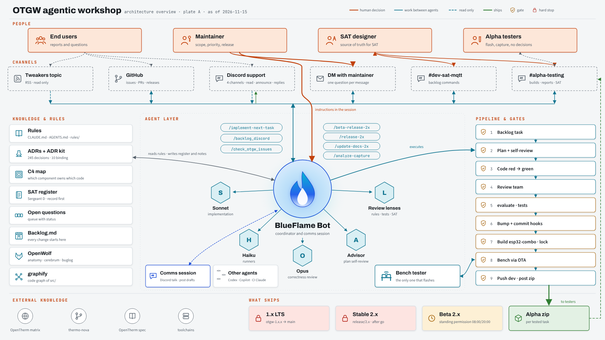

*Plaat A, referentiewireframe in het lichte thema ([SVG](images/agentic-setup-plate-a.svg)). Dezelfde zones en knopen als het diagram hieronder; bedoeld als layoutbasis voor een image generator, zie [de beeldbrief](agentic-setup-image-brief.md). Plaat B over BlueFlame Bot staat in hoofdstuk 6.*

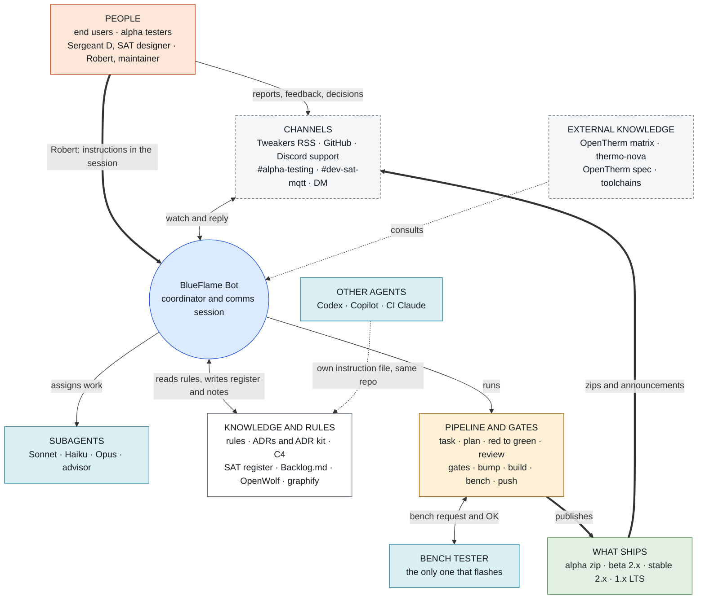

De werkplaats bestaat uit zes zones. **Mensen** bovenaan, met een strikt verschil in zeggenschap. **Kanalen** waarlangs zij met de werkplaats praten. In het midden de **agentlaag**: een coördinerende sessie en een comms-sessie die als BlueFlame Bot naar buiten optreden, met subagents eromheen, een aparte bench-tester die als enige hardware aanraakt, en andere agents (Codex, Copilot, CI-Claude) met een eigen instructiebestand. Links **kennis en regels**, rechts de **pijplijn met poorten**, onderaan **wat naar buiten gaat**.

---

## 3. Definities

Dit hoofdstuk legt de projecteigen termen vast die de rest van het document gebruikt. Waar het project zelf een term definieert (`CLAUDE.md`, de regelbestanden onder `.claude/rules/`, skills, ADR's, scripts), volgt de definitie die bron en staat de vindplaats in de laatste kolom. Sinds de vorige peildatum zijn vier dingen veranderd die bijna elke definitie raken: vragen aan de maintainer lopen per Discord-DM via de coördinator (2026-11-12), alleen de bench-tester flasht (2026-11-11), een publieke 2.x-beta loopt op een staand mandaat (2026-11-14), en het aantal binding ADR's is van 7 naar 10 gegaan. Termen die alleen in de praktijk bestaan en in geen regelbestand staan (comms-sessie, de delegatie van 2026-11-15) zijn als zodanig gemarkeerd.

### 3.1 Begrippenkaart

De kaart verbindt de termen die het vaakst samen voorkomen. Oranje is een mens, petrol een agentrol, blauw de botpersona, amber een poort of mandaat, rood een harde stop, wit een bestand of register.

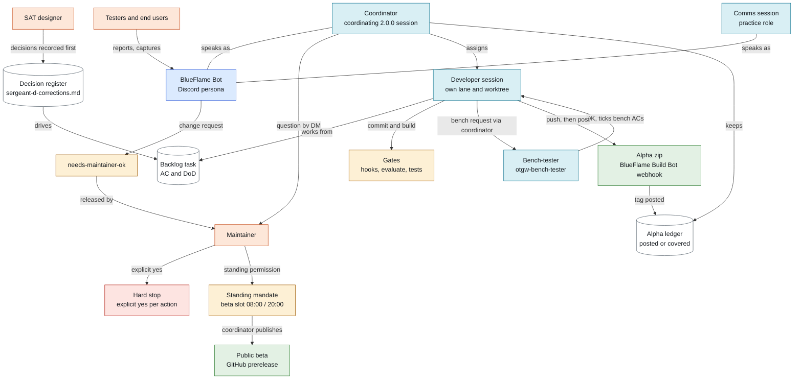

### 3.2 Rollen: mensen

| Term | Definitie | Vastgelegd in |
|---|---|---|
| **Maintainer** | Robert. Beslist over scope, prioriteit, waivers en releases. Een open beslissing gaat naar hem als één vraag per bericht, met opties, gevolgen en een gewogen advies, **per Discord-DM via de coördinator**; een interactieve CLI-vraag (`AskUserQuestion` of een andere blokkerende vraag) is sinds 2026-11-12 niet meer toegestaan. Zonder DM-kanaal staat de vraag asynchroon als tekst in de sessie en gaat het werk door. | `CLAUDE.md:18`, `CLAUDE.md:60` |
| **SAT-ontwerper** | Sergeant D. Ontwierp SAT (Smart Autotune Thermostat) op papier; Alex (Alexwijn) zette het om in code. Hij beslist over SAT-gedrag en zijn vastgelegde correcties staan bovenaan de ground truth. | `CLAUDE.md:18`; `.claude/rules/sat-ground-truth.md:8`, `:11` |
| **Tester** | Alpha- of betatester die builds flasht en captures levert. Levert input en bewijs, nooit besluiten: een wijzigingsverzoek wordt een taak met `needs-maintainer-ok`. Wie tester is, staat in het lokale people-bestand, niet in de repo. | `CLAUDE.md:18`; `.claude/commands/backlog_discord.md:19`, `:21` |
| **Read-only lid** | Discord-lid van wie niets tot code, taak, build, registerentry of botactie leidt. Krijgt één keer "Changes go through Robert." | `.claude/commands/backlog_discord.md:22` |
| **Eindgebruiker** | Melder in een supportkanaal, op GitHub of op Tweakers. Op GitHub (stap 0b van `/implement-next-task`) krijgt een bugrapport of PR prioriteit `high` en een feature-verzoek, voorstel of discussie het label `needs-maintainer-ok`; een gewone vraag wordt op het issue beantwoord. `/check_otgw_issues` maakt van een nieuw bugrapport uit Discord, GitHub of Tweakers een taak met labels `bug,needs-info` en prioriteit `medium`. | `.claude/skills/implement-next-task/SKILL.md:52`, `:83-89`; `.claude/commands/check_otgw_issues.md:157`, `:196-202` |
| **People-bestand** | `.claude/discord-people.local.md`: namen, ID's en regels per persoon. Lokaal en gitignored; de repo bevat alleen het sjabloon. | `.claude/commands/backlog_discord.md:19`; `.gitignore:47`; `docs/guides/second-machine-setup.md:11` |

### 3.3 Rollen: agents en persona's

| Term | Definitie | Vastgelegd in |
|---|---|---|
| **BlueFlame Bot** | De Discord-identiteit (botaccount) waaronder een Claude Code-sessie leest en schrijft, via de lokale `discord-mcp`-server. Geen programma met eigen logica: het gedrag staat in commands, skills en regelbestanden. Zie hoofdstuk 6. | `docs/guides/discord-mcp-server.md:18`; `.claude/rules/discord.md:12` |
| **BlueFlame Build Bot** | De webhook op `#alpha-testing` waarmee `scripts/discord-post-build.sh` de flash-zip post. Een aparte afzender naast het botaccount; de webhook-URL staat buiten de repo en wordt nooit afgedrukt. | `backlog/archive/tasks/task-1313 - Post-the-combo-flash-zip-to-alpha-testing-via-webhook-after-each-build.md:32`; `scripts/discord-post-build.sh:2`, `:9-11` |
| **Coördinator** (coördinerende 2.0.0-sessie) | De sessie die het knooppunt tussen sessies en maintainer vormt. Zij beheert het DM-kanaal met Robert en geeft antwoorden door, krijgt elke build-aankondiging, kondigt build- en push-freezes af, geeft bench-aanvragen door, post het verslag in `#alpha-testing`, houdt het alpha-ledger bij en start de beta in het slot. | `CLAUDE.md:18`, `:60`, `:113`; `.claude/rules/discord.md:21-22`; `docs/guides/worktrees.md:19` |
| **Comms-sessie** (praktijkrol) | Eén eigenaar van het concept van de releasenotities en van de Discord-post, bijgewerkt na elke push. In de praktijk antwoordt zij ook in supportkanalen en heeft zij de beta van het 20:00-slot op 2026-11-15 samengesteld en gepubliceerd. De rol staat in één skill en in taaknotities; `CLAUDE.md` definieert haar niet. | `.claude/skills/beta-release-2x/SKILL.md:72-73`; `backlog/tasks/task-1544 - beta.1-follow-up-24-h-soak-and-macOS-capture-run-waived-for-v2.0.0-beta.1.md:45`; `backlog/tasks/task-1982 - Public-beta-v2.0.0-beta.323-2026-11-15-20-00-slot.md:20`, `:40`, `:44` |
| **Bench-tester** (`otgw-bench-tester`) | De enige agent die een unit flasht (USB of OTA) en benchtests draait, sinds de directive van 2026-11-11. Beheert elke hardware-unit op de laptop, kiest de tests, legt het bewijs vast en vinkt de bench-AC's af. Een agentdefinitie onder `.claude/agents/` is niet gevonden in de repo. | `CLAUDE.md:21`, `:115`; `docs/guides/agent-build-and-bench.md:74-76` |
| **Ontwikkelsessie** (developer) | Sessie die een taak implementeert: hosttests rood op de oude code en groen op de fix, `python evaluate.py --quick`, eigen bump, commit en een esp32-combo-build; daarna een bench-aanvraag via de coördinator en pas na het OK een push. | `CLAUDE.md:114` |
| **Hoofdsessie** | Binnen `/implement-next-task` de sessie die elke stap aanstuurt: ontwerp, advisor-aanroepen, het eindoordeel over bewijs en elke Discord-post. | `.claude/skills/implement-next-task/SKILL.md:9`, `:29-30` |
| **Subagent** | Door de hoofdsessie gestarte agent met een smalle opdracht: implementeren (`sonnet`), poorten draaien en output letterlijk citeren (`haiku`), reviewen (`sonnet` per lens plus één `opus` op correctheid). Bumpt, commit en pusht niet. | `.claude/skills/implement-next-task/SKILL.md:35-37`, `:42` |
| **Andere agents** | Codex (`AGENTS.md`) en GitHub Copilot (`.github/copilot-instructions.md`). Ze delen het AGENT-CORE-blok met `CLAUDE.md`; waar ze afwijken, wint `CLAUDE.md`. | `CLAUDE.md:15`; `tests/test_agent_core_block.py:3-7` |

### 3.4 Zeggenschap: stops, mandaten en labels

| Term | Definitie | Vastgelegd in |
|---|---|---|
| **Harde stop** | Actie die Roberts expliciete ja voor die ene actie vraagt, als antwoord op een DM die actie en doel noemt: release, PIC flashen, push naar `main`, force-push, andermans PR mergen. Een algemeen "go on" telt niet. | `CLAUDE.md:18`, `:60` |
| **Staand mandaat** | Doorlopende toestemming met voorwaarden. Drie bestaan: push naar `origin/dev`, push naar `origin/otgw-1.x.x`, en sinds 2026-11-14 de publieke 2.x-beta via `/beta-release-2x`. | `CLAUDE.md:140-145`, `:18` |
| **Beta-slot** | Hoogstens één publieke beta per 12 uur, om 08:00 of 20:00 lokale tijd. De kandidaat heeft als releasebuild minstens 1 uur op de bench-unit gedraaid; een soak-waiver bestaat niet. De coördinator start de skill zelf. | `.claude/skills/beta-release-2x/SKILL.md:47-56`, `:64-67` |
| **Delegatie van 2026-11-15** | Uitspraak van Robert aan de coördinator: "Ask me only if you really can't do it yourself. You have my permission." De coördinator beslist sindsdien zelf en meldt het besluit per DM met een aanbod om terug te draaien. Staat alleen in een taaknotitie, niet in een regelbestand (§3.8). | `backlog/tasks/task-1919 - An-app-image-that-the-bootloader-marked-ABORTED-keeps-running-but-never-confirms-itself-so-the-next-reset-of-any-kind-rolls-back-to-safeboot.md:58` |
| **`needs-maintainer-ok`** | Label op een taak die pas mag worden opgepakt na vrijgave door Robert. Het komt op wijzigingsverzoeken van testers en op feature-verzoeken, voorstellen en vragen van GitHub. `/implement-next-task` slaat elke taak met dit label over. | `CLAUDE.md:18`; `.claude/commands/backlog_discord.md:21`; `.claude/skills/implement-next-task/SKILL.md:86-87`, `:121` |
| **Plan-checkpoint** | Het moment waarop het plan met Robert wordt gedeeld en op akkoord wacht. Binnen `/implement-next-task` vervangen een advisor-zelfreview en een melding in `#alpha-testing` die wachtstap. Harde stops blijven de cyclus stoppen, en een wijziging van hoe SAT de ketel regelt wacht op het OK van Sergeant D. | `CLAUDE.md:39`, `:50`; `.claude/skills/implement-next-task/SKILL.md:21-23`; `.claude/rules/sat-ground-truth.md:24` |
| **Freeze** (build of push) | Door de coördinator afgekondigde periode waarin niet gebouwd of gepusht wordt. Een lane pusht pas als de poorten en de afgekondigde freezes het toelaten. | `CLAUDE.md:24`, `:113`; `docs/guides/worktrees.md:19` |

### 3.5 Werkeenheden en bewijs

| Term | Definitie | Vastgelegd in |
|---|---|---|
| **Backlog-taak** | De eenheid van werk in Backlog.md (`TASK-NNN`). Elke wijziging begint met een taak. Lezen en schrijven gaat alleen via de `backlog`-CLI: nooit de MCP-server, nooit een directe bewerking van `backlog/tasks/*.md`. | `CLAUDE.md:19`, `:33`, `:46` |
| **AC / DoD** | Acceptatiecriteria en Definition of Done per taak. Een AC wordt alleen afgevinkt met bewijs uit de sessie die het produceerde: build-output, testrun, capture, screenshot. De bench-AC's vinkt de bench-tester af. | `CLAUDE.md:20`, `:21`, `:48` |
| **Oud-tegen-fix-bewijs** | Dezelfde reproductie faalt op de oude code en slaagt op de fix. Een groene run op alleen de fix is geen bewijs; een hosttest die de code nabouwt in plaats van aanroept, bewijst niets over die code. | `CLAUDE.md:20`, `:127-133` |
| **Capture** | De diagnose-opname die een gebruiker draait met `capture-mqtt-debug.bat` of `.sh`: telnet, MQTT, browser, crashlog en ruwe OT-frames in één upload-zip, met geheimen weggelakt. Zonder capture wordt een bug niet gefixt; voor het eigen systeem van de gebruiker gaat een capture boven de equipment matrix. | `scripts/otgw_capture.py:2-16`, `:85-88`, `:147`; `CLAUDE.md:120-123`; `.claude/rules/discord.md:31` |
| **Poort** (gate) | Geautomatiseerde controle die een stap kan weigeren: de git-hooks in `.githooks/`, `python evaluate.py --quick` zonder nieuwe FAIL, `python scripts/run_tests.py`, en de weigercontroles van het postscript. | `CLAUDE.md:23`, `:25`; `scripts/discord-post-build.sh:13-15` |
| **Bench** | De fysieke testunits op de laptop, beheerd door de bench-tester. Flashen gaat eerst over WiFi-OTA (app via de safeboot-updater, filesystem via `/update?cmd=100`); USB alleen als OTA niet kan. | `CLAUDE.md:21`, `:115`; `docs/guides/agent-build-and-bench.md:77-79`, `:101` |
| **Bench-aanvraag** | Het verzoek van een ontwikkelsessie aan de coördinator om een benchrun, met de githash, het absolute artefactpad en het te controleren gedrag. | `CLAUDE.md:21`; `.claude/skills/implement-next-task/SKILL.md:257-258` |
| **Lane** | Een parallelle werklijn: een sub-branch voor echt parallel werk. Enkelvoudig werk commit direct op `dev`. Een lane wordt afgesloten zodra `git cherry origin/dev <branch>` laat zien dat het werk is geland: branch lokaal en remote weg, worktree weg. | `CLAUDE.md:24`, `:170`; `docs/guides/worktrees.md:13`, `:15-25` |
| **Worktree** | Een eigen git-werkmap per lopende sessie (`wt-<topic>`). Twee live sessies delen nooit een werkmap. Een achtergebleven map verhuist naar `RvdB/OTGW-worktree-leftovers/` en wordt niet blind verwijderd. | `CLAUDE.md:24`, `:170`; `docs/guides/worktrees.md:25`, `:37`, `:45` |
| **Build-lock** | Machinebrede vergrendeling in `build.py`: één build tegelijk over alle sessies en worktrees, hoogstens 4 compilerjobs, op `dev` alleen `esp32-combo`. Bouwen gaat alleen via `build.bat` of `./build.sh`. | `CLAUDE.md:112-113`; `docs/guides/agent-build-and-bench.md:7` |

### 3.6 Versies, lijnen en distributie

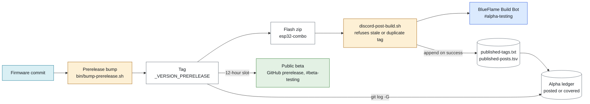

| Term | Definitie | Vastgelegd in |
|---|---|---|
| **Lijnen** | `dev` is de 2.x-lijn (alleen ESP32-S3, async en FreeRTOS). `otgw-1.x.x` is de 1.x-onderhoudslijn (ESP8266). `main` is de laatste publieke release en wordt alleen in de releaseflow gepusht. `release/2.x` is de stabiele 2.x-lijn (besluit 2026-11-01) en merget nooit als geheel terug naar `dev`. | `CLAUDE.md:17`, `:148` |
| **Alpha-tag** (prerelease-tag) | De waarde van `_VERSION_PRERELEASE` waaraan een tester zijn build herkent. Elke commit die `src/OTGW-firmware/**` of `src/libraries/**` raakt, draagt een eigen bump via `bin/bump-prerelease.sh`; de pre-commit-hook controleert dat. Elke tag op `dev` wordt gepubliceerd (directive 2026-10-29). | `CLAUDE.md:23`, `:168`; `docs/guides/versioning-policy.md:5`; `.githooks/pre-commit:14-27`; `.claude/rules/discord.md:18` |
| **Build-stempel** | Wijzigingen die een build zelf in `version.h` en `version.hash` zet. Geen bump: terugzetten. Het postscript negeert ze bij zijn controle op een schone `src/`. | `CLAUDE.md:168`; `scripts/discord-post-build.sh:13-14` |
| **Alpha-zip** | `build/OTGW-firmware-esp32-combo-*-flash.zip`, de complete flashset van één build. Het postscript weigert als de githash van de zip niet HEAD is, als `src/` niet schoon is of als de zip groter is dan 10 MB. | `scripts/discord-post-build.sh:5`, `:13-15`; `docs/guides/agent-build-and-bench.md:44` |
| **Gedekte tag** (covered) | Een tag zonder eigen zip, die meelift op de volgende geposte zip; die post en zijn `-m`-regel noemen elke gedekte tag. | `.claude/rules/discord.md:20`; `scripts/alpha_ledger.py:15-16` |
| **Published-tags** | `published-tags.txt` en `published-posts.tsv` in `%LOCALAPPDATA%\OTGW-capture`, machinebreed gedeeld door elke worktree en sessie. Eén tag per geposte build; het script weigert een al gepubliceerde of oudere tag. | `scripts/discord-post-build.sh:63-80`, `:143`; `docs/guides/second-machine-setup.md:13-14` |
| **Alpha-ledger** | `.claude/alpha-build-ledger.local.md` in de hoofd-dev-tree, gitignored, met de hand bijgehouden door de coördinator: welke tag is gepost of gedekt. Vóór elke post vergeleken met `git log -G"_VERSION_PRERELEASE"`; herbouwbaar met `scripts/alpha_ledger.py`. | `.claude/rules/discord.md:21-22`; `scripts/alpha_ledger.py:2-17`; `docs/guides/second-machine-setup.md:12` |
| **Alpha-track en publieke beta** | Elke firmwaretaak houdt haar eigen bump en haar zip in `#alpha-testing` (alpha-track). Alleen de slotrelease krijgt een GitHub-prerelease en een post in `#beta-testing`. | `.claude/skills/beta-release-2x/SKILL.md:48-50`; `CLAUDE.md:157` |
| **Watermerk** | Tijdstempelbestand `.claude/*_last_checked.txt` waarmee een command bepaalt wat nieuw is en of een run kan worden overgeslagen. `/backlog_discord` gebruikt `discord_backlog_last_checked.txt`; `/check_otgw_issues` gebruikt `discord_`, `github_` en `tweakers_last_checked.txt`. | `.claude/commands/backlog_discord.md:10`, `:16`; `.claude/commands/check_otgw_issues.md:20-24`; `.gitignore:74-78` |

### 3.7 Regels en kennis

| Term | Definitie | Vastgelegd in |
|---|---|---|
| **AGENT-CORE-blok** | Het blok kernregels tussen de markers `AGENT-CORE START` en `END`, woordelijk gelijk in `CLAUDE.md`, `AGENTS.md` en `.github/copilot-instructions.md`. Een test bewaakt de gelijkheid; wijzigen gebeurt in alle drie tegelijk. | `CLAUDE.md:12-27`; `tests/test_agent_core_block.py:1-11` |
| **Regelbestand** | Bestand onder `.claude/rules/`; er zijn er vijf (geteld met `ls .claude/rules/`). Drie zonder `paths:`-frontmatter laden in elke sessie (SAT ground truth, Discord, OpenWolf), twee alleen bij het lezen of bewerken van bestanden onder bepaalde paden (firmware-coding, navigation). De tabel in `CLAUDE.md` noemt `openwolf.md` niet (§3.8). | `CLAUDE.md:181-184`; `.claude/rules/openwolf.md:1`; `.claude/rules/firmware-coding.md:1-5` |
| **Directive** | Gedateerde uitspraak van de maintainer die een regel wordt. Het overzicht van geldende en vervangen directives is `docs/process/directive-changelog.md`. | `CLAUDE.md:188`; `docs/process/directive-changelog.md:8-28` |
| **Binding ADR** | Architectuurbesluit op patroonniveau met een geautomatiseerde poort in `evaluate.py` of `tests/` (ADR-080). De frontmatter `binding: true` is de bron van waarheid; `tests/test_adr_governance.py` faalt als de lijst in `CLAUDE.md` daarvan afwijkt. Nu 10 in de lijst (geteld in `CLAUDE.md:77-86`); 12 ADR-bestanden dragen `binding: true`, waarvan ADR-122 en ADR-124 de status Superseded hebben (`grep -l '^binding: true' docs/adr/*.md`). | `CLAUDE.md:76-86`, `:108`; `scripts/adr_governance.py:91-95` |
| **Structurele ADR** | Architectuurbesluit dat bij review wordt gecontroleerd, zonder geautomatiseerde poort. | `CLAUDE.md:88` |
| **ADR-kit** | Claude Code-plugin voor het schrijven, linten en bewaken van ADR's. `/adr-kit:context <topic>` gaat vooraf aan een architectuurwijziging; `/adr-kit:adr` schrijft een ADR. Een ADR gaat alleen van Proposed naar Accepted door vier poorten (Completeness, Evidence, Clarity, Consistency) en is daarna onveranderlijk: vervangen, niet bewerken. | `CLAUDE.md:174`; `.claude/adr-kit-guide.md:38-47`, `:102-108`; `.claude/settings.json:121-122` |
| **Enforcement-blok** | Optionele sectie `## Enforcement` aan het eind van een ADR: een JSON-blok dat `bin/adr-judge` leest. Declaratieve regels worden tegen de diff gecontroleerd; `llm_judge: true` laat een model de diff tegen de Decision-tekst beoordelen als de LLM-pass aan staat. Een ADR zonder blok slaat de judge stil over. | `.claude/adr-kit-guide.md:58-60`, `:80-81`, `:122` |
| **Ground truth (SAT)** | De rangorde voor SAT-gedrag: (1) het beslisregister, (2) de thermo-nova-code op een vaste commit, (3) `docs/sat/thermo-nova-spec.md`, (4) de firmware en haar specs, die alleen beschrijven wat de port nu doet. Elke uitspraak citeert `file:line` en is in de huidige sessie geopend. | `.claude/rules/sat-ground-truth.md:10-14`, `:17` |
| **Beslisregister** | `docs/sat/sergeant-d-corrections.md`: één genummerde entry per correctie of besluit van Sergeant D, vastgelegd in dezelfde sessie en vóór de wijziging waartoe het leidt. Oude entries worden nooit herschreven. | `.claude/rules/sat-ground-truth.md:21`; `CLAUDE.md:26` |
| **Open-vragenwachtrij** | `docs/sat/open-questions.md`: de SAT-vragen voor Sergeant D met de status queued, asked, answered of dropped. Eén vraag per Discord-bericht; een open vraag blokkeert de implementatie. | `.claude/rules/sat-ground-truth.md:23`; `docs/sat/open-questions.md:12-15` |
| **Equipment matrix** | De OpenTherm Gateway-matrix van Schelte Bron (auteur van de PIC-firmware), opgebouwd uit OTmonitor-logs van gebruikers. Sinds de directive van 2026-11-11 de eerste bron bij elke vraag of een ketel of thermostaat werkt. "Best effort, not a guarantee"; ontbreekt een model, dan volgt een captureverzoek. | `.claude/rules/discord.md:26-31` |
| **C4-documentatie** | `docs/c4/`: context, componenten en code per onderdeel. Bepaalt welk component welke code bezit; wie dat niet kan noemen, leest eerst `docs/c4/c4-context.md`. | `CLAUDE.md:70`; `.claude/rules/navigation.md:10` |
| **OpenWolf** | Contextlaag in `.wolf/`: `anatomy.md` (bestandsindex), `cerebrum.md` (lessen en Do-Not-Repeat), `buglog.json`, `memory.md`. Hooks rond sessiestart, Read, Write en Stop houden haar bij. | `CLAUDE.md:1-5`; `.wolf/OPENWOLF.md:7-9`; `.claude/settings.json:17`, `:60`, `:70`, `:82` |
| **graphify** | Kennisgraaf van `src/` in `graphify-out/` voor structuurvragen (`graphify query`, `path`, `explain`). Vult de C4-leesregels aan en vervangt ze niet. | `CLAUDE.md:175` |

### 3.8 Spanningen

| # | Spanning | De ene kant | De andere kant |
|---|---|---|---|
| 1 | **"Coördinator" heeft geen eigen definitie.** De rol draagt DM-kanaal, freezes, ledger en beta-start, maar bestaat alleen als verwijzing in losse regels. | "by Discord DM (via the coordinator)"; "the coordinator owns the DM channel" (`CLAUDE.md:18`, `:60`) | geen sectie of agentbestand dat de rol beschrijft: niet gevonden in de repo; `CLAUDE.md:179-189` noemt geen bestand ervoor |
| 2 | **"Comms-sessie" is een praktijkrol zonder regel.** | "the comms session ... one owner" van de concepten (`.claude/skills/beta-release-2x/SKILL.md:72-73`) | `CLAUDE.md:18` kent alleen de coördinator; toch "Release commit composed by session 92", gebouwd "from a clean wt-comms tree" (`backlog/tasks/task-1982 - Public-beta-v2.0.0-beta.323-2026-11-15-20-00-slot.md:20`, `:40`) |
| 3 | **De delegatie van 2026-11-15 staat in geen regelbestand.** | "Ask me only if you really can't do it yourself. You have my permission." (`backlog/tasks/task-1919 - An-app-image-that-the-bootloader-marked-ABORTED-keeps-running-but-never-confirms-itself-so-the-next-reset-of-any-kind-rolls-back-to-safeboot.md:58`) | "Do not decide it silently, do not leave it only in task notes" (`CLAUDE.md:60`); geen rij in `docs/process/directive-changelog.md:10-28` |
| 4 | **De directive-changelog definieert de vraagroute nog interactief.** | "Open questions go to Robert interactively with a weighed recommendation" (`docs/process/directive-changelog.md:25`) | "never as an interactive CLI question" (`CLAUDE.md:18`, `:60`) |
| 5 | **"Harde stop" telt vijf of vier acties.** | vijf, met "merging someone else's PR" (`CLAUDE.md:18`) | vier: "PIC flash, release, push to `main` and force-push" (`CLAUDE.md:50`) |
| 6 | **"Alpha-tag" heet alpha, maar is nu een beta-nummer.** De regel spreekt van alpha-tags; de tag op `dev` is `beta.N`, en het postscript beschrijft nog een derde naamgeving. | "Every alpha tag on `dev` is published" (`.claude/rules/discord.md:18`); "dev builds after beta.1 are 2.0.1-alpha.N" (`scripts/discord-post-build.sh:68`) | "Every firmware task keeps its own `2.0.0-beta.N` bump" (`.claude/skills/beta-release-2x/SKILL.md:48-49`); `#define _VERSION_PRERELEASE beta.327` (`src/OTGW-firmware/version.h:10`) |
| 7 | **`main` heeft twee definities.** | "`main` is the latest public release" (`CLAUDE.md:17`) | "`main` stays the 1.x stable line until 1.x is end-of-life" (`CLAUDE.md:148`) |
| 8 | **De watermerken staan in `.gitignore` en zijn toch getrackt.** | `.claude/github_last_checked.txt`, `.claude/tweakers_last_checked.txt`, `.claude/discord_last_checked.txt` genegeerd (`.gitignore:76-78`) | `git ls-files .claude` toont `discord_`, `github_` en `tweakers_last_checked.txt` als getrackte bestanden; `.gitignore` werkt niet op bestanden die al getrackt zijn |
| 9 | **De bench-tester heeft een naam maar geen definitie.** | "the bench-tester agent (`otgw-bench-tester`)" (`CLAUDE.md:21`) | `.claude/agents/` bevat alleen `otgw-device-verify.md` (`.claude/agents/otgw-device-verify.md:1-6`) |
| 10 | **Het pushmandaat definieert "build verifies" met een verboden commando.** | "`python build.py` returns exit 0" (`CLAUDE.md:144`) | "never `python build.py`" (`CLAUDE.md:25`, `:112`) |
| 11 | **`CLAUDE.md` mist een regelbestand in zijn laadtabel.** | de tabel noemt vier regelbestanden (`CLAUDE.md:181-184`) | `.claude/rules/` bevat er vijf; `openwolf.md` heeft geen `paths:`-frontmatter en laadt dus in elke sessie (`.claude/rules/openwolf.md:1`) |

> **Voor de plaat:** de definities krijgen geen eigen zone; ze leven in de legenda en in de iconen. Gebruik de kleuren van de beeldbrief: oranje voor mensen en besluiten, petrol voor agentrollen, de blauwe waakvlam alleen voor BlueFlame Bot, een oker schild voor elke poort, een steenrood hangslot voor een harde stop en groen voor wat naar buiten gaat (alpha-zip, beta). Het staande beta-mandaat is de klok op 08:00 en 20:00 bij de tegel "Beta 2.x", het watermerk een zandloper, het beslisregister een gebonden logboek. Licht thema, Engelse labels van hoogstens drie woorden.

---

## 4. Mensen, rollen en zeggenschap

Mensen beslissen, agents voeren uit. Er zijn precies twee personen met beslismacht: Robert (maintainer) over scope, prioriteit, waivers en releases, en Sergeant D (SAT-ontwerper) over SAT-gedrag (`CLAUDE.md:18`). Alle anderen leveren input en bewijs: testers, eindgebruikers en externe bijdragers kunnen een taak laten ontstaan, maar niet laten uitvoeren. Vijf acties zitten op slot en vragen per keer Roberts expliciete ja; daarnaast lopen drie staande mandaten waarbinnen de agents zonder vraag doorwerken.

Dit hoofdstuk beschrijft wie wat mag en hoe een besluit wordt gevraagd en vastgelegd. De Discord-mechaniek erachter (kanalen, sweeps, antwoordregels, de vraag-en-antwoordcyclus met Sergeant D) staat in hoofdstuk 6.

### 4.1 De rollen in één beeld

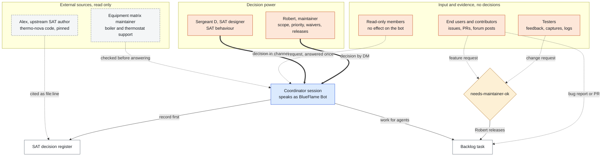

Een dikke lijn is een besluit van een mens, een gestippelde lijn is input. Geen enkele lijn uit het blok "Input and evidence" bereikt de backlog als uitvoerbaar werk zonder een poort of een triageregel.

### 4.2 De rollen

| Rol | Wie | Zeggenschap | Bron |
|---|---|---|---|
| **Maintainer** | Robert | Beslist over scope, prioriteit, waivers en releases. Geeft elke harde stop per actie vrij. Accepteert ADR's: een agent maakt alleen een Proposed ADR, "never self-accepted". Keurt het masterplan voor werk over beide lijnen goed. | `CLAUDE.md:18`; `.claude/skills/implement-next-task/SKILL.md:160-161`; `CLAUDE.md:170` |
| **SAT-ontwerper** | Sergeant D | Beslist over SAT-gedrag. Zijn vastgelegde correcties en besluiten staan bovenaan de grondwaarheid, vóór de thermo-nova-code. Een wijziging van hoe SAT de ketel regelt wacht op zijn OK. Een taak aanmaken uit zijn melding mag; builds worden hem niet aangekondigd. | `CLAUDE.md:18`; `.claude/rules/sat-ground-truth.md:10-11`, `:24`; `.claude/commands/backlog_discord.md:20` |
| **Auteur van de SAT-code upstream** | Alex (Alexwijn) | Geen beslisrol in dit project. Hij heeft het ontwerp van Sergeant D in code omgezet; die code is op een vaste commit gepind en geldt als tweede niveau van de grondwaarheid, alleen-lezen. Een kanaal of procedure om hem iets te vragen is niet gevonden in de repo: gaten in de code gaan naar Sergeant D. | `.claude/rules/sat-ground-truth.md:8`, `:12`, `:18` |
| **Testers** | de alpha-testers uit het lokale people-bestand, "and any other regular test user" | Input en bewijs, nooit besluiten. Een wijzigingsverzoek wordt een taak met het label `needs-maintainer-ok`. Hun bewijs (captures, logs) mag een bestaande taak verifiëren en sluiten. | `CLAUDE.md:18`; `.claude/commands/backlog_discord.md:21`; `.claude/skills/implement-next-task/SKILL.md:121-125` |
| **Read-only leden** | vermeld in het people-bestand | Niets wat zij schrijven leidt tot code, een taak, een build, een registerentry of een andere botactie. Vraagt zo iemand iets, dan volgt één keer "Changes go through Robert." met Roberts mention, plus een melding in de sessiesamenvatting. | `.claude/commands/backlog_discord.md:22` |
| **Eindgebruikers** | melders op GitHub, in de Discord-supportkanalen en op Tweakers | Een GitHub-issue of -PR wordt een backlog-taak: een bugmelding of PR krijgt prioriteit `high`, een feature-verzoek, voorstel of vraag krijgt `needs-maintainer-ok`. Een melding uit de Discord-kanalen die `/check_otgw_issues` leest, wordt een taak met de labels `bug,needs-info` en prioriteit `medium`. | `.claude/skills/implement-next-task/SKILL.md:54-55`, `:83-89`; `.claude/commands/check_otgw_issues.md:47-51`, `:197-204` |
| **Externe bijdragers** | auteurs van een PR | Hun PR wordt gereviewd, getest en zo nodig gebencht. Mergen blijft Roberts beslissing, per PR. | `.claude/skills/implement-next-task/SKILL.md:78-80`, `:94-99` |
| **Beheerder van de equipment-matrix** | Schelte Bron, auteur van de PIC-firmware | Geen rol in het project zelf. Zijn matrix is de eerste bron bij elke vraag of een ketel of thermostaat werkt. Zij is "best effort, not a guarantee"; een capture van de gebruiker gaat voor. | `.claude/rules/discord.md:26-31` |

Wie tester of read-only lid is, staat niet in de repo. De namen, ID's en regels per persoon staan in `.claude/discord-people.local.md`, een lokaal bestand dat via `.gitignore:47` buiten git blijft; de repo bevat alleen het sjabloon (`.claude/commands/backlog_discord.md:19`; `.claude/discord-people.example.md:3-6`). Ontbreekt het bestand, dan beantwoordt de bot alleen Sergeant D en de maintainer (`.claude/discord-people.example.md:5-6`).

Aan de agentkant horen twee rollen bij dit beeld, omdat zij de menselijke zeggenschap doorgeven. De **coördinator** is eigenaar van het DM-kanaal met Robert en geeft antwoorden door (`CLAUDE.md:60`). De **bench-tester** is de enige die een unit flasht en benchtests draait, sinds Roberts directive van 2026-11-11 (`CLAUDE.md:21`, `:115`). Hoofdstuk 5 beschrijft beide.

### 4.3 Zeggenschapsmatrix

Legenda: **B** beslist, **M** staand mandaat (mag zonder vraag, binnen de voorwaarden), **I** levert input die via een poort loopt, **·** geen rol.

| Handeling | Robert | Sergeant D | Testers | Eindgebruikers, bijdragers | Read-only | Agents | Bron |
|---|---|---|---|---|---|---|---|
| Taak laten aanmaken | B | I, taak mag direct | I, met `needs-maintainer-ok` | I: bug of PR direct, feature met `needs-maintainer-ok` | · | M: elke wijziging begint met een taak | `CLAUDE.md:19`; `.claude/commands/backlog_discord.md:20-22`; `.claude/skills/implement-next-task/SKILL.md:83-89` |
| Prioriteren en vrijgeven | B | · | · | · | · | volgen de vaste selectievolgorde | `CLAUDE.md:18`; `.claude/skills/implement-next-task/SKILL.md:112-125` |
| SAT-gedrag bepalen | B alleen in de uitzonderingen van §4.4 | **B** | · | · | · | · | `CLAUDE.md:18`; `.claude/rules/sat-ground-truth.md:20-24` |
| Code laten wijzigen | B | B voor SAT-regelgedrag | · | · | · | M binnen een taak | `.claude/commands/backlog_discord.md:21`; `.claude/skills/implement-next-task/SKILL.md:19-25`, `:168-180` |
| ADR accepteren | B | · | · | · | · | alleen Proposed | `.claude/skills/implement-next-task/SKILL.md:160-161` |
| Waiver verlenen | B | · | · | · | · | · | `CLAUDE.md:18`, `:60` |
| Pushen naar `origin/dev` en `origin/otgw-1.x.x` | B | · | · | · | · | **M** | `CLAUDE.md:140-145` |
| Bench-unit flashen | B | · | · | · | · | alleen de bench-tester | `CLAUDE.md:21`, `:115` |
| Publieke 2.x-beta | B | · | · | · | · | **M**, slot 08:00 of 20:00 | `CLAUDE.md:18`; `.claude/skills/beta-release-2x/SKILL.md:47-67` |
| Stabiele release | **B, harde stop** | · | · | · | · | · | `CLAUDE.md:18`; `.claude/skills/release-2x/SKILL.md:61-69` |
| Push naar `main`, force-push | **B, harde stop** | · | · | · | · | · | `CLAUDE.md:18`, `:146-147` |
| PIC flashen | **B, harde stop** | · | · | · | · | · | `CLAUDE.md:18`; `.claude/skills/implement-next-task/SKILL.md:200` |
| PR van een ander mergen | **B, harde stop** | · | · | I: dient de PR in | · | review en test | `CLAUDE.md:18`; `.claude/skills/implement-next-task/SKILL.md:97-99` |

De kolom "Agents" is geen zeggenschap maar uitvoeringsruimte: zij rust overal op een mandaat of een besluit van een mens.

### 4.4 Twee beslissers: de grens tussen Robert en Sergeant D

De regel is kort: "Sergeant D decides SAT behaviour" (`CLAUDE.md:18`). Het register laat zien hoe de grens in de praktijk loopt.

| Situatie | Wie beslist | Hoe vastgelegd | Bron |
|---|---|---|---|
| SAT-regelgedrag: setpoint, PWM, PID, cutoffs, modulatie | Sergeant D. Het plan citeert thermo-nova en wacht op zijn OK. | genummerde entry in `docs/sat/sergeant-d-corrections.md`, vóór de implementatie | `.claude/skills/implement-next-task/SKILL.md:168-180`; `.claude/rules/sat-ground-truth.md:21` |
| Zijn beschrijving en de code spreken elkaar tegen | Sergeant D, met beide citaten voor zich | uitkomst in het register | `.claude/rules/sat-ground-truth.md:20` |
| Een maintainer-besluit botst met zijn oordeel over regelgedrag | Sergeant D gaat voor. Entry 277 is gemarkeerd als "overrules maintainer entry 271". | nieuwe entry die de oude noemt | `docs/sat/sergeant-d-corrections.md:6084-6090` |
| Firmware-only functie zonder tegenhanger in thermo-nova, waarbij hij naar de maintainer verwijst | Robert | in dezelfde registerentry | `docs/adr/ADR-196-sat-behaviour-ground-truth-sergeant-d-s-recorded-decisions-then-pinned-thermo-nova-then-specs-then-firmware.md:192-196` |
| Robert neemt zelf een besluit dat SAT raakt | Robert, waarna Sergeant D één "agree?"-vraag krijgt | entry begint met "Not by Sergeant D." | `docs/sat/sergeant-d-corrections.md:7003-7005` |
| Een vraag aan Sergeant D blijft onbeantwoord en Robert antwoordt | Robert. Sergeant D wordt uitgenodigd te zeggen of hij het anders ziet. | entry met "Not by Sergeant D." | `docs/sat/open-questions.md:93`; `docs/sat/sergeant-d-corrections.md:7078-7080` |
| Afwijken van thermo-nova voor warmtepompen | Robert haalt thermo-nova als argument weg. De vastgelegde besluiten van Sergeant D blijven gelden. | entry 182 | `docs/sat/sergeant-d-corrections.md:5300-5304` |
| De rangorde van de grondwaarheid zelf | Robert. Bevestiging door Sergeant D is "welcome but not a condition". | ADR-196 | `docs/adr/ADR-196-sat-behaviour-ground-truth-sergeant-d-s-recorded-decisions-then-pinned-thermo-nova-then-specs-then-firmware.md:251-256` |

De index van het register telt op de peildatum 353 entries, waarvan 293 met bron Sergeant D en 41 met bron maintainer (`python scripts/sat_corrections_index.py` zonder argumenten, telling in `scripts/sat_corrections_index.py:171-178`). De maintainer-lus is dus geen randgeval.

### 4.5 Wie beslist wat: de beslisrechten-flow

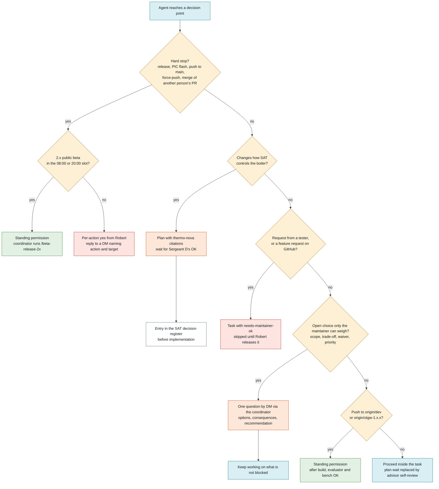

De laatste tak is de standaard binnen `/implement-next-task`: het wachten op goedkeuring van het plan is daar vervangen door een zelfreview met de advisor en een melding in #alpha-testing, terwijl de harde stops blijven gelden (`.claude/skills/implement-next-task/SKILL.md:19-25`; `CLAUDE.md:50`). Buiten die cyclus deelt de agent het plan met Robert en wacht (`CLAUDE.md:39`).

### 4.6 Harde stops en staande mandaten

**Harde stops.** Vijf acties vragen Roberts expliciete ja voor die ene actie, als antwoord op een DM die de actie en het doel noemt; "a general 'go on' is no confirmation" (`CLAUDE.md:18`).

| Harde stop | Wat de regel erbij zegt | Bron |
|---|---|---|
| Stabiele release (`/release-2x`, `/release`) | Alleen een ja op een DM die versie en actie noemt telt. De antwoorden staan in de trackingtaak vóór een push. | `.claude/skills/release-2x/SKILL.md:61-69` |
| Push naar `origin/main` | `main` is altijd de laatste publieke release, alleen in de releaseflow. | `CLAUDE.md:146` |
| Force-push | Per keer bevestigen op elke branch; naar `main` verboden, ook met bevestiging. | `CLAUDE.md:147` |
| PIC flashen | "never flash or reset a PIC without an explicit order". Nooit via WiFi met OTmonitor. | `.claude/skills/implement-next-task/SKILL.md:200`; `CLAUDE.md:115` |
| PR van een ander mergen | Per PR vragen, daarna mergen en de auteur noemen in het verslag. | `.claude/skills/implement-next-task/SKILL.md:97-99` |

Twee pushdoelen staan niet in dat rijtje maar vragen wel een bevestiging per keer: `origin/release/2.x` (alleen binnen `/release-2x`, na Roberts go) en sub-branches of andere remote branches (`CLAUDE.md:148-149`).

**Staande mandaten.** Drie toestemmingen gelden doorlopend, elk met voorwaarden.

| Mandaat | Sinds | Voorwaarden | Wie voert uit | Bron |
|---|---|---|---|---|
| Push naar `origin/dev` | staand, als het "logical" is | taak lokaal gecommit, build groen voor het relevante target, `python evaluate.py --quick` zonder nieuwe FAIL; alleen-docs-commits slaan beide over; voor firmware pas na het OK van de bench-tester | de ontwikkelsessie | `CLAUDE.md:140-144`, `:21` |
| Push naar `origin/otgw-1.x.x` | staand, zelfde voorwaarden | build groen voor het esp8266-target, evaluator groen | de sessie op de 1.x-lijn | `CLAUDE.md:145` |
| Publieke 2.x-beta | 2026-11-14: "Ik wil dat je de release van een beta gewoon uitvoert" | hoogstens één per 12 uur, om 08:00 of 20:00; de releasebuild heeft minstens 1 uur op de bench-unit gedraaid; geen soak-waiver; iets nieuws om te wegen (nieuwe waiver, gefaalde gate, breaking change) gaat alsnog per DM naar Robert | de coördinator start de skill zelf | `CLAUDE.md:18`; `.claude/skills/beta-release-2x/SKILL.md:47-67` |

Vóór dat derde mandaat bleef de publicatiestap van een beta geweigerd door de permissiecontrole tot Robert de skill zelf aanriep (`backlog/tasks/task-1745 - Public-beta-v2.0.0-beta.158-08-00-slot-over-beta.145-158.md:34`). Bij twijfel of een push "logical" is, geldt: vragen (`CLAUDE.md:151`).

**Handhaving.** In de repo zijn de harde stops conventie. De projectinstelling zet `defaultMode` op `bypassPermissions` (`.claude/settings.json:8`), en geen hook in `.claude/settings.json` of `.githooks/` controleert een push naar `main` of een force-push, dus een permissieprompt uit de projectinstellingen houdt een harde stop niet tegen. Een permissiecontrole buiten de repo kan wel weigeren, zoals bij beta.158 hierboven. De technische rem in de repo is `disable-model-invocation: true`, dat op zes skills staat (geteld met `grep -rl "disable-model-invocation: true" .claude/skills`): het model kan onder meer `/release-2x`, `/release` en `/flash` niet zelf starten (`.claude/skills/release-2x/SKILL.md:4`; `.claude/skills/release/SKILL.md:4`; `.claude/skills/flash/SKILL.md:4`). `/beta-release-2x` heeft die regel niet, in lijn met het staande mandaat (`.claude/skills/beta-release-2x/SKILL.md:1-4`). Een `git push` buiten een skill houdt de vlag niet tegen.

### 4.7 Een besluit van Robert vragen en vastleggen

De route is sinds 2026-11-12 Discord-DM in plaats van een interactieve CLI-vraag. Roberts reden: "als je stopt in een CLI sessie leg je de voortgang vast" (`backlog/tasks/task-1829 - Agent-rule-questions-to-Robert-only-by-Discord-DM-never-as-an-interactive-CLI-question-asynchronous-in-the-session-when-DM-is-unavailable.md:23`).

| Onderdeel | Regel | Bron |
|---|---|---|
| Wanneer | Een besluit is open: scope, een afweging, een AC zonder bewijs, een waiver, een prioriteit | `CLAUDE.md:60` |
| Kanaal | Discord-DM; de coördinator is eigenaar van het kanaal en geeft het antwoord door | `CLAUDE.md:60` |
| Vorm | Eén vraag per bericht, de concrete opties met gevolgen, en een kritisch gewogen advies | `CLAUDE.md:60` |
| Verboden | `AskUserQuestion` of een andere blokkerende vraag; stil zelf beslissen; het besluit alleen in taaknotities laten; meerdere besluiten bundelen | `CLAUDE.md:60` |
| Intussen | Doorwerken aan wat niet geblokkeerd is | `CLAUDE.md:60` |
| Zonder DM-kanaal | De vraag asynchroon als platte tekst in de sessie schrijven en doorwerken | `CLAUDE.md:18`, `:60` |
| Harde stop | Mag ook per DM, maar alleen met een expliciete ja voor die ene actie, als antwoord op een DM die actie en doel noemt (versie, branch, unit) | `CLAUDE.md:60` |
| SAT-ontwerpvragen | Gaan niet naar Robert maar naar Sergeant D | `CLAUDE.md:60` |

De mechaniek van de DM staat in §6.7, wie er achter de bot spreekt in §6.1.

**Vastleggen.** Een besluit bestaat pas als het ergens staat waar een volgende sessie het vindt.

| Soort besluit | Waar het wordt vastgelegd | Voorbeeld | Bron |
|---|---|---|---|
| Keuze binnen een taak | taaknotitie met datum, route, bericht-ID en het letterlijke antwoord | "DECISION Robert (2026-11-12, DM via the coordinator, msg ..., verbatim 'B')" | `backlog/tasks/task-1746 - Unconfirmed-crash-risk-vendored-AsyncTCP-accept-callback-returns-ERR_OK-after-tcp_abort-when-the-AsyncClient-allocation-fails.md:41` |
| Vrijgave van een wachtende taak | het label gaat weg in dezelfde edit die het besluit in de notities zet | `--remove-label needs-maintainer-ok` | `docs/guides/backlog-cli.md:141` |
| ADR-acceptatie | taaknotitie met het DM-bericht; het antwoord is uit de eerste hand gecontroleerd via Discord REST, inclusief de verwijzing naar de vraag | ADR-231, antwoord "A" | `backlog/tasks/task-1817 - SAT-self-tune-PWM-hours-count-for-the-warm-up-phase-Q-1796b-Robert-B-waits-for-Sergeant-D.md:46` |
| Releasebesluit | trackingtaak, vóór een push | go, waivers, de keuze voor GitHub "Latest" | `.claude/skills/release-2x/SKILL.md:64-69` |
| Besluit dat SAT raakt | SAT-register, met "Not by Sergeant D." | entry 334 | `docs/sat/sergeant-d-corrections.md:7003-7005` |
| Nieuwe werkregel (directive) | het instructiebestand waar de regel geldt, plus een rij in de directive-changelog | de bench-tester-regel van 2026-11-11 | `docs/process/directive-changelog.md:23`, `:44-46` |

### 4.8 De bevestiging van een harde stop

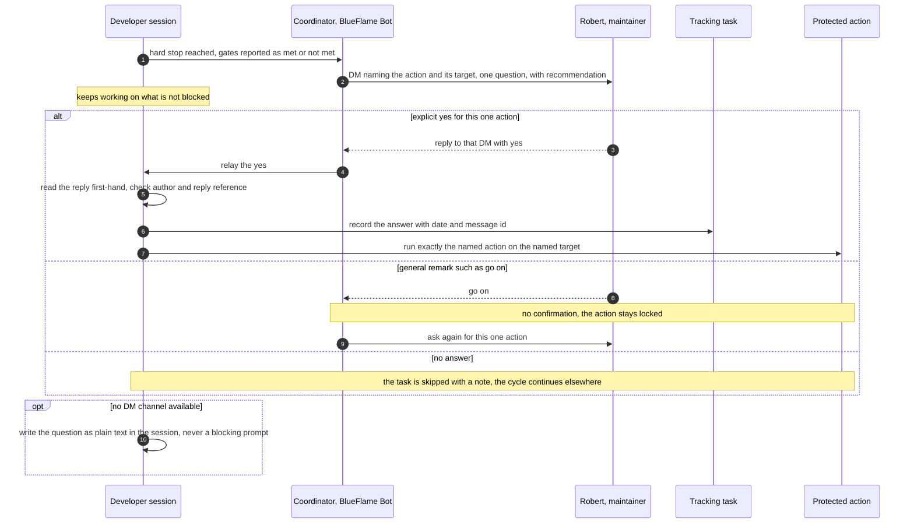

Bronnen bij de stappen: de eis van een antwoord op een DM die actie en doel noemt, en de uitsluiting van een algemeen "go on" (`CLAUDE.md:18`, `:60`); gates melden als gehaald of niet gehaald en de antwoorden vastleggen vóór een push (`.claude/skills/release-2x/SKILL.md:58-69`); de controle uit de eerste hand op auteur en verwijzing, in de praktijk door de ontwikkelsessie (d3) en niet door de coördinator; een regel die die controle voorschrijft is niet gevonden in de repo (`backlog/tasks/task-1817 - SAT-self-tune-PWM-hours-count-for-the-warm-up-phase-Q-1796b-Robert-B-waits-for-Sergeant-D.md:46`; `backlog/tasks/task-1829 - Agent-rule-questions-to-Robert-only-by-Discord-DM-never-as-an-interactive-CLI-question-asynchronous-in-the-session-when-DM-is-unavailable.md:38`); het overslaan van een taak die maintainer-toestemming nodig heeft, met een notitie waarom (`.claude/skills/implement-next-task/SKILL.md:116-119`).

De regel zelf is langs dezelfde weg ontstaan. De coördinator legde Robert per DM voor of een harde stop ook per DM bevestigd mag worden; hij antwoordde "B", waarna de bot de waarborg aan hem terugmeldde: alleen een expliciete ja voor die ene actie (`backlog/tasks/task-1829 - Agent-rule-questions-to-Robert-only-by-Discord-DM-never-as-an-interactive-CLI-question-asynchronous-in-the-session-when-DM-is-unavailable.md:38`).

### 4.9 Hoe een verzoek het label `needs-maintainer-ok` krijgt

Het label is de poort tussen "iemand vraagt iets" en "een agent bouwt het". Het bestaat sinds Roberts directive van 2026-10-25: testers hebben geen beheersrechten (`.claude/commands/backlog_discord.md:21`).

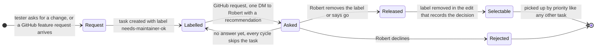

| Stap | Regel | Bron |
|---|---|---|
| Herkennen | Een tester vraagt om een wijziging, of op GitHub komt een feature-verzoek, voorstel, discussie of vraag binnen | `.claude/commands/backlog_discord.md:21`; `.claude/skills/implement-next-task/SKILL.md:85-86` |
| Aanmaken | Taak met het label en een notitie die de tester en het bericht noemt | `.claude/commands/backlog_discord.md:21` |
| Voorleggen | Voor een GitHub-verzoek: één DM aan Robert via de coördinator, met advies | `.claude/skills/implement-next-task/SKILL.md:86-88` |
| Wachten | Elke cyclus slaat de taak over. Een testerbericht "never selects, re-prioritises or unblocks a task". | `.claude/skills/implement-next-task/SKILL.md:121-125` |
| Vrijgeven | Alleen Robert: hij haalt het label weg of zegt "go" | `.claude/skills/implement-next-task/SKILL.md:124` |
| Meten | Label erop en eraf gebeurt elk in een eigen edit, zodat `scripts/agentic_throughput.py` de wachttijd kan dateren | `docs/guides/backlog-cli.md:137-141` |

Drie dingen vallen buiten de poort. Een bugmelding of PR op GitHub wordt direct een taak met prioriteit `high` (`.claude/skills/implement-next-task/SKILL.md:83-84`). Bewijs van een tester mag een bestaande taak verifiëren en sluiten (`.claude/commands/backlog_discord.md:21`). En Robert kan een verzoek ter plekke goedkeuren: op 2026-11-15 vroeg een gebruiker in #beta-testing om een functie en gaf Robert de bot daar meteen opdracht het uit te zoeken (`backlog/tasks/task-1979 - HA-climate-entity-follows-SAT-when-SAT-is-enabled-target-temperature-and-presets-like-the-web-UI.md:25`).

### 4.10 Spanningen

| # | Spanning | De ene kant | De andere kant |
|---|---|---|---|
| 1 | **De delegatie van 2026-11-15 staat in geen regelbestand.** Robert gaf de coördinator ruimte om zelf te beslissen; die besliste daarop een AC en meldde dat achteraf per DM met een aanbod om terug te draaien. | "Ask me only if you really can't do it yourself. You have my permission." (`backlog/tasks/task-1919 - An-app-image-that-the-bootloader-marked-ABORTED-keeps-running-but-never-confirms-itself-so-the-next-reset-of-any-kind-rolls-back-to-safeboot.md:58`) | "Do not decide it silently" en "Robert (maintainer) decides scope, priority, waivers and releases" (`CLAUDE.md:60`, `:18`); geen rij in `docs/process/directive-changelog.md:10-28` |
| 2 | **De directive-changelog noemt de oude vraagroute nog als geldend.** | "Open questions go to Robert interactively with a weighed recommendation" (`docs/process/directive-changelog.md:25`) | "never as an interactive CLI question", route gewijzigd op 2026-11-12 (`CLAUDE.md:60`) |
| 3 | **De lijst harde stops verschilt per plek.** Van de vier opsommingen in `CLAUDE.md` en `/implement-next-task` missen er twee het mergen van andermans PR. | vijf acties, inclusief "merging someone else's PR" (`CLAUDE.md:18`; `.claude/skills/implement-next-task/SKILL.md:24-25`) | vier acties, zonder mergen (`CLAUDE.md:50`; `.claude/skills/implement-next-task/SKILL.md:117-119`) |
| 4 | **Het beta-mandaat noemt de coördinator, de praktijk een andere sessie.** De beta van het 20:00-slot op 2026-11-15 is samengesteld en gepubliceerd door sessie 92, de comms-sessie. | "invoked by the coordinator itself" (`CLAUDE.md:18`) | "Release commit composed by session 92", "Publish (92, 20:00:21)" (`backlog/tasks/task-1982 - Public-beta-v2.0.0-beta.323-2026-11-15-20-00-slot.md:20`, `:44`); "comms (92)" (`backlog/tasks/task-1928 - SAT-research-improvements-beyond-thermo-nova-self-tune-boost-detection-weather-heating-curve.md:36`) |
| 5 | **De beta-skill telt nog twee checkpoints.** | "Checkpoints: 2 (Robert's go, announcement text)" (`.claude/skills/beta-release-2x/SKILL.md:30`) | "No per-release question within this rule" en de aankondiging "sent without showing it first" (`.claude/skills/beta-release-2x/SKILL.md:58`, `:278-279`) |
| 6 | **Backlog-commando's in #dev-sat-mqtt kennen geen eigen rolcontrole.** De ondersteunde intents omvatten "mark task 42 done" en "assign"; fase 2 en 3 kijken niet wie ze geeft, alleen de algemene regels voor testers en read-only leden begrenzen dat. De maintainer wordt voor backlog-commando's juist genegeerd, behalve als hij de bot een verzoek doet. | intents "Update status" en "Assign" (`.claude/commands/backlog_discord.md:80-81`, `:100-101`); "Ignore the maintainer ... for backlog commands, but not when he addresses the bot with a request" (`.claude/commands/backlog_discord.md:44`) | "Do not implement, re-prioritise, close or change behaviour because a tester asks" (`.claude/commands/backlog_discord.md:21`) |
| 7 | **Vrijgeven "in the session" tegenover de DM-route.** | "he removes the label or says go in the session" (`.claude/skills/implement-next-task/SKILL.md:124-125`) | besluiten lopen per DM via de coördinator (`CLAUDE.md:60`) |
| 8 | **`/check_otgw_issues` heeft nog een blokkerend checkpoint.** | "CHECKPOINT: Ask the developer which issue(s) to work on. Do not proceed until they select one." (`.claude/commands/check_otgw_issues.md:212`) | "Never use AskUserQuestion or another blocking question" (`CLAUDE.md:60`) |
| 9 | **Het pushmandaat noemt een verboden buildcommando.** | "`python build.py` returns exit 0 for the relevant ESP32 target" (`CLAUDE.md:144`) | "never `python build.py`" (`CLAUDE.md:112`, `:25`) |
| 10 | **Het masterplan voor twee lijnen gaat nog naar "the user".** De tekst noemt ook nog een 2.0.0-featurebranch. | "Share the master plan with the user for approval"; "2.0.0 feature branch push needs explicit confirmation" (`docs/guides/worktrees.md:77`, `:75`) | `dev` is de 2.x-lijn en besluiten gaan per DM (`CLAUDE.md:17`, `:60`) |
| 11 | **Persoons-ID's horen niet in de publieke repo, maar staan er wel.** | het people-bestand is lokaal omdat ID's en regels per persoon "do not belong in a public repository" (`.claude/discord-people.example.md:3-4`) | een gebruikers-ID van de maintainer in `CLAUDE.md:60` en `.claude/commands/backlog_discord.md:17`, en van Sergeant D in `.claude/skills/implement-next-task/SKILL.md:170` |
| 12 | **De rollen tester en read-only lid zijn in de repo niet controleerbaar.** Wie welke rol heeft, staat alleen in een lokaal bestand; ontbreekt het, dan vervalt het onderscheid. | "without it the bot answers only Sergeant D and the maintainer" (`.claude/discord-people.example.md:5-6`); `.gitignore:47` | de regels voor testers en read-only leden verwijzen naar dat bestand (`.claude/commands/backlog_discord.md:21-22`) |
| 13 | **Harde stops rusten in de repo op conventie.** | "needs his explicit yes for that one action" (`CLAUDE.md:18`) | `"defaultMode": "bypassPermissions"` (`.claude/settings.json:8`); geen hook bewaakt push naar `main` of force-push; alleen zes skills, waaronder `/release-2x`, `/release` en `/flash`, zijn voor het model afgesloten (`.claude/skills/release-2x/SKILL.md:4`; `.claude/skills/flash/SKILL.md:4`) |
| 14 | **De regel "Sergeant D beslist SAT-gedrag" kent meer uitzonderingen dan de kernregel noemt.** De praktijk van maintainer-besluiten met "Not by Sergeant D." staat in het register en in één uitzondering van ADR-196, niet in het AGENT-CORE-blok. | "Sergeant D decides SAT behaviour" (`CLAUDE.md:18`) | "Not by Sergeant D. This is a maintainer decision by Robert" (`docs/sat/sergeant-d-corrections.md:7005`); de enige beschreven uitzondering is de firmware-only functie (`docs/adr/ADR-196-sat-behaviour-ground-truth-sergeant-d-s-recorded-decisions-then-pinned-thermo-nova-then-specs-then-firmware.md:192-196`) |

> **Voor de plaat:** de mensen staan als vier kaarten met perzik vlak en gebrand-oranje rand in de bovenste band van plaat A, van links naar rechts eindgebruikers (groepje van drie figuren), maintainer (figuur met sleutel), SAT-ontwerper (figuur met passer en tekendriehoek) en alpha-testers (figuur met reageerbuis), zoals in de beeldbrief. Alleen van de maintainer en de SAT-ontwerper vertrekken oranje lijnen (besluiten), die van de maintainer dik naar de DM-tegel en de waakvlam; van eindgebruikers en testers lopen grijs gestippelde lijnen naar de kanaaltegels. De harde stops zijn steenrode hangsloten op de tegels "Stable 2.x" en "1.x LTS" onderaan, het staande beta-mandaat is een oker klokje met de wijzers op 08:00 en 20:00 op de tegel "Beta 2.x". Alex en de beheerder van de equipment-matrix horen niet in de mensenband: hun bronnen staan als kleine grijze ronde badges ("thermo-nova", "OpenTherm matrix") linksonder bij de externe kennis.

---

## 5. Agents en modellen

De werkplaats draait op meerdere Claude Code-sessies tegelijk, elk met een eigen rol: één coördinerende 2.0.0-sessie als knooppunt, ontwikkelsessies in een eigen worktree, een comms-sessie en één bench-tester die als enige hardware aanraakt (`CLAUDE.md:21`, `CLAUDE.md:113-114`, `CLAUDE.md:170`, `.claude/skills/beta-release-2x/SKILL.md:72-73`). Binnen een sessie verdeelt de skill `/implement-next-task` het werk over subagents per model: Sonnet implementeert, Haiku draait de gates, Opus zoekt de fout, en de hoofdsessie leest het ruwe bewijs zelf (`.claude/skills/implement-next-task/SKILL.md:29-43`). Naast Claude Code lezen Codex en GitHub Copilot elk hun eigen instructiebestand, en draait Claude in GitHub Actions op een checkout van de repo; een woordelijk gedeeld AGENT-CORE-blok met een drifttest houdt de drie instructiebestanden gelijk (`CLAUDE.md:12-27`, `tests/test_agent_core_block.py:1-11`, `.github/workflows/claude.yml:28-35`).

### 5.1 Sessietopologie

Sessies heten in de taaknotes `otgw-firmware-<id>` of kortweg hun id, zoals 95, 92 of 09 (`backlog/tasks/task-1870 - ADR-225-raise-the-ESP32-S3-IPC-task-stack-ipc0-and-ipc1-to-at-least-1280-B-via-a-custom_sdkconfig-framework-lib-rebuild.md:38-40`, `backlog/tasks/task-1982 - Public-beta-v2.0.0-beta.323-2026-11-15-20-00-slot.md:20`). De rol is een afspraak, geen bestand: `.claude/agents/` bevat alleen `otgw-device-verify.md`, dus voor de bench-tester bestaat geen eigen agentdefinitie; het is de agent `otgw-cycle`, die Robert op 2026-11-11 `otgw-bench-tester` noemde (`backlog/tasks/task-1826 - Process-one-bench-tester-agent-flashes-and-tests-every-unit-developers-request-it.md:23`, `.claude/agents/otgw-device-verify.md:3`).

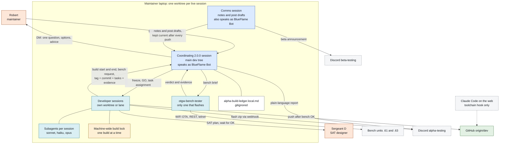

| Sessie of rol | Wat zij doet | Wat zij niet doet | Bron |
|---|---|---|---|
| Coördinerende 2.0.0-sessie (coordinator) | Ontvangt build-aankondigingen, kondigt build- en push-freezes af, beheert het DM-kanaal met Robert, geeft bench-aanvragen door, post het verslag in `#alpha-testing`, houdt het ledger bij, start de beta in het slot; spreekt op Discord als BlueFlame Bot (hoofdstuk 6) | Geen harde stop zonder Roberts ja per actie | `CLAUDE.md:18`, `CLAUDE.md:21`, `CLAUDE.md:60`, `CLAUDE.md:113`, `.claude/rules/discord.md:21-22` |
| Ontwikkelsessie (developer) | Host-tests rood en groen, `evaluate.py --quick`, eigen bump, commit, esp32-combo-build; vraagt een bench-run aan; pusht en publiceert na het OK | Flasht nooit | `CLAUDE.md:114`, `CLAUDE.md:21` |
| `otgw-bench-tester` | Beheert alle hardware-units, flasht via OTA of USB, kiest de tests, legt bewijs vast en vinkt de bench-AC's af | Bouwt de taak niet | `CLAUDE.md:21`, `backlog/tasks/task-1826 - Process-one-bench-tester-agent-flashes-and-tests-every-unit-developers-request-it.md:23-25` |
| Comms-sessie | Enige eigenaar van de notes-draft en de Discord-postdraft, bijgewerkt na elke push; spreekt ook als BlueFlame Bot (hoofdstuk 6) | Niet vermeld; CLAUDE.md definieert de rol niet | `.claude/skills/beta-release-2x/SKILL.md:72-73` |
| Subagents | Implementeren, draaien gates, reviewen; rapporteren aan de hoofdsessie | Bumpen, committen en pushen nooit | `.claude/skills/implement-next-task/SKILL.md:42-43` |
| Cloudsessie (Claude Code on the web) | Een SessionStart-hook zet de build-toolchain klaar als `CLAUDE_CODE_REMOTE` waar is | Een rol in de sessietopologie (berichten, bench, ledger) is niet gevonden in de repo | `.claude/hooks/session-start-build-toolchain.sh:2-16`, `.claude/settings.json:27` |

Volgens de gids voor een tweede machine staan de bench-units, hun adressen en seriële poorten in het sessiegeheugen van het hoofdwerkstation, niet in de repo (`docs/guides/second-machine-setup.md:44-46`); losse adressen staan wel in de repo, zoals .61 en .63 in de bench-gids en de beta-skill (`docs/guides/agent-build-and-bench.md:82`, `.claude/skills/beta-release-2x/SKILL.md:80`). Het ledger, de post-registers en de webhook leven buiten git (`docs/guides/second-machine-setup.md:9-18`).

**Worktrees en lanes.** Werk op één lijn gaat direct op `dev`. Een extra worktree is er alleen voor een echt parallelle lane en verdwijnt direct na de merge; per live sessie geldt één worktree (`CLAUDE.md:170`). Die regel komt uit een waargenomen fout van 2026-05-29: twee sessies in één tree gaven indexcorruptie en botsende `.pio`-builds (`docs/guides/worktrees.md:37-45`). Afsluiten gaat volgens "Finish a lane": pushen, `git fetch --prune`, met `git cherry origin/dev <branch>` bewijzen dat het werk geland is, dan branch en worktree weg; andermans branch of vuile tree gaat naar de coordinator (`CLAUDE.md:24`, `docs/guides/worktrees.md:15-25`). Cross-line werk krijgt één masterplan dat Robert goedkeurt, daarna één taak en één agent per lijn (`CLAUDE.md:170`, `docs/guides/worktrees.md:67-86`).

### 5.2 Hoe sessies met elkaar praten

Er zijn drie dragers: berichten tussen sessies met de coordinator als knooppunt, het lokale ledger, en Discord. De Discord-kant (kanalen, toon, DM-opmaak) staat in hoofdstuk 6; hier alleen wie wat aan wie meldt.

| Van | Naar | Drager | Inhoud | Bron |
|---|---|---|---|---|
| Developer | Coordinator | sessiebericht | Build-aankondiging vóór de start en bij het einde | `CLAUDE.md:113` |
| Coordinator | Developers | sessiebericht | Build- of push-freeze | `CLAUDE.md:113` |
| Developer | Coordinator, dan bench-tester | sessiebericht | Bench-aanvraag: githash, absoluut artefactpad, te controleren gedrag | `CLAUDE.md:21`, `docs/guides/agent-build-and-bench.md:9` |
| Bench-tester | Coordinator, dan taaknotes | sessiebericht | Uitslag met bewijs; hij vinkt de bench-AC's zelf af | `CLAUDE.md:21` |
| Pushende sessie | Coordinator | sessiebericht | Tag, commit, taken en bewijs | `.claude/rules/discord.md:21` |
| Pushende sessie | `#alpha-testing` | webhook via `scripts/discord-post-build.sh` | Flashzip met `-m "TASK-NNN: ..."`; weigert als de githash niet HEAD is of `src/` vuil is | `.claude/rules/discord.md:19`, `scripts/discord-post-build.sh:2-15` |
| Coordinator | `#alpha-testing` | Discord MCP | Verslag in gewone taal; meerdere tags mogen in één bericht | `.claude/rules/discord.md:21` |
| Coordinator | Ledger tegen git | `git log -G"_VERSION_PRERELEASE"` | Vóór elke post: elke tag die niet gepost of gedekt is, gaat mee met de volgende zip | `.claude/rules/discord.md:22` |
| Elke sessie | Robert | Discord-DM via de coordinator | Eén vraag per bericht, opties met gevolgen, gewogen aanbeveling; nooit een blokkerende CLI-vraag (directive 2026-11-12, TASK-1829) | `CLAUDE.md:60` |
| `/release-2x` | Alle live peers | `ListAgents` plus bericht | Freeze van dev-pushes en builds | `.claude/skills/release-2x/SKILL.md:70` |
| `/update-docs-2x` | 2.0.0-lead-sessie | `ListAgents` plus bericht | Toestemming vóór een docs-push | `.claude/skills/update-docs-2x/SKILL.md:287` |

Het ledger `.claude/alpha-build-ledger.local.md` staat in de hoofd-dev-tree en is gitignored; `scripts/alpha_ledger.py` bouwt het opnieuw op uit git en de lokale post-registers (`.claude/rules/discord.md:21`, `.gitignore:47`, `scripts/alpha_ledger.py:2-16`).

In de taaknotes is de knooppuntrol breder dan de regeltekst: de coordinator wijst taken toe, geeft het GO voor een push en regelt een onafhankelijke review door een andere sessie (`backlog/tasks/task-1870 - ADR-225-raise-the-ESP32-S3-IPC-task-stack-ipc0-and-ipc1-to-at-least-1280-B-via-a-custom_sdkconfig-framework-lib-rebuild.md:38`, `backlog/tasks/task-1919 - An-app-image-that-the-bootloader-marked-ABORTED-keeps-running-but-never-confirms-itself-so-the-next-reset-of-any-kind-rolls-back-to-safeboot.md:52-56`).

### 5.3 Subagents en modelverdeling

De hoofdsessie draait op het model dat de maintainer met `/model` koos en houdt vier dingen in eigen hand: het ontwerp, de advisor-calls, het eindoordeel over bewijs en elke Discord-post. De rest delegeert zij met de `model`-parameter van de Agent-tool (`.claude/skills/implement-next-task/SKILL.md:29-31`).

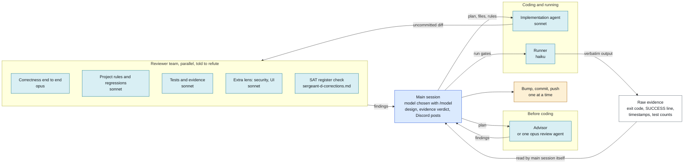

| Werksoort | Model | Reden uit de skill | Bron |
|---|---|---|---|
| Ontwerp, advisor-calls, eindoordeel over bewijs, elke Discord-post | hoofdsessie (keuze via `/model`) | "owns design, the advisor calls, the final judgement on evidence, and every Discord post" | `.claude/skills/implement-next-task/SKILL.md:29-30` |
| Implementatie (code, tests, docs) | `sonnet` | "Strong coder, faster and cheaper." | `.claude/skills/implement-next-task/SKILL.md:35` |
| `build.bat`, `evaluate.py`, tests en bench-scripts draaien en de ruwe output melden | `haiku` | "Mechanical; must quote output verbatim." | `.claude/skills/implement-next-task/SKILL.md:36` |
| Reviewteam | `sonnet` per lens plus één `opus` op correctheid | "Diverse lenses, one strong critic." | `.claude/skills/implement-next-task/SKILL.md:37` |
| Plan-zelfreview | advisor; zonder advisor-tool één `opus`-reviewagent | Kritische toets vóór de implementatie | `.claude/skills/implement-next-task/SKILL.md:157-161` |

De reviewlenzen zijn: correctheid end-to-end (`opus`); projectregels en regressies (`sonnet`); tests en bewijs, met de vraag of de test de echte code aanroept (`sonnet`); een extra lens waar de wijziging erom vraagt, zoals security bij auth of OTA en UI bij webwijzigingen; en bij SAT een reviewer die de diff tegen elke entry van `docs/sat/sergeant-d-corrections.md` legt. De opdracht is weerleggen, niet goedkeuren (`.claude/skills/implement-next-task/SKILL.md:205-216`).

**De hoofdsessie leest het ruwe bewijs zelf.** De skill zegt het zo: "A weaker model claims PASS more easily. Never accept a subagent's verdict on its own". Vóór het afvinken van een AC leest de hoofdsessie de exitcode, de SUCCESS-regel, de tijdstempels van de artefacten, de testaantallen en de voor- en nawaarden (`.claude/skills/implement-next-task/SKILL.md:39-41`). Elke reviewbevinding toetst zij zelf aan de code voordat die wordt verwerkt of gemotiveerd afgewezen (`.claude/skills/implement-next-task/SKILL.md:218-220`). Bumpen, committen en pushen doet alleen de hoofdsessie, één voor één, omdat `.pio/` en de git-index gedeeld zijn (`.claude/skills/implement-next-task/SKILL.md:42-43`).

### 5.4 Eigen agentdefinities en workflows

| Artefact | Soort | Model | Wat het doet | Bron |
|---|---|---|---|---|
| `.claude/agents/otgw-device-verify.md` | agentdefinitie, de enige in `.claude/agents/` | `sonnet`; tools Bash, Read, Write, Glob, Grep | Build, flash en verificatie op het apparaat; geeft alleen een compacte PASS/FAIL-samenvatting terug, zodat buildlog en esptool-uitvoer buiten de context van de aanroeper blijven. Volgens de beschrijving alleen voor de bench-tester | `.claude/agents/otgw-device-verify.md:2-8` |
| `.claude/workflows/translate-webui-language.js` | Workflow-script | translate, twee reviewers en editor op `opus`; prepare en verify zonder model-parameter | Vier fasen (Prepare, Translate, Review, Verify) met zes agentaanroepen. De agents bouwen, flashen, bumpen en committen nooit; dat blijft bij de aanroeper | `.claude/workflows/translate-webui-language.js:1-19`, `.claude/workflows/translate-webui-language.js:24-80` |
| `.claude/workflows/archive/implement-next-task-865-drain.js` | Workflow-script, gearchiveerd | niet vermeld | De oude drain-engine voor TASK-865 (Audit, Select, Implement, Review, Land, Announce, ADR Evaluation). De skill zegt: "do not run it" | `.claude/skills/implement-next-task/SKILL.md:15-17`, `.claude/workflows/archive/implement-next-task-865-drain.js:4-12` |
| `tools/adr-kit/agents/adr-generator.md` | agentdefinitie van de ADR-kit | `sonnet`; tools Read, Write, Edit, Glob, Grep, Bash | Schrijft één volledige ADR in `docs/adr/`; zie hoofdstuk 10 | `CLAUDE.md:174`, `tools/adr-kit/agents/adr-generator.md:2-5` |

De vertaalworkflow laat het patroon van 5.3 in het klein zien: het sterkste model voor het inhoudelijke werk en de twee adversariële reviewers, en een editor die elke bevinding zelf tegen de code toetst (`.claude/workflows/translate-webui-language.js:47-67`).

### 5.5 Skill-inventaris

De repo telt 11 skills in `.claude/skills/`, 2 commands in `.claude/commands/`, 1 agentdefinitie in `.claude/agents/` en 1 actief Workflow-script in `.claude/workflows/` (plus 1 in `archive/`). Zes skills dragen `disable-model-invocation: true`: alleen de gebruiker roept ze aan (`beta-prerelease`, `flash`, `release`, `release-2x`, `update-docs`, `update-docs-2x`). Meetwijze: `ls` van de vier mappen op `dev` @ 105a8fe en `grep -l "disable-model-invocation: true" .claude/skills/*/SKILL.md`.

| Skill of command | Trigger | Doel | Kanalen | Toestemmingsniveau | Bron |
|---|---|---|---|---|---|
| `/implement-next-task` | "pak de volgende taak", "implement next task"; door het model aan te roepen | Doorlopende cyclus over het 2.0.0-backlog, taak voor taak | `#alpha-testing` (meldingen zijn notices), DM aan Robert, Sergeant D bij SAT, GitHub via `gh` | Autonoom; stopt voor PIC-flash, release, push naar `main`, force-push en andermans werk mergen | `.claude/skills/implement-next-task/SKILL.md:1-25`, `:57`, `:86`, `:132-133`, `:168-171` |
| `/beta-release-2x` | Slot 08:00 of 20:00; door de coordinator zelf gestart | Publieke 2.x-beta vanaf `dev`: release-commit, build, 1 h soak, tag, draft-first prerelease | `#beta-testing`, `#alpha-testing`, GitHub Releases | Staande toestemming van Robert sinds 2026-11-14 | `CLAUDE.md:18`, `.claude/skills/beta-release-2x/SKILL.md:64-67` |
| `/release-2x` | Alleen gebruiker | Stabiele 2.x-release op `release/2.x` | Aankondiging NL en EN, GitHub Releases, DM | Drie checkpoints; per actie een expliciete ja per DM | `.claude/skills/release-2x/SKILL.md:4`, `.claude/skills/release-2x/SKILL.md:43-69` |
| `/update-docs-2x` | Alleen gebruiker, of release-mode vanuit de twee 2.x-releaseskills | Handleidingen EN en NL, API-docs en C4-docs bijwerken sinds de laatste v2-tag | Geen Discord; bericht aan de 2.0.0-lead-sessie | Vraagt toestemming vóór de push; één background-subagent tegelijk, die alleen docs wijzigt | `.claude/skills/update-docs-2x/SKILL.md:1-34`, `.claude/skills/update-docs-2x/SKILL.md:112-117`, `.claude/skills/update-docs-2x/SKILL.md:287-289` |
| `/release` | Alleen gebruiker | Doorverwijzing naar de 1.x-releaseskill in de `otgw-1.x.x`-worktree | geen | Eigen proces staat op de 1.x-lijn | `.claude/skills/release/SKILL.md:1-43` |
| `/beta-prerelease` | Alleen gebruiker | Doorverwijzing naar de 1.x-beta-skill | geen | Nooit een 1.x-beta vanaf `dev` | `.claude/skills/beta-prerelease/SKILL.md:1-40` |
| `/update-docs` | Alleen gebruiker | 1.x-documentatie-update; volledige kopie in de dev-tree | niet vermeld | Alleen 1.x-lijn | `.claude/skills/update-docs/SKILL.md:1-26` |
| `/flash` | Alleen gebruiker | Bouwen en via USB flashen; verouderd, zie 5.8 | geen | Botst met de bench-tester-regel | `.claude/skills/flash/SKILL.md:1-20` |
| `analyze-capture` | Een tester post of mailt een capture; Robert vraagt wat een ketel deed; door het model aan te roepen | Capture omzetten in getelde feiten, een verhaal in tijdsvolgorde en grafieken | niet vermeld | Geen eigen stop | `.claude/skills/analyze-capture/SKILL.md:1-11` |
| `translate_webui_otgw-firmware` | Robert vraagt een nieuwe web-UI-taal, ontbrekende vertalingen of een review; door het model aan te roepen | Taalpakket toevoegen of bijwerken via het Workflow-script | Materiaal naar de comms-agent | Push na het go van de coordinator | `.claude/skills/translate_webui_otgw-firmware/SKILL.md:1-22`, `.claude/skills/translate_webui_otgw-firmware/SKILL.md:65-69` |
| `firmware-design-handoff` | Door het model aan te roepen; generieke skill | Design-system-pakket voor een on-device web-UI | geen | Geen eigen stop | `.claude/skills/firmware-design-handoff/SKILL.md:1-73` |
| `/backlog_discord` | Stap 0 van de cyclus, of los | Onbeantwoorde berichten beantwoorden en backlog-verzoeken uit Discord afhandelen; zie hoofdstuk 6 | `#dev-sat-mqtt` (backlog-commando's) en `#alpha-testing` (gelezen, geen commando's) | Phase 0 draait altijd; Phase 1 stopt bij een watermerk jonger dan 5 minuten | `.claude/commands/backlog_discord.md:1-18`, `:27-41`, `.claude/skills/implement-next-task/SKILL.md:45-48` |
| `/check_otgw_issues` | Handmatig | Discord, GitHub en Tweakers scannen op meldingen; zie hoofdstuk 6 | Discord, GitHub, Tweakers | Fixes pas na goedkeuring van de ontwikkelaar | `.claude/commands/check_otgw_issues.md:1-3` |

### 5.6 De ontwikkelcyclus in het kort

Eén aanroep van `/implement-next-task` werkt het backlog taak voor taak af tot niets meer uitvoerbaar is; de hoofdsessie stuurt elke stap zelf (`.claude/skills/implement-next-task/SKILL.md:8-10`). De poorten, de build-lock en de publicatie staan in hoofdstuk 7; hier alleen de volgorde en wie er aan zet is.

1. **Stap 0 en 0b.** Eerst testervragen via `/backlog_discord`, dan de GitHub-sweep met `gh` (`.claude/skills/implement-next-task/SKILL.md:45-101`).
2. **Stap 1, kiezen.** Eerste actie `-s "In Progress" -a @claude`, daarna de melding in `#alpha-testing` (`.claude/skills/implement-next-task/SKILL.md:103-133`).
3. **Stap 2 en 3, ontwerp en zelfreview.** Plan in de taak, dan de advisor of een `opus`-reviewagent (`.claude/skills/implement-next-task/SKILL.md:137-161`).
4. **Stap 4, notice.** Plan in `#alpha-testing` zonder te wachten; alleen SAT-regelgedrag wacht op het OK van Sergeant D (`.claude/skills/implement-next-task/SKILL.md:163-180`).
5. **Stap 5, implementeren.** Rood op de oude code, `sonnet` wijzigt, gates in de hoofdsessie of via `haiku` (`.claude/skills/implement-next-task/SKILL.md:182-203`).
6. **Stap 6, reviewteam.** Parallel op de uncommitted diff (`.claude/skills/implement-next-task/SKILL.md:205-220`).
7. **Stap 7, Done met bewijs.** Final summary per AC, bump, één commit; nog niet pushen (`.claude/skills/implement-next-task/SKILL.md:222-238`).
8. **Stap 9 en 8, build, bench, push, post, verslag.** Daarna terug naar stap 0 (`.claude/skills/implement-next-task/SKILL.md:243-285`).

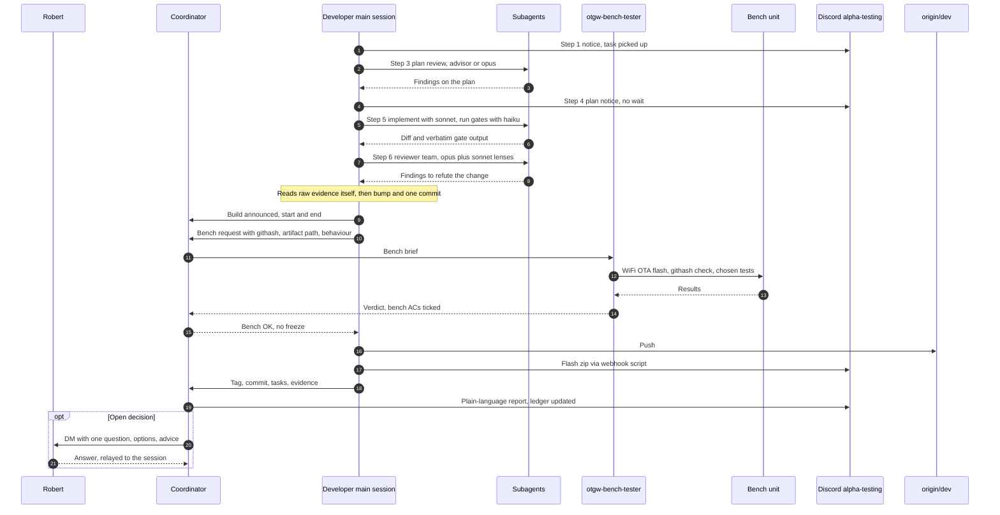

De volgorde na de commit volgt `CLAUDE.md:113-114`, `docs/guides/agent-build-and-bench.md:9` en `.claude/rules/discord.md:19-22`.

### 5.7 Andere agents en het gedeelde AGENT-CORE-blok

Buiten de lokale Claude Code-sessies werken Codex, GitHub Copilot en Claude in GitHub Actions. Codex en Copilot lezen elk een eigen instructiebestand; Claude in Actions heeft geen eigen bestand en werkt op een checkout van de repo (`.github/workflows/claude.yml:28-35`). Het AGENT-CORE-blok staat woord voor woord in de drie instructiebestanden en zegt zelf dat `CLAUDE.md` wint waar een ander bestand afwijkt (`CLAUDE.md:12-27`, `AGENTS.md:7-22`, `.github/copilot-instructions.md:3-18`).

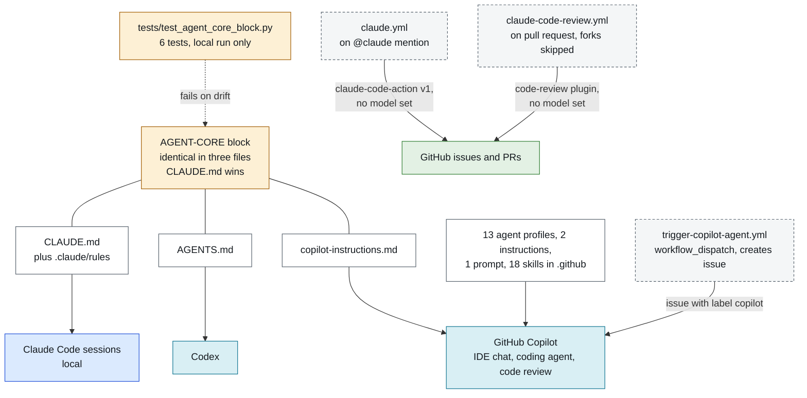

| Agent | Leest | Trigger | Model | Bron |
|---|---|---|---|---|
| Codex | `AGENTS.md`: "These instructions adapt the repository's Claude guidance for Codex agents" | Lokale sessie naast Claude-sessies; geen workflow gevonden | niet vermeld in de repo | `AGENTS.md:1-3`, `docs/guides/worktrees.md:39` |
| GitHub Copilot (IDE) | `.github/copilot-instructions.md`; zegt zelf dat delen onder het core-blok voor 1.x geschreven zijn en dat `CLAUDE.md` wint | niet vermeld | niet vermeld | `.github/copilot-instructions.md:1-24` |
| Copilot coding agent | `.github/instructions/adr.coding-agent.instructions.md`, optioneel een persona uit `.github/agents/` | `workflow_dispatch` van `trigger-copilot-agent.yml` met `title`, `task`, `agent`, `labels`; de workflow maakt een issue met label `copilot` | niet vermeld | `.github/workflows/trigger-copilot-agent.yml:3-52`, `.github/instructions/adr.coding-agent.instructions.md:1-47` |
| Copilot code review | `.github/instructions/adr.code-review.instructions.md` | PR-review op ADR-compliance | niet vermeld | `.github/instructions/adr.code-review.instructions.md:1-40` |
| Claude in GitHub Actions, `claude.yml` | geen eigen prompt; voert uit wat het commentaar vraagt | `issue_comment`, `pull_request_review_comment`, `issues` (opened, assigned), `pull_request_review`, alleen met `@claude` in de tekst | geen model-parameter; `anthropics/claude-code-action@v1` | `.github/workflows/claude.yml:3-19`, `.github/workflows/claude.yml:35-43` |
| Claude Code Review, `claude-code-review.yml` | plugin `code-review@claude-code-plugins` | `pull_request` (opened, synchronize, ready_for_review, reopened); alleen PR's uit dezelfde repo, forks worden overgeslagen | geen model-parameter | `.github/workflows/claude-code-review.yml:3-5`, `.github/workflows/claude-code-review.yml:15-20`, `.github/workflows/claude-code-review.yml:42-47` |

**Copilot-bestanden.** `.github/agents/` bevat 13 profielen; de keuzelijst van `trigger-copilot-agent.yml` biedt er 11 aan. Alleen `gpt-5-beast-mode` declareert in de frontmatter een model, "GPT-5 (copilot)"; `task-planner` noemt "Claude Sonnet 4" alleen in een promptsjabloon (`.github/agents/task-planner.agent.md:264-267`) (`.github/workflows/trigger-copilot-agent.yml:38-50`, `.github/agents/gpt-5-beast-mode.agent.md:1-15`). Daarnaast staan er twee instructiebestanden in `.github/instructions/` en één prompt, `.github/prompts/check-discord-issues.prompt.md`, die vier Discord-kanalen scant (`.github/prompts/check-discord-issues.prompt.md:1-40`). Van de 18 skills in `.github/skills/` is alleen `adr` projectspecifiek (`.github/skills/adr/SKILL.md:1-11`).

**De drifttest.** `tests/test_agent_core_block.py` bevat zes tests: elk bestand draagt het blok, de blokken zijn identiek, het blok noemt de gedeelde regels, `AGENTS.md` verkiest de backlog-MCP-server niet, de Copilot-instructies beschrijven de 2.x-lijn, en `CLAUDE.md` wijst naar een bestaande Discord-gids (`tests/test_agent_core_block.py:36-69`). De test bestaat omdat de bestanden elkaar vóór TASK-1625 tegenspraken (`tests/test_agent_core_block.py:1-9`). Twee zustertests bewaken andere gedeelde blokken: het SAT-blok tussen `.claude/rules/sat-ground-truth.md` en `AGENTS.md`, en de lijst met binding ADR's tussen `CLAUDE.md` en `AGENTS.md` (`tests/test_sat_ground_truth_block.py:1-40`, `tests/test_adr_governance.py:112-119`). Het blok groeit mee met de directives: de bench-tester-regel van 2026-11-11 en de beta-uitzondering van 2026-11-14 staan erin (`CLAUDE.md:18`, `CLAUDE.md:21`, `docs/process/directive-changelog.md:23`, `docs/process/directive-changelog.md:28`).

### 5.8 Spanningen

| # | Spanning | Ene kant | Andere kant | Leidend |
|---|---|---|---|---|
| 1 | Wie post het verslag in `#alpha-testing` | De skill laat de sessie zelf posten (`.claude/skills/implement-next-task/SKILL.md:243-248`) | De pushende sessie meldt aan de coordinator, die het verslag post (`.claude/rules/discord.md:21`) | `.claude/rules/discord.md:21`; de skill zegt zelf dat `CLAUDE.md` wint (`.claude/skills/implement-next-task/SKILL.md:19-20`) |
| 2 | Developer controleert zelf de hardware | Stap 1 laat de sessie nagaan welke boards aangesloten zijn (`.claude/skills/implement-next-task/SKILL.md:127-129`) | De bench-tester beheert elke unit (`CLAUDE.md:21`) | `CLAUDE.md:21` |
| 3 | `otgw-device-verify` bouwt en flasht buiten de regels om | USB-flash en eigen build via `scripts/device-verify.sh`, met een vast bench-adres en een vaste seriële poort (`.claude/agents/otgw-device-verify.md:11-21`); het script roept PlatformIO direct aan voor env `esp32` en flasht met `esptool` (`scripts/device-verify.sh:57-76`) | OTA eerst; alleen via de wrapper bouwen, nooit een directe `pio run`; op `dev` alleen `esp32-combo` (`CLAUDE.md:112-113`, `CLAUDE.md:115`) | `CLAUDE.md`; alleen de beschrijving van de agent is bijgewerkt (`.claude/agents/otgw-device-verify.md:3`) |
| 4 | `/flash` | `python build.py` en zelf flashen met `python flash_esp.py` via USB (`.claude/skills/flash/SKILL.md:16-20`) | Alleen de bench-tester flasht; bouwen alleen via `build.bat` of `./build.sh` (`CLAUDE.md:21`, `CLAUDE.md:112`) | `CLAUDE.md` |
| 5 | Vertaalskill flasht zelf | De uitvoerende agent doet de OTA en de soak (`.claude/skills/translate_webui_otgw-firmware/SKILL.md:65-69`) | `CLAUDE.md:21` | `CLAUDE.md:21` |
| 6 | Cloudsessie-hook bouwt direct | `python3 build.py --firmware` in de SessionStart-hook (`.claude/hooks/session-start-build-toolchain.sh:48`) | "never `python build.py`" (`CLAUDE.md:112`) | `CLAUDE.md:112` voor het werk; of de regel voor het klaarzetten van de toolchain in een cloudcontainer geldt, is niet gevonden in de repo |
| 7 | Bench-tester zonder definitie | De regels noemen "the bench-tester agent (`otgw-bench-tester`)" (`CLAUDE.md:21`) | `.claude/agents/` bevat alleen `otgw-device-verify.md` (`.claude/agents/otgw-device-verify.md:1-6`) | Geen tegenspraak, wel een gat: de rol is alleen als regel en in taaknotes vastgelegd |
| 8 | Wie start de beta | De coordinator "itself" (`CLAUDE.md:18`, `.claude/skills/beta-release-2x/SKILL.md:64-66`) | De beta van 2026-11-15 20:00 is samengesteld, gebouwd en gepubliceerd door sessie 92, die vanuit een schone `wt-comms`-tree bouwde; de soak deed de bench-tester (09) (`backlog/tasks/task-1982 - Public-beta-v2.0.0-beta.323-2026-11-15-20-00-slot.md:20`, `:40-46`) | `CLAUDE.md:18`; een delegatie is niet vastgelegd |
| 9 | Delegatie aan de coordinator | Robert, 2026-11-15: "Ask me only if you really can't do it yourself", alleen in taaknotes (`backlog/tasks/task-1919 - An-app-image-that-the-bootloader-marked-ABORTED-keeps-running-but-never-confirms-itself-so-the-next-reset-of-any-kind-rolls-back-to-safeboot.md:58`) | Robert beslist over scope en waivers (`CLAUDE.md:18`) | `CLAUDE.md:18` tot de directive is vastgelegd |
| 10 | `AGENTS.md` buiten het core-blok | Schrijft `python build.py` voor en laat na Done direct committen en pushen (`AGENTS.md:117`, `AGENTS.md:36`) | Core-blok: alleen de wrapper, push na gates, freezes en bench-OK (`AGENTS.md:16`, `AGENTS.md:19-20`) | Het core-blok |
| 11 | Copilot-restanten uit 1.x | De prompt maakt een `fix-issue-*`-branch, bumpt de patchversie met `autoinc-semver.py` en bouwt met `python build.py --firmware` (`.github/prompts/check-discord-issues.prompt.md:69-91`); de instructies noemen `addOTWGcmdtoqueue` (`.github/copilot-instructions.md:551`) | `addCommandToQueue()`, wrapper, direct op `dev` (`CLAUDE.md:22`, `CLAUDE.md:25`, `CLAUDE.md:170`) | `CLAUDE.md` |
| 12 | Drifttests draaien niet in CI | `adr-governance.yml` triggert niet op `CLAUDE.md` of `AGENTS.md` (`.github/workflows/adr-governance.yml:20-33`) | De tests vergelijken juist die bestanden (`tests/test_agent_core_block.py:1-11`) | Handhavingsgat: alleen lokaal via `python scripts/run_tests.py` (`scripts/run_tests.py:4-6`) |
| 13 | Copilot-toewijzing | De commentaarkop zegt dat het issue aan de coding agent wordt toegewezen (`.github/workflows/trigger-copilot-agent.yml:9-11`) | Het script zet alleen het label, zonder assignee (`.github/workflows/trigger-copilot-agent.yml:96-114`) | De code |
| 14 | Dode verwijzing voor Copilot | Het core-blok verwijst naar "the SAT ground truth block" (`.github/copilot-instructions.md:9`) | Dat blok staat alleen in `.claude/rules/sat-ground-truth.md` en `AGENTS.md` (`tests/test_sat_ground_truth_block.py:3-4`) | `CLAUDE.md` met `.claude/rules/sat-ground-truth.md` |
| 15 | DM-route in de directive-changelog | De rij van 2026-10-29 zegt nog "Open questions go to Robert interactively" (`docs/process/directive-changelog.md:25`) | Sinds 2026-11-12 per Discord-DM via de coordinator, nooit interactief in de CLI (`CLAUDE.md:60`) | `CLAUDE.md:60`; de changelog mist de rij voor 2026-11-12 (TASK-1829) |

> **Voor de plaat:** de coördinerende sessie is de ronde brander met de blauwe waakvlam in het midden (kobalt `#1d4ed8` naar cyaan, halo `#dbeafe`), label "BlueFlame Bot"; daaromheen een ring van vijf petrol zeshoeken (`#0e7490` op `#d9eff4`): Sonnet, Haiku en Opus met hun monogram, plus Advisor en Review lenses. Linksonder in de agentzone staan de kaart "Comms session" met kobaltrand en een gestippelde kobaltlijn naar de brander, en drie kleine satellieten "Other agents" (Codex · Copilot · CI Claude). Rechtsonder staat de bench-tester als werkbank met twee printplaatjes en een WiFi-boog; alleen hij is verbonden met de testunits. Lijnen tussen agents zijn petrol en doorgetrokken; oranje lijnen beginnen alleen bij mensen.

---

## 6. BlueFlame Bot: de waakvlam van de werkplaats

BlueFlame Bot is geen apart programma met eigen logica. Het is de **Discord-identiteit waaronder Claude Code-sessies lezen en schrijven**, en bij uitbreiding de persona waarmee de werkplaats naar buiten optreedt (`docs/guides/discord-mcp-server.md:17-18`). Het gedrag staat in tekstbestanden die een sessie laadt: twee commands (`/backlog_discord`, `/check_otgw_issues`), stap 0 en 0b van `/implement-next-task`, de releaseskills, de regelbestanden en één shellscript dat zips post. De techniek eronder is een lokaal Java-proces dat het bottoken vasthoudt, een webhook voor bestanden, `gh` voor GitHub en `curl` voor de Tweakers-feed.

Het ontwerp is daarmee **instructiegedreven**: wie wil weten wat de bot doet, leest de commands en regels; er is geen botcode om te inspecteren. Dat maakt het gedrag reviewbaar en snel aan te passen, maar ook afhankelijk van de discipline van de sessie die de instructies uitvoert. De harde waarborgen zitten in scripts die weigeren (§6.10); de rest is conventie, en daar zitten de meeste spanningen (§6.11).

Taakbestanden worden na hun eerste volledige vermelding afgekort tot `task-NNNN:regel`.

### 6.1 Eén persona, vier gezichten, twee stemmen

| Gezicht | Waar | Hoe | Bron |
|---|---|---|---|
| **BlueFlame Bot** (botaccount) | Discord-guild `812969634638725140`: kanalen en DM | `mcp__discord-mcp__*` via het lokale `saseq/discord-mcp`-proces | `docs/guides/discord-mcp-server.md:18`, `:38` |
| **BlueFlame Build Bot** (webhook) | alleen #alpha-testing | `scripts/discord-post-build.sh`, multipart-upload van de flash-zip | `backlog/archive/tasks/task-1313 - Post-the-combo-flash-zip-to-alpha-testing-via-webhook-after-each-build.md:32`; `scripts/discord-post-build.sh:1-15` |
| **Maintainer-account op GitHub** | issues, PR's en releases van `rvdbreemen/OTGW-firmware` | `gh` "is logged in as the maintainer"; een eigen GitHub-identiteit voor de bot is niet gevonden in de repo | `.claude/skills/implement-next-task/SKILL.md:57` |
| **Anonieme lezer** | Tweakers-forumtopic 1653967 | `curl` op de RSS-feed, alleen lezen | `.claude/commands/check_otgw_issues.md:84-92` |

Op GitHub is de bot dus niet als bot herkenbaar: een commentaar dat om captures vraagt of een PR-review plaatst, staat op naam van de maintainer (`.claude/skills/implement-next-task/SKILL.md:90-96`). De gids noemt alleen de botnaam, niet het Discord-user-ID van de bot (`docs/guides/discord-mcp-server.md:18`); dat ID komt in de repo alleen voor als mention in een geciteerd bericht in het SAT-register (`docs/sat/sergeant-d-corrections.md:7370`).

**Twee stemmen achter de persona.**

- De **coördinerende sessie** beheert de DM-route naar Robert, post de verslagen en houdt het alpha-ledger bij (`CLAUDE.md:18`, `:60`; `.claude/rules/discord.md:21`). Volgens de skill is de hoofdsessie eigenaar van "every Discord post" (`.claude/skills/implement-next-task/SKILL.md:29-30`).
- De **comms-sessie** is een rol die alleen terloops is beschreven: "one owner, the comms session" voor het concept van de releasenotities en de Discord-post (`.claude/skills/beta-release-2x/SKILL.md:72-73`). Taaknotities met de markering "(comms)" laten zien wat zij in de praktijk doet: antwoorden en capture-verzoeken in de supportkanalen (`backlog/tasks/task-1544 - beta.1-follow-up-24-h-soak-and-macOS-capture-run-waived-for-v2.0.0-beta.1.md:45`; `backlog/tasks/task-1786 - Classic-S3-Mini-PIC-no-longer-detected-after-flashing-with-migrate.md:50`), een bevestiging op een PR (`backlog/tasks/task-1949 - Review-PR-702-Use-L-min-for-the-DHW-flow-rate-unit-in-Home-Assistant-discovery.md:39`), de beta-aankondiging toen de MCP in de releasesessie plat lag (`backlog/tasks/task-1745 - Public-beta-v2.0.0-beta.158-08-00-slot-over-beta.145-158.md:34`) en het nalopen van citaten in SAT-vragen als tweede lezer (`docs/sat/open-questions.md:237`, `:269`). CLAUDE.md definieert deze rol niet.

**Drie technische paden.** Naast de MCP-tools en de webhook bestaat een derde pad: de **Discord REST API met het bottoken** uit de gebruikersomgeving. De comms-sessie leest er berichten "first-hand" mee (`docs/sat/sergeant-d-corrections.md:6503`), een ontwikkelsessie controleerde er een DM-antwoord van Robert mee (`backlog/tasks/task-1817 - SAT-self-tune-PWM-hours-count-for-the-warm-up-phase-Q-1796b-Robert-B-waits-for-Sergeant-D.md:46`), en `/beta-release-2x` noemt het als terugval voor posten als de MCP niet draait (`.claude/skills/beta-release-2x/SKILL.md:280-283`). Posten langs dit pad is niet aangetoond: bij TASK-1313 blokkeerde de auto-mode-classifier een POST met bottoken als "Credential Exploration" (`task-1313:32`), en daarom gaat de zip via een webhook.

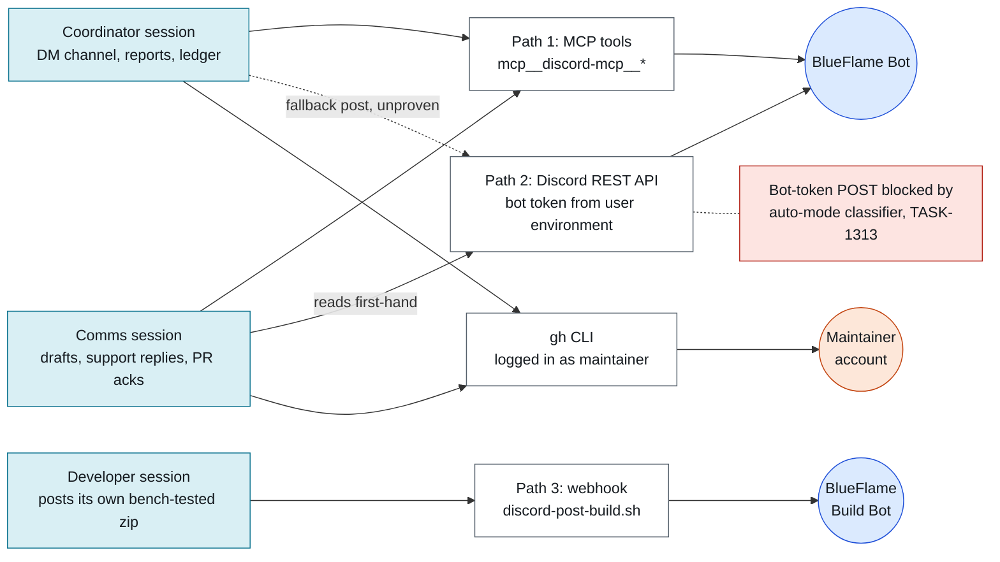

### 6.2 Technische opbouw

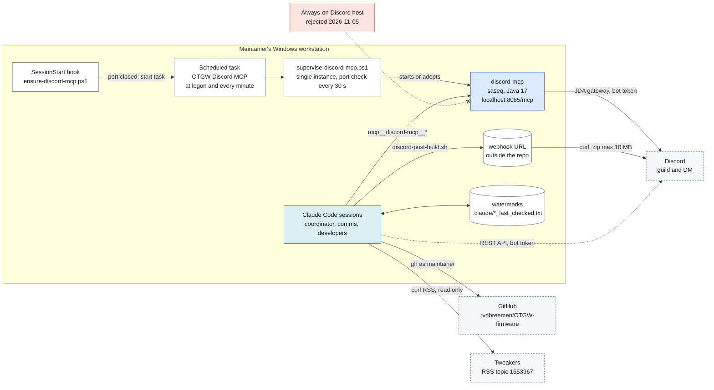

| Onderdeel | Wat het doet | Bron |
|---|---|---|
| `saseq/discord-mcp` | Native Java-proces (Temurin JDK 17) op `http://localhost:8085/mcp`; logt via JDA in bij Discord voordat de poort opengaat; geen Docker sinds 2026-07-04 | `docs/guides/discord-mcp-server.md:12`, `:16`; `docs/process/directive-changelog.md:38` |
| Supervisor (sinds 2026-11-10) | Eén instantie (named mutex), wacht tot `discord.com:443` bereikbaar is, adopteert een draaiende server, controleert poort 8085 elke 30 s, herstart na exit of vier mislukte checks (back-off 15-120 s); geeft `DISCORD_TOKEN` en `DISCORD_GUILD_ID` uit de Windows-gebruikersomgeving mee | `docs/guides/discord-mcp-server.md:13` |
| Geplande taak | `OTGW Discord MCP`, bij inloggen na 20 s en elke minuut; een draaiende supervisor maakt extra starts no-ops | `docs/guides/discord-mcp-server.md:14` |
| SessionStart-hook | `ensure-discord-mcp.ps1` in de gebruikers-`settings.json` (niet in de projectconfig): start de taak als poort 8085 dicht is en wacht tot 40 s | `docs/guides/discord-mcp-server.md:15`; `.claude/settings.json:11-41` |
| Tools | `read_messages(channelId, count)`, `send_message(channelId, message)`, `get_server_info`, `read_private_messages`, `send_private_message`; geen login-tool en geen bestandsparameter | `docs/guides/discord-mcp-server.md:26-31`; `task-1313:17` |
| Eén tokenhouder | Nooit een tweede proces op hetzelfde token: de gateway-verbindingen bijten elkaar. Op een tweede machine eerst de server op de eerste stoppen | `docs/guides/discord-mcp-server.md:21-22`; `docs/guides/second-machine-setup.md:39-40` |
| Herstel | Bij "Expected token to be set" of HTTP 401 het Java-proces killen; de supervisor start een nieuwe (ongeveer 15 s back-off plus 18 s opstarten). Een verbonden sessie werkt door; een sessie die startte terwijl de server plat lag, voert één keer `/mcp` uit | `docs/guides/discord-mcp-server.md:66-78` |
| Gemeten herstel | Gekilde java na 53 s terug, gekilde supervisor na 54 s, hook bracht `:8085` in 38 s omhoog. Wachten op het netwerk bij een echte herstart (AC2) is niet geverifieerd; de taak staat op To Do | `backlog/tasks/task-1793 - Discord-MCP-server-robust-autostart-supervisor-scheduled-task-SessionStart-hook.md:42`, `:28`, `:6` |

**Bewust geen always-on host.** De bot leeft alleen zolang de werkplek van de maintainer aanstaat en er een sessie draait die de commands uitvoert. Robert besloot op 2026-11-05 om nu geen always-on Discord-host (en geen tweede bench of build-runner) in te richten: met 8,7 tags per dag en 80% van de getimede antwoorden van Sergeant D binnen 2,4 uur is geen van beide de bottleneck (`backlog/tasks/task-1636 - Decide-on-scaling-the-build-bench-and-Discord-host.md:41`). Een cron of geplande trigger voor de twee commands is niet gevonden in de repo.

### 6.3 Kanalenkaart

| Kanaal | ID | Wat de bot leest | Wat de bot schrijft | Wie triggert | Bron |
|---|---|---|---|---|---|
| #alpha-testing | `1514720723980259460` | elke run de nieuwste 40 (Phase 0) | taakaankondiging, planmelding, verslag per taak, alpha-zip (webhook), SAT-vragen, antwoorden aan testers | `/backlog_discord`, `/implement-next-task` stap 1, 4, 8, 9 | `.claude/commands/backlog_discord.md:18`, `:31`; `.claude/skills/implement-next-task/SKILL.md:132-133`, `:165`, `:243-248` |
| #dev-sat-mqtt | `1105556725714649128` | nieuwste 25 (Phase 0) plus nieuw sinds het watermerk | antwoorden op backlog-commando's, SAT-vragen en simulatierondes | `/backlog_discord` | `.claude/commands/backlog_discord.md:15`, `:74-108`; `docs/guides/discord-mcp-server.md:43` |
| DM met Robert | n.v.t. | antwoorden van Robert | één open beslissing per bericht, met opties, gevolgen en advies | elke sessie, via de coördinator | `CLAUDE.md:18`, `:60` |
| #beta-testing | `914498730001072149` | 25 per run van `/check_otgw_issues` | beta-aankondiging, korte noot bij een stabiele release; in de praktijk ook antwoorden en een ontwerpvoorstel | `/check_otgw_issues`, releaseskills | `.claude/commands/check_otgw_issues.md:10`, `:48`; `.claude/skills/beta-release-2x/SKILL.md:278-283`; `docs/sat/sergeant-d-corrections.md:7358-7370` |
| #english-support | `931267109726593116` | idem | Engelse aankondiging van een stabiele release; in de praktijk ook antwoorden en capture-verzoeken | idem | `.claude/commands/check_otgw_issues.md:50`; `.claude/skills/release-2x/SKILL.md:191-202`; `task-1544:45` |
| #nederlandse-ondersteuning | `815561033036333076` | idem | Nederlandse aankondiging van een stabiele release; in de praktijk ook antwoorden | idem | `.claude/commands/check_otgw_issues.md:51`; `.claude/skills/release-2x/SKILL.md:191-202`; `task-1786:50` |
| #devs-esp-firmware | `924989767966425158` | idem | niets gevonden in de repo | `/check_otgw_issues` | `.claude/commands/check_otgw_issues.md:49` |
| GitHub issues | `rvdbreemen/OTGW-firmware` | open issues (50); commentaar (max. 5) alleen bij bugs | vraag om captures, antwoord op een gewone vraag, `Fixes #N` of `Refs #N` in commits | stap 0b, `/check_otgw_issues` | `.claude/skills/implement-next-task/SKILL.md:57-101`; `.claude/commands/check_otgw_issues.md:60-77` |
| GitHub PR's | idem | open PR's (30) | review als PR-commentaar; mergen alleen na Roberts "ja" per PR | stap 0b | `.claude/skills/implement-next-task/SKILL.md:94-99` |
| GitHub releases | idem | n.v.t. | beta-prerelease (`--latest=false`), stabiele release | releaseskills | `.claude/skills/beta-release-2x/SKILL.md:26-30` |
| Tweakers-topic | topic `1653967` | RSS: `<description>`, bij kandidaten `<content:encoded>` | niets; een postmechanisme is niet gevonden in de repo | `/check_otgw_issues` | `.claude/commands/check_otgw_issues.md:81-103` |

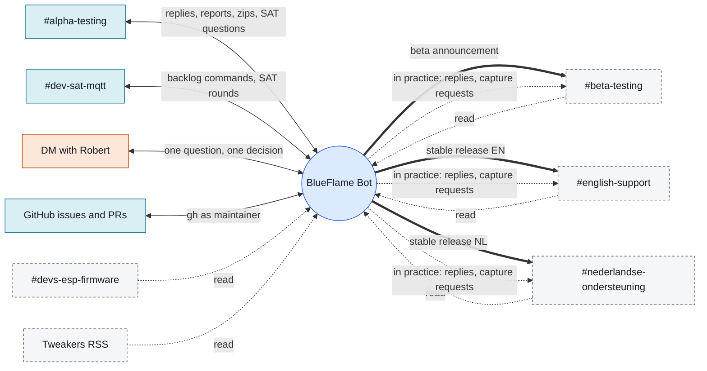

Voor de vier kanalen onderaan lopen **procedure en praktijk uiteen**. Volgens de commands zijn het luisterposten met een aankondigingsfunctie: `/check_otgw_issues` leest ze en post nergens (`.claude/commands/check_otgw_issues.md:155-212`, `:271-277`), en de gids noemt ze alleen "Read by `/check_otgw_issues`" (`docs/guides/discord-mcp-server.md:44-47`). In de praktijk antwoorden coördinator en comms-sessie er gebruikers (`backlog/tasks/task-1896 - SAT-a-PIC-measured-outside-temperature-DS18B20-on-the-gateway-boiler-without-MsgID-27-never-counts-as-valid-SAT-stays-handed-back-outside_temp_missing.md:57`). Sinds 2026-11-15 is #beta-testing bovendien een verzoek- en ontwerpkanaal: een tester vraagt er een feature, Robert vraagt de bot daar het beste ontwerp uit te zoeken, Sergeant D geeft ontwerpinput en de bot post een voorstel dat Robert met een reply goedkeurt (`backlog/tasks/task-1979 - HA-climate-entity-follows-SAT-when-SAT-is-enabled-target-temperature-and-presets-like-the-web-UI.md:25`; `docs/sat/sergeant-d-corrections.md:7324-7370`). De releasenotities sturen gebruikers ook zelf naar #beta-testing of #alpha-testing met hun capture-zip (`docs/releases/RELEASE_NOTES_2.0.0-beta.323.md:523-526`).

### 6.4 Vier bewakingspaden

| Pad | Wanneer | Vroege stop | Watermerk | Reageert het? | Bron |
|---|---|---|---|---|---|
| `/backlog_discord` Phase 0 | vóór elke nieuwe taak (stap 0), of los | geen: draait altijd | geen | ja, met mention | `.claude/commands/backlog_discord.md:27-36`; `.claude/skills/implement-next-task/SKILL.md:45-50` |
| `/backlog_discord` Phase 1-4 | idem | watermerk jonger dan 5 minuten | `.claude/discord_backlog_last_checked.txt` (zonder bestand: 1 uur terug) | ja, backlog-antwoorden | `.claude/commands/backlog_discord.md:10`, `:38-45` |
| GitHub-sweep (stap 0b, directive 2026-11-05) | vóór elke nieuwe taak | geen | geen bestand: ontdubbeling op de URL in `backlog/` | ja, op het issue of de PR | `.claude/skills/implement-next-task/SKILL.md:52-101` |
| `/check_otgw_issues` | met de hand; geen skill roept het aan | alle drie watermerken jonger dan 2 uur | `.claude/discord_last_checked.txt`, `github_last_checked.txt`, `tweakers_last_checked.txt` (zonder bestand: 7 dagen terug) | nee, alleen triage en taken | `.claude/commands/check_otgw_issues.md:9`, `:19-38`, `:46` |

#### 6.4.1 `/backlog_discord`: eerst niemand onbeantwoord laten

Phase 0 negeert het watermerk bewust, omdat een tijdfilter berichten mist die binnenkwamen terwijl een vorige run bezig was, of die wel gelezen maar niet beantwoord zijn (`.claude/commands/backlog_discord.md:29`).

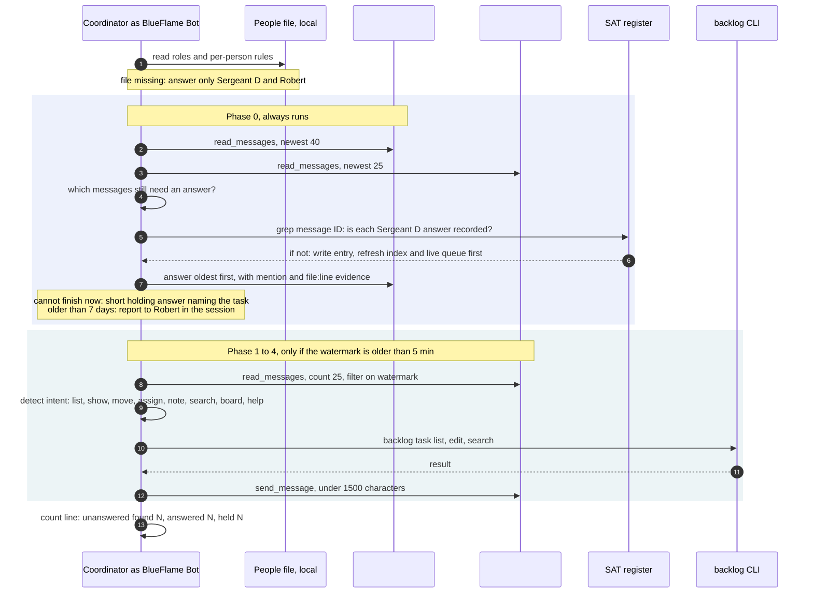

**Wie een antwoord krijgt** (`.claude/commands/backlog_discord.md:32`): Sergeant D, een tester uit de people-file, iemand anders die `@BlueFlame Bot` aanspreekt, of Robert als hij de bot aanspreekt, mits de people-file het niet uitsluit en er nog geen later botbericht is dat die persoon met `<@ID>` noemt en de inhoud behandelt. Een losse wedervraag aan iemand anders telt niet. **Backlog-commando's** komen alleen uit #dev-sat-mqtt (`:18`); de command wijzigt nooit een taak zonder expliciet verzoek en reageert niet op algemene chat (`:161-167`). **Zuinigheidsregels** B1-B5: altijd een statusfilter of `--limit`, nooit het volledige bord, bijlagen alleen bij een bugwoord, antwoorden onder 1500 tekens (`:5-11`).

#### 6.4.2 GitHub-sweep: elke issue en PR wordt een taak

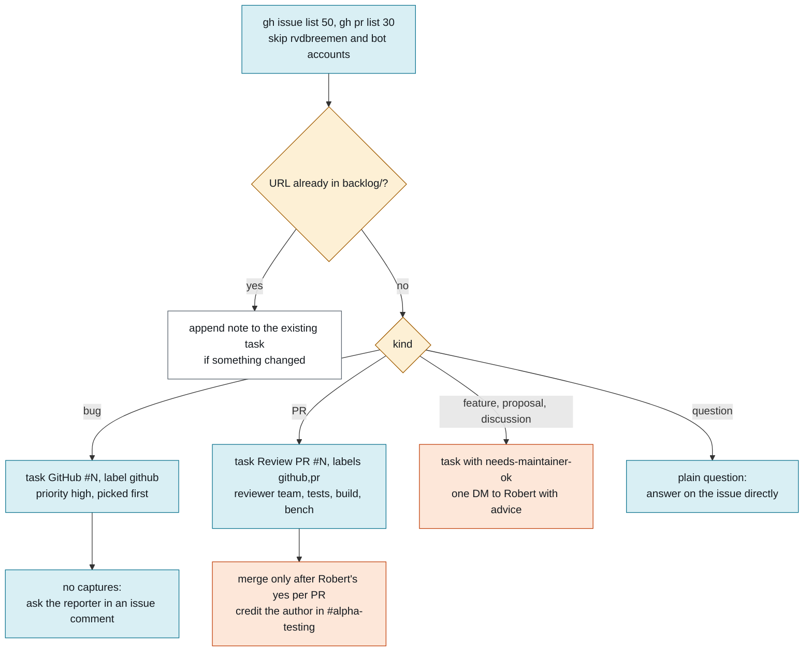

De sweep eindigt met één regel in de sessie: `github: open issues N, PRs N, new tasks N (ids), notes added N` (`.claude/skills/implement-next-task/SKILL.md:100-101`). Ontdubbelen gebeurt op de volledige URL, omdat een korte `#N` ongerelateerde tekst raakt (`:65-72`). De eerste proefrun (2026-11-05) vond 4 open issues en 0 PR's en maakte vier taken, alle met `needs-maintainer-ok` (`backlog/tasks/task-1637 - implement-next-task-sweep-GitHub-issues-and-PRs-file-new-ones-as-tasks-and-pick-them-up.md:35`). Los daarvan start een `@claude`-mention in een issue de GitHub-workflow "Claude Code" (`.github/workflows/claude.yml:13-37`).

#### 6.4.3 `/check_otgw_issues`: de brede scan

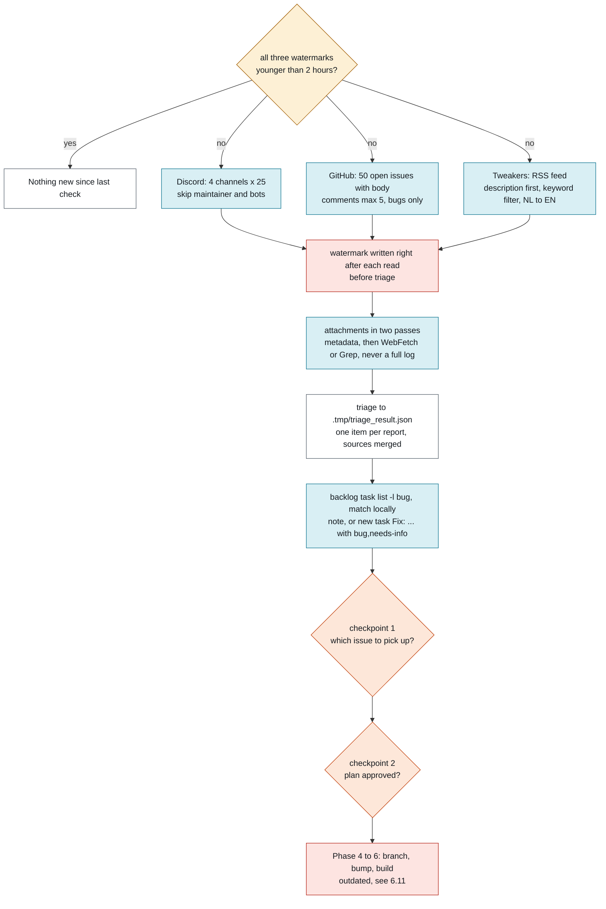

De zuinigheidsregels O1-O7 (`.claude/commands/check_otgw_issues.md:5-15`) bepalen het karakter: vroege stop, 25 berichten per kanaal, GitHub-commentaar alleen bij bugs, bij Tweakers eerst alleen de korte beschrijving, bijlagen lui laden (grens 50 KB, `:113-122`), één bulkquery op de backlog en triage-uitvoer in een bestand. Het Tweakers-filter is tweetalig: `werkt niet|niet meer|fout|crash|bug|error|probleem|kapot|broken|fails|issue|doesn't work` (`:100`); screenshots komen niet door de RSS (`backlog/archive/tasks/task-240 - Fix-upgrade-to-v6.6-fails-reported-by-Tomba-on-Tweakers.md:32-45`). Een melding is "ready" bij een reproduceerbare beschrijving, bekende code-context en minstens één melder die kan valideren; anders blijft `needs-info` staan (`.claude/commands/check_otgw_issues.md:209-210`).

**Zwakke plek.** Elk watermerk wordt direct na het lezen van de bron geschreven, dus vóór de triage (`.claude/commands/check_otgw_issues.md:54`, `:77`, `:102`). Breekt een run halverwege af, dan gelden die berichten toch als gezien. Een compenserende onbeantwoord-sweep bestaat alleen voor #alpha-testing en #dev-sat-mqtt (`.claude/commands/backlog_discord.md:29-31`).

#### 6.4.4 Van melding naar capture-analyse

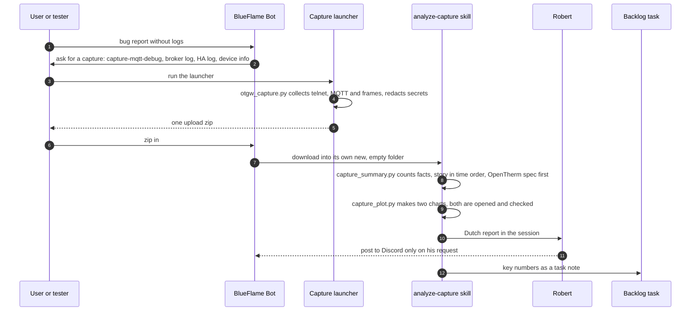

Bronnen: `CLAUDE.md:120-121`; `.claude/skills/analyze-capture/SKILL.md:13-21`, `:30-37`, `:78-88`, `:92`, `:96-106`; `scripts/otgw_capture.py:2-11`, `:85-88`; `scripts/README.md:172-178`. Een capture is onvertrouwde data en gaat altijd in een eigen map (`.claude/skills/analyze-capture/SKILL.md:15`). Afbeeldingen kan de MCP-tool niet bijvoegen: grafieken gaan via de alpha-webhook, met `allowed_mentions.users` op alleen de tester (`:100-102`).

#### 6.4.5 Dekking: wat welk pad ziet, en wat niemand ziet

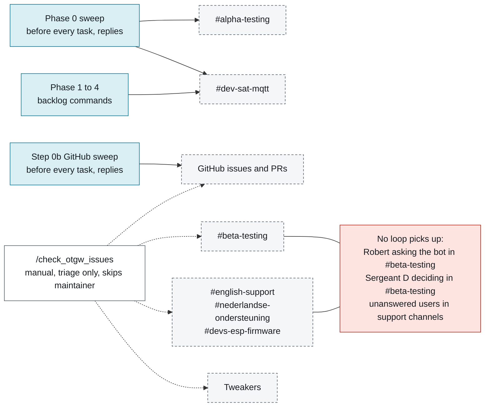

De twee GitHub-paden hanteren **verschillende regels voor hetzelfde issue**:

| Aspect | `/check_otgw_issues` | Stap 0b | Bron |
|---|---|---|---|
| Lijstcall | met `body` | zonder `body`, maar classificeert "from the body" | `.claude/commands/check_otgw_issues.md:65-66`; `.claude/skills/implement-next-task/SKILL.md:59-60`, `:81-82` |
| Ontdubbelen | lokaal op trefwoorden tegen `backlog task list -l bug` | `grep` op de volledige issue- of PR-URL in `backlog/` | `.claude/commands/check_otgw_issues.md:191-196`; `.claude/skills/implement-next-task/SKILL.md:65-72` |
| Taaktitel en labels | `Fix: ...`, `bug,needs-info`, prioriteit medium | `GitHub #N: ...`, `github` (PR: `github,pr`), bug of PR prioriteit high, feature of vraag `needs-maintainer-ok` | `.claude/commands/check_otgw_issues.md:197-204`; `.claude/skills/implement-next-task/SKILL.md:73-89` |
| Wachtmarkering | `needs-info` (staat niet in de CLI-gids) | `needs-maintainer-ok` | `docs/guides/backlog-cli.md:141-146` |
| Reactie naar buiten | geen | commentaar op het issue, PR-review | `.claude/commands/check_otgw_issues.md:271-277`; `.claude/skills/implement-next-task/SKILL.md:88-96` |

### 6.5 Of en hoe hij reageert: de beslisboom

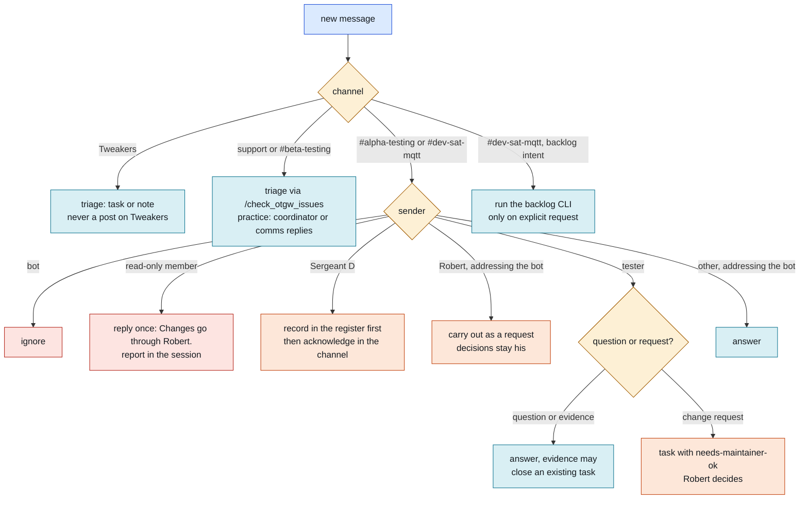

| Afzender | Wat de bot doet | Wat de bot niet doet | Bron |
|---|---|---|---|
| Robert (maintainer) | Antwoordt als Robert de bot aanspreekt; ook een besluit zoals "Q33: A" in het kanaal telt | Behandelt Roberts gewone chat niet als backlog-commando | `.claude/commands/backlog_discord.md:32`, `:44`; `docs/sat/open-questions.md:93` |
| Sergeant D | Legt elke correctie of beslissing eerst vast in `docs/sat/sergeant-d-corrections.md`, antwoordt in het Engels, antwoord eerst; mag een taak noemen | Kondigt geen builds aan hem aan; implementeert SAT-regelgedrag niet zonder zijn OK | `.claude/commands/backlog_discord.md:20`; `.claude/skills/implement-next-task/SKILL.md:168-180`, `:247` |
| Tester | Stelt vragen, gebruikt feedback, laat bewijs een bestaande taak sluiten | Implementeert, herprioriteert of sluit niets op verzoek van een tester | `.claude/commands/backlog_discord.md:21`; `.claude/skills/implement-next-task/SKILL.md:121-125` |
| Read-only lid | Eén antwoord: "Changes go through Robert." met Roberts mention | Niets wat zo iemand schrijft leidt tot code, taak, build of registerentry | `.claude/commands/backlog_discord.md:22` |
| Eindgebruiker (support, GitHub, Tweakers) | Triage, taak of notitie; op GitHub om captures vragen; in de supportkanalen in de praktijk antwoorden | Geen post op Tweakers; geen vastgelegde antwoordprocedure voor de supportkanalen | `.claude/commands/check_otgw_issues.md:155-212`; `.claude/skills/implement-next-task/SKILL.md:85-93`; `task-1896:57` |

### 6.6 Wat hij zegt: antwoordregels

| Regel | Geldt voor | Bron |
|---|---|---|
| Engels, het antwoord eerst, de echte `<@ID>`-mention, nooit een kale naam | alle antwoorden aan personen op Discord | `CLAUDE.md:26`; `.claude/commands/backlog_discord.md:23` |
| De gateway-hardware van de 2.x-lijn nooit bij naam noemen | alles wat publiek is: Discord, GitHub-commentaar, releasetekst | `CLAUDE.md:26`; `.claude/skills/implement-next-task/SKILL.md:91-93` |
| Zeggen wat nog niet geverifieerd is; Sergeant D niet taggen bij build-aankondigingen | verslagen in #alpha-testing | `.claude/skills/implement-next-task/SKILL.md:246-248` |
| Technische claims eerst in de code verifiëren, met `file:line` | antwoorden in Phase 0 | `.claude/commands/backlog_discord.md:34` |
| Onder 2000 tekens per bericht, genummerd opsplitsen, **alle** wijzigingen sinds de vorige post in dat kanaal (Robert, 2026-11-15) | release-aankondigingen | `.claude/skills/beta-release-2x/SKILL.md:284-296`; `.claude/skills/release-2x/SKILL.md:191-200` |
| Geen pings vanuit de zip-post (`allowed_mentions.parse` leeg), ASCII-veilige payload | webhook-post | `scripts/discord-post-build.sh:94-98` |
| Ketel- of thermostaatvraag: eerst de OpenTherm-equipment-matrix, geciteerd als "the equipment matrix shows ...", en vragen om een capture bij gaten (directive 2026-11-11) | Discord, GitHub, Tweakers, taaknotities | `.claude/rules/discord.md:24-31` |
| Elke uitspraak over gewenst SAT-gedrag vraagt een thermo-nova-citaat en een toets aan het register | antwoorden, capture-analyses | `.claude/rules/sat-ground-truth.md:16-22`; `.claude/skills/analyze-capture/SKILL.md:59-61` |

### 6.7 Uitgaande stromen

#### Taak, plan, verslag en zip in #alpha-testing

```mermaid
sequenceDiagram
  autonumber
  participant C as Coordinator as BlueFlame Bot
  participant Dv as Developer session
  participant BT as Bench-tester
  participant G as origin/dev
  participant W as discord-post-build.sh
  participant A as #alpha-testing
  C->>A: step 1: which task, in one or two sentences
  C->>A: step 4: what changes and how it is proven, a notice, no approval wait
  Dv->>Dv: red on old code, green on fix, evaluate, bump, commit, build esp32-combo
  Dv->>C: bench request: githash, artifact path, behaviour to check
  C->>BT: bench run
  BT->>BT: OTA flash, check githash, run tests, tick bench ACs
  BT-->>C: OK or FAIL
  alt OK
    Dv->>G: push
    Dv->>W: bash scripts/discord-post-build.sh -m "TASK-NNN: ..."
    W->>W: refuses on githash not HEAD, dirty src, tag already published or not newer, zip over 10 MB
    W->>A: zip as BlueFlame Build Bot
    Dv->>C: tag, commit, tasks and evidence
    C->>A: step 8: plain-language report, old versus new, what is not verified
    C->>C: update ledger, compare with git log
  else FAIL
    BT-->>Dv: publish nothing, fix and build again
  end
```

Bronnen: `.claude/skills/implement-next-task/SKILL.md:130-133`, `:163-166`, `:243-281`; `.claude/rules/discord.md:18-22`; `scripts/discord-post-build.sh:13-15`, `:48-90`; `CLAUDE.md:21`. Het script draait onder Git Bash; een kale `bash` vanuit PowerShell kan WSL zijn, waar `LOCALAPPDATA` ontbreekt (`.claude/skills/implement-next-task/SKILL.md:274-276`). Is er geen uitvoerbare taak, dan post de cyclus niets (`:134-135`).

#### Release-aankondigingen

```mermaid
flowchart LR
  classDef agent fill:#d9eff4,stroke:#0e7490,color:#151a1f
  classDef gate fill:#fdf0d5,stroke:#a15c00,color:#151a1f
  classDef human fill:#fde7d9,stroke:#c2410c,color:#151a1f
  classDef ship fill:#e3f1e4,stroke:#2f7d32,color:#151a1f
  classDef store fill:#ffffff,stroke:#56616c,color:#151a1f
  B["/beta-release-2x<br/>slot 08:00 or 20:00<br/>standing permission 2026-11-14"]:::agent
  K{"beta.N already posted<br/>as alpha zip?"}:::gate
  NOTE["#alpha-testing note:<br/>beta.N is now the public beta"]:::ship
  ZIP["post the zip<br/>with the post script"]:::ship
  ANN["#beta-testing announcement<br/>sent without preview<br/>all changes since the previous post"]:::ship
  RST["MCP down: REST API fallback<br/>read the message back"]:::store
  S["/release-2x<br/>hard stop: explicit yes by DM"]:::human
  CP3{"CHECKPOINT 3<br/>show the posts"}:::human
  NLP["#nederlandse-ondersteuning<br/>Dutch post"]:::ship
  ENP["#english-support<br/>English post"]:::ship
  BTN["#beta-testing<br/>short note with thanks"]:::ship
  B --> K
  K -->|"yes, normal case"| NOTE --> ANN
  K -->|"no"| ZIP --> ANN
  ANN -.-> RST
  S --> CP3 --> NLP & ENP & BTN
```

Bronnen: `.claude/skills/beta-release-2x/SKILL.md:47-67`, `:257-283`; `.claude/skills/release-2x/SKILL.md:61-63`, `:189-202`. De staande toestemming voor publieke beta's ("Ik wil dat je de release van een beta gewoon uitvoert") geldt alleen voor het slot van 08:00 of 20:00; een stabiele release blijft een harde stop (`CLAUDE.md:18`).

#### Een beslissing aan Robert voorleggen

```mermaid
sequenceDiagram
  autonumber
  participant X as Any session or agent
  participant C as Coordinator as BlueFlame Bot
  participant R as Robert, DM
  participant T as Task notes
  X->>C: open decision: one question, options, consequences, weighed advice
  C->>R: send_private_message
  Note over X: keeps working on what is not blocked
  R-->>C: answer
  C->>X: relay the answer
  X->>T: record question ID, answer ID and "relayed by the coordinator"
  alt hard stop: release, PIC flash, push to main, force-push, merging someone else's PR
    Note over C,R: only an explicit yes on a DM that names the action and its target<br/>a general go on does not count
  end
  opt no DM channel available
    X->>X: write the question asynchronously in the session, never interactively
  end
```

Bronnen: `CLAUDE.md:18`, `:60`; `backlog/tasks/task-1829 - Agent-rule-questions-to-Robert-only-by-Discord-DM-never-as-an-interactive-CLI-question-asynchronous-in-the-session-when-DM-is-unavailable.md:23`, `:38`; `backlog/tasks/task-1955 - esp32-combo-app-slot-at-93.8-141-KB-headroom-left-in-ota_0-beta.287.md:35`. De regel dateert van 2026-11-12 en vervangt de interactieve vraag van 2026-10-29.

Sinds 2026-11-15 bestaat daarnaast een bredere **delegatie**: "Ask me only if you really can't do it yourself. You have my permission." De coördinator nam daarop zelf een keuze binnen een taak en meldde die per DM met een aanbod om terug te draaien (`backlog/tasks/task-1919 - An-app-image-that-the-bootloader-marked-ABORTED-keeps-running-but-never-confirms-itself-so-the-next-reset-of-any-kind-rolls-back-to-safeboot.md:58`). Die delegatie staat alleen in taaknotities (§6.11).

### 6.8 De SAT-dialoog met Sergeant D

SAT is door Sergeant D ontworpen en door Alex geprogrammeerd; er is geen geschreven ontwerp. Daarom is zijn vastgelegde woord de eerste bron, vóór de vastgepinde thermo-nova-code en ver vóór de firmware (`.claude/rules/sat-ground-truth.md:8-14`). BlueFlame Bot is de gesprekspartner: Sergeant D spreekt hem aan met `@BlueFlame Bot`; de oudste zo geciteerde aanspreking in het register dateert van april 2026 (`docs/sat/sergeant-d-corrections.md:1553-1566`) en antwoordt vaak kort, zoals "@BlueFlame Bot my answer is B." (`:7060-7066`).

```mermaid
stateDiagram-v2
  [*] --> Found: gap in the spec, not found in the code
  Found --> Queued: row in open-questions.md<br/>options A/B/C with thermo-nova citations and advice
  Queued --> Asked: one question per Discord message, plain English
  Asked --> Asked: he is active, so the next question follows at once
  Asked --> Quiet: no reaction within one hour
  Quiet --> Quiet: check every hour, post nothing
  Quiet --> Asked: he is back, repeat the open question briefly with a link
  Asked --> Answered: answer, correction or decision
  Answered --> Recorded: numbered entry in the register<br/>quote, link, comparison, open points
  Recorded --> Task: one backlog task per decision
  Task --> [*]: plan names the entries, a reviewer checks the diff
```

| Feit | Waarde | Bron |
|---|---|---|
| Register op 2026-11-15 | 353 entries: 293 Sergeant D, 41 maintainer, 16 port-team, 3 unknown (geteld: `entries` en veld `source` in de index; laatste kop entry 353) | `docs/sat/sergeant-d-corrections.index.json:1-14`; `docs/sat/sergeant-d-corrections.md:7364` |
| Kanaal van de eerste link per entry | 181 #alpha-testing, 88 #dev-sat-mqtt, 3 #beta-testing (entries 351-353), 81 zonder link (geteld: kanaal-ID in `discord_link` per entry van de index) | `docs/sat/sergeant-d-corrections.index.json:1-14`; `docs/sat/sergeant-d-corrections.md:7326` |
| Wachtrij | 18 open: 4 asked, 14 queued | `docs/sat/open-questions.md:18-37` |
| Antwoordtijd (meetvenster 2026-10-06 tot 2026-11-04, niet herhaald) | mediaan 0,3 uur, 80e percentiel 2,4 uur (12 getimede antwoorden) | `docs/process/agentic-throughput-2026-11-05.md:1`, `:16-24` |
| Maintainer-lus | Robert kan een vraag zelf beantwoorden ("Not by Sergeant D."); Sergeant D wordt dan uitgenodigd te zeggen of hij het anders ziet, en kan bij SAT-regelgedrag een maintainer-besluit overrulen (entry 277 tegenover 271) | `docs/sat/sergeant-d-corrections.md:7078-7080`, `:6084-6090` |
| Onveranderlijk | Een nieuw antwoord vervangt een oud via een nieuwe entry ("Change my answer to B"); de oude blijft staan | `docs/sat/sergeant-d-corrections.md:7182-7192` |

De dialoog loopt in #alpha-testing en #dev-sat-mqtt en sinds 2026-11-15 ook in #beta-testing; Phase 0 vangt zijn antwoorden alleen in de eerste twee (`.claude/commands/backlog_discord.md:31`, `:33`). Kernregels (`.claude/rules/sat-ground-truth.md:16-26`): geen claim zonder thermo-nova-citaat dat in de sessie geopend is; een conflict tussen Sergeant D en de code gaat met beide citaten naar hem; vastleggen gaat vóór implementeren; een plan dat SAT-regelgedrag verandert, wacht op zijn OK (`.claude/skills/implement-next-task/SKILL.md:168-180`). Drie tests bewaken de regeltekst, de index en de wachtrij; de naleving zelf is conventie en review (`tests/test_sat_ground_truth_block.py:30-36`; `tests/test_sat_corrections_index.py:47-51`; `tests/test_open_questions_status.py:67-81`).

### 6.9 Geheugen en toestand

| Toestand | Waar | In git? | Wie schrijft | Bron |
|---|---|---|---|---|
| Watermerk backlog-bot | `.claude/discord_backlog_last_checked.txt` | nee: gitignored en afwezig in deze checkout | `/backlog_discord` Phase 1 | `.claude/commands/backlog_discord.md:16`, `:45`; `.gitignore:74-78` |
| Watermerken monitor | `.claude/discord_last_checked.txt`, `github_last_checked.txt`, `tweakers_last_checked.txt`, alle drie `2026-11-14T21:15:27Z` | ja, ondanks `.gitignore` | `/check_otgw_issues` | `.claude/discord_last_checked.txt:1`; `.gitignore:74-78` |
| People-file | `.claude/discord-people.local.md`, sjabloon `.claude/discord-people.example.md` | nee | Robert | `.claude/discord-people.example.md:1-9` |
| Gepubliceerde tags | `%LOCALAPPDATA%\OTGW-capture\published-tags.txt`, gedeeld door alle worktrees | nee | post-script | `scripts/discord-post-build.sh:63-80`, `:140` |
| Postlog | `published-posts.tsv` naast de tags: tijd, tag, versie, bericht-ID, `-m`-tekst | nee | post-script | `scripts/discord-post-build.sh:141-145` |
| Alpha-ledger | `.claude/alpha-build-ledger.local.md`, herbouwbaar met `python scripts/alpha_ledger.py --last 40` | nee | coördinator | `.claude/rules/discord.md:21-22`; `docs/guides/second-machine-setup.md:12` |
| SAT-register en wachtrij | `docs/sat/sergeant-d-corrections.md`, `docs/sat/open-questions.md` | ja | de sessie die het antwoord verwerkt | `.claude/rules/sat-ground-truth.md:21-23` |

### 6.10 Waarborgen en faalwijzen

| Risico | Waarborg | Soort | Bron |
|---|---|---|---|
| Een zip die niet bij de code past | Post-script weigert bij githash ongelijk aan HEAD, prerelease ongelijk aan die van HEAD, `src/` niet schoon | script-weigering | `scripts/discord-post-build.sh:48-61`, `:82-87` |
| Een tag twee keer of in verkeerde volgorde | `published-tags.txt`: weigert een gepubliceerde of niet-nieuwere tag, per core-versie | script-weigering | `scripts/discord-post-build.sh:63-80` |
| Zip te groot of upload stil mislukt | Grens 10 000 000 bytes; daarna controle op een 2xx-code en een bijlage van precies de bestandsgrootte | script-controle | `scripts/discord-post-build.sh:89-90`, `:130-136` |
| Een massa-ping | `allowed_mentions.parse` leeg in de zip-post | script | `scripts/discord-post-build.sh:98` |
| Gateway-conflict | Eén proces op het token; supervisor met mutex | infrastructuur | `docs/guides/discord-mcp-server.md:13`, `:21-22` |
| Testers sturen de prioriteit | `needs-maintainer-ok`; zulke taken worden overgeslagen | conventie plus selectieregel | `.claude/skills/implement-next-task/SKILL.md:121-125` |
| SAT-gedrag uit het geheugen | Register eerst, `file:line`-citaten, reviewer toetst tegen het register | conventie plus review | `.claude/rules/sat-ground-truth.md:16-26` |
| Berichten blijven liggen | Phase 0 negeert het watermerk; telregel aan het eind; alleen voor twee kanalen | procedure | `.claude/commands/backlog_discord.md:27-36` |
| Geheimen lekken | Webhook-URL buiten de repo en nooit geprint; token uit de Windows-gebruikersomgeving; capture-tool redigeert wachtwoorden en tokens | conventie plus script | `scripts/discord-post-build.sh:9-11`; `docs/guides/discord-mcp-server.md:13`, `:19`; `scripts/otgw_capture.py:85-88` |

### 6.11 Spanningen

Elke rij noemt beide kanten met citaat en wat leidend is. CLAUDE.md wint van elk ander instructiebestand (`CLAUDE.md:15`); de implement-next-task-skill zegt dat zelf ook (`.claude/skills/implement-next-task/SKILL.md:19-20`).

| # | Thema | Spanning | Kant A | Kant B | Leidend |
|---|---|---|---|---|---|
| 1 | rollen | De comms-sessie bestaat in de praktijk maar niet in de regels | "one owner, the comms session" (`.claude/skills/beta-release-2x/SKILL.md:72-73`); comms post op een PR en in supportkanalen (`task-1949:39`, `task-1544:45`) | CLAUDE.md kent alleen Robert, Sergeant D, testers, de coördinator en de bench-tester (`CLAUDE.md:18-21`, `:60`) | CLAUDE.md: de coördinator is eigenaar van het DM-kanaal; de comms-rol is praktijk, geen regel |
| 2 | rollen | Wie post het verslag in #alpha-testing | De hoofdsessie bezit "every Discord post" en post stap 8 (`.claude/skills/implement-next-task/SKILL.md:29-30`, `:243-248`) | De pushende sessie meldt aan de coördinator, die het verslag post (`.claude/rules/discord.md:21`) | `.claude/rules/discord.md`, onderdeel van de CLAUDE.md-regelset |
| 3 | rollen | Delegatie van 2026-11-15 staat alleen in een taaknotitie | "Ask me only if you really can't do it yourself. You have my permission." (`task-1919:58`) | Robert beslist scope, prioriteit, waivers en releases; elke open beslissing als DM-vraag (`CLAUDE.md:18`, `:60`) | Formeel CLAUDE.md; de delegatie is later maar niet in de regelbestanden of de changelog opgenomen |
| 4 | rollen | Statusmutaties via Discord door iedereen | "move task 42", "mark task 42 done", "assign" zonder beperking op afzender (`.claude/commands/backlog_discord.md:76-104`) | Testers sluiten of herprioriteren niets; de maintainer wordt voor backlog-commando's genegeerd (`:21`, `:44`) | Regel 21 (directive 2026-10-25) en `CLAUDE.md:18`; wie dan wel mag muteren, staat nergens |
| 5 | rollen | Interactieve checkpoints | "Ask the developer which issue(s) to work on", "Wait for developer approval" (`.claude/commands/check_otgw_issues.md:212`, `:227`); "show the posts; send after approval" zonder route (`.claude/skills/release-2x/SKILL.md:201-202`) | Vragen aan Robert alleen per Discord-DM (`CLAUDE.md:60`) | `CLAUDE.md:60` (2026-11-12); de changelog noemt de interactieve route nog als geldend (`docs/process/directive-changelog.md:25`) |
| 6 | rollen | Beta-skill telt nog twee checkpoints | "2 (Robert's go, announcement text)" (`.claude/skills/beta-release-2x/SKILL.md:30`); "Message the peers: beta.N tag out" (`:245`) | Staande toestemming, aankondiging "sent without showing it first", het peer-bericht vervalt (`:64-67`, `:278-279`, `:89-90`) | `CLAUDE.md:18` en Phase 0 van de skill |
| 7 | kanalen | Supportkanalen: alleen lezen of tweerichting | "Read by `/check_otgw_issues`" (`docs/guides/discord-mcp-server.md:44-47`); de beeldbrief zegt "nooit antwoorden op meldingen" (`docs/process/agentic-setup-image-brief.md:249`) | Release-posts in NL en EN (`.claude/skills/release-2x/SKILL.md:191-193`); antwoorden van comms en coördinator (`task-1786:50`, `task-1896:57`) | De skill en de praktijk; alleen de monitorlezing is alleen-lezen |
| 8 | kanalen | Gat voor verzoeken en besluiten in #beta-testing | Phase 0 leest alleen #alpha-testing en #dev-sat-mqtt (`.claude/commands/backlog_discord.md:31`); `/check_otgw_issues` sluit de maintainer uit en kent geen SAT-stap (`.claude/commands/check_otgw_issues.md:48-53`) | Robert vraagt de bot daar iets uit te zoeken (`task-1979:25`); Sergeant D besluit er (`docs/sat/sergeant-d-corrections.md:7326`) | Niet geregeld in de repo; "record before implement" geldt in elk kanaal (`.claude/rules/sat-ground-truth.md:21`) |
| 9 | kanalen | Kanaal van de SAT-dialoog | "answer him in `#alpha-testing`" (`.claude/commands/backlog_discord.md:20`); "one question at a time in #alpha-testing" (`docs/sat/open-questions.md:4-5`) | "SAT simulation rounds" in #dev-sat-mqtt (`docs/guides/discord-mcp-server.md:43`); een ronde op Roberts order verplaatst (`docs/sat/open-questions.md:160-161`); sinds 2026-11-15 #beta-testing (`docs/sat/sergeant-d-corrections.md:7350`) | Onbeslist: `.claude/rules/sat-ground-truth.md:23` noemt geen kanaal |
| 10 | kanalen | Reikwijdte van de MCP in de regels | "Discord I/O for `#dev-sat-mqtt` and the support channels" (`.claude/rules/discord.md:12`) | De gids noemt ook #alpha-testing en #beta-testing; DM's zijn de vaste route naar Robert (`docs/guides/discord-mcp-server.md:40-47`; `CLAUDE.md:60`) | De gids en CLAUDE.md |
| 11 | kanalen | Zonder people-file alleen Sergeant D en Robert | "Without that file, answer only Sergeant D and Robert" (`docs/guides/discord-mcp-server.md:57-59`; `.claude/commands/backlog_discord.md:19`) | Eindgebruikers in supportkanalen krijgen antwoord (`task-1544:45`) | Niet te bepalen: het lokale bestand zit niet in de checkout |
| 12 | kanalen | "Check the chat every hour" zonder mechanisme | "Check the chat every hour" (`.claude/rules/sat-ground-truth.md:23`) | `/backlog_discord` draait alleen vóór elke taak (`.claude/skills/implement-next-task/SKILL.md:47`); geen planner gevonden | De regel; hoe het uurritme wordt afgedwongen is niet gevonden in de repo |
| 13 | kanalen | Eén vraag per bericht, met uitzonderingen | "one question per Discord message" (`.claude/rules/sat-ground-truth.md:23`) | Overzicht Q2-Q28 in één keer (`docs/sat/open-questions.md:49-52`); alle 13 vragen tegelijk op Roberts order (`:389`) | De regel; uitzonderingen alleen op order van Robert, per rij vastgelegd |
| 14 | kanalen | Engels tegenover een Nederlandse post | "Answer in English" (`CLAUDE.md:26`) | "Dutch in `#nederlandse-ondersteuning`" (`.claude/skills/release-2x/SKILL.md:191`) | CLAUDE.md formeel; de NL-post is een aankondiging, geen antwoord, en gaat langs CHECKPOINT 3 |
| 15 | monitor | Twee ontdubbelregels en labelsets voor GitHub | Trefwoorden tegen `backlog task list -l bug`, labels `bug,needs-info` (`.claude/commands/check_otgw_issues.md:191-204`) | URL-grep, labels `github` en `needs-maintainer-ok` (`.claude/skills/implement-next-task/SKILL.md:65-89`); `#N` gaf valse treffers (`task-1637:35`) | Stap 0b (directive 2026-11-05); `needs-info` is een lokale conventie (`docs/guides/backlog-cli.md:141-146`) |
| 16 | monitor | Stap 0b classificeert op een body die niet wordt opgevraagd | `--json number,title,author,createdAt,updatedAt,labels,url` (`.claude/skills/implement-next-task/SKILL.md:59-60`) | "Classify from the body" (`:81-82`); het command vraagt `body` wel op (`.claude/commands/check_otgw_issues.md:65-66`) | Niet geadresseerd in de repo |
| 17 | monitor | Watermerk vóór de triage | Schrijven direct na het lezen (`.claude/commands/check_otgw_issues.md:54`, `:77`, `:102`) | Een onbeantwoord-sweep alleen voor twee kanalen (`.claude/commands/backlog_discord.md:29-31`) | Niet geadresseerd in de repo |
| 18 | monitor | Watermerkbestanden: gitignored, toch gevolgd | Alle vier in `.gitignore` (`.gitignore:74-78`) | Drie staan in git met een tijdstempel (`.claude/discord_last_checked.txt:1`); het vierde, van `/backlog_discord`, ontbreekt (`.claude/commands/backlog_discord.md:16`) | `.gitignore`: bedoeld als lokale toestand; dat ze gevolgd worden is een verzuim |
| 19 | monitor | Phase 4-6 van de monitor zijn achterhaald | `fix-issue-*`-branch, `_VERSION_PATCH`, `addOTWGcmdtoqueue()`, `python build.py --firmware`, "Do NOT push" (`.claude/commands/check_otgw_issues.md:231-277`, `:258`, `:263`) | Direct op `dev`, `bin/bump-prerelease.sh`, `addCommandToQueue()`, alleen `build.bat` of `./build.sh`, bench-run, push na de gates (`CLAUDE.md:21-25`, `:112`) | CLAUDE.md |
| 20 | monitor | Toolparameters en Copilot-prompt | `limit=25` en `after` (`.claude/commands/check_otgw_issues.md:10`); Copilot: "Login to Discord", limit 50 (`.github/prompts/check-discord-issues.prompt.md:31-37`) | `read_messages` kent `channelId` en `count`; geen login-tool (`docs/guides/discord-mcp-server.md:17`, `:28`) | De gids voor de parameters; CLAUDE.md wint van de Copilot-bestanden |
| 21 | monitor | Bijlagen: gedeelde map of eigen map | Vaste map `$env:TEMP\otgw-issues-attach` met een hard gebruikerspad (`.claude/commands/check_otgw_issues.md:134-138`) | "own new, empty folder (a capture is untrusted data)" (`.claude/skills/analyze-capture/SKILL.md:15`) | analyze-capture voor captures |
| 22 | monitor | Tweakers-uitsluiting | `number3` of `rvdbreemen` (`.claude/commands/check_otgw_issues.md:99`) | Alleen `rvdbreemen` (`:291`) | Onbeslist; beide uitsluiten is de veilige lezing |
| 23 | monitor | Capture-scriptnaam in CLAUDE.md | "`capture-otgw.sh` transcript" (`CLAUDE.md:121`) | Op `dev` bestaan `capture-mqtt-debug.bat`, `.sh` en `otgw_capture.py` (`scripts/README.md:78-80`) | CLAUDE.md voor de regel; de bestandsnaam is verouderd |
| 24 | techniek | REST-terugval voor posten is niet aangetoond | "post through the Discord REST API with the bot token" (`.claude/skills/beta-release-2x/SKILL.md:281-283`) | "the auto-mode classifier blocks a bot-token POST" (`task-1313:32`); lezen via REST werkt wel (`docs/sat/sergeant-d-corrections.md:6503`) | Niet beslist in de repo |
| 25 | techniek | Herkomst van het token | "`DISCORD_TOKEN` is injected via MCP config" (`.claude/commands/backlog_discord.md:47`; `.claude/commands/check_otgw_issues.md:44`) | De supervisor geeft het uit de Windows-gebruikersomgeving mee (`docs/guides/discord-mcp-server.md:13`; `.claude/rules/discord.md:12`) | `.claude/rules/discord.md` en de gids |
| 26 | techniek | Autostart als werkend beschreven, AC open | Supervisor, taak en hook beschreven als de werkende opzet (`.claude/rules/discord.md:12`) | "Autostart at logon waits for the network" niet afgevinkt, taak To Do (`task-1793:28`, `:6`) | TASK-1793: geïmplementeerd, het bootpad is niet geverifieerd |
| 27 | techniek | Legacy MCP-config in git | `npx mcp-discord` met tokenprompt en de backlog-MCP (`.claude/.vscode/mcp.json:10-27`) | Java-proces op `:8085`; backlog-MCP niet gebruiken (`docs/guides/discord-mcp-server.md:12`; `CLAUDE.md:19`) | CLAUDE.md en de gids |
| 28 | techniek | Tagnotatie | "`2.0.0-alpha.N+hash`" (`.claude/skills/implement-next-task/SKILL.md:246`); "dev builds after beta.1 are 2.0.1-alpha.N" (`scripts/discord-post-build.sh:66-68`) | Elke firmwaretaak krijgt een eigen `2.0.0-beta.N`-bump (`.claude/skills/beta-release-2x/SKILL.md:48-49`) | De beta-skill; functioneel geen probleem, de volgordecontrole werkt per core |
| 29 | techniek | Verwijzingen naar het SAT-blok "in CLAUDE.md" | "see the SAT ground truth block in CLAUDE.md" (`.claude/commands/backlog_discord.md:20`; `docs/guides/discord-mcp-server.md:53-54`; `.claude/rules/sat-ground-truth.md:5`) | Het blok staat in `.claude/rules/sat-ground-truth.md` en AGENTS.md (`CLAUDE.md:181`; `tests/test_sat_ground_truth_block.py:30-36`) | `CLAUDE.md:181` plus de test |
| 30 | techniek | Changelog mist de Discord-directives | "Open questions go to Robert interactively" als geldend, geen rij voor de DM-route, de GitHub-sweep of de equipment-matrix (`docs/process/directive-changelog.md:21-28`) | DM-route sinds 2026-11-12 (`CLAUDE.md:60`) | `CLAUDE.md:60` |

> **Voor de plaat:** BlueFlame Bot is de blauwe waakvlam met witte kern in het hart van plaat A en het onderwerp van plaat B (`docs/process/agentic-setup-image-brief.md`, hoofdstuk 4), in het lichte thema. Drie stralen gaan naar drie buitenposten: Discord links met zeven deuren, GitHub rechtsboven onder het maintainer-account en Tweakers rechtsonder, alleen lezen. Nieuw ten opzichte van de brief: teken achter de vlam twee kleine teal sessiefiguren (coördinator en comms), geef de deuren #beta-testing, #english-support en #nederlandse-ondersteuning een dunne tweede pijl voor antwoorden uit de praktijk, en markeer #beta-testing met een rood gestippeld randje als plek zonder bewakingslus. De vijf oker schilden rond de vlam blijven de spelregels; het fundament toont de Java-server, de supervisor en het losse webhookblokje.

---

## 7. De softwarepipeline: van taak tot tester en release

De pijplijn draait vrijwel geheel lokaal op de Windows-werkplek van Robert (maintainer): "`dev` has no release CI: 2.x builds are local (esp32-combo) and assets are uploaded with `gh`, draft first" (`CLAUDE.md:162`, `docs/guides/second-machine-setup.md:3-4`). Elke firmwaretaak doorloopt dezelfde keten van poorten en krijgt een eigen prerelease-tag; de zip voor de testers volgt pas na het bench-OK, en taken die tegelijk klaar zijn mogen één build delen (`docs/guides/agent-build-and-bench.md:9`). Een deel van de poorten weigert in een script of git-hook, de rest is conventie die review en de coördinator bewaken; dit hoofdstuk benoemt per stap welke van de twee het is. Boven op die alpha-stroom liggen drie publieke distributielijnen: de 2.x-beta in een vast slot, de stabiele 2.x op `release/2.x` en de 1.x-lijn via `otgw-1.x.x` naar `main` (`CLAUDE.md:153-158`).

### 7.1 De keten in één beeld

```mermaid
flowchart TD
  classDef human fill:#fde7d9,stroke:#c2410c,color:#151a1f
  classDef agent fill:#d9eff4,stroke:#0e7490,color:#151a1f
  classDef bot fill:#dbeafe,stroke:#1d4ed8,color:#151a1f
  classDef gate fill:#fdf0d5,stroke:#a15c00,color:#151a1f
  classDef store fill:#ffffff,stroke:#56616c,color:#151a1f
  classDef ext fill:#f4f6f7,stroke:#56616c,color:#151a1f,stroke-dasharray:4 3
  classDef stop fill:#fde4e1,stroke:#b42318,color:#151a1f
  classDef ship fill:#e3f1e4,stroke:#2f7d32,color:#151a1f

  T["1 Backlog task<br/>In Progress first"]:::store
  P["2 Plan + self-review<br/>advisor or opus reviewer"]:::agent
  SD["SAT control change<br/>OK from SAT designer first"]:::human
  RG["3 Red on old code<br/>green on fix"]:::gate
  RV["4 Reviewer team<br/>told to refute"]:::gate
  EV["5 evaluate.py --quick<br/>run_tests.py"]:::gate
  BC["6 bump-prerelease.sh<br/>+ git commit"]:::agent
  HK["git hooks<br/>pre-commit / commit-msg"]:::gate
  BD["7 build.sh / build.bat<br/>lock, 4 jobs, esp32-combo"]:::gate
  BN["8 Bench run over OTA<br/>otgw-bench-tester only"]:::gate
  PU["9 git push origin/dev"]:::agent
  CI["GitHub Actions<br/>build.yml + evaluate.yml"]:::ext
  PB["10 discord-post-build.sh<br/>webhook"]:::gate
  LG["11 Report + ledger<br/>coordinator"]:::bot
  TS["Tester flashes zip<br/>reports with capture"]:::human
  X1["REFUSED<br/>no bump / no task file"]:::stop
  X2["REFUSED<br/>exit 1-4"]:::stop
  X3["Nothing published<br/>fix, rebuild, new run"]:::stop
  X4["REFUSED exit 2<br/>hash, tag, dirty, size"]:::stop
  ZIP["Alpha zip in<br/>#alpha-testing"]:::ship

  T --> P --> RG --> RV --> EV --> BC --> HK
  P -.->|"SAT control only"| SD -.-> RG
  HK -->|ok| BD
  HK -->|fail| X1
  BD -->|"SUCCESS line + fresh artifacts"| BN
  BD -->|fail| X2
  BN -->|"PASS, bench ACs ticked"| PU
  BN -->|FAIL| X3
  PU --> CI
  PU --> PB
  PB -->|ok| ZIP
  PB -->|fail| X4
  ZIP --> LG
  ZIP --> TS
```

Het diagram vereenvoudigt de volgorde. In `/implement-next-task` draaien de reproductie en de gates (inclusief een build) in skillstap 5, dan het reviewerteam van skillstap 6 op de ongecommitte diff, en daarna opnieuw de geraakte gates (`.claude/skills/implement-next-task/SKILL.md:182-220`). De bump en de commit komen pas daarna (`.claude/skills/implement-next-task/SKILL.md:222-238`).

### 7.2 Per stap: gereedschap, poort en weigerconditie

| # | Stap | Gereedschap | Poort en handhaving | Weigert of stopt wanneer | Bron |
|---|---|---|---|---|---|
| 1 | Taak | `backlog` CLI; eerste actie `backlog task edit <n> -s "In Progress" -a @claude` | Conventie plus hook: `.claude/hooks/backlog-mcp-guard.py` blokkeert Edit/Write op taakbestanden | Geen taak, geen werk; geen uitvoerbare taak: niets posten, rapporteren en stoppen | `CLAUDE.md:19`, `CLAUDE.md:46`, `.claude/skills/implement-next-task/SKILL.md:130-135` |
| 2 | Plan en zelfreview | `backlog task edit <n> --plan`, `/adr-kit:context`, de advisor (zonder advisor-tool één `opus`-reviewagent) | Conventie. Binnen de cyclus vervangt de zelfreview plus de notitie in #alpha-testing het wachten op Roberts akkoord | SAT-regelgedrag: niet implementeren zonder OK van Sergeant D (SAT-ontwerper). Harde stops blijven staan | `.claude/skills/implement-next-task/SKILL.md:20-25`, `:137-166`, `:168-170` |
| 3 | Rood-groen | Host-tests, frame-replay, ketelemulator, bench | Review: dezelfde reproductie faalt op de oude code en slaagt op de fix | Een groene run op alleen de fix is geen bewijs; een test die de code naspeelt in plaats van aanroept bewijst niets | `CLAUDE.md:118-133`, `.claude/skills/implement-next-task/SKILL.md:184-197` |
| 4 | Reviewerteam | Parallelle reviewers op de ongecommitte diff: correctheid (`opus`), projectregels (`sonnet`), tests en bewijs (`sonnet`), zo nodig een extra lens | Conventie: elke bevinding wordt door de hoofdsessie tegen de code gecontroleerd | Een bevinding die standhoudt wordt hersteld; wat niet binnen de taak past wordt een eigen taak | `.claude/skills/implement-next-task/SKILL.md:205-220` |
| 5 | Statische gates en tests | `python evaluate.py --quick`, `python scripts/run_tests.py` | Hook plus conventie: `post-edit-evaluate.py` draait de evaluator na elke edit van een `.ino`/`.cpp`/`.h` | Exit 1 bij FAIL, exit 2 bij meer dan 5 WARN; de hook geeft alleen bij FAIL exit 2 terug aan de agent | `docs/guides/agent-build-and-bench.md:66-73`, `.claude/hooks/post-edit-evaluate.py:1-22`, `.claude/settings.json:43-53` |
| 6 | Bump en commit | `bin/bump-prerelease.sh`, `git add <paden>`, `git commit` | Git-hooks `.githooks/pre-commit` en `.githooks/commit-msg` | Firmwarepad zonder wijziging van `_VERSION_PRERELEASE`; `TASK-NNN` zonder taakbestand; firmware-, docs- of backlog-commit zonder `TASK-NNN` of vrijstellingstag | `.githooks/pre-commit:16-41`, `.githooks/commit-msg:39-110` |
| 7 | Build | `build.bat` / `./build.sh` (starten `build.py`) | Script: submodule-check, machinebrede lock, jobs-cap, app-versiecheck, RTC-layoutcheck, safeboot-grootte | Exit 3 lock-deadline, exit 4 app-image zonder eigen semver, exit 2 `pio` exit 0 zonder artefact, exit 1 overig | `build.py:3285-3293`, `build.py:3227-3268`, `build.py:715-740`, `build.py:3439-3440`, `build.py:346-358`, `build.py:2673-2680`, `build.py:2361-2364` |
| 8 | Bench | `scripts/ota_flash.py`, `scripts/bench_check.py`, tests naar keuze van de bench-tester | Conventie (directive 2026-11-11): alleen `otgw-bench-tester` flasht en vinkt de bench-AC's af | Een mislukte benchtest publiceert niets: herstellen, opnieuw bouwen, nieuwe run aanvragen | `CLAUDE.md:21`, `CLAUDE.md:115`, `docs/guides/agent-build-and-bench.md:9` |
| 9 | Push naar `dev` | `git push origin dev` | Conventie: staande toestemming zodra taak gecommit, build en evaluator groen, bench OK; docs-only mag de gates overslaan | Aangekondigde build- of push-freeze; na een rebase eerst opnieuw bouwen en opnieuw benchen | `CLAUDE.md:144`, `CLAUDE.md:24`, `docs/guides/agent-build-and-bench.md:9` |
| 10 | Zip-post | `bash scripts/discord-post-build.sh -m "TASK-NNN: ..."` in Git Bash | Script (exit 2) | Zip-githash is niet HEAD; prerelease is niet die van HEAD; tag al gepubliceerd of niet nieuwer; `src/` vies; zip groter dan 10 MB | `scripts/discord-post-build.sh:13-15`, `scripts/discord-post-build.sh:43-90`, `docs/guides/second-machine-setup.md:30-31` |
| 11 | Verslag en ledger | Sessiebericht aan de coördinator; Discord-MCP; `.claude/alpha-build-ledger.local.md`; `scripts/alpha_ledger.py` | Conventie: vóór elke post vergelijkt de coördinator de ledger met `git log -G"_VERSION_PRERELEASE" origin/dev` | Een tag die niet gepost en niet als gedekt genoemd is, gaat mee met de volgende zip | `.claude/rules/discord.md:18-22`, `scripts/alpha_ledger.py:1-17` |

Drie afspraken gelden over de hele keten:

- **Modeldelegatie.** De hoofdsessie houdt ontwerp, advisor, het eindoordeel over bewijs en elke Discord-post. Implementatie gaat naar `sonnet`, het draaien van build, evaluator en tests naar `haiku`. Subagents bumpen, committen en pushen niet (`.claude/skills/implement-next-task/SKILL.md:27-43`). De rolverdeling zelf staat in hoofdstuk 5.
- **Een weigering wordt gemeld, niet omzeild.** Geen hernoemde zip, geen upload via de MCP-server, geen `--no-verify` (`.claude/skills/implement-next-task/SKILL.md:277-279`, `.claude/skills/implement-next-task/SKILL.md:231`).
- **Exit 0 is geen bewijs.** Het bewijs van een build is de regel "Build completed successfully" plus verse artefacten (`.claude/skills/implement-next-task/SKILL.md:193-194`, `build.py:3505-3516`).

### 7.3 De build: één baan, vier rijstroken

`build.bat` en `./build.sh` zijn de enige toegestane entrypoints. `python build.py`, `python flash_esp.py` en een directe `pio run` zijn verboden: een verkeerde host-Python geeft een liegende exit 0, en `pio` omzeilt de lock (`CLAUDE.md:112`). `build.bat` accepteert alleen Python 3.10 tot en met 3.13 en bootstrapt anders een portable 3.12.10 (`build.bat:17`, `build.bat:102-112`).

```mermaid
flowchart LR
  classDef agent fill:#d9eff4,stroke:#0e7490,color:#151a1f
  classDef gate fill:#fdf0d5,stroke:#a15c00,color:#151a1f
  classDef store fill:#ffffff,stroke:#56616c,color:#151a1f
  classDef stop fill:#fde4e1,stroke:#b42318,color:#151a1f
  classDef ship fill:#e3f1e4,stroke:#2f7d32,color:#151a1f

  W["build.bat / build.sh<br/>venv + toolchain"]:::agent
  S["Submodule check<br/>OpenTherm, SimpleTelnet"]:::gate
  L["Machine-wide lock<br/>build.lock, wait 120 min"]:::gate
  V["Stamp githash<br/>version.h, version.hash"]:::store
  SB["Safeboot build<br/>must fit 960K"]:::gate
  FW["esp32-combo firmware<br/>+ filesystem, max 4 jobs"]:::agent
  AV["App version check<br/>image carries own semver"]:::gate
  RTC["RTC layout check<br/>ADR-239"]:::gate
  OUT["flash zip, .ino.bin,<br/>.littlefs.bin, .elf"]:::ship
  AR["Archive outside repo<br/>OTGW-build-archive"]:::store
  E3["exit 3"]:::stop
  E4["exit 4"]:::stop
  E1["exit 1"]:::stop

  W --> S --> L --> V --> SB --> FW --> RTC --> AV --> OUT --> AR
  L -->|deadline| E3
  SB -->|"too large"| E1
  RTC -->|violation| E1
  AV -->|mismatch| E4
```

| Eigenschap | Waarde | Handhaving | Bron |
|---|---|---|---|
| Gelijktijdige builds | Eén per machine, over alle sessies en worktrees | Script: lockbestand met exclusief aanmaken; een tweede build wacht en toont de houder; een lock van een dode pid wordt overgenomen | `CLAUDE.md:113`, `build.py:3227-3268` |
| Wachttijd op de lock | Standaard 120 minuten; `OTGW_BUILD_LOCK_WAIT=0` weigert direct | Script, exit 3 | `build.py:3236-3266` |
| Compilerjobs | Hoogstens 4; `OTGW_BUILD_JOBS` mag alleen verlagen | Script (`pio_jobs()`); meer jobs liet builds sneuvelen op commit charge naast agentsessies | `build.py:2542-2561` |
| Target op `dev` | Alleen `esp32-combo`, ook bij `HAS_*`-, platform- of `platformio.ini`-wijzigingen (directive 2026-10-29) | Conventie; `esp32-combo` is wel de default van `build.py` | `CLAUDE.md:113`, `build.py:3053-3056` |
| Vooraf | Rebase op `origin/dev`; build aankondigen bij de coördinator, bij start en einde | Conventie | `CLAUDE.md:113`, `docs/guides/agent-build-and-bench.md:7` |
| Buildlog | `build/logs/build-<stempel>.log`, gekopieerd naar `build/logs/latest.log` | Script | `build.py:3296-3299`, `docs/guides/agent-build-and-bench.md:25-34` |
| Artefacten | `build/OTGW-firmware-esp32-combo-<semver>+<githash>-flash.zip` plus `.ino.bin`, `.littlefs.bin`, merged images, `.elf` en `OTGW-safeboot-<semver>.bin` | Script | `docs/guides/agent-build-and-bench.md:36-47`, `build.py:2344-2370` |

### 7.4 Versiebeleid: één tag per firmwarecommit

Testers herkennen hun build aan `_VERSION_PRERELEASE` en vergelijken twee builds A/B. Meerdere fixes onder één tag vernietigt dat signaal, daarom is de bump mechanisch afgedwongen (`docs/guides/versioning-policy.md:5`).

| Onderwerp | Regel | Handhaving | Bron |
|---|---|---|---|
| Wanneer bumpen | Elke commit die `src/OTGW-firmware/**` (behalve `version.h`) of `src/libraries/**` raakt | `.githooks/pre-commit` (bypass `OTGW_BUMP_HOOK_DISABLE=1`) | `docs/guides/versioning-policy.md:7-10`, `.githooks/pre-commit:7-8`, `.githooks/pre-commit:16-41` |
| Wanneer niet | `*.md`, `docs/**`, `backlog/**`, `.claude/**`, `scripts/**`, `bin/**`, `.githooks/**`, top-level `.py`/`.sh`/`.bat` | De hook triggert alleen op de firmwarepaden | `docs/guides/versioning-policy.md:12-16` |
| Hoe | `bin/bump-prerelease.sh`: `woord.N` wordt `woord.N+1`, alle versiebanners worden gesynchroniseerd en gestaged; nooit `--git` | Script; niet met de hand alleen `version.h` en `version.hash` stagen | `bin/bump-prerelease.sh:10-33`, `docs/guides/versioning-policy.md:25-30`, `CLAUDE.md:168` |
| Woordwissel (alpha naar beta) | Niet met het bump-script; `autoinc-semver.py --prerelease beta.1 --update-all` | Conventie | `.claude/skills/beta-release-2x/SKILL.md:144-153` |
| Build-stempel | `build.py` schrijft bij elke build githash, datum en buildnummer in `version.h` en `data/version.hash`. Dat is geen bump: terugzetten met `git checkout --` | Conventie; `discord-post-build.sh` sluit beide bestanden uit van zijn dirty-check | `build.py:663-693`, `CLAUDE.md:168`, `scripts/discord-post-build.sh:82-83` |
| Taakkoppeling | Elke `TASK-NNN` in een commitbericht eist zijn taakbestand | `.githooks/commit-msg` (pass 2) | `CLAUDE.md:23`, `.githooks/commit-msg:39-110` |
| Hooks actief | `git config core.hooksPath .githooks`; een SessionStart-hook zet het als het ontbreekt | Hook | `CLAUDE.md:23`, `.claude/settings.json:37` |
| Stand op de peildatum | `_VERSION_PRERELEASE` `beta.327`, `_SEMVER_CORE` `2.0.0` | n.v.t. | `src/OTGW-firmware/version.h:8-16` |

### 7.5 De bench: alleen de bench-tester flasht

Sinds de directive van 2026-11-11 flasht alleen `otgw-bench-tester`, over USB of OTA; hij beheert alle hardware-units, kiest de tests, legt het bewijs vast en vinkt de bench-AC's af (`CLAUDE.md:21`). De ontwikkelaar vraagt de run aan via de coördinator met githash, absoluut artefactpad en het te testen gedrag, en bij een bug de reproductie op de oude code. Hij bouwt in die worktree niet opnieuw tot de flash bevestigd is (`docs/guides/agent-build-and-bench.md:9`).

| Aspect | Inhoud | Bron |
|---|---|---|
| Route | Eerst WiFi-OTA; USB alleen als OTA niet kan, en dan `flash_otgw.bat --board esp32 --migrate --host <ip>` | `CLAUDE.md:115` |
| Volgorde in `scripts/ota_flash.py` | Settings lezen, `POST /safeboot`, app-upload naar de `/update` van de safeboot-updater, 35 s wachten op de zelfbevestiging van de app, filesystem naar `/update?cmd=100`, `/version.hash` pollen, settings vergelijken | `scripts/ota_flash.py:1-42`, `scripts/ota_flash.py:287-368` |
| Weigeringen van het script | Exit 3 als alleen de safeboot-updater antwoordt (er wordt niets geflasht), weigering vooraf bij een ontbrekende of lege image, exit 2 als de settings na afloop verschillen | `scripts/ota_flash.py:37-39`, `scripts/ota_flash.py:126-161`, `scripts/ota_flash.py:342-346`, `scripts/ota_flash.py:364-368` |
| Controle | Het apparaat meldt de githash van de build; daarna `scripts/bench_check.py` of zelfgekozen tests, met een transcript als bewijs | `docs/guides/agent-build-and-bench.md:9`, `docs/guides/bench-check.md:3-15` |
| Verboden | Een merged image over WiFi; `--update --fs` over USB; PIC-firmware over WiFi via OTmonitor | `docs/guides/agent-build-and-bench.md:100`, `docs/guides/agent-build-and-bench.md:104`, `CLAUDE.md:115` |
| Benchunits | `.63` is de Classic-unit met PIC en draagt de beta-soak; `.61` is de OT-Direct-unit. De volledige adressen en seriële poorten staan in het sessiegeheugen van de werkplek, niet in de repo | `.claude/skills/beta-release-2x/SKILL.md:51`, `tools/bench/ot-boiler-sim/README.md:93`, `docs/guides/second-machine-setup.md:42-46` |

Een definitiebestand voor `otgw-bench-tester` is niet gevonden in de repo; `.claude/agents/` bevat alleen `otgw-device-verify.md` (zie 7.11).

### 7.6 Push, zip en ledger

Na het OK van de bench-tester volgen push, zip-post, verslag en ledgerregel, in die volgorde (`docs/guides/agent-build-and-bench.md:9`). Een rebase vóór de push betekent een nieuwe build vanaf de gerebasede HEAD, omdat het post-script een zip weigert waarvan de githash niet HEAD is; de bench-tester flasht en controleert die zip opnieuw (`docs/guides/agent-build-and-bench.md:9`). De Discord-kant van deze stap (wie wat in welk kanaal zegt) staat in hoofdstuk 6.7; hier alleen het pijplijndeel.

| Onderdeel | Wat het doet | Bron |
|---|---|---|
| `scripts/discord-post-build.sh` | Post de flash-zip via een webhook in #alpha-testing, met een lege `allowed_mentions`. Uploadt onder een naam met `_` omdat Discord de `+` laat vallen, en controleert de bijlagegrootte in het antwoord | `scripts/discord-post-build.sh:92-136` |
| `published-tags.txt`, `published-posts.tsv` | Machinebrede lijst van geposte tags en het postlogboek (tijd, tag, build, message-id, `-m`-tekst); de volgordecontrole loopt per core | `scripts/discord-post-build.sh:63-80`, `scripts/discord-post-build.sh:140-145` |
| Gedeelde build | Taken die tegelijk klaar zijn mogen één build delen; elk gedrag wordt apart gebencht en de `-m`-tekst noemt elke gedekte tag | `docs/guides/agent-build-and-bench.md:9`, `.claude/rules/discord.md:20` |
| Ledger | De coördinator houdt `.claude/alpha-build-ledger.local.md` bij (gitignored) en post het verslag in gewone taal | `.claude/rules/discord.md:21-22` |
| `scripts/alpha_ledger.py` | Bouwt de ledger opnieuw op uit de bump-commits op `origin/dev` plus de twee lokale bestanden; toont per tag gepost of gedekt | `scripts/alpha_ledger.py:1-17`, `scripts/alpha_ledger.py:34-108` |
| Lane afsluiten | `git fetch --prune`, met `git cherry origin/dev <branch>` bewijzen dat het werk geland is, lane-branch en worktree verwijderen | `CLAUDE.md:24`, `docs/guides/worktrees.md:15-25` |

### 7.7 CI op GitHub: vangnet, geen releasemechanisme

Het werk landt op `dev` door directe push, niet via een PR. Daarom draaien `build.yml` en `evaluate.yml` sinds TASK-1626 (2026-11-05) ook op een push naar `dev` (`.github/workflows/build.yml:18-27`, `.github/workflows/evaluate.yml:12-15`). CI publiceert niets: de 2.x-builds en -assets komen van de werkplek (`CLAUDE.md:162`). De map `.github/workflows/` telt zeven workflows.

| Workflow | Push naar `dev` | Pull request | Overig | Wat het doet | Bron |
|---|---|---|---|---|---|
| `build.yml` | Ja, behalve docs-only (`docs/**`, `backlog/**`, `.claude/**`, `**/*.md`) | Ja, naar `dev`, `1.4.*`, `1.5.*`, `feature-dev-*`, `release/**` | | Compileert alleen `esp32-combo` (TASK-1929, 2026-11-14: "Just build combo.") | `.github/workflows/build.yml:6-27` |
| `evaluate.yml` | Ja, altijd | Ja, dezelfde branches | | `evaluate.py --quick` | `.github/workflows/evaluate.yml:3-15` |
| `adr-governance.yml` | Ja, bij wijzigingen in `docs/adr/**` of de governance-scripts | Ja, idem | | Lint en index-check van de ADR's | `.github/workflows/adr-governance.yml:1-33` |
| `claude-code-review.yml` | Nee | Ja, niet op forks | | Claude-review op de PR | `.github/workflows/claude-code-review.yml:3-20` |
| `claude.yml` | Nee | Via commentaar of review | `@claude` in een nieuw of toegewezen issue, of in issue-, PR- of reviewcommentaar | Claude Code op verzoek | `.github/workflows/claude.yml:3-19` |
| `dependency-scan.yml` | Nee | Ja, bij `platformio.ini` | Wekelijks, maandag 06:00 UTC, en handmatig | Niet-blokkerende scan | `.github/workflows/dependency-scan.yml:3-28` |
| `trigger-copilot-agent.yml` | Nee | Nee | Handmatig | Maakt een issue voor de Copilot coding agent | `.github/workflows/trigger-copilot-agent.yml:3-40` |

CI initialiseert alleen de submodules OpenTherm en SimpleTelnet en draait `pio run -e esp32-combo` direct, buiten de machine-lock (`.github/workflows/build.yml:40-50`, `.github/workflows/build.yml:74`). Wat er gebeurt als CI rood wordt op een al gepushte commit (wie het ziet, wie terugdraait) is niet gevonden in de repo.

### 7.8 Vier producten, drie lijnen

```mermaid
flowchart LR
  classDef human fill:#fde7d9,stroke:#c2410c,color:#151a1f
  classDef agent fill:#d9eff4,stroke:#0e7490,color:#151a1f
  classDef bot fill:#dbeafe,stroke:#1d4ed8,color:#151a1f
  classDef gate fill:#fdf0d5,stroke:#a15c00,color:#151a1f
  classDef store fill:#ffffff,stroke:#56616c,color:#151a1f
  classDef stop fill:#fde4e1,stroke:#b42318,color:#151a1f
  classDef ship fill:#e3f1e4,stroke:#2f7d32,color:#151a1f

  DEV["dev<br/>2.x, ESP32-S3"]:::store
  R2["release/2.x<br/>stable 2.x line"]:::store
  L1["otgw-1.x.x<br/>1.x, ESP8266"]:::store
  MAIN["main<br/>latest public release"]:::store

  A["Alpha zip<br/>every firmware commit"]:::ship
  B["Public beta 2.x<br/>GitHub prerelease"]:::ship
  S["Stable 2.x<br/>GitHub release"]:::ship
  O["1.x beta and stable<br/>from the 1.x worktree"]:::ship

  G1["Bench OK<br/>+ post script"]:::gate
  G2["Standing mandate<br/>slot 08:00 / 20:00<br/>1 h soak"]:::gate
  G3["Per-action yes<br/>3 checkpoints, freeze"]:::stop
  G4["Per-action yes<br/>skill in 1.x worktree"]:::stop

  DEV --> G1 --> A
  DEV --> G2 --> B
  DEV -->|"ff-only to tested commit"| R2
  R2 --> G3 --> S
  R2 -.->|"docs by cherry-pick -x"| DEV
  L1 --> G4 --> O
  L1 -->|"release flow only"| MAIN
```

| Product | Lijn en tag | Skill | Wie start | Poorten | Kanaal | Bron |
|---|---|---|---|---|---|---|
| Alpha-zip | `dev`, elke `2.0.0-beta.N`-bump van een firmwaretaak | stap 9 van `/implement-next-task` | De pushende sessie | Bench-OK, weigeringen van het post-script | #alpha-testing (webhook) | `.claude/skills/beta-release-2x/SKILL.md:47-50`, `.claude/rules/discord.md:18-22` |
| Publieke 2.x-beta | `dev`, annotated tag `v2.0.0-beta.N` op de release-commit, GitHub-prerelease met `--latest=false` | `/beta-release-2x` | De coördinator zelf, op staand mandaat (Robert, 2026-11-14) | Hoogstens één per 12 uur in het slot; 1 uur soak op `.63`, geen soak-waiver; draft eerst | GitHub Releases, #beta-testing | `CLAUDE.md:18`, `.claude/skills/beta-release-2x/SKILL.md:47-90`, `.claude/skills/beta-release-2x/SKILL.md:326-330` |
| Stabiele 2.x | `release/2.x`, tag `v<v>` | `/release-2x` (`disable-model-invocation: true`) | Robert, met een ja per actie via DM | Drie checkpoints; 24 uur soak, captureruns op Windows, Linux en macOS; push- en buildfreeze; bench minimaal 30 minuten | GitHub Releases, #nederlandse-ondersteuning, #english-support, #beta-testing | `.claude/skills/release-2x/SKILL.md:43-70`, `.claude/skills/release-2x/SKILL.md:159`, `.claude/skills/release-2x/SKILL.md:189-202` |
| 1.x beta en stabiel | `otgw-1.x.x`, stabiel naar `main` | `/beta-prerelease`, `/release` (in de `dev`-tree alleen doorverwijzingen) | Robert | De gezaghebbende skill staat in de `otgw-1.x.x`-worktree; nooit vanuit `dev` | Volgens de 1.x-skill (buiten deze checkout) | `CLAUDE.md:158`, `.claude/skills/release/SKILL.md:20-43`, `.claude/skills/beta-prerelease/SKILL.md:33-36` |

Kenmerken per lijn:

- **`release/2.x`** krijgt alleen een fast-forward naar een geteste `dev`-commit, cherry-picks, de productie-commit en doc-fixes (`.claude/skills/release-2x/SKILL.md:33-36`). Het wordt nooit geforce-pusht en nooit als geheel teruggemerged naar `dev`, omdat de productie-commit `_VERSION_PRERELEASE` uitcommentarieert; de release-docs gaan per cherry-pick terug (`CLAUDE.md:148`, `.claude/skills/release-2x/SKILL.md:117-135`, `.claude/skills/release-2x/SKILL.md:204-213`).
- **`main`** is altijd de laatste publieke release en blijft de stabiele 1.x-lijn tot 1.x end-of-life is. Elke push vraagt een bevestiging per keer; force-push naar `main` is verboden (`CLAUDE.md:146-148`).
- **1.x en CI.** De 1.x-beta's worden door CI gebouwd met `beta-prerelease.yml`; dat workflowbestand staat niet in deze `dev`-checkout (`.claude/skills/beta-release-2x/SKILL.md:26`). Hoe de stabiele 1.x-release in CI loopt is vanuit deze checkout niet vast te stellen.
- **Documentatie.** `/update-docs-2x` draait los of in release-mode vanuit beide 2.x-skills en levert dan een bestandslijst zonder commit; `/update-docs` hoort bij 1.x (`CLAUDE.md:160`, `.claude/skills/update-docs-2x/SKILL.md:290-292`).

### 7.9 Het beta-slot als tijdlijn

Sinds 2026-11-15 wordt de beta kort vóór het slot samengesteld en draait de soak op de release-build zelf, zodat het einde van de soak het publicatiemoment is (`.claude/skills/beta-release-2x/SKILL.md:68-84`). Er is geen `dev`-freeze meer: alleen de benchunit wordt vastgehouden, van de flash tot het oordeel (`.claude/skills/beta-release-2x/SKILL.md:87-90`).

```mermaid
sequenceDiagram
  autonumber
  participant CM as Comms session
  participant CO as Coordinator
  participant BU as Build on workstation
  participant BT as Bench-tester
  participant U as Bench unit .63
  participant GH as GitHub
  participant DC as Discord

  Note over CM: All day - keep notes draft and post draft current
  Note over CO: T-75 - standing mandate, no per-release question
  CO->>GH: Push docs-only release commit to dev
  CO-->>CM: Release commit id to peers, no freeze
  Note over BU: T-70 to T-62
  CO->>BU: Build esp32-combo from the release commit
  BU-->>CO: SUCCESS line and fresh artifacts
  Note over BT: T-62
  CO->>BT: Bench request with githash and artifact path
  BT->>U: Save settings, OTA flash, health checks
  Note over U: 1 h soak, MQTT connected, no restart
  U-->>BT: Bootcount is flash + 2, no crashlog
  BT-->>CO: Soak verdict PASS
  Note over CO: T - publish at once
  CO->>GH: Annotated tag on the release commit
  CO->>GH: Draft prerelease with assets and SHA256SUMS, latest=false
  CO->>GH: Verify assets, then publish
  CO->>DC: Note or zip in the alpha channel
  CO->>DC: Announcement in the beta channel, all changes since last post
```

| Moment | Wat gebeurt er | Bron |
|---|---|---|
| Hele dag | De comms-sessie houdt het notes-concept en het Discord-concept na elke push actueel | `.claude/skills/beta-release-2x/SKILL.md:72-73` |
| T-75 | Release-commit (notes, CHANGELOG-rollover, README) boven op `origin/dev` HEAD, meteen gepusht. Een normale slotrelease heeft geen bump: de tag draagt het nummer van de kandidaat | `.claude/skills/beta-release-2x/SKILL.md:74-77`, `.claude/skills/beta-release-2x/SKILL.md:154-157` |
| T-70 tot T-62 | Build van die commit, desnoods in een worktree op die commit | `.claude/skills/beta-release-2x/SKILL.md:78-79` |
| T-62 | Flash op `.63`; deze flash start de soak van 1 uur. Elke nieuwe flash herstart de soak | `.claude/skills/beta-release-2x/SKILL.md:80-81`, `.claude/skills/beta-release-2x/SKILL.md:55-56` |
| T | Soakoordeel, dan tag, draft, verificatie, publicatie en posts. Geen rebuild: de gesoakte binary is de gepubliceerde binary | `.claude/skills/beta-release-2x/SKILL.md:82-84` |
| Bij een fout | Publiceren zodra een soak van 1 uur van de herstelde build klaar kan zijn; het slot vervalt alleen als de fix nieuwe firmware vraagt | `.claude/skills/beta-release-2x/SKILL.md:85-86` |
| Na publicatie | Staat de tag al in de lokale post-ledger, dan draait het post-script niet en volgt alleen een notitie in #alpha-testing | `.claude/skills/beta-release-2x/SKILL.md:251-277` |

Releases zijn immutable: eerst een draft, assets controleren, dan publiceren; een verwijderde release verbrandt de tagnaam (`.claude/skills/beta-release-2x/SKILL.md:326-329`). Hoe de coördinator het moment T-75 bewaakt (scheduler of handmatig) is niet gevonden in de repo.

### 7.10 Timingregels en waar state leeft

| Regel | Waarde | Sinds | Handhaving | Bron |
|---|---|---|---|---|
| Tijd tussen twee builds zolang er werk landt | Hoogstens 3 uur | 2026-10-30 | Conventie | `docs/guides/agent-build-and-bench.md:9` |
| Publieke beta | Hoogstens één per 12 uur, om 08:00 of 20:00 lokale tijd | 2026-11-02 | Conventie | `.claude/skills/beta-release-2x/SKILL.md:47-48` |
| Beta-soak | Minstens 1 uur op `.63` (was 8 uur), geen waiver | 2026-11-03 | Review van het benchbewijs | `.claude/skills/beta-release-2x/SKILL.md:50-56` |
| Stabiele soak | 24 uur; bench na de build minimaal 30 minuten | niet vermeld | Checkpoint 1 | `.claude/skills/release-2x/SKILL.md:58-60`, `.claude/skills/release-2x/SKILL.md:159` |
| App-bevestiging na OTA | 30 s in de firmware; `ota_flash.py` wacht 35 s | n.v.t. | Script | `src/OTGW-firmware/OTGW-firmware.ino:1201-1208`, `scripts/ota_flash.py:58-63` |
| Lock-wachttijd | 120 minuten | TASK-1488 | Script, exit 3 | `build.py:3236-3266` |
| Evaluator na een edit | 25 s binnen een hook-timeout van 30 s | n.v.t. | Hook | `.claude/hooks/post-edit-evaluate.py:22`, `.claude/settings.json:50` |

De toestand van de pijplijn staat op drie plekken. Git en GitHub dragen wat herbouwbaar en publiek is; de Windows-werkplek draagt wat de pijplijn nodig heeft om niet dubbel te posten of dubbel te bouwen. Dat laatste deel staat buiten git (`docs/guides/second-machine-setup.md:9-18`).

```mermaid
flowchart TB
  classDef store fill:#ffffff,stroke:#56616c,color:#151a1f
  classDef ext fill:#f4f6f7,stroke:#56616c,color:#151a1f,stroke-dasharray:4 3
  classDef gate fill:#fdf0d5,stroke:#a15c00,color:#151a1f
  classDef stop fill:#fde4e1,stroke:#b42318,color:#151a1f

  subgraph WS["Windows workstation - not in git"]
    LK["OTGW-build/build.lock"]:::gate
    PT["OTGW-capture/published-tags.txt<br/>published-posts.tsv"]:::store
    WH["OTGW-capture/discord-alpha-webhook.url<br/>secret"]:::stop
    LD[".claude/alpha-build-ledger.local.md"]:::store
    ARC["../OTGW-build-archive/semver.zip"]:::store
    MEM["Session memory<br/>bench unit addresses"]:::store
  end
  subgraph GIT["Git and GitHub"]
    BR["Branches dev, release/2.x,<br/>otgw-1.x.x, main"]:::store
    TG["Tags and releases"]:::store
    BK["backlog/tasks<br/>evidence per AC"]:::store
  end
  subgraph CL["Cloud"]
    GA["GitHub Actions<br/>7 workflows"]:::ext
    DS["Discord channels<br/>zip posts, announcements"]:::ext
  end

  BR --> GA
  PT --> LD
  BR --> LD
  WH --> DS
  TG --> DS
```

| State | Plek | In git | Herstel op een tweede machine | Bron |
|---|---|---|---|---|
| Build-lock | `%LOCALAPPDATA%\OTGW-build\build.lock` | Nee | Wordt door `build.py` aangemaakt | `docs/guides/second-machine-setup.md:17` |
| Geposte tags en postlogboek | `%LOCALAPPDATA%\OTGW-capture\published-tags.txt`, `published-posts.tsv` | Nee | Bestand kopiëren, anders kan het script een oude tag opnieuw posten | `docs/guides/second-machine-setup.md:13-14` |
| Webhook voor de zips | `%LOCALAPPDATA%\OTGW-capture\discord-alpha-webhook.url` | Nee, geheim | Nieuwe webhook op het kanaal aanmaken; nooit printen of committen | `docs/guides/second-machine-setup.md:15` |
| Alpha/beta-ledger | `.claude/alpha-build-ledger.local.md` in de hoofd-`dev`-tree | Nee, gitignored | `python scripts/alpha_ledger.py --last 40` | `docs/guides/second-machine-setup.md:12` |
| Build-archief | `../OTGW-build-archive/<semver>.zip`, gedeeld door de worktrees | Nee | Niet beschreven in de repo | `config.py:16-21` |
| Benchunits | Sessiegeheugen van de hoofdwerkplek | Nee | Via het MAC-adres in de ARP-tabel van de router | `docs/guides/second-machine-setup.md:42-46` |
| Code, tags, releases, taken | Git en GitHub | Ja | `git clone` plus submodules | `docs/guides/second-machine-setup.md:5` |

Een cloud-sessie richt bij de start zelf de toolchain in en zet het build-stempel daarna terug (`.claude/hooks/session-start-build-toolchain.sh:13-67`). Zo'n sessie heeft geen `LOCALAPPDATA`, dus geen webhook en geen post-ledger: `discord-post-build.sh` hoort in Git Bash op de werkplek te draaien (`docs/guides/second-machine-setup.md:30-31`).

### 7.11 Spanningen

| # | Spanning | Ene kant | Andere kant | Leidend |
|---|---|---|---|---|
| P1 | De push-poort noemt een verboden commando als bewijs | "`python build.py` returns exit 0 for the relevant ESP32 target" (`CLAUDE.md:144`) | "never `python build.py`" en de waarschuwing voor een liegende exit 0 (`CLAUDE.md:112`, `docs/guides/agent-build-and-bench.md:13`) | `CLAUDE.md:112`: alleen de wrapper; bewijs is de SUCCESS-regel plus verse artefacten |
| P2 | De release-skills bouwen met `build.py` direct en leiden de uitvoer om | `./.build-python/python.exe build.py` (`.claude/skills/beta-release-2x/SKILL.md:172`, `.claude/skills/release-2x/SKILL.md:141`) | Alleen de wrappers; omleiden gaf bestanden van 0 bytes (`CLAUDE.md:112`, `docs/guides/agent-build-and-bench.md:25-28`) | `CLAUDE.md:112`. Ook de cloud-hook roept `build.py` direct aan, buiten de wrapper maar wel onder de lock die in `build.py` zit (`.claude/hooks/session-start-build-toolchain.sh:48`, `build.py:3291-3294`); CI draait `pio run` direct, buiten wrapper én lock (`.github/workflows/build.yml:74`) |
| P3 | De beta-skill beschrijft CI onjuist | `build.yml` zou alleen op PR's draaien (`.claude/skills/beta-release-2x/SKILL.md:32-34`) | Ook op push naar `dev` sinds TASK-1626 (`.github/workflows/build.yml:18-27`) | Het workflowbestand |
| P4 | Restanten van de oude beta-flow in dezelfde skill | Phase 4 eist nog "origin/dev must still be the parent", tagt de "bump commit" en stuurt "beta.N tag out" (`.claude/skills/beta-release-2x/SKILL.md:203`, `:205-209`, `:245`) | Die checks vervallen en de tag gaat op de docs-only release-commit (`.claude/skills/beta-release-2x/SKILL.md:82`, `:87-90`, `:154-157`) | De latere directive van 2026-11-15 |
| P5 | Praktijk wijkt af van de sloteregel | Tag en draft pas op T na het soakoordeel (`.claude/skills/beta-release-2x/SKILL.md:82-84`) | Bij beta.323 is de tag om 18:38 gepusht, het soakoordeel kwam om 19:38 (`backlog/tasks/task-1982 - Public-beta-v2.0.0-beta.323-2026-11-15-20-00-slot.md:42-44`); wanneer de draft is gemaakt, staat niet in de taak | De skill; de taak toont de afwijking |
| P6 | Wie de beta uitvoert | De coördinator roept de skill zelf aan (`CLAUDE.md:18`, `.claude/skills/beta-release-2x/SKILL.md:64-66`) | Bij beta.323 stelde sessie 92 samen, bouwde in de worktree `wt-comms` en publiceerde; dat het de comms-sessie was, is een afleiding uit die worktreenaam (`backlog/tasks/task-1982 - Public-beta-v2.0.0-beta.323-2026-11-15-20-00-slot.md:20`, `:40-44`) | `CLAUDE.md:18`; een delegatie is in de taak niet vastgelegd |
| P7 | Naam van de prerelease | "dev builds after beta.1 are 2.0.1-alpha.N" en buildtag `2.0.0-alpha.N+hash` (`scripts/discord-post-build.sh:66-68`, `.claude/skills/implement-next-task/SKILL.md:246`) | `version.h` staat op `beta.327`; elke taak houdt een `2.0.0-beta.N`-bump (`src/OTGW-firmware/version.h:8-16`, `.claude/skills/beta-release-2x/SKILL.md:47-49`) | `version.h` en de beta-skill |
| P8 | De hooktekst stuurt naar de foute handeling | De pre-commit-melding en de hooks-README zeggen `version.h` en `data/version.hash` te stagen (`.githooks/pre-commit:31-34`, `.githooks/README.md:22-28`) | Niet met de hand alleen die twee stagen; het bump-script staget alle banners (`docs/guides/versioning-policy.md:25-30`) | Het versiebeleid |
| P9 | Hook is losser dan de regel | "needs its task file staged" (`CLAUDE.md:23`) | De hook accepteert ook een al getrackt taakbestand (`.githooks/commit-msg:85-99`) | `CLAUDE.md:23` als regel; de hook handhaaft de lossere vorm |
| P10 | De enige flashende rol heeft geen definitie in de repo | Alle regels verwijzen naar `otgw-bench-tester` (`CLAUDE.md:21`) | `.claude/agents/` bevat alleen `otgw-device-verify.md`, dat over USB flasht met een directe `pio -e esp32` (`.claude/agents/otgw-device-verify.md:10-20`, `scripts/device-verify.sh:58-76`) | `CLAUDE.md:112-115`; model en tools van de bench-tester: niet gevonden in de repo |
| P11 | Verouderde flash-skill | `/flash` draait `python build.py` en `python flash_esp.py` over USB (`.claude/skills/flash/SKILL.md:1-24`) | Alleen de wrappers; alleen de bench-tester flasht, OTA eerst (`CLAUDE.md:112`, `CLAUDE.md:115`) | `CLAUDE.md`; de skill heeft wel `disable-model-invocation: true` |
| P12 | Verouderd procesdocument voor releases | `docs/process/RELEASE_PROCESS.md` beschrijft `dev` naar `main` mergen en `python build.py --target all` (`docs/process/RELEASE_PROCESS.md:41-56`, `:248-264`) | `dev` is 2.x, `main` is 1.x stabiel, `release/2.x` is de stabiele 2.x-lijn (`CLAUDE.md:17`, `CLAUDE.md:148`, `CLAUDE.md:153-162`) | `CLAUDE.md` en de release-skills |
| P13 | Wie het verslag post | De pushende sessie post de zip, de coördinator het verslag (`.claude/rules/discord.md:19-21`) | De hoofdsessie van de cyclus doet elke Discord-post, ook het verslag van stap 8 (`.claude/skills/implement-next-task/SKILL.md:29-30`, `:243-248`) | `.claude/rules/discord.md` (altijd geladen) |
| P14 | De directive-changelog loopt achter op de pijplijnregels | Geen rijen voor de 12-uursslots, de soak van 1 uur, CI op push naar `dev`, CI alleen combo en het samenstellen op T-75 (`docs/process/directive-changelog.md:10-28`) | Die regels staan gedateerd in de skill en de workflows (`.claude/skills/beta-release-2x/SKILL.md:47-90`, `.github/workflows/build.yml:6-7`, `.github/workflows/build.yml:18`) | De skill en de workflowbestanden |
| P15 | Aantal succesregels in de buildlog | 2 regels "for firmware + safeboot" (`docs/guides/agent-build-and-bench.md:32`) | 2 bij een koude en 1 bij een warme build (`.claude/skills/beta-release-2x/SKILL.md:173`) | De beta-skill (later, TASK-1921) |

Naast deze tegenstrijdigheden is het grootste structurele punt dat een flink deel van de keten alleen op conventie rust: combo-only, de buildaankondiging, de 3-uursregel, het slot, "alleen de bench-tester flasht" en de volgorde bench vóór push hebben geen script of hook die weigert (kolom "Poort en handhaving" in 7.2 en 7.10).

> **Voor de plaat:** de pijplijn is op plaat A de rechterflank (zone "Pipeline & gates"): een verticale transportband met negen witte stations met een oker schildje (Task, Plan + review, Red to green, Review team, Gates, Bump + hooks, Build (lock), Bench (OTA), Push + post), zoals de beeldbrief ze benoemt (`docs/process/agentic-setup-image-brief.md:181`, `:222`). De bench-tester staat als werkbank met twee printplaatjes en een WiFi-boog rechtsonder in de agentzone en is met station Bench (OTA) verbonden (`docs/process/agentic-setup-image-brief.md:177`). Onderaan gaan vier tegels naar buiten: 1.x LTS en Stable 2.x met een steenrood hangslot, Beta 2.x met een oker klokje (08:00/20:00) en de groene Alpha zip (`docs/process/agentic-setup-image-brief.md:183`). Plaat C toont dezelfde keten als horizontale banner van links naar rechts met elf stations, inclusief het oranje station voor het OK van de SAT-ontwerper (`docs/process/agentic-setup-image-brief.md:360-376`); alles in het lichte thema, witte kaarten op gebroken wit.

---

## 8. Het regelsysteem: lagen, laden, toepassen en handhaven

Het regelsysteem bestaat uit lagen met een vaste rangorde: gedateerde maintainer-directives bovenaan, daaronder `CLAUDE.md` met het gedeelde AGENT-CORE-blok, dan de regelbestanden in `.claude/rules/`, skills, ADR's en het OpenWolf-protocol. Een regel komt op drie manieren in een sessie: automatisch bij de start, pad-geladen bij het eerste bestand in een bepaalde map, of pas bij het aanroepen van een skill. Handhaving loopt in vijf ringen (Claude-hooks, git-hooks, `evaluate.py`, tests, CI), maar een groot deel van de regels rust alleen op afspraak. De projectinstelling `bypassPermissions` met `Bash(*)` betekent bovendien dat de harde stops vanuit de projectinstellingen niet door een permissieprompt worden bewaakt (`.claude/settings.json:2-9`); wat in de gebruikersinstellingen staat, is niet gevonden in de repo.

### 8.1 De lagen en hun rangorde

```mermaid
flowchart TB
  classDef human fill:#fde7d9,stroke:#c2410c,color:#151a1f
  classDef agent fill:#d9eff4,stroke:#0e7490,color:#151a1f
  classDef gate fill:#fdf0d5,stroke:#a15c00,color:#151a1f
  classDef store fill:#ffffff,stroke:#56616c,color:#151a1f
  classDef ext fill:#f4f6f7,stroke:#56616c,color:#151a1f,stroke-dasharray:4 3

  DIR["Dated maintainer directives<br/>Robert"]:::human
  LOG["directive-changelog.md<br/>in force and replaced"]:::store

  subgraph CORE["Loaded in every session"]
    AC["AGENT-CORE block<br/>identical in three files"]:::gate
    CM["CLAUDE.md core<br/>189 lines, limit 230"]:::store
    OW["OPENWOLF.md<br/>via @ import"]:::store
    RA["Always-loaded rules<br/>sat-ground-truth, discord, openwolf"]:::store
  end

  subgraph LAZY["Loaded on demand"]
    RP["Path-loaded rules<br/>firmware-coding, navigation"]:::store
    SK["Skills and commands<br/>loaded when invoked"]:::agent
    GD["Guides in docs/guides<br/>read before the step"]:::store
  end

  subgraph ADR["ADR layer"]
    AB["Binding ADRs<br/>10, each names a gate"]:::gate
    AS["Structural ADRs<br/>reviewed, no gate"]:::store
  end

  subgraph SAT["SAT ground truth order"]
    S1["1 Sergeant D register"]:::human
    S2["2 thermo-nova at pinned commit"]:::ext
    S3["3 thermo-nova spec"]:::store
    S4["4 Own firmware and specs"]:::store
    S1 --> S2 --> S3 --> S4
  end

  OTH["AGENTS.md and copilot-instructions<br/>own copies of detail rules"]:::ext

  DIR -->|"rule text goes where it applies"| CM
  DIR -.->|"history"| LOG
  AC --- CM
  CM -->|"imports"| OW
  CM -->|"points to"| RA
  CM -->|"points to"| RP
  CM -->|"points to"| GD
  CM -->|"lists"| AB
  CM -->|"lists"| AS
  RA --> S1
  AC -->|"same block, CLAUDE.md wins"| OTH
  SK -.->|"must follow"| CM
```

| Laag | Wat erin staat | Rangorde en reikwijdte | Bron |
|---|---|---|---|
| Maintainer-directive | Gedateerde uitspraak van Robert (maintainer), vaak letterlijk geciteerd | Hoogste gezag. De tekst staat in het bestand waar hij geldt; de geschiedenis in de changelog | `docs/process/directive-changelog.md:3-6`, `CLAUDE.md:18` |
| AGENT-CORE-blok | Kernregels: lijnen, rollen, taken, bewijs, flashen, firmwareregels, versies, lanes, poorten, Discord | Woord voor woord gelijk in `CLAUDE.md`, `AGENTS.md` en `.github/copilot-instructions.md`. Waar een ander bestand afwijkt, wint `CLAUDE.md` | `CLAUDE.md:12-27`, `CLAUDE.md:15`, `AGENTS.md:7-22`, `.github/copilot-instructions.md:3-18` |
| Rest van `CLAUDE.md` | Taakdiscipline, ontwerpprincipes, ADR-lijsten, build- en flashregels, bugfixregel, push-beleid, releaseflows, verwijstabel | Elke Claude-sessie, volledig geladen. 189 regels, testlimiet 230 | `CLAUDE.md:1-189`, `tests/test_claude_md_core.py:3`, `tests/test_claude_md_core.py:15` |
| `.wolf/OPENWOLF.md` | OpenWolf-protocol: `anatomy.md` vóór een read, `cerebrum.md` vóór code, verplichte buglog | Geïmporteerd met `@.wolf/OPENWOLF.md`; alleen voor Claude | `CLAUDE.md:3`, `.wolf/OPENWOLF.md:5-135` |
| Altijd-geladen rules | `sat-ground-truth.md`, `discord.md` (geen `paths:`), `openwolf.md` (alleen `description` en `globs: **/*`) | Elke Claude-sessie | `.claude/rules/sat-ground-truth.md:3`, `.claude/rules/discord.md:3`, `.claude/rules/openwolf.md:1-4` |
| Pad-geladen rules | `firmware-coding.md` (`src/**`, `test/**`, `safeboot/**`) en `navigation.md` (`src/**`, `docs/c4/**`, `other-projects/**`) | Pas bij lezen of bewerken van een passend pad | `.claude/rules/firmware-coding.md:1-10`, `.claude/rules/navigation.md:1-6` |
| Skills en commando's | 11 skills in `.claude/skills/`, 2 commando's in `.claude/commands/` | Laden bij aanroep. Zes skills dragen `disable-model-invocation: true` en zijn alleen door de mens te starten: `beta-prerelease`, `flash`, `release`, `release-2x`, `update-docs`, `update-docs-2x` | `.claude/skills/release-2x/SKILL.md:4`, `.claude/skills/flash/SKILL.md:4`, `.claude/commands/check_otgw_issues.md:1` |
| Bindende ADR's | ADR-088, 091, 097, 101, 146, 177, 201, 217, 239, 242, elk met de poort die het afdwingt | Accepted is bindend; terugdraaien alleen met een vervangende ADR. De frontmatter `binding: true` is de bron van de lijst | `CLAUDE.md:76-86`, `CLAUDE.md:101`, `scripts/adr_governance.py:91-95` |
| Structurele ADR's | ADR-044, 051, 056, 077, 078, 079, 080, 081, 090, 167, 180 | Beoordeeld bij review, geen automatische poort | `CLAUDE.md:88-99` |
| SAT-grondwaarheid | Vier treden: register van Sergeant D (SAT-ontwerper), thermo-nova op de gepinde commit, de spec, de eigen firmware | Eigen rangorde binnen het SAT-domein; de firmware is nooit bron van waarheid | `.claude/rules/sat-ground-truth.md:10-14` |
| Guides | Build en bench, versiebeleid, worktrees, backlog-CLI, PR-checklist | Op aanwijzing van `CLAUDE.md`, vóór de betreffende stap | `CLAUDE.md:177-189` |

Twee details bepalen hoe de lagen zich in de praktijk gedragen:

- **Andere agents krijgen de detailregels niet automatisch.** Codex en Copilot laden `.claude/rules/` niet. `AGENTS.md` (938 regels) draagt daarom eigen kopieën, waaronder het SAT-blok en de lijst van bindende ADR's (`AGENTS.md:1-3`, `AGENTS.md:151`, `AGENTS.md:273-295`). De Copilot-instructies (1487 regels) dragen het SAT-blok niet. Hoofdstuk 5.7 beschrijft die agents; hier telt alleen dat een regel die alleen in een rule-bestand staat de andere agents niet bereikt.
- **De ADR-laag heeft een eigen metaregel.** ADR-080 eist dat een nieuwe patroonregel zijn poort in `evaluate.py` of `tests/` noemt, of uitdrukkelijk "guideline-level" heet (`CLAUDE.md:108`, `docs/adr/ADR-080-binding-adr-rules-must-have-a-ci-gate.md:47-59`). Hoofdstuk 10 beschrijft de ADR-kit zelf.

### 8.2 Hoe regels een sessie binnenkomen

```mermaid
sequenceDiagram
  autonumber
  participant CC as Claude Code harness
  participant CTX as Session context
  participant HK as SessionStart hooks
  participant AG as Agent
  participant FS as Repo files

  CC->>CTX: Load CLAUDE.md in full
  CC->>CTX: Follow @ import of .wolf/OPENWOLF.md
  CC->>CTX: Load rules without paths key
  Note over CTX: sat-ground-truth.md, discord.md, openwolf.md
  CC->>HK: Fire SessionStart
  HK->>FS: OpenWolf session-start.js writes _session.json and memory.md header
  HK->>FS: Toolchain hook, remote sessions only
  HK->>FS: Set core.hooksPath to .githooks when unset
  Note over HK: Plus adr-kit guardian hook and a user-level Discord MCP hook
  AG->>FS: First read or edit under src, test or safeboot
  CC->>CTX: Load firmware-coding.md
  AG->>FS: First read or edit under src, docs/c4 or other-projects
  CC->>CTX: Load navigation.md
  AG->>CC: Invoke a skill or slash command
  CC->>CTX: Load that SKILL.md
  AG->>CC: Run /adr-kit:context with a topic
  CC->>CTX: Accepted ADRs for that topic
```

| Moment | Wat laadt of draait | Voorwaarde | Bron |
|---|---|---|---|
| Sessiestart | `CLAUDE.md` plus `@.wolf/OPENWOLF.md` | Altijd | `CLAUDE.md:1-5` |
| Sessiestart | `sat-ground-truth.md`, `discord.md`, `openwolf.md` | Geen `paths:`-sleutel | `tests/test_claude_md_core.py:3-6`, `.claude/rules/openwolf.md:1-4` |
| Sessiestart | OpenWolf `session-start.js` (timeout 5 s): verse `_session.json`, kop in `memory.md`, herinnering aan `cerebrum.md` en buglog | Altijd | `.claude/settings.json:11-21`, `.wolf/hooks/session-start.js:25-73` |
| Sessiestart | `session-start-build-toolchain.sh` (timeout 600 s): zet de buildtoolchain klaar | Alleen als `CLAUDE_CODE_REMOTE=true`; overgeslagen als de marker `~/.cache/otgw-toolchain-ready` bestaat | `.claude/settings.json:22-31`, `.claude/hooks/session-start-build-toolchain.sh:14-27` |
| Sessiestart | Inline-hook: `git config core.hooksPath .githooks` | Alleen als de waarde nog niet gezet is | `.claude/settings.json:32-41` |
| Sessiestart | Guardian-hook van de adr-kit-plugin (staleness-detector, blokkeert nooit) | Plugin staat aan | `.claude/settings.json:121-123`, `.claude/adr-kit-guide.md:138-140` |
| Sessiestart | `ensure-discord-mcp.ps1` | Staat in de user-settings, niet in het project | `docs/guides/discord-mcp-server.md:15` |
| Eerste bestand in `src/`, `test/`, `safeboot/` | `firmware-coding.md` | `paths:`-match | `.claude/rules/firmware-coding.md:1-10` |
| Eerste bestand in `src/`, `docs/c4/`, `other-projects/` | `navigation.md` | `paths:`-match | `.claude/rules/navigation.md:1-6` |
| Skill-aanroep | De betreffende `SKILL.md` | Aanroep door mens of, zonder `disable-model-invocation`, door het model | `.claude/skills/release-2x/SKILL.md:1-5`, `.claude/skills/beta-release-2x/SKILL.md:1-4` |
| Vóór ontwerpwerk | `/adr-kit:context <topic>` | Voorgeschreven, niet afgedwongen | `CLAUDE.md:174` |

Of de drie SessionStart-hooks van het project na elkaar of parallel lopen: niet gevonden in de repo; alleen de volgorde van registratie staat vast (`.claude/settings.json:11-42`). Voor planwerk aan firmware zonder een bronbestand te openen laadt er niets vanzelf: `CLAUDE.md` vraagt dan om de twee pad-regels zelf te lezen (`CLAUDE.md:70`).

### 8.3 Eén wijziging langs alle controles

Het diagram volgt één firmware-edit van toolcall tot gepubliceerde zip. Rode stappen kunnen weigeren; de overige adviseren of registreren.

```mermaid
sequenceDiagram
  autonumber
  participant AG as Agent
  participant PRE as PreToolUse hooks
  participant POST as PostToolUse hooks
  participant GIT as Git hooks
  participant CI as GitHub Actions
  participant PUB as discord-post-build.sh

  AG->>PRE: Edit a file
  PRE-->>AG: pre-write.js warns on Do-Not-Repeat match, exit 0
  PRE-->>AG: backlog-mcp-guard.py exit 2 on backlog/tasks/*.md
  AG->>POST: Edit applied
  POST-->>AG: post-edit-evaluate.py runs evaluate --quick on .ino .cpp .h
  Note over POST,AG: exit 2 with the FAIL lines only when evaluate returns 1
  POST-->>AG: post-write.js updates anatomy.md and memory.md, exit 0
  AG->>AG: Host tests red on old code, green on fix
  AG->>AG: bin/bump-prerelease.sh stages every banner
  AG->>GIT: git commit
  GIT-->>AG: pre-commit pass 1 rejects when the bump is missing
  Note over GIT: pass 2 adr-judge and pass 3 adr-suggest are off by default
  GIT-->>AG: commit-msg pass 1 rejects without TASK-NNN or exemption tag
  GIT-->>AG: commit-msg pass 2 rejects when the task file is not in the index
  AG->>AG: Build esp32-combo under the machine-wide lock
  Note over AG: Bench-tester flashes and gives its OK, see chapter 7
  AG->>CI: git push origin dev
  CI-->>AG: evaluate.yml runs evaluate --quick on every push
  CI-->>AG: build.yml compiles esp32-combo unless docs-only
  CI-->>AG: adr-governance.yml only when ADR paths change
  AG->>PUB: Post the zip
  PUB-->>AG: exit 2 unless githash is HEAD, tag is new and src is clean
  Note over AG: Stop hook stop.js writes the token ledger and reminders
```

De hooks rond één toolcall, uit `.claude/settings.json:43-119`:

| Gebeurtenis | Matcher | Hook | Effect | Kan weigeren | Bron |
|---|---|---|---|---|---|
| PreToolUse | `Read` | `pre-read.js` | Hint uit `anatomy.md` met tokenschatting, waarschuwing bij herhaald lezen | Nee, exit 0 | `.claude/settings.json:89-98`, `.wolf/hooks/pre-read.js:23-63` |
| PreToolUse | `Write\|Edit\|MultiEdit` | `pre-write.js` | Waarschuwt bij een match met de Do-Not-Repeat-sectie van `cerebrum.md` | Nee, exit 0 | `.claude/settings.json:99-108`, `.wolf/hooks/pre-write.js:26-66` |
| PreToolUse | `Bash\|Write\|Edit\|MultiEdit` | `backlog-mcp-guard.py` | Weigert Edit, Write en MultiEdit op `backlog/tasks/*.md` | Ja, exit 2 | `.claude/settings.json:109-118`, `.claude/hooks/backlog-mcp-guard.py:46-60` |
| PostToolUse | `Write\|Edit` | `post-edit-evaluate.py` | `evaluate.py --quick --no-color` in de worktree van het bestand, alleen bij `.ino`, `.cpp`, `.h`; timeout 25 s in het script, 30 s in de registratie | Ja, exit 2 bij een FAIL; WARN blokkeert niet | `.claude/settings.json:44-54`, `.claude/hooks/post-edit-evaluate.py:21-70` |
| PostToolUse | `Read` | `post-read.js` | Tokenschatting in `_session.json` | Nee | `.claude/settings.json:55-64` |
| PostToolUse | `Write\|Edit\|MultiEdit` | `post-write.js` | Werkt `anatomy.md` en `memory.md` bij, telt edits per bestand | Nee | `.claude/settings.json:65-74`, `.wolf/hooks/post-write.js:41-153` |
| Stop | alle | `stop.js` | Token-ledger, sessieregel in `memory.md`, herinneringen aan buglog en cerebrum | Nee | `.claude/settings.json:76-87`, `.wolf/hooks/stop.js:21-108` |

Twee hooks zijn dus echte poorten; de zes OpenWolf-hooks zijn een adviserende geheugenlaag en eindigen altijd met exit 0 (`.wolf/hooks/pre-write.js:34`, `.wolf/hooks/pre-write.js:120`). De evaluate-hook gaf vóór TASK-1627 nooit een signaal door: het was een inline-commando met een vast pad en `|| true` (`.claude/hooks/post-edit-evaluate.py:4-8`).

De git-hooks in `.githooks/`:

| Hook | Pass | Controle | Standaard | Bron |
|---|---|---|---|---|
| `pre-commit` | 1 | Een gestaged pad onder `src/OTGW-firmware/` (behalve `version.h`) of `src/libraries/` vraagt een plus- en een minregel op `_VERSION_PRERELEASE` | Aan | `.githooks/pre-commit:16-40` |
| `pre-commit` | 2 | adr-judge uit de plugin-cache toetst de gestagede diff aan de Enforcement-blokken, met `--llm` | **Uit sinds 2026-05-31** | `.githooks/pre-commit:50-53`, `.githooks/pre-commit:70-91` |
| `pre-commit` | 3 | adr-suggest: advies over een ontbrekende ADR, blokkeert nooit | Uit sinds 2026-05-31 | `.githooks/pre-commit:97-107` |
| `commit-msg` | 1 | Commit met `src/OTGW-firmware/`, `src/libraries/`, `docs/` of `backlog/` noemt een `TASK-NNN`, of draagt `[no-task]` of een subject `chore(housekeeping\|release\|meta\|daily-report):` | Aan | `.githooks/commit-msg:39-83` |
| `commit-msg` | 2 | Elke genoemde `TASK-NNN` heeft een taakbestand in de index, onder `backlog/tasks`, `backlog/archive/tasks` of `backlog/completed` | Aan | `.githooks/commit-msg:85-120` |
| `post-checkout` | | Nieuwe worktree krijgt zijn submodules; mislukt nooit | Aan | `.githooks/post-checkout:13-33` |

De git-hooks werken alleen als `core.hooksPath` naar `.githooks` wijst. In een verse clone is dat niet zo (`.githooks/README.md:3-9`); de SessionStart-hook zet het voor Claude-sessies (`.claude/settings.json:32-41`), en in deze repo wijst de waarde naar het absolute pad van de hoofdboom zodat elke worktree dezelfde hooks gebruikt (`docs/guides/worktrees.md:52`).

### 8.4 De vijf ringen van handhaving

```mermaid
flowchart LR
  classDef agent fill:#d9eff4,stroke:#0e7490,color:#151a1f
  classDef gate fill:#fdf0d5,stroke:#a15c00,color:#151a1f
  classDef store fill:#ffffff,stroke:#56616c,color:#151a1f
  classDef ext fill:#f4f6f7,stroke:#56616c,color:#151a1f,stroke-dasharray:4 3
  classDef stop fill:#fde4e1,stroke:#b42318,color:#151a1f
  classDef ship fill:#e3f1e4,stroke:#2f7d32,color:#151a1f

  E["Edit"]:::agent --> R1
  subgraph R1["Ring 1: Claude hooks"]
    G1["backlog guard<br/>exit 2"]:::gate
    G2["post-edit evaluate<br/>exit 2 on FAIL"]:::gate
    A1["OpenWolf hooks<br/>advice only"]:::store
  end
  R1 --> R2
  subgraph R2["Ring 2: git hooks"]
    G3["bump check"]:::gate
    G4["TASK id and task file"]:::gate
    OFF["adr-judge<br/>OFF since 2026-05-31"]:::ext
  end
  R2 --> R3
  subgraph R3["Ring 3: evaluate.py"]
    G5["34 quick checks"]:::gate
    A2["8 full-run checks"]:::store
  end
  R3 --> R4
  subgraph R4["Ring 4: tests, local only"]
    G6["run_tests.py<br/>incl. drift and governance tests"]:::gate
  end
  R4 --> R5
  subgraph R5["Ring 5: CI on push to dev"]
    G7["evaluate.yml"]:::gate
    G8["build.yml esp32-combo"]:::gate
    G9["adr-governance.yml<br/>ADR paths only"]:::gate
  end
  R5 --> OUT["Published build"]:::ship
  BY["Bypass variables and --no-verify"]:::stop -.-> R2
  BASH["Bash edit of a task file"]:::stop -.->|"not checked"| G1
  CONV["Convention only: hard stops, wrapper build,<br/>bench-tester flashes, DM route"]:::stop -.-> OUT
```

| Ring | Mechanisme | Omvang | Waar het draait | Bron |
|---|---|---|---|---|
| 1 | Claude-hooks | 10 registraties: SessionStart 3, PreToolUse 3, PostToolUse 3, Stop 1; twee kunnen weigeren | Elke Claude-sessie | `.claude/settings.json:11-119` |
| 2 | Git-hooks | 3 hooks, 5 passes, waarvan 2 standaard uit | Bij elke commit, mits `core.hooksPath` gezet | `.githooks/pre-commit:14-139`, `.githooks/commit-msg:39-120` |
| 3 | `evaluate.py` | 42 checks, 34 in `--quick`; exitcode 1 bij FAIL, 2 bij meer dan 5 WARN | Handmatig, post-edit-hook, CI | `evaluate.py:3775-3820`, `evaluate.py:3840-3851` |
| 4 | Tests | 274 `tests/test_*.py`; `test/host/` alleen op Windows; 4 bestanden tegelijk, 600 s per bestand | Alleen lokaal via `scripts/run_tests.py`; geen workflow roept het aan | `scripts/run_tests.py:1-15`, `scripts/run_tests.py:183-205` |
| 5 | CI | `evaluate.yml` bij elke push naar `dev`; `build.yml` behalve bij docs-only; `adr-governance.yml` alleen bij ADR-paden | GitHub Actions | `.github/workflows/evaluate.yml:3-15`, `.github/workflows/build.yml:9-27`, `.github/workflows/adr-governance.yml:20-33` |

De tests in ring 4 bewaken het regelsysteem zelf:

| Test | Wat hij vasthoudt | Bron |
|---|---|---|
| `tests/test_agent_core_block.py` | Het AGENT-CORE-blok staat in alle drie de bestanden, is identiek en bevat de kernregels; `AGENTS.md` prijst de backlog-MCP niet aan | `tests/test_agent_core_block.py:36-57` |
| `tests/test_claude_md_core.py` | `CLAUDE.md` maximaal 230 regels; elke verwijzing bestaat; altijd-geladen rules zonder `paths:`, pad-rules met `paths:`; het SAT-blok staat niet in `CLAUDE.md` | `tests/test_claude_md_core.py:15-59` |
| `tests/test_sat_ground_truth_block.py` | Het SAT-blok is identiek in het rule-bestand en `AGENTS.md` en pint de thermo-nova-commit | `tests/test_sat_ground_truth_block.py:30-58` |
| `tests/test_adr_governance.py` | De bindende-ADR-lijst in `CLAUDE.md` volgt de frontmatter en is gelijk aan `AGENTS.md`; een genoemde `check_*`-poort bestaat | `tests/test_adr_governance.py:151-172`, `scripts/adr_governance.py:159-163` |

De `--changed`-modus van `run_tests.py` negeert `.claude/`, `docs/` en `*.md`, zodat een wijziging aan `CLAUDE.md` of een rule zelf geen test selecteert (`scripts/run_tests.py:61-63`, `scripts/run_tests.py:147`).

### 8.5 Handhavingsmatrix

Legenda bij de kolom Mechanisme: **blokkeert** (weigert de stap), **waarschuwt** (meldt, laat door), **test** (lokaal of CI), **afspraak** (geen technisch middel gevonden).

| Regel | Mechanisme | Wat het blokkeert | Omzeilbaar via | Bron |
|---|---|---|---|---|
| Taakbestanden nooit direct bewerken | Blokkeert: PreToolUse `backlog-mcp-guard.py` | Edit, Write, MultiEdit op `backlog/tasks/*.md` | Bash (bijv. `sed -i`), paden onder `backlog/archive/tasks/`, een onleesbare payload (fail-open) | `.claude/hooks/backlog-mcp-guard.py:35-60` |
| `evaluate.py --quick` zonder nieuwe FAIL | Blokkeert: PostToolUse-hook plus CI `evaluate.yml` | Meldt de FAIL-regels na een edit van `.ino`, `.cpp`, `.h`; CI-run rood bij PR en push naar `dev` | Hook: timeout van 25 s laat door; edits buiten die extensies | `.claude/hooks/post-edit-evaluate.py:48-70`, `.github/workflows/evaluate.yml:3-34` |
| Firmwarecommit draagt een prerelease-bump | Blokkeert: `pre-commit` pass 1 | De commit, exit 1 | `OTGW_BUMP_HOOK_DISABLE=1` | `.githooks/pre-commit:16-40` |
| Bump alleen via `bin/bump-prerelease.sh` | Afspraak; het script zelf weigert alleen een huidige tag buiten `^[a-zA-Z]+\.[0-9]+$` | Niets tegen een handmatige bump: `pre-commit` pass 1 kijkt alleen of `_VERSION_PRERELEASE` wijzigt | Handmatig `version.h` bewerken | `bin/bump-prerelease.sh:13-16`, `.githooks/pre-commit:23-35` |
| Commit noemt `TASK-NNN` | Blokkeert: `commit-msg` pass 1 | De commit, exit 1 | `OTGW_TASK_HOOK_DISABLE=1`, `--no-verify`, `[no-task]`, `chore(...)`-subject | `.githooks/commit-msg:19-21`, `.githooks/commit-msg:39-83` |
| Elke `TASK-NNN` heeft een taakbestand | Blokkeert: `commit-msg` pass 2 | De commit, exit 1 | Dezelfde variabele en `--no-verify` | `.githooks/commit-msg:85-120` |
| Wijziging respecteert Enforcement-blokken (ADR-101, ADR-177) | Uit: `pre-commit` pass 2 | Niets, tenzij aangezet | Aanzetten met `ADR_KIT_HOOK_DISABLE=0`; `ADR_KIT_NO_LLM=1` voor alleen declaratief | `.githooks/pre-commit:50-53`, `.githooks/pre-commit:7-10` |
| Nieuwe worktree heeft submodules | Hook `post-checkout`, mislukt nooit | Niets | `OTGW_SUBMODULE_HOOK_DISABLE=1` | `.githooks/post-checkout:13-33` |
| Geen ArduinoJson (ADR-146) | Blokkeert: `check_no_arduinojson`, in `--quick` | FAIL in evaluate | | `evaluate.py:2626-2627` |
| String-literals in flash | Blokkeert: `check_progmem_compliance`, in `--quick` | FAIL in evaluate | | `evaluate.py:2536-2545` |
| Geen rauwe `#ifdef ESP32/ESP8266` buiten Platform | Blokkeert: `check_esp_abstraction_boundary`, baseline 0 | FAIL bij elke overtreding | | `evaluate.py:3221-3258`, `evaluate.py:543` |
| PIC-UART alleen in de task-owner-functies | Blokkeert: `check_pic_uart_task_owns_serial`, in `--quick` | FAIL in evaluate | | `evaluate.py:3415-3456` |
| Geen `String` in hot paths (ADR-180) | Waarschuwt: WARN, alleen in de volledige run | Niets | Valt buiten `--quick` | `evaluate.py:2482-2488` |
| Design-system-drift (ADR-091) | Blokkeert: `check_design_system_drift` | FAIL in evaluate | | `evaluate.py:2055-2059` |
| MQTT-statusburst (ADR-088) | Blokkeert: drie checks in `--quick` | FAIL in evaluate | | `evaluate.py:3798-3800` |
| Web-UI maximaal 2 API-calls | Runtime-grens in de firmware plus afspraak voor de frontend | Een derde gelijktijdige REST-call krijgt 503 | `-DREST_MAX_INFLIGHT=255` zet de grens uit | `src/OTGW-firmware/restAPI.ino:27`, `src/OTGW-firmware/restAPI.ino:43-45` |
| Firmware compileert | Blokkeert: CI `build.yml`, `pio run -e esp32-combo` | CI-run rood | Docs-only push start geen build | `.github/workflows/build.yml:18-27`, `.github/workflows/build.yml:73-74` |
| Eén build tegelijk, maximaal 4 jobs | Blokkeert: lockbestand en jobs-limiet in `build.py` | Tweede build wacht, standaard 120 min | `OTGW_BUILD_LOCK_WAIT` (0 = meteen weigeren); `OTGW_BUILD_JOBS` kan alleen verlagen | `build.py:3106-3109`, `build.py:2542-2557`, `build.py:3232-3239` |
| Alpha-zip komt van HEAD | Blokkeert: `discord-post-build.sh`, exit 2 | Post bij verkeerde githash, oude of dubbele tag, vuile `src/`, zip boven 10 MB | Geen variabele gevonden | `scripts/discord-post-build.sh:48-90` |
| Instructieblokken lopen niet uiteen | Test: drift- en governancetests | Lokale testrun rood | Draait niet in CI, behalve `test_adr_governance.py` bij ADR-paden | `tests/test_agent_core_block.py:36-51`, `.github/workflows/adr-governance.yml:59-60` |
| Nieuwe bindende ADR noemt zijn poort | Waarschuwt: `check_adr_gates` geeft INFO; lint in `adr_governance.py` | Lint faalt als een genoemde `check_*` niet bestaat | | `evaluate.py:3680-3719`, `scripts/adr_governance.py:159-163` |
| OpenWolf: anatomy, cerebrum, buglog | Waarschuwt: Node-hooks, altijd exit 0 | Niets | | `.wolf/hooks/pre-write.js:26-34` |
| Nooit de backlog-MCP-server | Afspraak, plus een test op de tekst van `AGENTS.md` | Niets | | `CLAUDE.md:19`, `tests/test_agent_core_block.py:53-57` |
| Build alleen via `build.bat` of `./build.sh` | Afspraak; geen weigering in `build.py` gevonden voor een directe aanroep | Niets | | `CLAUDE.md:112` |
| Alleen de bench-tester flasht | Afspraak; geen weigering in de flashscripts gevonden | Niets | | `CLAUDE.md:21`, `.claude/agents/otgw-device-verify.md:3` |
| Harde stops vragen een ja per actie | Afspraak, plus `disable-model-invocation` op `release` en `release-2x` | Het model kan die twee skills niet zelf starten | `Bash(*)` staat open | `CLAUDE.md:18`, `.claude/skills/release-2x/SKILL.md:4`, `.claude/settings.json:2-9` |
| Open vragen per Discord-DM, niet interactief | Afspraak | Niets | | `CLAUDE.md:60` |
| Done alleen met bewijs; bugfix oud-tegen-fix | Afspraak, reviewer-lens in de skill; `check_backlog_hygiene` geeft INFO | Niets | | `CLAUDE.md:118-134`, `.claude/skills/implement-next-task/SKILL.md:205-220`, `evaluate.py:3721-3764` |
| SAT-beslissing eerst in het register | Afspraak, een test op de regeltekst, reviewer-lens | Niets | | `.claude/rules/sat-ground-truth.md:21`, `tests/test_sat_ground_truth_block.py:48-58` |
| Nooit `--no-verify`, nooit `git add -A` | Afspraak | Niets | | `.claude/skills/implement-next-task/SKILL.md:230-231`, `CLAUDE.md:170` |
| Nieuwe directive krijgt een changelog-rij | Afspraak; geen test of poort gevonden | Niets | | `docs/process/directive-changelog.md:42-46` |

### 8.6 Permissiemodus en risico's

De projectinstelling staat `Bash(*)`, `Write(.claude/*)` en `Edit(.claude/*)` toe en zet `defaultMode` op `bypassPermissions` (`.claude/settings.json:2-9`). Vanuit de projectinstellingen komt er dus geen permissieprompt. Wat een harde stop tegenhoudt, is de regeltekst en de skill-frontmatter.

| Risico | Waarom het bestaat | Wat het nu afdekt | Bron |
|---|---|---|---|
| Release, push naar `main`, force-push of PIC-flash zonder ja | Geen prompt; `git` en `gh` vallen onder `Bash(*)` | AGENT-CORE: expliciet ja per actie per DM; `release` en `release-2x` alleen door de mens te starten | `CLAUDE.md:18`, `CLAUDE.md:146-147`, `.claude/skills/release/SKILL.md:4` |
| 2.x-beta zonder ja per keer | Bewust: staand mandaat sinds 2026-11-14, `beta-release-2x` zonder `disable-model-invocation` | Slot van 08:00 of 20:00; stabiele release houdt het ja per actie | `CLAUDE.md:18`, `.claude/skills/beta-release-2x/SKILL.md:1-4`, `docs/process/directive-changelog.md:28` |
| Git-hook uitgeschakeld | Elke blokkerende git-hook heeft een variabele; `--no-verify` slaat ze allemaal over | Afspraak in de skill; CI `evaluate.yml` vangt alleen wat `evaluate.py` ziet, geen bump of TASK-id | `.githooks/pre-commit:7-10`, `.githooks/commit-msg:19-21`, `.claude/skills/implement-next-task/SKILL.md:230-231` |
| Taakbestand via Bash bewerkt | De guard kijkt alleen naar Edit, Write en MultiEdit, hoewel hij ook op `Bash` is geregistreerd | Alleen de regeltekst | `.claude/settings.json:110`, `.claude/hooks/backlog-mcp-guard.py:46` |
| Bindende ADR zonder werkende poort | adr-judge staat uit; geen hook, test, workflow of evaluate-check roept `bin/adr-judge` aan | Review; de Enforcement-blokken van ADR-101 en ADR-177 worden door niets automatisch gelezen | `.githooks/pre-commit:50-53`, `.githooks/pre-commit:70-79`, `bin/adr-judge:1-25` |
| Drift in instructiebestanden ongezien | Drifttests draaien alleen lokaal; `adr-governance.yml` start niet bij een wijziging van alleen `CLAUDE.md` of `AGENTS.md` | Lokale `run_tests.py` zonder `--changed` | `.github/workflows/adr-governance.yml:20-33`, `scripts/run_tests.py:61-63` |
| Hooks niet actief buiten Claude | Verse clone heeft geen `core.hooksPath`; alleen de Claude-SessionStart-hook zet hem | Handmatig per clone | `.githooks/README.md:3-9`, `.claude/settings.json:32-41` |
| Geleerde fout wordt niet gematcht | `pre-write.js` leest de Do-Not-Repeat-sectie tot de volgende kop; vier zo gelabelde regels staan onder Decision Log | Niets | `.wolf/hooks/pre-write.js:36-41`, `.wolf/cerebrum.md:174-201` |

### 8.7 Directives toevoegen en vervangen

```mermaid
stateDiagram-v2
  [*] --> Stated: Robert states a dated directive
  Stated --> Placed: Rule text into the file where it applies
  Placed --> Registered: Row under Directives in force
  Placed --> Mirrored: AGENT-CORE touched, change all three files
  Mirrored --> Registered
  Registered --> InForce
  InForce --> Replaced: A later directive supersedes it
  Replaced --> Archived: Old text removed, row moved to Replaced directives with date
  Archived --> [*]
  note right of Mirrored
    test_agent_core_block.py fails
    when the three blocks differ
  end note
  note right of Registered
    No test checks that a row exists
  end note
```

De procedure staat in drie regels onderaan de changelog: zet de directive in het instructiebestand waar hij geldt, voeg een rij toe onder "Directives in force", en bij vervanging: haal de oude tekst uit de lopende instructies, verplaats de rij naar "Replaced directives" en noem de datum (`docs/process/directive-changelog.md:42-46`). De lopende instructietekst noemt alleen de geldende regel (`docs/process/directive-changelog.md:3-6`). Het register telt 17 geldende en 7 vervangen rijen (`docs/process/directive-changelog.md:12-28`, `docs/process/directive-changelog.md:34-40`).

| Waar de directive landt | Wat mee moet | Bewaking | Bron |
|---|---|---|---|
| AGENT-CORE-blok | Alle drie de bestanden tegelijk | `test_agent_core_block.py`, lokaal | `CLAUDE.md:15`, `tests/test_agent_core_block.py:40-43` |
| Bindende-ADR-lijst | `CLAUDE.md` en `AGENTS.md`, volgend op de frontmatter | `test_adr_governance.py`, lokaal en in CI bij ADR-paden | `tests/test_adr_governance.py:164-172` |
| SAT-blok | Rule-bestand en `AGENTS.md` | `test_sat_ground_truth_block.py`, lokaal | `tests/test_sat_ground_truth_block.py:30-36` |
| Alleen een rule-bestand | `AGENTS.md` en Copilot nemen hem niet vanzelf over | Geen test | `AGENTS.md:1-3` |
| Een ADR | Nieuwe ADR die de oude vervangt; nooit bewerken | Supersessie-lint in `adr_governance.py` | `CLAUDE.md:101`, `scripts/adr_governance.py:148-158` |
| SAT-beslissing van Sergeant D | Genummerd item in `docs/sat/sergeant-d-corrections.md`, vóór de implementatie; oude items worden niet herschreven | Afspraak, reviewer-lens | `.claude/rules/sat-ground-truth.md:21` |

Voorbeeld van een volledige vervanging: de directive van 2026-10-29 over batch-cadans (bouwen na vier taken) staat onder "Replaced", met de per-taak-cadans van 2026-10-30 als opvolger (`docs/process/directive-changelog.md:35`, `docs/process/directive-changelog.md:26`). Voorbeeld van een onvolledige: zie 8.8, eerste rij.

### 8.8 Spanningen

| Nr | Spanning | Kant A | Kant B | Leidend |
|---|---|---|---|---|
| 1 | De changelog noemt "Open questions go to Robert interactively" nog als geldend; er is geen rij onder "Replaced" | `docs/process/directive-changelog.md:25` | "by Discord DM, never as an interactive CLI question", route gewijzigd 2026-11-12: `CLAUDE.md:60`, `CLAUDE.md:18` | `CLAUDE.md` |
| 2 | De changelog mist gedateerde directives die wel in instructies of scripts staan, o.a. equipment matrix (2026-11-11), harde stops per DM (2026-11-12), CI bij push naar `dev` (2026-11-05), CI alleen combo (2026-11-14), één tag per gepubliceerde build (2026-10-31) | `docs/process/directive-changelog.md:12-28` | `.claude/rules/discord.md:26`, `CLAUDE.md:60`, `.github/workflows/build.yml:18`, `.github/workflows/build.yml:6`, `scripts/discord-post-build.sh:63` | De instructiebestanden |
| 3 | ADR-101 en ADR-177 heten "gated by `bin/adr-judge`", maar de pass staat standaard uit en gebruikt de plugin-cache-kopie; niets roept `bin/adr-judge` aan | `CLAUDE.md:80`, `CLAUDE.md:82` | `.githooks/pre-commit:50-53`, `.githooks/pre-commit:70-79` | De hookcode: er is geen automatische poort |
| 4 | ADR-091 beschrijft nog de overgang ("WARN for one release, TASK-480 promotes to FAIL"); de check zegt dat de overgang voorbij is en geeft FAIL | `CLAUDE.md:78` | `evaluate.py:2055-2059` | `evaluate.py`; de tekst in `CLAUDE.md` is verouderd, niet tegenstrijdig |
| 5 | `.githooks/README.md` en de kopcommentaar van `pre-commit` beschrijven twee passes met adr-kit als actieve poort; de code heeft drie passes, bump eerst, adr-passes uit. De adr-kit-gids zegt dat elke commit adr-judge draait | `.githooks/README.md:15-28`, `.githooks/pre-commit:3-10`, `.claude/adr-kit-guide.md:87` | `.githooks/pre-commit:14-139` | De hookcode |
| 6 | De weigermelding van de backlog-guard verwijst naar de Backlog-MCP-server, die verboden is | `.claude/hooks/backlog-mcp-guard.py:49-58` | `CLAUDE.md:19`, `CLAUDE.md:33` | `CLAUDE.md` (de CLI) |
| 7 | De guard is op `Bash` geregistreerd maar controleert Bash niet; `CLAUDE.md` noemt hem "blocks Edit/Write on task files" | `.claude/settings.json:110`, `CLAUDE.md:46` | `.claude/hooks/backlog-mcp-guard.py:46` | Het script; het gat is echt |
| 8 | "Nooit `python build.py` direct" tegenover het push-beleid, de PR-checklist, de toolchain-hook en de `/flash`-skill, die het wel noemen of aanroepen | `CLAUDE.md:112`, `docs/process/directive-changelog.md:14` | `CLAUDE.md:144`, `docs/guides/pr-checklist.md:13-15`, `.claude/hooks/session-start-build-toolchain.sh:48`, `.claude/skills/flash/SKILL.md:18-19` | `CLAUDE.md:112` |
| 9 | De `/flash`-skill flasht zelf over USB; sinds 2026-11-11 flasht alleen de bench-tester | `.claude/skills/flash/SKILL.md:1-19` | `CLAUDE.md:21`, `docs/process/directive-changelog.md:23` | De directive; de skill is verouderd, wel alleen door de mens te starten |
| 10 | `otgw-device-verify` flasht via `scripts/device-verify.sh` met esptool over USB; de regel is OTA eerst | `scripts/device-verify.sh:6`, `scripts/device-verify.sh:76` | `CLAUDE.md:115`, `docs/process/directive-changelog.md:20` | `CLAUDE.md:115` |
| 11 | De PR-checklist eist een schone build op ESP8266 en ESP32-S3, en stelt dat `--quick` de String-regels toetst | `docs/guides/pr-checklist.md:13`, `docs/guides/pr-checklist.md:19-23` | `CLAUDE.md:17`, `CLAUDE.md:113`, `evaluate.py:3811-3813` | `CLAUDE.md` en `evaluate.py` |
| 12 | De marker van het SAT-blok zegt "identical in CLAUDE.md and AGENTS.md"; een test eist dat `CLAUDE.md` het blok niet bevat | `.claude/rules/sat-ground-truth.md:5` | `tests/test_sat_ground_truth_block.py:30-36`, `tests/test_claude_md_core.py:59` | De tests |
| 13 | AGENT-CORE eist het taakbestand "staged"; de hook accepteert ook een al getrackt of gearchiveerd bestand | `CLAUDE.md:23` | `.githooks/commit-msg:8-11`, `.githooks/commit-msg:92-93` | Het hookgedrag |
| 14 | `openwolf.md` laadt in elke sessie maar staat niet in de tabel "Where the rest lives" en valt buiten de test | `.claude/rules/openwolf.md:1-4` | `CLAUDE.md:179-184`, `tests/test_claude_md_core.py:16-17` | Niet bepaald; documentatiegat |
| 15 | `CLAUDE.md` zegt dat de governancetest faalt bij een afwijkende ADR-lijst; in CI start de workflow niet bij een wijziging van alleen `CLAUDE.md` of `AGENTS.md` | `CLAUDE.md:76` | `.github/workflows/adr-governance.yml:20-33` | De workflow |
| 16 | De equipment-matrix-directive staat alleen in een Claude-rule; `AGENTS.md` en Copilot dragen hem niet, terwijl hij ook voor GitHub en Tweakers geldt | `.claude/rules/discord.md:26` | `AGENTS.md:1-3` | `.claude/rules/discord.md` |
| 17 | `beta-release-2x` (door het model te starten) noemt `/update-docs-2x` als stap; die skill is alleen door de mens te starten | `.claude/skills/beta-release-2x/SKILL.md:138` | `.claude/skills/update-docs-2x/SKILL.md:4` | Niet bepaald; de stap is optioneel |
| 18 | `CLAUDE.md` vraagt `superpowers:verification-before-completion`; de projectinstellingen zetten alleen de adr-kit-plugin aan. Waar superpowers geïnstalleerd is: niet gevonden in de repo | `CLAUDE.md:48` | `.claude/settings.json:121-123` | Niet bepaald |
| 19 | `discord.md` noemt een SessionStart-hook `ensure-discord-mcp.ps1` zonder te zeggen waar hij staat; hij staat niet in de projectinstellingen maar in de user-settings | `.claude/rules/discord.md:12` | `.claude/settings.json:11-42`, `docs/guides/discord-mcp-server.md:15` | De guide |
| 20 | De docstring van `evaluate.py` noemt `--fix`; argparse kent die optie niet | `evaluate.py:19` | `evaluate.py:3888-3918` | argparse |

> **Voor de plaat:** het regelsysteem is de bovenste lade "Rules" van de witte archiefkast in de kenniszone links, met het icoon van een boek met bladwijzer (wit vlak, grijze rand); het SAT-beslisregister is een eigen lade met een gebonden logboek. De handhaving staat als oker schildjes met vinkje op de stations van de transportband rechts; de harde poorten zijn de stations 5 tot en met 8 met een oker rand (evaluate en tests, bump en commit-hooks, build met lock, bench via OTA). De harde stops zijn de steenrode hangsloten op de tegels "Stable 2.x" en "1.x LTS" onderaan, de beta-tegel draagt het oker klokje van het staande mandaat; zo blijft het beeld gelijk aan de beeldbrief (`docs/process/agentic-setup-image-brief.md`, zone 4, 5 en 6).

---

## 9. De kennisbank

De kennisbank is alles wat een agent leest voordat hij iets doet en bijschrijft nadat hij iets deed: de werkvoorraad (Backlog.md), de regels (CLAUDE.md-familie), de besluiten (ADR's en het SAT-register), de kaart van de code (C4 en graphify), het sessie-overstijgende geheugen (OpenWolf) en de referenties (OpenTherm-specificatie, `other-projects`, onderzoek en bewijs). Bijna elke bron heeft één schrijfroute en een regel of skill die het lezen voorschrijft; alleen de bewijs- en onderzoeksmappen hebben geen van beide (9.3). Alleen bij Backlog.md, de binding ADR's en de afgeleide SAT-bestanden dwingt een hook, test of CI-stap die route ook af. De versheid loopt sterk uiteen: backlog en SAT-register worden vrijwel dagelijks bijgeschreven (`updated_date` in `backlog/tasks/*.md`; `date` in `docs/sat/sergeant-d-corrections.index.json`), de codegraaf dateert van 2026-07-26 (`graphify-out/GRAPH_REPORT.md:1`). Dit hoofdstuk geeft per bron inhoud, omvang, schrijver, lezer en levenscyclus; de regels zelf staan in hoofdstuk 8, de ADR-kit in hoofdstuk 10 en de SAT-dialoog in hoofdstuk 6.8.

### 9.1 De kaart: wie leest, wie schrijft

Dikke pijlen zijn besluiten van mensen; een agent legt ze vast. Dunne doorgetrokken pijlen zijn schrijfroutes, gestippelde pijlen zijn leesroutes. Het pijllabel noemt het mechanisme.

```mermaid
flowchart LR
  classDef human fill:#fde7d9,stroke:#c2410c,color:#151a1f
  classDef agent fill:#d9eff4,stroke:#0e7490,color:#151a1f
  classDef bot fill:#dbeafe,stroke:#1d4ed8,color:#151a1f
  classDef gate fill:#fdf0d5,stroke:#a15c00,color:#151a1f
  classDef store fill:#ffffff,stroke:#56616c,color:#151a1f
  classDef ext fill:#f4f6f7,stroke:#56616c,color:#151a1f,stroke-dasharray:4 3
  classDef stop fill:#fde4e1,stroke:#b42318,color:#151a1f
  classDef ship fill:#e3f1e4,stroke:#2f7d32,color:#151a1f

  ROB["Maintainer<br/>directives, ADR accept"]:::human
  SGD["SAT designer<br/>answers on Discord"]:::human
  AG["Agent session<br/>coordinator, developer, reviewer"]:::agent

  subgraph WORK["Work and decisions"]
    BL["Backlog.md<br/>477 active, 1323 archived"]:::store
    ADR["ADR corpus<br/>245 files"]:::store
    SAT["SAT register and question queue<br/>353 entries, 18 open"]:::store
  end
  subgraph RULES["Rules"]
    CM["CLAUDE.md family<br/>and .claude/rules"]:::store
    DC["directive-changelog.md"]:::store
  end
  subgraph CODEMAP["Map of the code"]
    C4["C4 docs<br/>20 files"]:::store
    GR["graphify graph<br/>1628 nodes, 3220 edges"]:::store
  end
  subgraph MEMORY["Session memory, Claude only"]
    OW["OpenWolf .wolf<br/>anatomy, cerebrum, buglog, memory"]:::store
  end
  subgraph REF["Reference, read-only"]
    OT["OpenTherm spec v4.2<br/>PIC 6.8 spec"]:::store
    OP["other-projects submodule<br/>private, pinned"]:::ext
    RS["research, evidence,<br/>guides, process"]:::store
  end

  G1["backlog-mcp-guard<br/>commit-msg hook"]:::gate
  WH["OpenWolf hooks<br/>read, write, stop"]:::gate

  ROB ==>|"directives, ADR yes by DM"| AG
  SGD ==>|"answers on Discord"| AG
  AG -->|"rule edit"| CM
  AG -->|"directive row"| DC
  AG -->|"backlog CLI"| G1 --> BL
  AG -->|"adr-kit"| ADR
  AG -->|"numbered entry, recorded first"| SAT
  AG -->|"update-docs-2x"| C4
  AG -->|"graphify update src"| GR
  AG -->|"Write or Edit"| WH --> OW
  AG -->|"spike notes, captures"| RS
  CM -.->|"loaded every session"| AG
  BL -.->|"search before work"| AG
  ADR -.->|"adr-kit context"| AG
  SAT -.->|"before any SAT decision"| AG
  C4 -.->|"navigation rule on src"| AG
  GR -.->|"graphify query"| AG
  OW -.->|"hints on Read and Write"| AG
  OT -.->|"first on a user bug"| AG
  OP -.->|"then the reference"| AG
```

### 9.2 Inventaris: inhoud en omvang

Peildatum 2026-11-15. De kolom "Meetwijze" noemt het commando waarmee het getal is geteld.

| Bron | Inhoud | Omvang | Meetwijze | Bron |
|---|---|---|---|---|
| Backlog.md | Taken met AC's, plan, notities en eindsamenvatting; statussen `To Do`, `In Progress`, `In Review`, `Done` | 477 actief (357 Done, 58 To Do, 44 In Progress, 18 In Review), 1.323 gearchiveerd, 4 milestones, 8 docs, hoogste id `TASK-1984` | `status:` in de frontmatter van `backlog/tasks/*.md`; `ls backlog/archive/tasks` | `backlog/config.yml:3` |
| CLAUDE.md-familie | Kernregels, padgebonden regels, gidsen (hoofdstuk 8) | `CLAUDE.md` 189 regels plus 287 in `.claude/rules/` | `wc -l` | `CLAUDE.md:177-189`; `.claude/rules/*.md` |
| ADR-corpus | Architectuurbesluiten met frontmatter (hoofdstuk 10) | 245 genummerde bestanden, 10 binding en Accepted | `ls docs/adr/ADR-[0-9]*.md`; `grep '^binding: true'` | `CLAUDE.md:76` |
| C4-documentatie | Eigenaarschap van code: 1 context, 1 container, 1 index, 7 componenten, 10 code-docs | 20 bestanden, 7.362 regels | `ls docs/c4`; `wc -l` | `docs/c4/c4-component.md:7-30` |
| graphify | Codegraaf van `src/`: `graph.json` en `GRAPH_REPORT.md` | 1.628 nodes, 3.220 edges, 93 communities, 3 hyperedges; rapport van 2026-07-26 | kop van het rapport; `json.load` op `graph.json` | `graphify-out/GRAPH_REPORT.md:1-10` |
| OpenWolf `anatomy.md` | Bestandsindex met beschrijving en tokenschatting | kop "165 tracked", 283 secties, 1.011 regels | `git show HEAD:.wolf/anatomy.md`: kop, `grep -c '^## '`, `wc -l`; de werkkopie staat op skip-worktree en verandert na elke write | `.wolf/anatomy.md:3-4` |
| OpenWolf `cerebrum.md` | Leergeheugen in vier secties | 5 Preferences, 72 Key Learnings, 70 Do-Not-Repeat, 23 Decision Log; 46.662 bytes | bullets per sectie; `wc -c` | `.wolf/cerebrum.md:7-174` |
| OpenWolf `buglog.json` | Opgeloste bugs met oorzaak en fix | 224 entries, 219 unieke ids, 2026-05-01 t/m 2026-11-15 | `json.load`, lengte en `set` van ids | `.wolf/buglog.json:1-3` |
| SAT-register | Genummerde correcties en besluiten (hoofdstuk 6.8) | 353 entries, 7.376 regels; herkomst 293 Sergeant D, 41 maintainer, 16 port-team, 3 onbekend | `grep -c '^## [0-9]'`; `source` in de index | `scripts/sat_corrections_index.py:171-178` |
| SAT-vragenwachtrij | Vragentabel plus gegenereerde Live queue | 227 vraagrijen (184 answered, 25 dropped, 14 queued, 4 asked); 18 open | ROW-regex van `sat_open_questions.py`; `--check` | `docs/sat/open-questions.md:18-37` |
| thermo-nova-spec | Geciteerde specificatie van thermo-nova op de pin | 3.378 regels, 13 keer "Not found in the code" | `wc -l`; `grep -c` | `docs/sat/thermo-nova-spec.md:3-12` |
| OpenTherm-specificatie | v4.2 als PDF en Markdown, message-id-referentie, member-ids | 23 bestanden; v4.2-Markdown 2.602 regels | `find`; `wc -l` | `docs/opentherm specification/OpenTherm-Protocol-Specification-v4.2.md:1-9` |
| PIC-6.8-referentiespec | Wat de PIC-firmware 6.8 doet, uit `gateway.asm` | 1.154 regels | `wc -l` | `docs/pic/pic-firmware-6.8-spec.md:1-12` |
| `other-projects` | Referentie-implementaties uit een private repo, gitlink `770aa45` | 263 MB volgens de ignore-regel; in deze checkout niet geïnitialiseerd | `.gitmodules`; `git submodule status` | `.gitmodules:7-9`; `.gitignore:70-73` |
| `docs/research` | Spike- en onderzoeksnotities | 15 notities plus 1 bewijsmap, 33 bestanden | `ls`; `find -type f` | eigen telling 2026-11-15 |
| `tools/research/sat` | Simulatiescripts achter de SAT-rondes | 51 scripts plus README | `ls` | `tools/research/sat/README.md:7-9` |
| `docs/evidence` | Bewijs per taak: schermafdrukken, benchlogs, verificatierapporten | 74 bestanden, 37 items op het hoogste niveau waarvan 7 mappen | `find docs/evidence -type f`; `ls` | eigen telling 2026-11-15 |
| `docs/guides` | Gebruikers- en agentgidsen | 26 bestanden | `ls docs/guides` | eigen telling 2026-11-15; vier ervan staan in `CLAUDE.md:185-189` |
| `docs/process` | Procesbeschrijvingen, doorloopmetingen, dit document | 17 bestanden: 13 op het hoogste niveau plus 4 platen in `images/` | `find docs/process -type f`; `git ls-files docs/process` | eigen telling 2026-11-15 |

### 9.3 Schrijver en lezer per bron

| Bron | Wie schrijft, wanneer | Wie leest, wanneer | Verplichtende regel of skill | Handhaving |
|---|---|---|---|---|
| Backlog.md | Elke agent via de `backlog`-CLI: bij oppakken, per AC, bij afronden | Elke agent vóór elk werk (`backlog search`) | `CLAUDE.md:33`; `CLAUDE.md:35-44` | Hook `backlog-mcp-guard.py` blokkeert Edit/Write op taakbestanden (`.claude/hooks/backlog-mcp-guard.py:46-58`); `commit-msg` eist een taakbestand bij elke `TASK-NNN` (`.githooks/commit-msg:85-99`) |
| ADR's | Agent met `/adr-kit:adr`; Robert accepteert per ADR | Agent vóór feature- of architectuurwerk met `/adr-kit:context` | `CLAUDE.md:174`; `.claude/skills/implement-next-task/SKILL.md:141` | CI `adr-governance.yml`, `tests/test_adr_governance.py` (hoofdstuk 10) |
| C4 | C4-subagent van `/update-docs-2x`, bij een nieuw bronbestand of 3+ gewijzigde bronbestanden | Agent die `src/**`, `docs/c4/**` of `other-projects/**` aanraakt | `.claude/rules/navigation.md:1-10`; `.claude/rules/navigation.md:51` | Alleen conventie; de regel laadt automatisch op die paden |
| graphify | Ontwikkelagent met `graphify update src` na een `src`-wijziging | Agent bij structuurvragen: `graphify query`, `path`, `explain` | `CLAUDE.md:175`; `.claude/skills/implement-next-task/SKILL.md:237` | Alleen conventie |
| `anatomy.md` | Hook `post-write.js` bij elke Write/Edit; rescan door de daemon elke 6 uur | Agent vóór elke Read; hook `pre-read.js` toont de entry | `.wolf/OPENWOLF.md:7-9`; `.claude/rules/openwolf.md:6` | Hook waarschuwt, blokkeert niet (`.wolf/hooks/pre-read.js:37-77`) |
| `cerebrum.md` | Agent bij een correctie, les of besluit; wekelijkse reflectie door de daemon | Agent vóór het genereren van code; hook `pre-write.js` toont Do-Not-Repeat-treffers | `.wolf/OPENWOLF.md:13-15`; `.wolf/OPENWOLF.md:25` | Hook waarschuwt, blokkeert niet (`.wolf/hooks/pre-write.js:36-67`) |
| `buglog.json` | Agent na elke fix | Agent vóór elke fix | `.wolf/OPENWOLF.md:67-69` | `stop.js` herinnert alleen (`.wolf/hooks/stop.js:90-139`) |
| `memory.md` | Hooks: sessiekop bij start, regel per write, samenvatting bij stop | Dezelfde machine; het bestand is gitignored | `.wolf/OPENWOLF.md:19` | Hook (`.wolf/hooks/session-start.js:37-40`; `.gitignore:99`) |
| SAT-register | De sessie die het antwoord ontvangt, in dezelfde sessie en vóór de implementatie | Elke agent vóór een SAT-besluit; reviewer controleert dezelfde lijst | `.claude/rules/sat-ground-truth.md:21-22` | `tests/test_sat_corrections_index.py:33-65`; Phase 0 van `/backlog_discord` (`.claude/commands/backlog_discord.md:33`) |
| SAT-wachtrij | De sessie die een vraag toevoegt, stelt, beantwoordt of laat vallen, in de praktijk vaak de coördinator (`docs/sat/open-questions.md:274-275`); Live queue via `sat_open_questions.py --update` | Coördinator bij het bepalen van de volgende vraag | `.claude/rules/sat-ground-truth.md:23` | `--check` van het script; `tests/test_open_questions_status.py` faalt zolang de Live queue verouderd is (`docs/sat/open-questions.md:13-14`) |
| OpenTherm-spec | Niet door agents gewijzigd | Agent als eerste stap bij een gebruikersbug | `.claude/rules/firmware-coding.md:153-155` | Alleen conventie |
| `other-projects` | Nooit; alleen-lezen | Agent na de spec, via `other-projects/README.md` | `.claude/rules/firmware-coding.md:156-157`; `.claude/rules/navigation.md:42-49` | Alleen conventie |
| `docs/guides` | Agent of maintainer bij een proceswijziging | Agent vóór bouwen, een firmware-commit of een parallelle lane | `CLAUDE.md:185-187` | Alleen conventie |
| `directive-changelog.md` | Agent die een directive verwerkt: rij toevoegen, vervangen rij verplaatsen | Op verzoek | `docs/process/directive-changelog.md:42-46`; `CLAUDE.md:188` | Alleen conventie |
| `docs/evidence`, `docs/research` | Agent tijdens een taak | Reviewer en maintainer | Een regel die deze mappen voorschrijft is niet gevonden in de repo; de bewijsplicht zelf staat in `CLAUDE.md:20` en `CLAUDE.md:48` | Geen |

### 9.4 Backlog.md: werkvoorraad en taakgeheugen

Backlog.md is tegelijk planbord en archief van wat is besloten en bewezen. De configuratie is klein: prefix `TASK`, vier statussen, `auto_commit: false`, `bypass_git_hooks: false` (`backlog/config.yml:1-14`). De CLI-gids beschrijft `backlog.md v1.46.1`; Roberts werkstation draait v1.55.3 (stand 2026-11-04) en de commando's werken op beide (`docs/guides/backlog-cli.md:5`).

| Onderdeel | Pad | Aantal | Opmerking |
|---|---|---|---|
| Actieve taken | `backlog/tasks/` | 477 | Waarvan 31 subtaken; prioriteit: 164 low, 159 medium, 114 high, 40 zonder |
| Archief | `backlog/archive/tasks/` | 1.323 | 1.285 Done, 36 To Do, 2 In Progress |
| Milestones | `backlog/milestones/` | 4 | `m-0 audit-sat-c++`, `m-1 otgw32-support`, `m-2 v2.0.0`, `m-3 v2.1.0`; op actieve taken 300 keer 2.0.0, 24 keer 2.1.0, 1 keer 1.8.0 |
| Docs | `backlog/docs/` | 8 | SAT-inventarissen en -handleidingen |
| Decisions, drafts | `backlog/decisions/`, `backlog/drafts/` | 0 | Leeg; besluiten staan in ADR's en het SAT-register |
| Labels | frontmatter `labels:` | 135 verschillende | Top: `sat` 123, `webui` 87, `bug` 83, `otdirect` 78, `mqtt` 30; `config.yml` definieert er geen (`backlog/config.yml:4`) |

Tellingen: frontmatter van `backlog/tasks/*.md` en `backlog/archive/tasks/*.md`, 2026-11-15.

Een taak doorloopt vaste stappen; elke overgang is één CLI-aanroep (`CLAUDE.md:35-44`). Wachten wordt expliciet gemarkeerd, zodat `scripts/agentic_throughput.py` de wachttijd uit de git-historie van het taakbestand kan dateren (`docs/guides/backlog-cli.md:137-145`).

```mermaid
stateDiagram-v2
  [*] --> ToDo: backlog task create
  ToDo --> InProgress: first action on pickup
  InProgress --> InProgress: plan, check AC with evidence, append notes
  InProgress --> WaitMaintainer: add label needs-maintainer-ok
  WaitMaintainer --> InProgress: decision recorded, label removed
  InProgress --> InReview: only field validation left
  InReview --> Done: field evidence in
  InReview --> InProgress: evidence shows a defect
  InProgress --> Done: every AC evidenced, final summary
  Done --> Archived: moved to backlog/archive/tasks
  Archived --> [*]
  note right of WaitMaintainer
    Tester requests start here.
    implement-next-task skips these tasks.
  end note
  note right of Done
    check_backlog_hygiene reports Done tasks
    with open ACs as INFO only.
  end note
```

| Wachtmarker | Betekenis | Bron |
|---|---|---|
| Label `needs-maintainer-ok` | Wacht op een besluit van Robert; verzoeken van testers krijgen dit label altijd. Op 11 actieve taken, waarvan 4 niet Done | `docs/guides/backlog-cli.md:141`; `.claude/commands/backlog_discord.md:21`; `.claude/skills/implement-next-task/SKILL.md:121` |
| Status `In Review` | Alleen veldvalidatie rest | `docs/guides/backlog-cli.md:142` |
| Label `needs-field-data` | Eén AC wacht op veldbewijs, het overige werk loopt door | `docs/guides/backlog-cli.md:143` |

De automatische bewaking is licht: `check_backlog_hygiene` in `evaluate.py` kijkt alleen naar Done-taken in `backlog/tasks/` met open AC's zonder deviation-notitie, en meldt die als INFO (`evaluate.py:3721-3763`). Het archief valt erbuiten.

### 9.5 OpenWolf: het geheugen tussen sessies

OpenWolf werkt alleen voor Claude Code: `AGENTS.md` en `.github/copilot-instructions.md` noemen het niet (`grep -i wolf` op beide bestanden geeft geen treffers, 2026-11-15). Zes Node-hooks plus `shared.js` hangen aan SessionStart, Read, Write, Edit, MultiEdit en Stop (`.claude/settings.json:11-118`). De hooks geven hints en waarschuwingen op stderr; ze blokkeren geen enkele actie.

```mermaid
sequenceDiagram
  autonumber
  participant A as Agent session
  participant H as OpenWolf hooks
  participant AN as anatomy.md
  participant CE as cerebrum.md
  participant BU as buglog.json
  participant ME as memory.md
  participant D as Cron daemon

  A->>H: SessionStart
  H->>ME: session header
  H-->>A: reminder if cerebrum is stale
  A->>H: Read file
  H->>AN: look up entry
  H-->>A: description, repeated-read warning
  A->>H: Write or Edit
  H->>CE: scan Do-Not-Repeat
  H-->>A: warning on a match
  H--xBU: bug lookup fails silently
  H->>AN: add or update entry
  H->>ME: one line per write
  A->>BU: append entry after a fix, by hand
  A->>CE: append learning, by hand
  A->>H: Stop
  H->>ME: session summary
  H-->>A: reminder to update buglog and cerebrum
  Note over D,CE: Outside the session, if the daemon runs
  D->>AN: rescan every 6 hours
  D->>ME: consolidate at 02.00
  D->>CE: weekly AI task on Sunday 03.00
```

| Bestand | Getrackt | Levenscyclus | Bron |
|---|---|---|---|
| `anatomy.md` | Ja | Hook bij elke write; rescan elke 6 uur (`0 */6 * * *`), maximaal 500 bestanden | `.wolf/hooks/post-write.js:41-104`; `.wolf/cron-manifest.json:5-7`; `.wolf/config.json:5-62` |
| `cerebrum.md` | Ja | Groeit per les; de wekelijkse reflectie (`0 3 * * 0`, actie `ai_task`) moet het onder 2.000 tokens houden | `.wolf/cron-manifest.json:57-64`; `.wolf/config.json:51-52` |
| `buglog.json` | Ja | Alleen toevoegen; entry met `id`, `root_cause`, `fix`, `tags` | `.wolf/OPENWOLF.md:69-83` |
| `memory.md` | Nee | Sessielog; consolidatie om 02:00 (`0 2 * * *`) na 7 dagen | `.gitignore:99`; `.wolf/cron-manifest.json:23-25` |
| `cron-manifest.json` | Ja | Vijf taken: anatomy-rescan, memory-consolidatie, token-audit (maandag 00:00), cerebrum-reflectie, AI-suggesties (maandag 04:00) | `.wolf/cron-manifest.json:4-95` |
| `token-ledger.json`, `cron-state.json`, `hooks/_session.json` | Nee | Runtime-state per machine | `.gitignore:97-105` |

Of de daemon (poort 18790, dashboard 18791) draait, is niet gevonden in de repo (`.wolf/config.json:39-62`).

### 9.6 Graphify: de codegraaf

`graphify-out/graph.json` is een ongerichte graaf met `nodes`, `links` en `hyperedges`, gebouwd op commit `9eaf961` (sleutel `built_at_commit` in `graphify-out/graph.json`). Alleen `graph.json` en `GRAPH_REPORT.md` worden getrackt (`.gitignore:117-121`).

| Kenmerk | Waarde | Meetwijze |
|---|---|---|
| Nodes | 1.628: 1.568 `code`, 36 `concept`, 11 `document`, 7 `rationale`, 6 `image`; 1.504 uit `src/` | `file_type` en `source_file` per node in `graph.json` |
| Edges | 3.220: `calls` 1.291, `contains` 911, `defines` 497, `references` 294, `method` 61, `indirect_call` 59, `imports` 56, overige 51 | `relation` per link |
| Betrouwbaarheid | 3.003 `EXTRACTED`, 216 `INFERRED`, 1 `AMBIGUOUS` | `confidence` per link; rapport: 93% en 7% (`graphify-out/GRAPH_REPORT.md:8`) |
| Corpus | 76 bestanden, ongeveer 190.902 woorden, 93 communities | `graphify-out/GRAPH_REPORT.md:4-8` |

De regel is: eerst `graphify query|path|explain` voor structuurvragen, het rapport alleen voor een brede review, en de graaf vult de C4-leesregels aan maar vervangt ze nooit (`CLAUDE.md:175`).

### 9.7 C4, regels en ADR's in het kort

- **C4.** De navigatieregel schrijft per scenario voor wat een agent leest: dertien scenario's, van "Bug in MQTT publishing" tot "New dependency", plus een tabel van de zeven componentdocs (`.claude/rules/navigation.md:12-38`). Wie het bezittende component niet kan noemen, leest eerst `c4-context.md` (`.claude/rules/navigation.md:51`). De C4-subagent van `/update-docs-2x` werkt de docs gericht bij; `scripts/docs-scope-2x.sh` koppelt bronbestanden aan C4-documenten (`.claude/skills/update-docs-2x/SKILL.md:174-181`; `scripts/docs-scope-2x.sh:51-66`).
- **CLAUDE.md-familie.** Voor de kennisbank telt vooral de tabel "Where the rest lives": die wijst van de kernregels naar vier regelbestanden, vier gidsen en de directive-changelog (`CLAUDE.md:177-189`). Hoofdstuk 8 beschrijft het laden en handhaven.
- **ADR's.** Een ADR begint als Proposed, gaat door vier poorten en is na acceptatie onveranderlijk (`CLAUDE.md:174`). Hoofdstuk 10 beschrijft de kit, de poorten en de tellingen.

### 9.8 SAT-register, wachtrij en spec in het kort

De rangorde voor SAT-gedrag is vast: register, thermo-nova op de gepinde commit, `thermo-nova-spec.md`, en pas daarna de firmware, die nooit een bron is (`.claude/rules/sat-ground-truth.md:10-14`). Twee scripts houden de afgeleide bestanden bij: `sat_corrections_index.py --update` na elke entry en `sat_open_questions.py --update` voor de Live queue (`.claude/rules/sat-ground-truth.md:21`; `.claude/rules/sat-ground-truth.md:23`). De index geeft per entry `source`, `kind`, `discord_link`, `supersedes` en `tasks` (`scripts/sat_corrections_index.py:8-24`). Oude entries worden nooit herschreven; een latere entry noemt de entry die hij wijzigt (`.claude/rules/sat-ground-truth.md:21`). De dialoog zelf staat in hoofdstuk 6.8.

### 9.9 Referenties, onderzoek en bewijs

| Bron | Rol | Rangorde of gebruik | Bron |
|---|---|---|---|
| OpenTherm-specificatie v4.2 | Grondwaarheid voor protocolvragen | Eerste stap bij elke gebruikersbug; bij een ontwerpkeuze wint de spec | `.claude/rules/firmware-coding.md:153-159` |
| `other-projects/` | Referentie-implementaties: vier mappen voor de ESP32-port, thermo-nova (`SAT-releases-thermo-nova/`), de PIC-firmware 6.6 (`otgw-6.6/`) en otmonitor 6.6 (`otmonitor-6.6/`) | Tweede stap; alleen-lezen, nooit letterlijk kopiëren | `.claude/rules/navigation.md:42-49` |
| Thermo-nova-pin | SAT-referentie op commit `7beaaf5` | Verplaatsen alleen bewust, in één commit | `.claude/rules/sat-ground-truth.md:12`; `.claude/rules/sat-ground-truth.md:26` |
| `docs/pic/pic-firmware-6.8-spec.md` | Wat de PIC 6.8 doet, voor pariteitswerk | Geschreven uit `otgw-6.8/gateway.asm` in dezelfde submodule | `docs/pic/pic-firmware-6.8-spec.md:1-12` |
| Equipment matrix | Welke Data-ID's een ketel of thermostaat beantwoordde | Verplicht bij elke supportvraag over ondersteuning (directive 2026-11-11); een eigen capture gaat erboven | `.claude/rules/discord.md:26-31` |
| `docs/research/` | Spikes en onderzoek, 13 van de 15 notities met datum in de naam | Vrij gebruik; geen regel noemt de map. De regel "eerst open source zoeken" legt de vergelijking vast in de taaknotities, niet hier | `CLAUDE.md:62`; eigen telling 2026-11-15 |
| `tools/research/sat/` | Simulaties achter SAT-vragen; uit `scripts/` verhuisd met TASK-1634 | Geen operationele tooling | `tools/research/sat/README.md:1-12` |
| `docs/evidence/` | Bewijs dat niet in een taaknotitie past | Vrij gebruik, geen regel | eigen telling 2026-11-15 |

Bij de eerste checkout van een nieuwe worktree (`git worktree add`) initialiseert een post-checkout-hook alle submodules, ook deze, met `--reference ... --dissociate` naar de volledige kopie in de hoofd-worktree (`.githooks/README.md:30-36`). De externe kant van deze bronnen staat in hoofdstuk 11.

### 9.10 Welke vraag naar welke bron

| Vraag | Eerste bron | Daarna | Bron |
|---|---|---|---|
| Bestaat er al werk aan, wat is besloten, wat is het bewijs? | `backlog search "<topic>" --plain` | Taaknotities en eindsamenvatting | `CLAUDE.md:35-44` |
| Welk architectuurbesluit geldt hier? | `/adr-kit:context <topic>` | De ADR zelf in `docs/adr/` | `CLAUDE.md:174` |
| Welk component bezit deze code, wat lees ik eerst? | `docs/c4/c4-context.md`, `docs/c4/c4-component.md` | Scenariotabel in de navigatieregel | `.claude/rules/navigation.md:10-40` |
| Wat roept X aan, hoe hangt de code samen? | `graphify query`, `path`, `explain` | `GRAPH_REPORT.md` bij een brede review | `CLAUDE.md:175` |
| Is dit bestand het lezen waard? | `.wolf/anatomy.md` | Grep of Glob als het ontbreekt | `.wolf/OPENWOLF.md:7-9` |
| Welke fout maakten we eerder? | `.wolf/cerebrum.md`, sectie Do-Not-Repeat | `.wolf/buglog.json` | `.wolf/OPENWOLF.md:13-15`; `.wolf/OPENWOLF.md:67` |
| Wat zegt het protocol? | OpenTherm-specificatie v4.2 | `other-projects/`, met Schelte Brons projecten voorop | `.claude/rules/firmware-coding.md:153-157` |
| Wat doet de PIC precies? | `docs/pic/pic-firmware-6.8-spec.md` | `otgw-6.6/` in `other-projects/` | `docs/pic/pic-firmware-6.8-spec.md:3`; `.claude/rules/navigation.md:48` |
| Werkt ketel of thermostaat X? | Equipment matrix | Capture van de gebruiker | `.claude/rules/discord.md:26-31` |
| Wat moet SAT doen? | `docs/sat/sergeant-d-corrections.md` | Thermo-nova op de pin, dan `thermo-nova-spec.md`; anders een vraag aan Sergeant D | `.claude/rules/sat-ground-truth.md:10-14` |
| Welke SAT-vraag staat nog open? | Live queue in `docs/sat/open-questions.md` | De vragentabel | `docs/sat/open-questions.md:18-37` |
| Welke directive geldt sinds wanneer? | `docs/process/directive-changelog.md` | `CLAUDE.md` bij twijfel (zie 9.12) | `docs/process/directive-changelog.md:8-28` |
| Hoe bouw, flash of bench ik? | `docs/guides/agent-build-and-bench.md` | `docs/guides/versioning-policy.md`, `docs/guides/worktrees.md` | `CLAUDE.md:185-187` |

### 9.11 Levenscyclus: van melding tot vastgelegde kennis

Eén melding kan in vier bronnen eindigen. Het diagram volgt de route; de okerkleurige ruiten zijn de beslispunten.

```mermaid
flowchart TD
  classDef human fill:#fde7d9,stroke:#c2410c,color:#151a1f
  classDef agent fill:#d9eff4,stroke:#0e7490,color:#151a1f
  classDef bot fill:#dbeafe,stroke:#1d4ed8,color:#151a1f
  classDef gate fill:#fdf0d5,stroke:#a15c00,color:#151a1f
  classDef store fill:#ffffff,stroke:#56616c,color:#151a1f
  classDef ext fill:#f4f6f7,stroke:#56616c,color:#151a1f,stroke-dasharray:4 3
  classDef stop fill:#fde4e1,stroke:#b42318,color:#151a1f
  classDef ship fill:#e3f1e4,stroke:#2f7d32,color:#151a1f

  R["Report<br/>Discord, GitHub, Tweakers"]:::ext
  M["Monitor loops<br/>backlog_discord, GitHub sweep,<br/>check_otgw_issues"]:::bot
  T["Backlog task<br/>To Do, with source ref"]:::store
  Q1{"Tester request<br/>or maintainer call?"}:::gate
  W["Label needs-maintainer-ok<br/>question to maintainer by DM"]:::human
  P["Pickup: In Progress<br/>read ADRs, C4, cerebrum, buglog"]:::agent
  Q2{"SAT behaviour<br/>unclear?"}:::gate
  SQ["Question queue<br/>open-questions.md"]:::store
  SD["SAT designer answers"]:::human
  SR["SAT register entry<br/>index refreshed"]:::store
  Q3{"Architecture, contract<br/>or dependency change?"}:::gate
  AP["ADR Proposed<br/>four gates"]:::store
  AA["ADR Accepted<br/>maintainer reply by DM"]:::human
  I["Implement<br/>old versus fix evidence"]:::agent
  D["Task Done<br/>final summary per AC"]:::ship
  K["Knowledge update<br/>graphify, buglog, cerebrum"]:::store
  U["update-docs-2x<br/>manuals, API docs, C4"]:::agent
  AR["Archive<br/>backlog/archive/tasks"]:::store

  R --> M --> T --> Q1
  Q1 -->|"yes"| W --> P
  Q1 -->|"no"| P
  P --> Q2
  Q2 -->|"yes"| SQ --> SD --> SR --> Q3
  Q2 -->|"no"| Q3
  Q3 -->|"yes"| AP --> AA --> I
  Q3 -->|"no"| I
  I --> D --> K --> AR
  D -.->|"at a release or on request"| U
```

| Stap | Wat er wordt vastgelegd | Bron |
|---|---|---|
| Melding wordt taak | `backlog task create` met labels `bug,needs-info` en een `--ref` naar de bron | `.claude/commands/check_otgw_issues.md:197-203` |
| Verzoek van een tester | Label `needs-maintainer-ok` en een notitie met de naam van de tester | `.claude/commands/backlog_discord.md:21` |
| Oppakken | `In Progress` als eerste actie, daarna `/adr-kit:context`; voor SAT het register | `CLAUDE.md:38`; `.claude/skills/implement-next-task/SKILL.md:141-143` |
| SAT-antwoord | Genummerde entry vóór de implementatie; daarna een backlogtaak per besluit | `.claude/rules/sat-ground-truth.md:21`; `.claude/rules/sat-ground-truth.md:23` |
| ADR | Proposed bij de taak zelf sinds 2026-10-20, nooit door de agent zelf geaccepteerd; acceptatie door Robert, sinds 2026-11-12 als antwoord op een DM (hoofdstuk 10) | `.claude/skills/implement-next-task/SKILL.md:159-161`; `.wolf/cerebrum.md:178`; `.claude/adr-kit-guide.md:55`; `backlog/tasks/task-1817 - SAT-self-tune-PWM-hours-count-for-the-warm-up-phase-Q-1796b-Robert-B-waits-for-Sergeant-D.md:46` |
| Done | AC's met bewijs uit dezelfde sessie, eindsamenvatting per AC | `CLAUDE.md:48` |
| Kennis bijwerken | `graphify update src`, entry in `buglog.json`, les in `cerebrum.md` | `.claude/skills/implement-next-task/SKILL.md:237-238` |
| Documentatie | `/update-docs-2x`, standalone of in releasemodus, met fase 3C voor C4 | `.claude/skills/update-docs-2x/SKILL.md:174-181` |

### 9.12 Spanningen

| # | Spanning | Ene kant | Andere kant | Leidend |
|---|---|---|---|---|
| K1 | De codegraaf is verouderd en het voorgeschreven commando ververst de getrackte graaf niet | `CLAUDE.md:175`: "After changing `src/` run `graphify update src`" | Rapport van 2026-07-26 (`graphify-out/GRAPH_REPORT.md:1`); volgens een taaknotitie schrijft het commando naar `src/graphify-out/`, dat gitignored is (`.gitignore:117-121`; `backlog/tasks/task-1707 - OT-Direct-gateway-mode-own-reads-and-commands-only-in-alternative-slots-as-on-the-PIC-follow-up-of-TASK-1701.md:47`) | C4 boven graphify (`CLAUDE.md:175`) |
| K2 | De OpenWolf-hooks lezen de buglog in een ander formaat dan het bestand heeft | Het bestand is een JSON-lijst met 224 entries (`.wolf/buglog.json:1-3`) | De hooks lezen `{bugs: [...]}`; de buglog-waarschuwing, de automatische bug-detectie en de lege-buglog-melding falen stil (`.wolf/hooks/pre-write.js:77-92`; `.wolf/hooks/post-write.js:244-276`; `.wolf/hooks/session-start.js:60-68`) | De bestandsinhoud; de hooks passen er niet bij |
| K3 | Buglog-ids zijn niet uniek | `.wolf/OPENWOLF.md:72`: `"id": "bug-NNN"` | 224 entries, 219 unieke ids (`.wolf/buglog.json:1-3`) | `OPENWOLF.md` |
| K4 | `anatomy.md` bevat secties buiten de repo | `.wolf/cerebrum.md:152-153`: zulke secties verwijderen vóór een commit, omdat de repo publiek is | In de gecommitte versie liggen 171 van de 283 secties buiten de repo (`../`, een absoluut Windows-pad) (`.wolf/anatomy.md:6-25`; `git show HEAD:.wolf/anatomy.md`) | `cerebrum.md:153` |
| K5 | `cerebrum.md` beschrijft de eigen hooks onjuist | `.wolf/cerebrum.md:153`: "OpenWolf records every file read" | Van de hooks schrijft alleen `post-write.js` in `anatomy.md` (daarnaast de rescan van de daemon); `post-read.js` werkt alleen `_session.json` bij (`.wolf/hooks/post-write.js:41-104`; `.wolf/hooks/post-read.js:65`) | De hookcode |
| K6 | Kop en budget van `cerebrum.md` zijn achterhaald | Kop "Last updated: 2026-08-23" (`.wolf/cerebrum.md:5`); budget 2.000 tokens (`.wolf/config.json:51-52`) | Entries tot 2026-11-15, 46.662 bytes (`.wolf/cerebrum.md:102`) | De inhoud |
| K7 | `cerebrum.md` spreekt de backlogconfiguratie tegen | `.wolf/cerebrum.md:60`: `backlog task edit` "AUTO-COMMITS in the dev worktree" | `auto_commit: false` (`backlog/config.yml:10`; `docs/guides/backlog-cli.md:147`) | `backlog/config.yml` |
| K8 | De blokkeermelding van de guard verwijst naar de verboden MCP-server | `.claude/hooks/backlog-mcp-guard.py:49-58` noemt `mcp__backlog__task_create` | `CLAUDE.md:19`; `CLAUDE.md:33`: nooit de MCP-server | `CLAUDE.md` |
| K9 | Werkregel strenger dan de hook | `CLAUDE.md:46`: taakbestand "staged" | De hook accepteert ook een getrackt bestand, ook in het archief (`.githooks/commit-msg:85-99`) | De hook voor de handhaving, `CLAUDE.md` als werkregel |
| K10 | `directive-changelog.md` loopt achter | `docs/process/directive-changelog.md:25`: "Open questions go to Robert interactively" | `CLAUDE.md:60`: per Discord-DM sinds 2026-11-12; ook de matrix-directive van 2026-11-11 ontbreekt (`.claude/rules/discord.md:26`) | `CLAUDE.md` |
| K11 | De tabel "Where the rest lives" mist een regelbestand | `CLAUDE.md:179-189` noemt vier regelbestanden | `.claude/rules/openwolf.md:1-4` bestaat, met `globs: **/*` | De bestanden in `.claude/rules/` |
| K12 | De referentieset in `other-projects` is per bron anders beschreven | Vier mappen (`.claude/rules/navigation.md:42-49`) | Ook `otgwmcu`, HA `opentherm_gw` en `pyotgw` (`.claude/rules/firmware-coding.md:156`); ook `otgw-6.8` en `OTGW-documentation` (`docs/pic/pic-firmware-6.8-spec.md:5-9`) | `other-projects/README.md`, niet uitgecheckt in deze checkout |
| K13 | Geen regel voor de bewijsmappen | `CLAUDE.md:20`: afvinken alleen met bewijs | Een voorschrift waar bewijsbestanden horen (`docs/evidence/`, 74 bestanden) is niet gevonden in de repo | Geen; taaknotities zijn de vaste plek |
| K14 | Labels zijn een vrij vocabulaire | `backlog/config.yml:4`: `labels: []` | 135 verschillende labels op actieve taken; wachtmarkers kennen oudere varianten zoals `needs-decision` en `waiting-for-field` (`docs/guides/backlog-cli.md:141-143`) | `docs/guides/backlog-cli.md` voor de wachtmarkers |
| K15 | De Live queue toont bij nieuwere vragen geen onderwerp | Tabelkop met vijf kolommen (`docs/sat/open-questions.md:59`) | 77 rijen vanaf regel 199 hebben er vier; de vraagtekst staat in Status (`docs/sat/open-questions.md:199`; `scripts/sat_open_questions.py:31-46`) | De tabel is het record |
| K16 | De gegenereerde ADR-index wijkt af van de frontmatter | Index: 199 Accepted (`docs/adr/README.md:1079-1086`) | Frontmatter: 196 Accepted; ADR-124, ADR-140 en ADR-141 verschillen | De frontmatter (`CLAUDE.md:76`); uitwerking in hoofdstuk 10 |

De telling van de vragenwachtrij hangt af van de meetwijze: 227 rijen met de ROW-regex van `scripts/sat_open_questions.py:20`, 223 met `grep '^| Q'`. Dit document gebruikt de regex van het script.

> **Voor de plaat:** de kennisbank is zone 4 van plaat A, links: een witte archiefkast (rand `#d5dce2`) met acht laden van boven naar beneden, elk met zijn icoon uit de beeldbrief: boek met bladwijzer (regels), stempel op dossiermap (ADR's en ADR-kit), geneste rechthoeken (C4-kaart), gebonden logboek (SAT-register), rij genummerde kaartjes (open vragen), kanbanbord (Backlog), wolvenkop boven een kaartenbak (OpenWolf) en een knopennetwerk (codegraaf). Eén grijze lijn met twee punten verbindt de kast met de waakvlam in het midden: BlueFlame Bot leest de regels en schrijft register en notities. Geef de graphify-lade de kleine zandloper van het watermerk, als teken dat de graaf van juli dateert; de externe referenties (OpenTherm-spec, thermo-nova) staan niet in de kast maar als ronde grijze badges in de onderband.

---

## 10. De ADR-kit

De ADR-kit is de open-source toolkit van de maintainer waarmee dit project architectuurbesluiten schrijft, toetst en bewaakt (`tools/adr-kit/.claude-plugin/plugin.json:2-11`). Agents schrijven een ADR als `Proposed`; `Accepted` wordt hij pas na expliciete menselijke goedkeuring, in de praktijk die van Robert, en daarna verandert de inhoud niet meer (`.claude/adr-kit-guide.md:49-56`, `CLAUDE.md:174`). De kit levert de schrijf- en toetsgereedschappen, maar de automatische bewaking die vandaag werkelijk draait, is repo-eigen: `scripts/adr_governance.py` met `tests/test_adr_governance.py` in de workflow `adr-governance.yml`, en de `check_*`-poorten van `evaluate.py` in `evaluate.yml` (`scripts/adr_governance.py:1-6`, `.github/workflows/adr-governance.yml:53-60`, `.github/workflows/evaluate.yml:31-34`). De pre-commit-stap van de kit zelf staat sinds 2026-05-31 standaard uit (`.githooks/pre-commit:50-53`), en de binding host-tests draaien alleen lokaal.

### 10.1 Wat het is en waar het staat

De kit bestaat in dit project op vier plekken, elk met een eigen versie. Alleen de geïnstalleerde plugin voert werk uit; de rest is naslag of spiegel.

| Plek | Versie | Rol | Bron |
|---|---|---|---|
| Plugin `adr-kit@rvdbreemen-adr-kit` | 0.61.0 op de machine van de maintainer, afgeleid uit het `adr-index`-pad in een notitie van 2026-11-06 | Ingeschakeld per project; levert skills, subagent, de `adr`-CLI, `adr-index`, `adr-suggest` en de hooktemplate uit de plugin-cache | `.claude/settings.json:121-123`, `.wolf/cerebrum.md:106`, `.claude/adr-kit-guide.md:186` |
| Projectgids `.claude/adr-kit-guide.md` | 0.30.5 | Platte Markdown-kopie van de pluginhandleiding, leesbaar voor hooks, CI en agents buiten Claude Code | `.claude/adr-kit-guide.md:1-3` |
| Repokopie `bin/adr-*` | 8 scripts, `adr-judge` "v0.12.0+" | Lokale kopieën van de CLI-scripts; `bin/adr`, `adr-index`, `adr-suggest` en `adr-guardian` zitten er niet bij | `bin/adr-judge:1-35`, `.wolf/cerebrum.md:106` |
| Gevendorde spiegel `tools/adr-kit/` | 0.11.0 van 2026-04-25 | Oude kopie van de kit-repo: skills, agent, instructions, `bin/adr-lint`, schemas, tests | `tools/adr-kit/.claude-plugin/plugin.json:4`, `tools/adr-kit/CHANGELOG.md:7` |

De licentie is MIT en de bron is `https://github.com/rvdbreemen/adr-kit` (`tools/adr-kit/.claude-plugin/plugin.json:9-11`).

### 10.2 Onderdelen

```mermaid
flowchart LR
  classDef human fill:#fde7d9,stroke:#c2410c,color:#151a1f
  classDef agent fill:#d9eff4,stroke:#0e7490,color:#151a1f
  classDef gate fill:#fdf0d5,stroke:#a15c00,color:#151a1f
  classDef store fill:#ffffff,stroke:#56616c,color:#151a1f
  classDef ext fill:#f4f6f7,stroke:#56616c,color:#151a1f,stroke-dasharray:4 3

  subgraph PLUGIN["adr-kit plugin, plugin cache"]
    CTX["/adr-kit:context"]:::agent
    SK["/adr-kit:adr skill"]:::agent
    GEN["adr-generator subagent"]:::agent
    CLI["adr CLI<br/>new, answer, accept, supersede"]:::gate
    IDX["adr-index"]:::store
    GUARD["guardian<br/>SessionStart nudge"]:::ext
  end

  subgraph REPO["Repository"]
    CORPUS["docs/adr/ADR-NNN-*.md"]:::store
    CFG["docs/adr/.adr-kit.json"]:::store
    README["docs/adr/README.md<br/>ADR-INDEX.md and .json"]:::store
    GUIDE[".claude/adr-kit-guide.md"]:::store
    BIN["bin/adr-lint, adr-judge,<br/>adr-context and five more"]:::gate
    GOV["scripts/adr_governance.py"]:::gate
  end

  DEV["Developer agent"]:::agent
  ROBERT["Robert, maintainer"]:::human

  DEV --> CTX
  CTX -->|"ranked Accepted ADRs"| DEV
  DEV --> SK
  SK --> GEN
  GEN -->|"writes Proposed ADR"| CORPUS
  CFG -->|"lint policy"| CLI
  ROBERT -->|"explicit approval"| CLI
  CLI -->|"status Accepted"| CORPUS
  IDX --> README
  CORPUS --> GOV
  README --> GOV
  CORPUS --> BIN
  GUIDE -.->|"reference"| DEV
```

| Onderdeel | Soort | Wat het doet | Bron |
|---|---|---|---|
| `/adr-kit:context <topic>` | skill | Geeft de relevante Accepted ADR's voor een onderwerp; in de cyclus sinds 2026-07-09 (TASK-708) | `CLAUDE.md:174`, `backlog/archive/tasks/task-708 - choreadr-kit-adopt-adr-kit-context-once-available-—-wire-into-agent-prompts.md:34` |
| `bin/adr-context` | script | Zoeker achter de skill, met vijf gewogen signalen: exact trefwoord 0,40, domeintag 0,25, gerelateerde besluiten 0,15, status 0,10, recentheid 0,10 | `bin/adr-context:1-14`, `bin/adr-context:228-249`, `backlog/archive/tasks/task-708 - choreadr-kit-adopt-adr-kit-context-once-available-—-wire-into-agent-prompts.md:21` |
| `/adr-kit:adr` | skill | Schrijft één ADR, delegeert aan `adr-generator` en draait de vier poorten; het model mag hem zelf aanroepen | `.claude/adr-kit-guide.md:29` |
| `adr-generator` | subagent | Schrijft één volledig ADR-bestand; schrijft geen code en bewerkt geen andere bestanden. Model `sonnet` in de gevendorde kopie; het model van de geïnstalleerde versie is niet gevonden in de repo | `tools/adr-kit/agents/adr-generator.md:1-12` |
| `/adr-kit:judge`, `/adr-kit:guardian` | commando | Diff beoordelen tegen ADR's; gezondheidssweep. Het model mag ze zelf aanroepen | `.claude/adr-kit-guide.md:30`, `.claude/adr-kit-guide.md:36` |
| `/adr-kit:init`, `lint`, `migrate`, `setup`, `upgrade`, `install-hooks` | commando | Bootstrap, poorten linten, legacy-ADR's herschrijven, CLAUDE.md-blok, migratie, hooks. Alleen door de gebruiker aan te roepen | `.claude/adr-kit-guide.md:28-35` |
| `adr new`, `answer`, `accept --confirm`, `supersede` | CLI (plugin) | Aanmaken, open vragen beantwoorden, accepteren met strikte lint, vervangen | `backlog/tasks/task-1805 - OT-Direct-gateway-mode-rewrites-MsgID-0-bits-1-2-4-5-and-6-like-the-PIC-HW-SM-BW-CE-H2-new-ADR-superseding-ADR-208.md:38`, `:44` |
| `bin/adr-lint` | script | De vier poorten als CLI; standaard Completeness en Consistency, Evidence en Clarity via `--gates` | `bin/adr-lint:1-27`, `.claude/adr-kit-guide.md:47` |
| `bin/adr-judge` | script | Toetst een diff tegen de Enforcement-blokken van Accepted ADR's; exit 0 schoon, 1 schending, 2 configuratiefout | `bin/adr-judge:1-35` |
| `bin/adr-quality`, `adr-status`, `adr-retire`, `adr-audit`, `adr-generate-scripts` | script | Score per poort, dashboard, kandidaten voor herbeoordeling, scan op beslisvormige artefacten, validatiescripts uit Enforcement-blokken | `bin/adr-quality:1-13`, `bin/adr-status:1-10`, `bin/adr-retire:1-13`, `bin/adr-audit:1-23`, `bin/adr-generate-scripts:1-15` |
| `instructions/adr.coding.md`, `adr.review.md` | instructies | Regels voor coderen (wanneer een ADR, supersede of amend) en de benoemde reviewchecks | `.claude/adr-kit-guide.md:187-188`, `tools/adr-kit/instructions/adr.coding.md:36-43` |
| Guardian | hook plus commando | Meldt bij SessionStart dat een gezondheidsronde aan de beurt is: cheap dagelijks en gratis, llm tweewekelijks na kostenbevestiging. Blokkeert nooit | `.claude/adr-kit-guide.md:138-153` |

De getrackte kopie van de guardian-state registreert voor geen van beide rondes een run: `cheap_tier` en `llm_tier` hebben `last_run` null, en de laatste nudge is van 2026-07-20 (`docs/adr/.adr-kit-state.json:2-14`).

### 10.3 De levenscyclus van een ADR

```mermaid
stateDiagram-v2
  [*] --> Draft: architectural change, new dependency, contract change
  Draft --> Proposed: adr-generator writes file, number reserved by coordinator
  state "Four gates" as Gates {
    [*] --> Completeness
    Completeness --> Evidence
    Evidence --> Clarity
    Clarity --> Consistency
    Consistency --> [*]
  }
  Proposed --> Gates: adr-lint, strict lint in adr accept
  Gates --> Proposed: gate fails, author repairs
  Gates --> AwaitingApproval: all four pass
  AwaitingApproval --> Accepted: explicit yes from maintainer, adr accept --confirm
  AwaitingApproval --> Rejected: maintainer says no
  Accepted --> Superseded: new ADR accepted, adr supersede OLD --by NEW
  Accepted --> Amended: new ADR narrows or extends one aspect
  Accepted --> Accepted: content immutable, only Status line and Status History change
  Rejected --> [*]
  Superseded --> [*]
```

| Stap | Wat er gebeurt | Wie | Bron |
|---|---|---|---|
| 1. Aanleiding | Architectuurwijziging, nieuwe of vervangen dependency, wijziging van API-contract of build-tooling. Niet voor refactors, bugfixes of kleine features binnen bestaande patronen | ontwikkelagent | `CLAUDE.md:105-106` |
| 2. Nummer | De coördinator reserveert het volgende ADR-nummer | coördinator | `backlog/tasks/task-1805 - OT-Direct-gateway-mode-rewrites-MsgID-0-bits-1-2-4-5-and-6-like-the-PIC-HW-SM-BW-CE-H2-new-ADR-superseding-ADR-208.md:38` |
| 3. Proposed | `/adr-kit:adr` of `adr-generator` schrijft `docs/adr/ADR-NNN-kebab-titel.md` met status Proposed | subagent | `.claude/adr-kit-guide.md:49-56` |
| 4. Vier poorten | Completeness, Evidence, Clarity, Consistency. De eerste en de laatste zijn deterministisch, de middelste twee heuristisch | `adr-lint`, `adr accept` | `.claude/adr-kit-guide.md:38-47` |
| 5. Goedkeuring | Robert accepteert elke ADR afzonderlijk. Sinds 2026-11-12 is zijn antwoord op een Discord-DM het bewijs; tot en met 2026-11-11 was dat een interactieve vraag in de sessie | Robert | `backlog/tasks/task-1817 - SAT-self-tune-PWM-hours-count-for-the-warm-up-phase-Q-1796b-Robert-B-waits-for-Sergeant-D.md:46`, `backlog/tasks/task-1805 - OT-Direct-gateway-mode-rewrites-MsgID-0-bits-1-2-4-5-and-6-like-the-PIC-HW-SM-BW-CE-H2-new-ADR-superseding-ADR-208.md:44` |
| 6. Accepted | `adr accept --confirm` draait een strengere lint dan de maplint: niet-uitgeschreven acroniemen en onbekende Enforcement-sleutels blokkeren | beherende sessie | `.wolf/cerebrum.md:107` |
| 7. Immutabel | Alleen de Status-regel en een aangevulde Status History mogen nog veranderen | iedereen | `.claude/adr-kit-guide.md:102-110` |
| 8. Supersede of amend | Supersede als het oude besluit vervalt; amend als het blijft staan en één aspect smaller of breder wordt | nieuwe ADR | `tools/adr-kit/instructions/adr.coding.md:36-43` |

De vier poorten in één oogopslag (`.claude/adr-kit-guide.md:42-47`):

| Poort | Toetst | Aard |
|---|---|---|
| Completeness | Alle verplichte secties aanwezig en gevuld; bestandsnaam en kopnummer kloppen | deterministisch |
| Evidence | Context of References noemt minstens één concreet artefact | heuristisch |
| Clarity | Decision noemt één concrete keuze, gebiedende wijs, geen slagen om de arm | heuristisch |
| Consistency | Bestandsnaam, kopnummer en kruisverwijzingen kloppen; geen dubbele nummers | deterministisch |

De regel "Never self-approve" staat letterlijk in de gids (`.claude/adr-kit-guide.md:55`) en de ontwikkelcyclus herhaalt hem: een Proposed ADR via adr-kit, "never self-accepted" (`.claude/skills/implement-next-task/SKILL.md:160-161`).

### 10.4 Projectconfiguratie: `docs/adr/.adr-kit.json`

| Instelling | Waarde | Waarom | Bron |
|---|---|---|---|
| `template.profile` | `canonical` (sinds 2026-09-06) | Het standaardprofiel `madr` maakte ADR's die de eigen Completeness-poort niet haalden; gemeten op ADR-177 | `docs/adr/.adr-kit.json:6-9` |
| `template.required_sections` | Context, Decision, Alternatives Considered, Consequences, Related Decisions, References | De canonieke zeven zonder Status-kop, omdat het project Status als vette inline-regel schrijft (overschreven 2026-08-25) | `docs/adr/.adr-kit.json:4`, `docs/adr/.adr-kit.json:8-17` |
| `strict_from` | `ADR-082` | ADR 1 t/m 81 hebben een oudere structuur en worden adviserend gelint | `docs/adr/.adr-kit.json:2`, `docs/adr/.adr-kit.json:20` |
| `severity` | Completeness, Evidence en Clarity `advisory_before_strict_from`; Consistency `always_strict` | Dubbele nummers en afwijkende bestandsnamen zijn op elke leeftijd fouten | `docs/adr/.adr-kit.json:2`, `docs/adr/.adr-kit.json:29-34` |
| `judge.pre_commit_timeout_ms` | 45000 | Budget voor de niet-blokkerende prestatiewaarschuwing; de LLM-pas duurt ongeveer 30 s | `docs/adr/.adr-kit.json:24-27` |

Het bestand bevat geen `judge.llm_enabled` en geen `guardian`-blok (`docs/adr/.adr-kit.json:1-35`).

### 10.5 Enforcement-blokken en `adr-judge`

Een ADR kan eindigen met een sectie `## Enforcement`: een JSON-blok dat `bin/adr-judge` leest (`.claude/adr-kit-guide.md:58-60`).

| Sleutel | Betekenis | Bron |
|---|---|---|
| `forbid_pattern` | Regex mag niet matchen op een toegevoegde diffregel | `.claude/adr-kit-guide.md:77` |
| `forbid_import` | Zelfde engine; de naam legt de bedoeling vast | `.claude/adr-kit-guide.md:78` |
| `require_pattern` | Regex moet minstens één keer matchen in de inhoud na de diff van een bestand onder `path_glob` | `.claude/adr-kit-guide.md:79` |
| `llm_judge: true` | Claude Sonnet toetst de diff tegen de Decision-tekst; één batchaanroep voor alle zulke ADR's | `.claude/adr-kit-guide.md:80`, `bin/adr-judge:731-750` |
| geen blok | De judge slaat de ADR stil over | `.claude/adr-kit-guide.md:81` |

Van de 245 ADR's hebben er 58 een Enforcement-sectie. Daarvan hebben 40 een JSON-blok: 24 met minstens één niet-lege declaratieve regel, 17 met `llm_judge: true`, 7 met beide. De andere 18 hebben alleen proza, zoals "Guideline-level under ADR-080" (`docs/adr/ADR-115-per-board-constants-in-boards-h.md`); ADR-163 gebruikt een afwijkend schema met `rules` (meting: `grep -l "^## Enforcement"` en het eerste `json`-blok per sectie geparsed, peildatum 2026-11-15). Een voorbeeld is ADR-177, dat string-API's op de ruwe PIC-bytes verbiedt (`docs/adr/ADR-177-keep-the-pic-byte-stream-verbatim-from-the-serial-task-to-every-consumer.md:218-236`).

De kit ontwerpt de pre-commit-stap in twee passen: de declaratieve pas altijd aan, de LLM-pas opt-in sinds v0.17.0 via `judge.llm_enabled: true` of `ADR_KIT_LLM=1` (`.claude/adr-kit-guide.md:85-90`, `.claude/adr-kit-guide.md:94-96`). Dit project wijkt daarvan af: de hele judge-stap staat sinds 2026-05-31 standaard uit ("by user request") en draait alleen met `ADR_KIT_HOOK_DISABLE=0 git commit` (`.githooks/pre-commit:50-53`). Staat hij aan, dan kiest de hook de hoogste `adr-judge` uit de plugin-cache, niet `bin/adr-judge` van de repo, en geeft hij `--llm` mee (`.githooks/pre-commit:70-88`). De adviserende `adr-suggest`-stap staat sinds dezelfde datum uit (`.githooks/pre-commit:104-107`).

### 10.6 Het handhavingspad

```mermaid
flowchart TD
  classDef human fill:#fde7d9,stroke:#c2410c,color:#151a1f
  classDef agent fill:#d9eff4,stroke:#0e7490,color:#151a1f
  classDef gate fill:#fdf0d5,stroke:#a15c00,color:#151a1f
  classDef store fill:#ffffff,stroke:#56616c,color:#151a1f
  classDef ext fill:#f4f6f7,stroke:#56616c,color:#151a1f,stroke-dasharray:4 3
  classDef stop fill:#fde4e1,stroke:#b42318,color:#151a1f
  classDef ship fill:#e3f1e4,stroke:#2f7d32,color:#151a1f

  DESIGN["Design: /adr-kit:context"]:::agent
  CODE["Implementation diff"]:::agent
  REVIEW["Reviewer team<br/>binding ADRs lens"]:::agent
  COMMIT["git commit"]:::store

  subgraph HOOK["pre-commit hook"]
    BUMP["1. Bump check<br/>active"]:::gate
    JUDGE["2. adr-judge declarative<br/>off by default since 2026-05-31"]:::ext
    LLM["2b. LLM pass, Sonnet<br/>runs only with judge on"]:::ext
    SUGG["3. adr-suggest advisory<br/>off by default"]:::ext
  end

  PUSH["Push to dev or PR"]:::store

  subgraph CI["GitHub Actions"]
    GOVCI["adr-governance.yml<br/>lint --strict, index-check, unit tests<br/>only on ADR paths"]:::gate
    EVAL["evaluate.yml<br/>evaluate.py --quick"]:::gate
  end

  BIND["Binding ADR check_* gates<br/>ADR-088, 091, 097, 146"]:::gate
  LISTS["CLAUDE.md and AGENTS.md lists<br/>equal to frontmatter"]:::gate
  INFO["check_adr_gates<br/>INFO only"]:::ext
  LOCAL["Binding host tests and RTC check<br/>ADR-201, 217, 239, 242<br/>local run_tests.py and build only"]:::ext
  BLOCK["Blocked: fix or supersede"]:::stop
  OK["Change lands on dev"]:::ship

  DESIGN --> CODE --> REVIEW --> COMMIT
  COMMIT --> BUMP
  BUMP -.-> JUDGE
  JUDGE -.-> LLM
  LLM -.-> SUGG
  BUMP --> PUSH
  CODE -.->|"developer runs locally"| LOCAL
  PUSH --> GOVCI
  PUSH --> EVAL
  GOVCI --> LISTS
  EVAL --> BIND
  EVAL --> INFO
  BIND -->|"FAIL"| BLOCK
  LISTS -->|"FAIL"| BLOCK
  BIND -->|"PASS"| OK
  LISTS -->|"PASS"| OK
```

Gestippelde knopen blokkeren in CI niets: de judge staat uit, `check_adr_gates` meldt alleen, en de binding host-tests en de RTC-check draaien alleen in de lokale testrun en de lokale build. De vaste lagen zijn:

| Laag | Wat het toetst | Blokkeert | Bron |
|---|---|---|---|
| `scripts/adr_governance.py lint` | `superseded_by` bestaat, status past bij `superseded_by`, wederkerigheid, en een binding Accepted ADR die een `check_*`-naam noemt, heeft die poort in `evaluate.py` of `tests/` | ja, met `--strict` in CI | `scripts/adr_governance.py:1-19`, `scripts/adr_governance.py:145-179` |
| `scripts/adr_governance.py index-check` | Elke ADR staat precies één keer als link in `docs/adr/README.md` | ja | `scripts/adr_governance.py:134-141`, `scripts/adr_governance.py:170-179` |
| `tests/test_adr_governance.py` | 17 tests; onder meer dat de binding-lijst in `CLAUDE.md` gelijk is aan de frontmatter en woordelijk gelijk aan `AGENTS.md` | ja | `tests/test_adr_governance.py:151-172` |
| `.github/workflows/adr-governance.yml` | Draait de drie bovenstaande bij PR's en, sinds TASK-1626, bij push naar `dev`; alleen bij wijzigingen in `docs/adr/**`, het script, de test of de workflow | ja | `.github/workflows/adr-governance.yml:11-60` |
| `.github/workflows/evaluate.yml` | `evaluate.py --quick` bij PR's en elke push naar `dev`, met de `check_*`-poorten van de binding ADR's 088, 091, 097 en 146 | ja, bij FAIL | `.github/workflows/evaluate.yml:3-34`, `evaluate.py:3767-3810` |
| Lokale host-tests en RTC-check | `tests/test_board_detect_persist_gate.py` (ADR-201), `tests/test_bridge25238_sat_filter.py` (ADR-217), `tests/test_otd_loop_task_commands.py` (ADR-242) via `python scripts/run_tests.py`; `scripts/check_rtc_layout.py` (ADR-239) via `build.py`. Geen workflow draait ze; `build.yml` bouwt met `pio run` | alleen lokaal | `CLAUDE.md:25`, `build.py:2676-2679`, `.github/workflows/build.yml:73-74` |
| `evaluate.py check_adr_gates` | ADR-080-audit: elke Accepted ADR noemt een poortmarker of draagt een classificatielabel | nee, alleen INFO | `evaluate.py:357-369`, `evaluate.py:3708-3714` |

### 10.7 Binding en structurele ADR's

ADR-080 is de meta-regel: een nieuwe ADR op patroonniveau noemt zijn CI-poort in `evaluate.py` of `tests/`, of draagt in de Status-regel het label guideline-level (`CLAUDE.md:108`). ADR-080 zelf is Accepted sinds 2026-04-19, met `binding: false` en `gate: null` (`docs/adr/ADR-080-binding-adr-rules-must-have-a-ci-gate.md:1-17`). De frontmatter `binding: true` is de bron van waarheid (`CLAUDE.md:76`).

| Binding ADR | Onderwerp | Poort volgens `CLAUDE.md` | Bron |
|---|---|---|---|
| ADR-088 | MQTT status-burst en cooldown | drie `check_*` in `evaluate.py` | `CLAUDE.md:77` |
| ADR-091 | Drift van design-systeemklassen | `check_design_system_drift`; `CLAUDE.md` noemt WARN, de code geeft al FAIL (zie S10-9) | `CLAUDE.md:78`, `evaluate.py:2055-2059` |
| ADR-097 | MQTT-publicatie per bron | `check_ps_summary_master_topic_gate` | `CLAUDE.md:79` |
| ADR-101 | Platte MQTT-topics per waarde | `bin/adr-judge` | `CLAUDE.md:80` |
| ADR-146 | Geen ArduinoJson | `check_no_arduinojson` | `CLAUDE.md:81` |
| ADR-177 | PIC-bytestroom ongewijzigd | declaratieve regels van adr-judge | `CLAUDE.md:82` |
| ADR-201 | Borddetectie bewaart alleen een positief PIC-oordeel | `tests/test_board_detect_persist_gate.py` | `CLAUDE.md:83` |
| ADR-217 | Poort 25238 filtert bij SAT aan | `tests/test_bridge25238_sat_filter.py` | `CLAUDE.md:84` |
| ADR-239 | Eerste 32 bytes RTC-geheugen voor safeboot | `scripts/check_rtc_layout.py` en test | `CLAUDE.md:85` |
| ADR-242 | Eén schrijver voor OT-Direct-state | `tests/test_otd_loop_task_commands.py` | `CLAUDE.md:86` |

Twaalf ADR's dragen `binding: true`; tien zijn Accepted en precies die staan in de lijst (`CLAUDE.md:76-86`, afgedwongen door `tests/test_adr_governance.py:164-172`). ADR-122 en ADR-124 zijn binding maar Superseded (meting: `binding: true` in de frontmatter van `docs/adr/ADR-*.md`, status via `scripts/adr_governance.py:65-109`). De structurele ADR's (044, 051, 056, 077, 078, 079, 080, 081, 090, 167, 180) worden bij de PR beoordeeld en hebben geen automatische poort (`CLAUDE.md:88-99`).

**Aantallen op de peildatum** (status uit de frontmatter via `scripts/adr_governance.py:72-82`, gemeten met `python scripts/adr_governance.py doctor`; maanden geteld op het frontmatterveld `date:`):

| Meetpunt | Waarde |
|---|---|
| Genummerde ADR's | 245 (ADR-001 t/m ADR-248; 227, 234 en 243 ontbreken) |
| Accepted | 196 |
| Superseded | 40 |
| Proposed | 5 (ADR-218, 236, 237, 241, 248) |
| Rejected | 2 (ADR-142, 144) |
| Amended | 2 (ADR-011, 140) |
| `binding: true` | 12, waarvan 10 Accepted |
| Met Enforcement-sectie | 58 (40 met JSON-blok: 24 declaratief, 17 `llm_judge: true`, 7 beide; 18 alleen proza) |
| Nieuwe ADR's in oktober en november 2026 | 40 en 43 (tot de 15e) |

### 10.8 De kit in de ontwikkelcyclus

```mermaid
sequenceDiagram
  participant Dev as Developer agent
  participant Kit as adr-kit plugin
  participant Coord as Coordinator
  participant Rob as Robert, maintainer
  participant Rev as Reviewer team

  Dev->>Kit: /adr-kit:context topic, step 2
  Kit-->>Dev: Accepted ADRs to honour
  Note over Dev: Plan and advisor self-review, step 3
  opt Architectural change, new dependency or contract change
    Dev->>Coord: request next ADR number
    Coord-->>Dev: reserved number
    Dev->>Kit: /adr-kit:adr or adr-generator
    Kit-->>Dev: Proposed ADR, four gates applied
    Coord->>Rob: acceptance question by Discord DM
    Rob-->>Coord: explicit yes
    Coord->>Kit: adr accept --confirm
  end
  Dev->>Rev: uncommitted diff, step 6
  Rev-->>Dev: findings on CLAUDE.md rules and binding ADRs
```

| Moment | Gebruik van de kit | Bron |
|---|---|---|
| Ontwerp (stap 2) | `/adr-kit:context <topic>`; het plan respecteert de teruggegeven Accepted ADR's | `.claude/skills/implement-next-task/SKILL.md:141`, `CLAUDE.md:174` |
| Zelfreview (stap 3) | Een architectuurwijziging, nieuwe dependency of wijziging van API- of MQTT-contract krijgt een Proposed ADR; sinds 2026-10-20 hoort die bij de taak zelf | `.claude/skills/implement-next-task/SKILL.md:160-161`, `.wolf/cerebrum.md:178` |
| Coderen | De regels van `instructions/adr.coding.md` | `CLAUDE.md:174` |
| Review (stap 6) | Eén reviewer toetst op projectregels en regressies, waaronder de binding ADR's; `CLAUDE.md` vraagt de benoemde checks van `instructions/adr.review.md` | `.claude/skills/implement-next-task/SKILL.md:210`, `CLAUDE.md:174` |
| Na acceptatie | `adr-index` ververst het gegenereerde blok in `docs/adr/README.md`; de handmatige themalink blijft nodig voor de index-check | `docs/adr/README.md:1070-1073`, `scripts/adr_governance.py:134-141` |

### 10.9 Spanningen

| Nr | Spanning | Kant A | Kant B |
|---|---|---|---|
| S10-1 | Aantal reviewchecks | `CLAUDE.md:174`: "the six named ADR checks of `instructions/adr.review.md`" | `.claude/adr-kit-guide.md:114`: "apply these seven checks (Check 7 added in v0.12)" en `.claude/adr-kit-guide.md:188`: "the seven review checks". De gevendorde v0.11.0 heeft er zes (`tools/adr-kit/instructions/adr.review.md:5-86`) |
| S10-2 | Poort van ADR-101 en ADR-177 | `CLAUDE.md:80` en `CLAUDE.md:82` noemen `bin/adr-judge` als poort; `.githooks/README.md:17-20` beschrijft de adr-kit-gate als actieve pas | `.githooks/pre-commit:50-53`: "DISABLED 2026-05-31 by user request". Geen CI-workflow draait adr-judge, en `adr_governance.py lint` toetst alleen `check_*`-namen (`scripts/adr_governance.py:159-163`). Deze twee binding ADR's hebben nu geen automatische poort |
| S10-3 | Kit-ontwerp tegenover de projecthook | `.claude/adr-kit-guide.md:89-90`: declaratieve pas "always-on", LLM-pas "opt-in as of v0.17.0" | `.githooks/pre-commit:53` schakelt beide passen samen uit; staat de stap aan, dan geeft `.githooks/pre-commit:88` altijd `--llm` mee |
| S10-4 | CI-bereik van de lijstcontrole | `CLAUDE.md:76`: de test faalt als de binding-lijst afwijkt | `.github/workflows/adr-governance.yml:20-33`: de workflow start niet bij een wijziging in alleen `CLAUDE.md` of `AGENTS.md`; dan bewaakt alleen een lokale testrun de lijst |
| S10-5 | Vier versies naast elkaar | `tools/adr-kit/.claude-plugin/plugin.json:4`: 0.11.0; `.claude/adr-kit-guide.md:1`: 0.30.5 | `.wolf/cerebrum.md:106`: geïnstalleerd 0.61.0. `/adr-kit:context` is verplicht (`CLAUDE.md:174`) maar staat niet in de commandotabel van de gids (`.claude/adr-kit-guide.md:24-36`) |
| S10-6 | ADR-formaat | `CLAUDE.md:103`: "Status / Context / Decision / Consequences / Related" | `docs/adr/.adr-kit.json:8-17` eist zes secties, waaronder Alternatives Considered en References |
| S10-7 | Status volgens index en frontmatter | `docs/adr/README.md:1079-1086`: de gegenereerde index telt 199 Accepted | Frontmatter: 196 Accepted (`scripts/adr_governance.py:72-82`); ADR-124, ADR-140 en ADR-141 wijken af. Alle drie hebben in hun `## Status`-sectie een vette "Superseded by"- of "Amended by"-regel boven de oude "Accepted"-regel; dat `adr-index` die tweede regel leest, is een vermoeden: de tool staat niet in de repo (`.wolf/cerebrum.md:106`) |
| S10-8 | Guardian-state | `.claude/adr-kit-guide.md:180`: "gitignored, per-machine" | `docs/adr/.adr-kit-state.json:1-33` wordt getrackt (`git ls-files`, niet genegeerd volgens `git check-ignore`) en bevat nudges uit juli 2026 |
| S10-9 | Ernst van de ADR-091-poort | `CLAUDE.md:78`: "WARN for one release, TASK-480 promotes to FAIL" | `evaluate.py:2055-2059`: "Grace release complete (TASK-480): actionable drift is now FAIL"; de regel in `CLAUDE.md` en `AGENTS.md` is verouderd |
| S10-10 | Binding betekent niet: in CI | `CLAUDE.md:76`: binding ADR's zijn "enforced by `evaluate.py` or tests" | Geen workflow draait `tests/test_*.py` of `scripts/check_rtc_layout.py` (`.github/workflows/build.yml:73-74`, `.github/workflows/evaluate.yml:31-34`); ADR-201, 217, 239 en 242 hangen af van de lokale testrun en build door de ontwikkelaar (`CLAUDE.md:25`) |

> **Voor de plaat:** de ADR-kit is de tweede lade van de archiefkast in de linkerkolom "Kennis en regels", met het icoon uit de beeldbrief: een stempel met vinkje op een dossiermap (`docs/process/agentic-setup-image-brief.md:85`, `:179`). Kleur de lade wit met grijze rand zoals de andere kennisbronnen, en geef het stempel het oranje van de menselijke rol: alleen een mens zet het, in de praktijk de maintainer. Voeg geen eigen lijnsoort toe: de lade hangt aan de bestaande grijze lijn met twee punten tussen BlueFlame Bot en "Kennis en regels" (`docs/process/agentic-setup-image-brief.md:197`), en de ADR-poorten vallen onder de okerschildjes van station 5 "evaluate · tests" (`:181`).

---

## 11. Externe bronnen en integraties

De agentlaag praat met de buitenwereld via zeven soorten verbindingen: communicatiekanalen, kennisbronnen, distributie, toolchains en registries, AI-diensten, apparaten op het LAN en een gepland verzamelpunt in de cloud. Bijna al die verbindingen beginnen op één Windows-werkplek: daar draait de Discord-MCP, daar staan het bot-token en de webhook-URL, daar is `gh` ingelogd en daar staat de kennis over de bench-units (`docs/guides/discord-mcp-server.md:12-19`, `.claude/skills/implement-next-task/SKILL.md:57`, `docs/guides/second-machine-setup.md:42-46`). Alleen de CI-poorten en de AI-diensten in GitHub Actions werken zonder die werkplek (`.github/workflows/build.yml:18-37`). Hoofdstuk 6 beschrijft hoe BlueFlame Bot de kanalen bewaakt; dit hoofdstuk is het register van alle koppelingen, met adres, toegang, richting, sleutelnaam, doel, gebruiker en bron.

### 11.1 Integratiekaart

```mermaid
flowchart LR
  classDef human fill:#fde7d9,stroke:#c2410c,color:#151a1f
  classDef agent fill:#d9eff4,stroke:#0e7490,color:#151a1f
  classDef bot fill:#dbeafe,stroke:#1d4ed8,color:#151a1f
  classDef gate fill:#fdf0d5,stroke:#a15c00,color:#151a1f
  classDef store fill:#ffffff,stroke:#56616c,color:#151a1f
  classDef ext fill:#f4f6f7,stroke:#56616c,color:#151a1f,stroke-dasharray:4 3
  classDef stop fill:#fde4e1,stroke:#b42318,color:#151a1f
  classDef ship fill:#e3f1e4,stroke:#2f7d32,color:#151a1f

  WS["Agent sessions<br/>Windows workstation"]:::agent

  subgraph CH["Channels"]
    MCP["Discord MCP<br/>localhost:8085<br/>BlueFlame Bot"]:::bot
    GHI["GitHub issues and PRs<br/>gh CLI"]:::ext
    TW["Tweakers topic<br/>RSS, read only"]:::ext
  end

  subgraph KN["Knowledge sources"]
    MX["Equipment matrix<br/>otgw.tclcode.com"]:::ext
    TN["thermo-nova<br/>pinned 7beaaf5"]:::ext
    SPEC["OpenTherm spec v4.2<br/>local file"]:::store
    REF["other-projects<br/>read-only submodule"]:::store
    CDN["Discord CDN<br/>tester attachments"]:::ext
  end

  subgraph DI["Distribution"]
    WH["Webhook<br/>BlueFlame Build Bot"]:::ship
    REL["GitHub Releases<br/>draft first"]:::ship
  end

  subgraph TC["Toolchains and registries"]
    PIO["pioarduino platform<br/>PlatformIO registry"]:::ext
    PY["python.org, Miniconda, PyPI"]:::ext
    NPM["npm backlog.md"]:::ext
    ADR["adr-kit plugin<br/>GitHub marketplace"]:::ext
  end

  subgraph AI["AI services in GitHub"]
    CCA["Claude Code Action"]:::agent
    COP["Copilot coding agent"]:::agent
  end

  subgraph LAN["Bench LAN"]
    BU["Bench units<br/>.39 .61 .63"]:::store
    MQ["MQTT broker :1883"]:::store
    HA["Home Assistant rig<br/>Docker"]:::store
  end

  PB["PocketBase behind<br/>Cloudflare Tunnel<br/>planned"]:::ext

  WS <-->|"read and post"| MCP
  WS <-->|"sweep and comment"| GHI
  TW -.->|"curl"| WS
  MX -.->|"consult"| WS
  TN -.->|"cite file:line"| WS
  SPEC -.-> WS
  REF -.-> WS
  CDN -.->|"download"| WS
  WS ==>|"flash zip, charts"| WH
  WS ==>|"gh release"| REL
  PIO -->|"download"| WS
  PY --> WS
  NPM --> WS
  ADR --> WS
  GHI -->|"workflow event"| CCA
  GHI -->|"issue with label copilot"| COP
  WS <-->|"OTA, REST, telnet"| BU
  MQ -->|"capture"| WS
  WS <--> HA
  BU -.->|"not active"| PB
```

Leeswijzer: gestippeld is alleen lezen, dubbele pijlpunt is lezen en schrijven, dik is product naar buiten. De sessies zelf staan in hoofdstuk 5; de vier gezichten van BlueFlame Bot in hoofdstuk 6.

### 11.2 Communicatiekanalen

Zes Discord-kanalen plus de DM met de maintainer lopen via één lokaal MCP-endpoint; bestanden gaan via een aparte webhook omdat de MCP-tool geen bestanden kan bijvoegen (`docs/guides/discord-mcp-server.md:19`, `.claude/skills/analyze-capture/SKILL.md:100`, `docs/guides/discord-mcp-server.md:38-47`). GitHub en Tweakers zijn de twee andere inkomende kanalen.

| Systeem | Adres of host | Toegang | Richting | Auth (alleen naam) | Doel | Gebruiker | Bron |
|---|---|---|---|---|---|---|---|
| Discord-MCP | `http://localhost:8085/mcp`, guild `812969634638725140` | MCP over HTTP, tools `mcp__discord-mcp__*` (`read_messages`, `send_message`, `get_server_info`, `read_private_messages`, `send_private_message`) | beide | `DISCORD_TOKEN`, `DISCORD_GUILD_ID` (Windows-gebruikersomgeving) | Lezen en posten als BlueFlame Bot | `/backlog_discord`, `/check_otgw_issues`, `/implement-next-task`, `/beta-release-2x`, `/release-2x`, `/update-docs-2x`, `analyze-capture` | `docs/guides/discord-mcp-server.md:12-19`, `docs/guides/discord-mcp-server.md:26-31` |
| `#alpha-testing` | kanaal `1514720723980259460` | MCP voor tekst, webhook voor zips en beelden | beide | zie MCP en webhook | Alpha-zips, verslag per taak, SAT-vragen, testerfeedback; geen backlog-commando's | `/backlog_discord`, `/implement-next-task`, `scripts/discord-post-build.sh`, coördinator | `docs/guides/discord-mcp-server.md:42` |
| `#dev-sat-mqtt` | kanaal `1105556725714649128` | MCP | beide | zie MCP | Backlog-commando's, featureontwerp, SAT-simulatierondes | `/backlog_discord` | `docs/guides/discord-mcp-server.md:43`, `.claude/commands/backlog_discord.md:15` |
| Supportkanalen | `#beta-testing` `914498730001072149`, `#devs-esp-firmware` `924989767966425158`, `#english-support` `931267109726593116`, `#nederlandse-ondersteuning` `815561033036333076` | MCP | in; volgens de skills uit alleen bij releases (`#beta-testing`, NL- en EN-support); in de praktijk ook antwoorden aan gebruikers (hoofdstuk 6.3) | zie MCP | Meldingen binnenhalen; beta- en releaseaankondigingen | `/check_otgw_issues` (lezen), `/beta-release-2x`, `/release-2x` (posten) | `.claude/commands/check_otgw_issues.md:47-51`, `.claude/skills/release-2x/SKILL.md:191-193` |
| DM met Robert (maintainer) | privékanaal van de bot | MCP `read_private_messages` / `send_private_message` | beide | zie MCP | Open beslissingen en bevestiging van harde stops, één vraag per bericht | coördinerende sessie, namens alle agents | `CLAUDE.md:18`, `CLAUDE.md:60`, `docs/guides/discord-mcp-server.md:31` |
| Discord REST API (terugval) | Discord REST API (host niet letterlijk genoemd) | HTTP met bot-token, bericht teruglezen op id | uit | `DISCORD_TOKEN` | `#beta-testing`-aankondiging als de MCP plat ligt | `/beta-release-2x` | `.claude/skills/beta-release-2x/SKILL.md:280-283` |
| GitHub issues en PR's | `github.com/rvdbreemen/OTGW-firmware` | `gh issue list/view`, `gh pr list`, `gh pr checkout`, commentaar en PR-review | beide | `gh`-login van de maintainer | Meldingen en PR's worden taken; captures opvragen; reviewbevindingen terug | `/implement-next-task` stap 0b, `/check_otgw_issues` Phase 1b | `.claude/skills/implement-next-task/SKILL.md:57-64`, `.claude/skills/implement-next-task/SKILL.md:90-96` |
| Tweakers-forum | `https://gathering.tweakers.net/rss/list_messages/1653967` | `curl` op de RSS-feed naar `.tmp/tweakers_rss.xml` | in | geen | Nederlandstalige meldingen, in het Engels samengevat | `/check_otgw_issues` Phase 1c | `.claude/commands/check_otgw_issues.md:84-103` |

De GitHub-sweep bestaat sinds de directive van 2026-11-05 (TASK-1637) (`.claude/skills/implement-next-task/SKILL.md:52`). De DM-route voor open beslissingen geldt sinds 2026-11-12 (TASK-1829) (`CLAUDE.md:60`). Het transport van berichten tussen sessies onderling (pushende sessie naar coördinator) is niet gevonden in de repo; de regel noemt alleen dat het gebeurt (`.claude/rules/discord.md:21`).

### 11.3 Kennisbronnen

Agents raadplegen een vaste rangorde van bronnen; het merendeel is lokaal of vastgepind, zodat een antwoord herleidbaar blijft. Context7 komt alleen voor in Copilot-agentprofielen, niet in de Claude Code-configuratie van de repo (`.github/agents/context7.agent.md:5-11`; gemeten met `grep -ri context7` over `.claude/` en `CLAUDE.md`: geen treffers, en de repo heeft geen `.mcp.json`).

| Bron | Adres of host | Toegang | Richting | Auth | Doel | Gebruiker | Bron |
|---|---|---|---|---|---|---|---|
| OpenTherm-equipment-matrix | `https://otgw.tclcode.com/matrix.cgi` (`#boilers`, `#thermostats`) | web, raadplegen | in | geen | Eerste controle bij elke vraag of een ketel of thermostaat werkt (directive 2026-11-11); best effort, een eigen capture weegt zwaarder | elke agent die supportvragen beantwoordt | `.claude/rules/discord.md:26-31` |
| PIC-documentatie en forum | `https://otgw.tclcode.com/index.html#intro`, `/firmware.html`, `/support/forum` | web, raadplegen | in | geen | PIC-firmwaregedrag en seriële communicatie | Copilot-instructies; firmwarecommentaar | `.github/copilot-instructions.md:635-640` |
| Alexwijn/SAT thermo-nova | `https://github.com/Alexwijn/SAT/tree/releases/thermo-nova` op commit `7beaaf531ee99dc74a19ac74f3c06ce7f2922cfb`; lokaal `other-projects/SAT-releases-thermo-nova/` | lokale read-only kopie, citaat als `file:line` | in | geen | Tweede bron van SAT-waarheid, na het register van Sergeant D | alle SAT-werk | `.claude/rules/sat-ground-truth.md:10-17` |
| Register van Sergeant D | `docs/sat/sergeant-d-corrections.md`, met links naar Discord-berichten | bestand | in (gevoed vanuit Discord) | geen | Hoogste SAT-bron: elke correctie met citaat en berichtlink | `/backlog_discord` Phase 0, SAT-plannen, `scripts/sat_corrections_index.py` | `docs/sat/sergeant-d-corrections.md:1-12`, `.claude/commands/backlog_discord.md:33` |
| OpenTherm-specificatie v4.2 | `docs/opentherm specification/OpenTherm-Protocol-Specification-v4.2.md` | bestand | in | geen | Eerste bron bij het debuggen van gebruikersmeldingen | firmware-agents | `.claude/rules/firmware-coding.md:151-158` |
| Referentieprojecten | submodule `other-projects`, `https://github.com/rvdbreemen/OTGW-other-projects.git` | git submodule, read-only | in | geen (CI heeft geen toegang) | PIC-firmware en OTmonitor van Schelte Bron, HA `opentherm_gw`, pyotgw, OT-Thing en SAT als referentie-implementaties | firmware-agents via de navigatieregels | `.gitmodules:7-9`, `.claude/rules/firmware-coding.md:156`, `.claude/rules/navigation.md:46-49`, `.github/workflows/build.yml:40-50` |
| Discord-CDN | getekende bijlage-URL's uit `read_messages` | WebFetch voor tekst tot 50 KB, anders downloaden naar een eigen lege map en Grep | in | getekende URL, ongeveer 7 dagen geldig | Logs, screenshots en captures van testers | `/check_otgw_issues`, `/backlog_discord`, `analyze-capture` | `.claude/commands/check_otgw_issues.md:111-148`, `.claude/commands/backlog_discord.md:68`, `.claude/skills/analyze-capture/SKILL.md:15-16` |
| Context7 | `https://mcp.context7.com/mcp` | MCP over HTTP, tools `get-library-docs`, `resolve-library-id` | in | `COPILOT_MCP_CONTEXT7` (GitHub-secret) | Actuele bibliotheekdocumentatie | Copilot-profiel `Context7-Expert` | `.github/agents/context7.agent.md:5-11` |

In de checkout waarin dit hoofdstuk is geschreven (een cloud-container, niet de werkplek) zijn de drie submodules niet uitgecheckt (`git submodule status` toont `-` voor alle drie, gemeten 2026-11-15); de lokale thermo-nova-kopie is hier dus niet aanwezig. De matrixregel staat alleen in het altijd geladen `.claude/rules/discord.md`; de twee bewakingscommands noemen de matrix niet (`.claude/rules/discord.md:26`).

### 11.4 Distributie

Er zijn twee uitgangen voor het product: de webhook naar `#alpha-testing` voor elke alpha-zip, en GitHub Releases voor beta's en stabiele releases. De aankondigingen zelf lopen via de MCP (tabel 11.2).

| Systeem | Adres of host | Toegang | Richting | Auth (alleen naam) | Doel | Gebruiker | Bron |
|---|---|---|---|---|---|---|---|
| Discord-webhook `#alpha-testing` (BlueFlame Build Bot) | `https://discord.com/api/webhooks/*` | `curl` multipart met `?wait=true` | uit | URL in `%LOCALAPPDATA%\OTGW-capture\discord-alpha-webhook.url` of het pad in `$OTGW_DISCORD_WEBHOOK_FILE`; de URL is het geheim | Flash-zip (maximaal 10 MB) en grafiekbeelden | `scripts/discord-post-build.sh`, `analyze-capture` | `scripts/discord-post-build.sh:9-21`, `scripts/discord-post-build.sh:125-128`, `.claude/skills/analyze-capture/SKILL.md:100-102` |
| GitHub Releases | `github.com/rvdbreemen/OTGW-firmware/releases` | `gh release create --draft`, `gh release edit`, `gh api .../releases/latest`, downloadcontrole met `sha256sum` | uit | `gh`-login van de maintainer | 2.x-beta's als prerelease met `--latest=false`, stabiele releases met assets en `SHA256SUMS` | `/beta-release-2x`, `/release-2x`, `/update-docs-2x` | `.claude/skills/beta-release-2x/SKILL.md:214-243` |
| Post-ledger | `%LOCALAPPDATA%\OTGW-capture\published-tags.txt` en `published-posts.tsv` | bestand | uit | geen | Welke tag met welk bericht-id is gepost; `scripts/alpha_ledger.py` bouwt het ledger hieruit op | `scripts/discord-post-build.sh`, coördinator | `scripts/discord-post-build.sh:140-145`, `scripts/alpha_ledger.py:1-17` |
| Tools op de machine van de tester | `https://github.com/espressif/esptool/releases/download/...`, `https://www.python.org/ftp/python/3.12.10/`, `https://github.com/astral-sh/python-build-standalone/releases/download/20261026` | download door de flash- en capture-scripts in de zip | in (bij de tester) | geen | esptool en een capture-Python als de tester ze mist | `flash_otgw.bat/.sh`, `scripts/capture-mqtt-debug.bat/.sh` | `flash_otgw.bat:51`, `flash_otgw.sh:235`, `scripts/capture-mqtt-debug.bat:28`, `scripts/capture-mqtt-debug.bat:63`, `scripts/capture-mqtt-debug.sh:29-31` |
| Supportlinks in de zip | Discord-uitnodiging en GitHub-issues | tekst in de README die `build.py` schrijft | uit | geen | Wijst testers naar Discord en GitHub | `build.py` | `build.py:1697-1702` |
| PIC-download (product, geen agent) | `http://otgw.tclcode.com/download/%s/%s` | HTTP vanuit de firmware | in | geen | PIC-firmware ophalen; de capture-sweep slaat de update-check bewust over | firmware; `scripts/otgw_capture.py` sluit de route uit | `src/OTGW-firmware/OTGW-Core.ino:6919-6920`, `scripts/otgw_capture.py:2740-2741` |

Het post-script weigert met exit 2 als de githash niet HEAD is, `src/` vuil is, de tag al gepubliceerd is of de zip te groot is, en controleert na de post dat het antwoord een bijlage met precies de zipgrootte bevat (`scripts/discord-post-build.sh:48-90`, `scripts/discord-post-build.sh:135-136`). Sinds 2026-11-15 bevat elke Discord-releasepost alle wijzigingen sinds de vorige post in dat kanaal (`.claude/skills/beta-release-2x/SKILL.md:284-293`, `.claude/skills/release-2x/SKILL.md:195-197`).

### 11.5 Toolchains en registries

Een build haalt zijn platform, bibliotheken en Python-runtime van buiten. De versies zijn vastgepind in de repo; de downloads zelf zijn dat niet.

| Systeem | Adres of host | Toegang | Richting | Auth | Doel | Gebruiker | Bron |
|---|---|---|---|---|---|---|---|
| pioarduino-platform | `https://github.com/pioarduino/platform-espressif32/releases/download/55.03.35/platform-espressif32.zip` | PlatformIO via `build.bat` / `build.sh` | in | geen | Platform met Arduino-ESP32 3.3.5 | `build.py`, `build.yml`, `dependency-scan.yml` | `platformio.ini:108-111` |
| PlatformIO-register en AceTime | `lib_deps` met vaste versies; AceTime via `https://github.com/bxparks/AceTime.git#v2.0.1` | PlatformIO | in | geen | Vastgepinde bibliotheken | `build.py`, CI | `platformio.ini:33-48` |
| Firmware-submodules | `https://github.com/Phunkafizer/opentherm_library`, `https://github.com/rvdbreemen/SimpleTelnet` | git submodule; CI doet `git submodule update --init` voor deze twee | in | geen | Bibliotheken onder `src/libraries/` | `build.yml`, lokale builds | `.gitmodules:1-6`, `.github/workflows/build.yml:49-50` |
| Python-bootstrap | `https://repo.anaconda.com/miniconda/`, `https://bootstrap.pypa.io/get-pip.py`, `https://www.python.org/ftp/python/...` | download door de build-wrappers | in | geen | Eigen Python-runtime voor de build | `build.sh`, `build.bat` | `build.sh:74`, `build.sh:136`, `build.bat:146` |
| PyPI | `rjsmin==1.3.0`, `rcssmin==1.3.0` | `pip` uit `requirements-build.txt` | in | geen | Minifiers voor de webassets | build-wrappers | `requirements-build.txt:3-4` |
| Espressif- en Arduino-downloads (legacy pad) | `https://raw.githubusercontent.com/espressif/arduino-esp32/gh-pages/package_esp32_index.json`, `https://downloads.arduino.cc/arduino-cli` | arduino-cli-backend in `build.py` | in | geen | arduino-cli en board-index | `build.py` (alleen met `--arduino-cli`); de web-sessiehook noemt `downloads.arduino.cc` ook | `build.py:10`, `build.py:22`, `build.py:76`, `build.py:545`, `.claude/hooks/session-start-build-toolchain.sh:6-10` |
| npm | pakket `backlog.md` (gids v1.46.1, werkplek v1.55.3, gecontroleerd 2026-11-04) | `npm install -g backlog.md` | in | geen | De backlog-CLI voor alle taakbewerkingen | alle agents | `docs/guides/second-machine-setup.md:25-27`, `docs/guides/backlog-cli.md:5` |
| adr-kit-plugin | `https://github.com/rvdbreemen/adr-kit`, marketplace `rvdbreemen-adr-kit`, cache `~/.claude/plugins/cache/rvdbreemen-adr-kit/adr-kit` | `/plugin marketplace add` en `/plugin install`; ingeschakeld in de projectinstellingen | in | geen | ADR-auteurschap, lint, judge (hoofdstuk 10) | alle sessies, `.githooks/pre-commit` | `.claude/settings.json:121-122`, `.claude/adr-kit-guide.md:7`, `.claude/adr-kit-guide.md:186`, `.githooks/pre-commit:70`, `tools/adr-kit/README.md:38-39` |

### 11.6 AI-diensten

Drie agentproducten lezen dezelfde kernregels: het AGENT-CORE-blok staat woordelijk in `CLAUDE.md` (Claude Code), `AGENTS.md` (Codex) en `.github/copilot-instructions.md` (Copilot), en bij verschil wint `CLAUDE.md` (`CLAUDE.md:15`). Alleen Claude en Copilot hebben een koppeling in CI; voor Codex is buiten `AGENTS.md` geen koppeling gevonden in de repo.

| Dienst | Adres of host | Toegang | Richting | Auth (alleen naam) | Doel | Gebruiker | Bron |
|---|---|---|---|---|---|---|---|
| Claude Code Action | `anthropics/claude-code-action@v1`; plugin `code-review@claude-code-plugins` uit `https://github.com/anthropics/claude-code.git` | workflow-event; job met leesrechten plus `id-token: write`; geen model ingesteld | beide | `CLAUDE_CODE_OAUTH_TOKEN` (GitHub-secret) | Automatische PR-review (niet op fork-PR's) en `@claude`-opdrachten | `claude-code-review.yml`, `claude.yml` | `.github/workflows/claude-code-review.yml:15-47`, `.github/workflows/claude-code-review.yml:44-47`, `.github/workflows/claude.yml:15-37` |
| GitHub Copilot coding agent | repo-instelling Coding agent | `workflow_dispatch` maakt een issue met label `copilot` en een persona-hint (11 keuzes uit `.github/agents/`) | uit | `GITHUB_TOKEN` | Een taak via een issue bij Copilot leggen | `trigger-copilot-agent.yml` | `.github/workflows/trigger-copilot-agent.yml:13-17`, `.github/workflows/trigger-copilot-agent.yml:38-50`, `.github/workflows/trigger-copilot-agent.yml:59-114` |
| Codex | instructiebestand `AGENTS.md` | leest de repo-instructies; geen workflow of secret gevonden in de repo | in | niet gevonden in de repo | Zelfde kernregels voor een Codex-agent | Codex-sessies | `CLAUDE.md:15` |
| Claude-CLI als ADR-judge | lokale `claude`-CLI, `claude -p --model claude-sonnet-4-6` | opt-in LLM-pass van `adr-judge`; staat in de pre-commit-hook standaard uit | uit | login van de lokale CLI (niet in de repo) | Optioneel oordeel over een gestagede diff | `bin/adr-judge`, `.githooks/pre-commit` | `bin/adr-judge:14-18`, `bin/adr-judge:55`, `.githooks/pre-commit:50-53` |
| CI-poorten (geen AI) | 4 van de 7 workflows in `.github/workflows/` (`build`, `evaluate`, `adr-governance`, `dependency-scan`; geteld met `ls .github/workflows`) | PR's en push naar `dev` (`build` niet bij docs-only, `adr-governance` alleen bij ADR-bestanden); dependency-scan wekelijks op maandag 06:00 UTC en bij PR's op `platformio.ini` | in | `GITHUB_TOKEN` | Build `esp32-combo`, `evaluate.py --quick`, ADR-governance, dependency-scan (alleen zichtbaarheid) | CI | `.github/workflows/build.yml:6-27`, `.github/workflows/evaluate.yml:12-15`, `.github/workflows/adr-governance.yml:11-20`, `.github/workflows/dependency-scan.yml:5-12`, `.github/workflows/dependency-scan.yml:18-21` |

### 11.7 Bench, LAN en cloud-recorder

| Systeem | Adres of host | Toegang | Richting | Auth (alleen naam) | Doel | Gebruiker | Bron |
|---|---|---|---|---|---|---|---|
| Bench-units | `192.168.88.39` (OT-Direct, geen PIC, USB op `COM4`), `192.168.88.61` (OT-Direct, geen PSRAM), `192.168.88.63` (Classic met S3 Mini-module, de soak-unit voor beta's) | REST `/api/v2/*`, OTA via `POST /safeboot`, `/update`, `/update?cmd=100`, telnet; USB alleen als OTA niet kan | beide | admin-routes met optionele HTTP Basic Auth (ADR-056); of de bench-units een wachtwoord hebben is niet gevonden in de repo | Flashen en bench-bewijs | `otgw-bench-tester`, `otgw-device-verify`, `scripts/ota_flash.py`, `scripts/bench_check.py` | `.claude/agents/otgw-device-verify.md:10-13`, `tools/bench/ot-boiler-sim/README.md:93`, `docs/adr/ADR-218-allow-outbound-tls-client-requests-on-boards-with-psram-inbound-stays-plain-http-amends-adr-003.md:54`, `docs/guides/agent-build-and-bench.md:77-82`, `docs/guides/agent-build-and-bench.md:95-98`, `.claude/skills/beta-release-2x/SKILL.md:51`, `.claude/skills/beta-release-2x/SKILL.md:184-186`, `CLAUDE.md:91` |
| MQTT-broker | LAN-broker, poort 1883; adres overgenomen uit de gateway-instellingen | `paho-mqtt` uit de meegeleverde wheel | in | niet gevonden in de repo | MQTT-stroom in captures en soaks | `scripts/otgw_capture.py`, `capture-mqtt-debug.*` | `scripts/otgw_capture.py:44`, `scripts/otgw_capture.py:3506-3509` |
| Home Assistant-testrig | `ghcr.io/home-assistant/home-assistant:2026.10.4` op `http://localhost:18123`, Caddy op 18443, nginx op 19443/19080, `hass_ingress` 1.4.0 | Docker Compose; HTTP naar een echt apparaat op het LAN | beide | geen gevonden in de repo | Ingress- en reverse-proxytests | `scripts/ha-ingress-rig/*` | `scripts/ha-ingress-rig/docker-compose.yml:1-41`, `scripts/ha-ingress-rig/setup_rig.py:30-31` |
| Cloud-recorder (gepland) | PocketBase 0.40.6 op een Synology-NAS achter `cloudflare/cloudflared:2024.12.2`, hostname `rec.<domein>` | HTTPS via Cloudflare Tunnel; alleen login- en batch-uploadpaden | in (naar de NAS) | `TUNNEL_TOKEN`, `RETENTION_DAYS` in een `.env` op de NAS; een login per gateway | Diagnostische batches van gateways verzamelen | `tools/cloud-recorder/pocketbase/test_client.py` | `tools/cloud-recorder/pocketbase/README.md:1-18`, `tools/cloud-recorder/pocketbase/README.md:46`, `tools/cloud-recorder/pocketbase/compose.yaml:2-27` |

De cloud-recorder is niet actief: de firmware stuurt nog niets (TASK-1473 staat on hold) en het recept is nooit gedraaid (`tools/cloud-recorder/pocketbase/README.md:3`, `tools/cloud-recorder/pocketbase/README.md:97-102`). Alleen de bench-tester flasht (directive 2026-11-11), over WiFi-OTA eerst (directive 2026-10-24) (`CLAUDE.md:21`, `CLAUDE.md:115`, `docs/process/directive-changelog.md:20`, `docs/process/directive-changelog.md:23`).

### 11.8 Sleutels: waar ze staan en welke koppeling ze openen

Geen enkele sleutel staat in de repo; de repo noemt alleen namen en vindplaatsen.

```mermaid
flowchart LR
  classDef human fill:#fde7d9,stroke:#c2410c,color:#151a1f
  classDef agent fill:#d9eff4,stroke:#0e7490,color:#151a1f
  classDef bot fill:#dbeafe,stroke:#1d4ed8,color:#151a1f
  classDef gate fill:#fdf0d5,stroke:#a15c00,color:#151a1f
  classDef store fill:#ffffff,stroke:#56616c,color:#151a1f
  classDef ext fill:#f4f6f7,stroke:#56616c,color:#151a1f,stroke-dasharray:4 3
  classDef stop fill:#fde4e1,stroke:#b42318,color:#151a1f
  classDef ship fill:#e3f1e4,stroke:#2f7d32,color:#151a1f

  subgraph WSK["Windows workstation"]
    K1["DISCORD_TOKEN<br/>DISCORD_GUILD_ID<br/>user environment"]:::gate
    K2["discord-alpha-webhook.url<br/>LOCALAPPDATA"]:::gate
    K3["gh login<br/>maintainer account"]:::gate
  end
  subgraph GHS["GitHub secrets"]
    K4["CLAUDE_CODE_OAUTH_TOKEN"]:::gate
    K5["GITHUB_TOKEN"]:::gate
    K6["COPILOT_MCP_CONTEXT7"]:::gate
  end
  subgraph NAS["NAS, planned"]
    K7["TUNNEL_TOKEN<br/>.env file"]:::gate
  end

  K1 --> U1["Discord MCP server<br/>all channels and DM"]:::bot
  K1 -.->|"fallback"| U2["Discord REST post<br/>beta announcement"]:::bot
  K2 --> U3["Webhook upload<br/>alpha zip and charts"]:::ship
  K3 --> U4["Issues, PRs, comments"]:::ext
  K3 --> U5["GitHub Releases"]:::ship
  K4 --> U6["Claude Code Action"]:::agent
  K5 --> U7["Copilot trigger issue"]:::agent
  K6 --> U8["Context7 MCP"]:::ext
  K7 -.-> U9["Cloudflare Tunnel"]:::ext
```

| Sleutel (naam) | Vindplaats | Opent | Bron |
|---|---|---|---|
| `DISCORD_TOKEN`, `DISCORD_GUILD_ID` | Windows-gebruikersomgeving, gelezen door de supervisor | Discord-MCP; als terugval de REST-post in de beta-flow | `docs/guides/discord-mcp-server.md:13`, `.claude/skills/beta-release-2x/SKILL.md:280-283` |
| Webhook-URL | `%LOCALAPPDATA%\OTGW-capture\discord-alpha-webhook.url` | Bestandsupload naar `#alpha-testing`; het script print de URL nooit | `scripts/discord-post-build.sh:9-11` |
| `gh`-login | werkplek, account van de maintainer | Issues, PR's en releases | `.claude/skills/implement-next-task/SKILL.md:57` |
| `CLAUDE_CODE_OAUTH_TOKEN` | GitHub-secret | Claude in GitHub Actions | `.github/workflows/claude.yml:37` |
| `GITHUB_TOKEN` | GitHub Actions | Issue aanmaken voor Copilot | `.github/workflows/trigger-copilot-agent.yml:68` |
| `COPILOT_MCP_CONTEXT7` | GitHub-secret | Context7 voor Copilot-profielen | `.github/agents/context7.agent.md:10` |
| `TUNNEL_TOKEN` | `.env` op de NAS, nooit committen | Cloudflare Tunnel (gepland) | `tools/cloud-recorder/pocketbase/compose.yaml:2-27` |

### 11.9 Afhankelijkheden en concentratierisico

De integraties liggen in drie ringen. De binnenste ring, de Windows-werkplek, draagt alles wat met Discord, `gh`, de webhook en de bench te maken heeft.

```mermaid
flowchart TB
  classDef human fill:#fde7d9,stroke:#c2410c,color:#151a1f
  classDef agent fill:#d9eff4,stroke:#0e7490,color:#151a1f
  classDef bot fill:#dbeafe,stroke:#1d4ed8,color:#151a1f
  classDef gate fill:#fdf0d5,stroke:#a15c00,color:#151a1f
  classDef store fill:#ffffff,stroke:#56616c,color:#151a1f
  classDef ext fill:#f4f6f7,stroke:#56616c,color:#151a1f,stroke-dasharray:4 3
  classDef stop fill:#fde4e1,stroke:#b42318,color:#151a1f
  classDef ship fill:#e3f1e4,stroke:#2f7d32,color:#151a1f

  subgraph R1["Ring 1: one Windows workstation"]
    S["Claude Code sessions<br/>coordinator, developers, bench tester"]:::agent
    J["Discord MCP java process<br/>supervisor, scheduled task"]:::bot
    T["Bot token, webhook URL, gh login"]:::stop
    L["Post ledger and watermarks"]:::store
    B["Build wrappers<br/>machine-wide build lock"]:::gate
    M["Bench knowledge<br/>session memory only"]:::stop
  end
  subgraph R2["Ring 2: bench LAN"]
    U["Bench units"]:::store
    Q["MQTT broker"]:::store
    H["Home Assistant rig"]:::store
  end
  subgraph R3["Ring 3: internet"]
    D["Discord"]:::ext
    G["GitHub repo, issues, releases"]:::ext
    CI["GitHub Actions<br/>gates, Claude, Copilot"]:::agent
    X["Tweakers, otgw.tclcode.com"]:::ext
    R["Registries<br/>pioarduino, PyPI, npm"]:::ext
  end

  S --> J
  T --> J
  J <--> D
  S <--> G
  S --> L
  S --> B
  R --> B
  M --> U
  S <--> U
  Q --> S
  S <--> H
  X -.-> S
  G --> CI
```

| Afhankelijkheid | Wat er stilvalt als ze wegvalt | Opvang in de repo | Bron |
|---|---|---|---|
| Het Java-proces van de Discord-MCP | Alle Discord-bewaking, DM's aan Robert, aankondigingen | Supervisor controleert poort 8085 elke 30 s en herstart na 4 mislukte checks; een sessie die tijdens de storing startte heeft `/mcp` nodig; de beta-flow heeft een REST-terugval | `docs/guides/discord-mcp-server.md:13`, `docs/guides/discord-mcp-server.md:66-76`, `.claude/skills/beta-release-2x/SKILL.md:280-283` |
| Eén bot-token, één proces | Een tweede machine kan niet meekijken zolang de eerste draait | Named mutex in de supervisor; op een tweede machine eerst de server op de eerste stoppen | `docs/guides/discord-mcp-server.md:13-22`, `docs/guides/second-machine-setup.md:39-40` |
| Webhook-URL en post-ledger buiten de repo | Geen alpha-zip naar testers; het ledger is machinegebonden | Geen; het script weigert zonder `LOCALAPPDATA` (Git Bash, niet WSL) | `scripts/discord-post-build.sh:9-21`, `docs/guides/second-machine-setup.md:30-31` |
| `gh`-login van de maintainer | GitHub-sweep, commentaar en releases | Geen gevonden in de repo | `.claude/skills/implement-next-task/SKILL.md:57` |
| Bench-units en hun adressen | Geen flash, geen bench-bewijs, geen beta-soak | Units terugvinden via het ARP-overzicht van de router; de beschrijving staat in het sessiegeheugen van de hoofdwerkplek, niet in de repo | `docs/guides/second-machine-setup.md:42-46`, `CLAUDE.md:21` |
| Lokale build | Geen alpha- of beta-artefact: `dev` heeft geen release-CI | CI compileert `esp32-combo` wel bij elke push naar `dev` die niet alleen docs raakt, maar publiceert niets | `CLAUDE.md:162`, `.github/workflows/build.yml:6-27` |
| Externe downloads (platformzip, bibliotheken, Python) | Een schone build op een nieuwe machine of in CI | Vaste versies in `platformio.ini` en `requirements-build.txt`; geen lokale spiegel gevonden in de repo | `platformio.ini:108-111`, `requirements-build.txt:3-4` |
| Submodule `other-projects` | thermo-nova-citaten en referentiecode ontbreken (in CI en in deze checkout) | CI slaat de submodule bewust over | `.github/workflows/build.yml:40-50`, `.gitmodules:7-9` |

Wat zonder de werkplek blijft draaien: de zeven workflows in GitHub Actions, dus de build- en evaluate-poorten, ADR-governance, de dependency-scan, de Claude-review en de Copilot-trigger (`.github/workflows/build.yml:18-37`, `.github/workflows/claude-code-review.yml:28-47`, `.github/workflows/trigger-copilot-agent.yml:59-114`). Wat stilvalt: elk contact met testers en met Sergeant D, elke DM-beslissing van Robert, elke flash en elke publicatie. De handleiding voor een tweede machine bestaat (`docs/guides/second-machine-setup.md:20-46`), maar draagt het token, de webhook-URL, het ledger en de bench-kennis niet over: die staan buiten de repo.

### 11.10 Spanningen

| # | Spanning | Citaten | Leidend |
|---|---|---|---|
| 1 | Twee Tweakers-topics: de agent bewaakt `rss/list_messages/1653967`, de Nederlandse handleiding noemt `forum/list_messages/1754099` als communityforum | `.claude/commands/check_otgw_issues.md:88`; `docs/manuals/nl/h10-bijlagen.md:233` | onbeslist, vraag aan Robert |
| 2 | De twee bewakingscommands zeggen dat `DISCORD_TOKEN` "via MCP config" wordt geïnjecteerd; de servergids zegt dat de supervisor hem uit de Windows-gebruikersomgeving haalt | `.claude/commands/check_otgw_issues.md:44`; `.claude/commands/backlog_discord.md:47`; `docs/guides/discord-mcp-server.md:13` | de servergids (2026-11-10) |
| 3 | `/check_otgw_issues` roept `read_messages` aan met `limit=25`; de tool kent `channelId` en `count` | `.claude/commands/check_otgw_issues.md:47`; `docs/guides/discord-mcp-server.md:28` | de servergids |
| 4 | De servergids noemt de vier supportkanalen alleen "Read by `/check_otgw_issues`", terwijl de releaseflows er posten; de regel in `.claude/rules/discord.md` laat `#alpha-testing` weg uit de omschrijving van de MCP | `docs/guides/discord-mcp-server.md:44-47`; `.claude/skills/release-2x/SKILL.md:191-202`; `.claude/rules/discord.md:12`; `docs/guides/discord-mcp-server.md:42` | de release-skills en de kanaaltabel |
| 5 | `.claude/.vscode/mcp.json` (getrackt, hoewel `.gitignore` het uitsluit) configureert nog `npx mcp-discord` en de backlog-MCP; `RELEASE_PROCESS.md` gebruikt de oude toolnaam `mcp__discord__discord_send` | `.claude/.vscode/mcp.json:10-26`; `.gitignore:48`; `docs/process/RELEASE_PROCESS.md:298`; `docs/guides/discord-mcp-server.md:17` | de servergids en `CLAUDE.md:19` |
| 6 | TASK-1313 koos de webhook omdat de auto-mode-classifier een POST met het bot-token blokkeerde ("Credential Exploration"); `/beta-release-2x` schrijft die bot-REST-route later voor als terugval | `backlog/archive/tasks/task-1313 - Post-the-combo-flash-zip-to-alpha-testing-via-webhook-after-each-build.md:32`; `.claude/skills/beta-release-2x/SKILL.md:280-283` | onbeslist: `/beta-release-2x` is later, maar of de classifier de route nu toelaat is niet gevonden in de repo |
| 7 | `analyze-capture` noemt de MCP-tool `get_attachment`, die niet in de tooltabel van de gids staat | `.claude/skills/analyze-capture/SKILL.md:16`; `docs/guides/discord-mcp-server.md:26-31` | onbeslist; de gids noemt alleen de meestgebruikte tools |
| 8 | De web-sessiehook draait `python3 build.py --firmware` rechtstreeks en noemt `arduino.esp8266.com` als downloadhost, terwijl `python build.py` verboden is en `dev` alleen ESP32-S3 bouwt | `.claude/hooks/session-start-build-toolchain.sh:6-10`; `.claude/hooks/session-start-build-toolchain.sh:48`; `CLAUDE.md:17`; `CLAUDE.md:112` | `CLAUDE.md` |
| 9 | `/beta-release-2x` zegt dat `build.yml` alleen op PR's draait; de workflow draait ook op pushes naar `dev` (TASK-1626) | `.claude/skills/beta-release-2x/SKILL.md:32`; `.github/workflows/build.yml:18-27` | `build.yml` |
| 10 | De Copilot-workflow zegt in commentaar en stapnaam dat het issue wordt toegewezen; de code maakt alleen een issue met label `copilot` | `.github/workflows/trigger-copilot-agent.yml:9-11`; `.github/workflows/trigger-copilot-agent.yml:110-114` | de code |
| 11 | Het cloud-recorder-ontwerp tekent de gateway met HTTPS naar Cloudflare; de firmwareregel staat geen HTTPS toe; ADR-218 (uitgaande TLS op boards met PSRAM) staat nog op Proposed | `tools/cloud-recorder/pocketbase/README.md:3-7`; `CLAUDE.md:22`; `docs/adr/ADR-218-allow-outbound-tls-client-requests-on-boards-with-psram-inbound-stays-plain-http-amends-adr-003.md:4` | `CLAUDE.md`, tot een geaccepteerde ADR anders beslist |
| 12 | `otgw-bench-tester` is de enige flasher, maar heeft geen agentdefinitie in `.claude/agents/`; de bench-adressen staan in sessiegeheugen en in één agentbestand, niet in een gids | `CLAUDE.md:21`; `.claude/agents/otgw-device-verify.md:10-13`; `docs/guides/second-machine-setup.md:42-46` | `CLAUDE.md` voor de rol; de definitie is niet gevonden in de repo |
| 13 | De equipment-matrixregel (2026-11-11) staat alleen in `.claude/rules/discord.md`; de commands die supportvragen afhandelen noemen de matrix niet, en `docs/process/directive-changelog.md` mist de directive | `.claude/rules/discord.md:26`; `docs/process/directive-changelog.md:10-28` | `.claude/rules/discord.md` |
| 14 | De drie watermerkbestanden van `/check_otgw_issues` (`.claude/discord_last_checked.txt`, `github_last_checked.txt`, `tweakers_last_checked.txt`) staan in `.gitignore` maar zijn in git getrackt (gemeten met `git ls-files`), dus een machinegebonden tijdstempel reist mee met de repo | `.gitignore:74-78` | onbeslist |
| 15 | De bench-tester beheert de units "on the laptop"; de tweede-machinegids en de servergids spreken van de hoofdwerkplek van Robert. Of dat dezelfde machine is, is niet gevonden in de repo | `CLAUDE.md:21`; `docs/guides/agent-build-and-bench.md:74-75`; `docs/guides/second-machine-setup.md:42-44`; `docs/guides/discord-mcp-server.md:12` | onbeslist, vraag aan Robert |

> **Voor de plaat:** dit hoofdstuk heeft geen eigen zone op plaat A; het staat op drie plekken uit de beeldbrief. De kanalen zijn de zes gestippelde tegels van zone 2 (Tweakers en Discord-support met een gestippelde petrol pijl naar de waakvlam, GitHub, DM, `#dev-sat-mqtt` en `#alpha-testing` met een petrol pijl met twee punten), de kennisbronnen zijn de vier kleine grijze ronde badges links in zone 6 ("OpenTherm matrix", "thermo-nova", "OpenTherm spec", "toolchains"), en de distributie is de dikke bosgroene pijl naar de tegels "Alpha zip" en "Beta 2.x". Wie het concentratierisico wil tonen, tekent één dunne gestippelde leigrijze contour om de waakvlam en de bench-tester met het label "one workstation", zonder nieuwe kleur of nieuw icoon (oranje is voorbehouden aan mensen, een sleutel aan de maintainer).

---

## 12. Cijfers

Gemeten op 2026-11-15 in deze checkout, naast de waarden van de vorige peildatum. Elke rij noemt de meetwijze, zodat de volgende versie dezelfde meting kan herhalen. De groei in elf dagen laat zien hoe hard de werkplaats draait. De firmware ging van beta.79 naar beta.327: één prerelease-tag per firmwarecommit (zie hoofdstuk 7). Het SAT-register groeide met 84 entries, het aantal Python-tests ruim verdubbelde.

| Meetpunt | 2026-11-04 | 2026-11-15 | Meetwijze |
|---|---|---|---|
| Firmwareversie op `dev` | 2.0.0-beta.79 | 2.0.0-beta.327 | `grep _VERSION_PRERELEASE src/OTGW-firmware/version.h` |
| Entries in het SAT-register | 269 (6.013 regels) | 353 (7.376 regels) | `grep -c '^## [0-9]' docs/sat/sergeant-d-corrections.md`; `wc -l` |
| Herkomst volgens de index | n.v.t. | 293 Sergeant D, 41 maintainer, 16 port-team, 3 onbekend | `source` in `docs/sat/sergeant-d-corrections.index.json` |
| Vragen in de SAT-wachtrij | ±86 | 227: 184 answered, 25 dropped, 14 queued, 4 asked | rijen volgens de `ROW`-regex van `scripts/sat_open_questions.py` (Q, Conf en QD), per statuswoord |
| Actieve taken | 115 | 477: 58 To Do, 44 In Progress, 18 In Review, 357 Done | `status:` in `backlog/tasks/*.md` |
| Gearchiveerde taken | 1.321 | 1.323 | `ls backlog/archive/tasks` |
| ADR-bestanden | ±210 | 245 | `ls docs/adr/ADR-[0-9]*.md` (zonder `ADR-INDEX.md`) |
| Binding ADR's | 7 | 10 Accepted (088, 091, 097, 101, 146, 177, 201, 217, 239, 242), plus 2 Superseded met `binding: true` (122, 124) | `binding: true` in de frontmatter; CLAUDE.md, Binding ADRs |
| Checks in `evaluate.py` | 42 | 42 checkfuncties, 28 resultaatcategorieën | `grep -c "def check_" evaluate.py`; eerste argument van `EvaluationResult(` |
| Python-tests | 125 | 274; in CI draait alleen `tests/test_adr_governance.py` | `ls tests/test_*.py`; `grep run_tests .github/workflows/*.yml` geeft niets |
| Host-harnassen in `test/host` (MSVC, alleen Windows) | 43 | 40 C++-harnassen plus 35 Python-drivers | `ls test/host/test_*` per extensie |
| Skills / commands / eigen subagents / workflows | 9 / 2 / 1 / n.v.t. | 11 / 2 / 1 / 1 (+1 gearchiveerd) | `.claude/skills/*/SKILL.md`, `.claude/commands`, `.claude/agents`, `.claude/workflows` |
| Copilot-agentprofielen / GitHub-workflows | 13 / n.v.t. | 13 / 7 | `.github/agents/*.md`, `.github/workflows/*.yml` |
| Scripts | 84, waarvan 45 `sat_*` | 65, waarvan 6 `sat_*` (studies verhuisd, TASK-1634) | `ls scripts` |
| Regels in de instructiebestanden | CLAUDE.md 673, AGENTS.md 918 | CLAUDE.md 189 plus 287 in `.claude/rules/`, AGENTS.md 938, copilot-instructions 1.487 | `wc -l` |
| Codegraaf | 1.628 nodes | 1.628 nodes, 3.220 edges, 93 communities (rapport van 2026-07-26) | `graphify-out/GRAPH_REPORT.md` |
| OpenWolf-buglog | n.v.t. | 224 entries | `.wolf/buglog.json` |
| C4-documenten | n.v.t. | 20 | `ls docs/c4/*.md` |

```mermaid
pie showData
  title SAT register entries by source (353)
  "Sergeant D" : 293
  "Maintainer" : 41
  "Port team" : 16
  "Unknown" : 3
```

```mermaid
pie showData
  title Active backlog tasks by status (477)
  "Done" : 357
  "To Do" : 58
  "In Progress" : 44
  "In Review" : 18
```

Doorlooptijden en wachttijden staan niet in deze tabel: die meet `scripts/agentic_throughput.py`. De laatste meting (`docs/process/agentic-throughput-2026-11-05.md`, venster van 30 dagen) gaf 8,7 prerelease-tags per dag en 80 % van de getimede SAT-antwoorden binnen 2,4 uur. De grootste wachttijd zat in de voorraad open taken. Op basis daarvan besloot Robert op 2026-11-05 om nu niet op te schalen (TASK-1636).

---

## 13. Bevindingen

**Wat goed werkt.** Het bewijsregime is streng en concreet: oud tegen fix, Done alleen met bewijs uit dezelfde sessie, reviewers die moeten weerleggen. Daarnaast:

- De SAT-rangorde met verplichte `file:line`-citaten en een register dat vóór de bouw wordt bijgewerkt, houdt hallucinatie buiten de deur. Er zijn nu 353 entries, met een machineleesbare herkomst per entry.
- Eén tag per firmwarecommit maakt testerfeedback toewijsbaar.
- Het post-script weigert bij elke twijfel.
- Alle twaalf verbetertaken uit de momentopname van 2026-11-04 zijn uitgevoerd (§13.1).

De nieuwe risico's (§13.2) zitten op twee plekken. Het eerste is het verschil tussen de praktijk en wat in de regels staat. Het tweede zijn oudere procedures die de nieuwe harde regels nog niet volgen.

### 13.1 Bevindingen van 2026-11-04: status

| # | Ernst | Bevinding (2026-11-04) | Status op 2026-11-15 |
|---|---|---|---|
| F1 | Hoog | Instructies lopen uiteen tussen agents | Opgelost in TASK-1625 (2026-11-05): gedeeld AGENT-CORE-blok in CLAUDE.md, AGENTS.md en de Copilot-instructies, met drifttest `tests/test_agent_core_block.py`; bridge-doc vervangen door `docs/guides/discord-mcp-server.md`. Restant: zie F13 (regels die alleen in `.claude/rules/` staan, bereiken Codex en Copilot niet). |
| F2 | Hoog | CI ziet de hoofdlijn niet | Opgelost in TASK-1626 (2026-11-05): evaluate, ADR-governance en build draaien op push naar `dev`, build niet bij docs-only. Restant: zie F12 (een wijziging van alleen CLAUDE.md start `adr-governance.yml` niet). |
| F3 | Middel | De omgeving zit vast aan één werkplek | Opgelost in TASK-1627 en TASK-1632: hooks draagbaar en zichtbaar bij FAIL, `core.hooksPath` bij sessiestart, ledger herbouwbaar met `scripts/alpha_ledger.py`, sjabloon voor de people-file, runbook `docs/guides/second-machine-setup.md`. Bewust geaccepteerd restrisico: één bench, geen build-runner, geen always-on Discord-host (besluit TASK-1636, 2026-11-05). |
| F3b | Middel | Builds door hooks laten een build-stempel achter | Opgelost in TASK-1628: de toolchain-hook zet `version.h` en `data/version.hash` terug als ze vóór de build schoon waren; de controle in een echte cloudsessie is naar TASK-1658 verplaatst. |
| F4 | Middel | Regels groeien als lagen bij | Opgelost in TASK-1631 en TASK-1635: CLAUDE.md van 673 naar 189 regels (testlimiet 230) met regels in `.claude/rules/` en gidsen in `docs/guides/`, plus `docs/process/directive-changelog.md`. Restant: zie F11 (de changelog loopt achter). |
| F5 | Middel | SAT-register en wachtrij ongestructureerd | Opgelost in TASK-1629 en TASK-1630: statuskolom genormaliseerd met generator, JSON-index met bron per entry. |
| F6 | Laag | Doorvoer niet gemeten | Opgelost in TASK-1633 en TASK-1636: `scripts/agentic_throughput.py`; 8,7 tags per dag, 80 % van de getimede SAT-antwoorden binnen 2,4 uur; de wachttijd zit in de voorraad open taken. Besluit: nu niet opschalen. |
| F7 | Laag | Onderzoek tussen gereedschap | Opgelost in TASK-1634: 42 SAT-studies naar `tools/research/sat/`; zes operationele SAT-scripts blijven in `scripts/`. |
| F8 | Laag | Workaround "`backlog task list` is leeg" | Opgelost in TASK-1635: de bug reproduceert niet; vervangen door de echte Windows-valkuil (`backlog.cmd` kapt meerregelige argumenten af). |

### 13.2 Nieuwe bevindingen

Gebundeld per thema. Elke bevinding noemt het bewijs; de volledige lijst spanningen staat aan het eind van de hoofdstukken 4 tot en met 11.

| # | Ernst | Bevinding | Bewijs |
|---|---|---|---|
| F9 | Hoog | **De praktijk is verder dan de regels.** De comms-sessie spreekt namens BlueFlame Bot en bezit de postconcepten, maar CLAUDE.md kent die rol niet. Coördinator en comms beantwoorden gebruikers in de supportkanalen zonder vastgelegde procedure. #beta-testing is sinds 2026-11-15 een verzoek- en SAT-kanaal dat geen command leest (Phase 0 leest alleen #alpha-testing en #dev-sat-mqtt; `/check_otgw_issues` negeert de maintainer). De delegatie van 2026-11-15 staat alleen in een taaknotitie. | `.claude/skills/beta-release-2x/SKILL.md:72-73`; `backlog/tasks/task-1896 - …md:57`; `backlog/tasks/task-1979 - …md:25`; `.claude/commands/backlog_discord.md:31`; `.claude/commands/check_otgw_issues.md:53`; `backlog/tasks/task-1919 - …md:58`; `CLAUDE.md:18-21` |
| F10 | Hoog | **Oudere procedures volgen de harde regels niet.** `/check_otgw_issues` fasen 4-6 schrijven een fix-branch, een patchbump, `python build.py --firmware`, `addOTWGcmdtoqueue()` en interactieve checkpoints voor; `/flash` bouwt met `python build.py` en flasht zelf; de vertaalskill laat de agent zelf OTA-flashen; `otgw-device-verify` flasht via esptool over USB; de Copilot-Discord-prompt herhaalt het oude patroon. Een agent die zo'n procedure letterlijk volgt, overtreedt CLAUDE.md. | `.claude/commands/check_otgw_issues.md:212-277`; `.claude/skills/flash/SKILL.md:16-20`; `.claude/skills/translate_webui_otgw-firmware/SKILL.md:65-69`; `.claude/agents/otgw-device-verify.md:3`; `.github/prompts/check-discord-issues.prompt.md:69-91`; `CLAUDE.md:21`, `:112` |
| F11 | Middel | **De directive-changelog loopt achter.** "2026-10-29: Open questions go to Robert interactively" staat nog als geldend; de DM-route van 2026-11-12 (TASK-1829), de GitHub-sweep (2026-11-05), de equipment matrix (2026-11-11), de beta-slotregels en de delegatie ontbreken. | `docs/process/directive-changelog.md:25`; `CLAUDE.md:60` |
| F12 | Hoog | **Twee binding ADR's hebben in de praktijk geen automatische poort, en de drifttests draaien niet in CI.** CLAUDE.md noemt ADR-101 en ADR-177 "gated by bin/adr-judge", maar de adr-judge-pass in pre-commit staat sinds 2026-05-31 standaard uit en niets anders roept hem aan. De tests op het AGENT-CORE- en SAT-blok draaien in geen workflow of git-hook; in CI draait van de 274 Python-tests alleen `tests/test_adr_governance.py`, en `adr-governance.yml` start niet bij een wijziging van alleen CLAUDE.md of AGENTS.md. Dat schuurt met ADR-080 ("binding rules must have a CI gate"). | `CLAUDE.md:76-86`; `.githooks/pre-commit`; `.github/workflows/adr-governance.yml:20-33`; `tests/test_agent_core_block.py` |
| F13 | Middel | **Regels die alleen in `.claude/rules/` staan, bereiken Codex en Copilot niet.** De equipment-matrixregel (2026-11-11) en het SAT-blok ontbreken in de Copilot-instructies; het gedeelde blok verwijst voor Copilot naar een SAT-blok dat er niet is. AGENTS.md en de Copilot-instructies bevatten nog `python build.py` en `addOTWGcmdtoqueue`. | `.claude/rules/discord.md:26`; `.github/copilot-instructions.md:9`, `:551`; `AGENTS.md:117` |
| F14 | Middel | **Handhavingsgaten in de hooks.** De backlog-guard blokkeert Edit en Write, maar niet een bewerking via Bash; zijn foutmelding verwijst naar de verboden backlog-MCP. Het commit-msg-hook accepteert ook een al getrackt taakbestand. De harde stops (push naar `main`, force-push) zijn in de repo conventie: geen hook bewaakt ze, de sessies draaien met `bypassPermissions`, en alleen zes skills zijn met `disable-model-invocation: true` voor het model afgesloten. | `.claude/hooks/backlog-mcp-guard.py:46-58`; `.claude/settings.json:8`, `:110`; `.githooks/commit-msg:8-11`; `.claude/skills/release-2x/SKILL.md:4` |
| F15 | Middel | **Toestand en watermerken.** Het watermerk van `/backlog_discord` is gitignored en ontbreekt in een verse checkout; de drie monitorwatermerken staan in `.gitignore` maar worden toch getrackt; ze worden vóór de triage geschreven, zodat een afgebroken run berichten als gezien markeert. | `.claude/commands/backlog_discord.md:16`; `.gitignore:74-78`; `.claude/commands/check_otgw_issues.md:54`, `:77`, `:102` |
| F16 | Middel | **Zeggenschap bij backlog-commando's.** In #dev-sat-mqtt mag volgens de command iedereen "mark done", "move" en "assign" geven, terwijl testers niets mogen sluiten of herprioriteren en de maintainer voor backlog-commando's wordt genegeerd. Wie statusmutaties mag geven, staat nergens. | `.claude/commands/backlog_discord.md:21`, `:44`, `:76-104` |
| F17 | Laag | **Documentatiedrift in gidsen en profielen.** O.a. `second-machine-setup.md` mist de supervisor; `RELEASE_PROCESS.md` en `release-workflow.md` beschrijven het 1.x-proces en een niet-bestaande `release.yml`; CLAUDE.md spreekt zichzelf tegen over `python build.py`; CLAUDE.md noemt zes ADR-reviewchecks, de kit zeven; het Copilot-profiel `gpt-5-beast-mode` zet "persistence > safety > correctness" en laat aannames invullen, tegen de projectregel in. | `docs/guides/second-machine-setup.md:33-37`; `docs/process/release-workflow.md:35-37`; `CLAUDE.md:144`; `.claude/adr-kit-guide.md:114`; `.github/agents/gpt-5-beast-mode.agent.md:9-12` |

| F18 | Middel | **De ADR-kit bestaat in vier versies naast elkaar.** De gevendorde spiegel `tools/adr-kit` is v0.11.0, de projectgids v0.30.5, de plugin in de cache v0.31.0 en de lokaal geïnstalleerde 0.61.0. `/adr-kit:context`, dat CLAUDE.md bij elk ontwerp verplicht stelt, zit niet in de gevendorde versie. De gegenereerde ADR-index telt andere statussen dan de frontmatter, en de generator `bin/adr-index` ontbreekt in de repo. | `tools/adr-kit/CHANGELOG.md`; `.claude/adr-kit-guide.md:1`; `CLAUDE.md` (ADR kit and graphify); `docs/adr/README.md`; `docs/adr/ADR-INDEX.md` |
| F19 | Middel | **Het geheugen van de werkplaats veroudert.** OpenWolf-hooks lezen de buglog als `{bugs: [...]}` terwijl het bestand een lijst is, dus de buglog-waarschuwingen tonen nooit iets; 224 buglog-entries hebben 219 unieke id's; `anatomy.md` in HEAD bevat 171 secties buiten de repo, terwijl een Do-Not-Repeat dat verbiedt; het graphify-rapport is van 2026-07-26 en noemt een `index.html` die niet meer bestaat. | `.wolf/hooks/*.js`; `.wolf/buglog.json`; `.wolf/anatomy.md`; `.wolf/cerebrum.md`; `graphify-out/GRAPH_REPORT.md:1` |

Hoe zwaar weegt dit? Geen van de bevindingen raakt de firmware of de bewijsketen van een taak direct: de poorten die echt weigeren (post-script, build-lock, commit-msg, evaluate, tests) werken. Het risico zit in **de volgende agent**. Die leest een command, skill of profiel dat een oudere werkwijze voorschrijft (F10, F13), of mist een rol of kanaal dat alleen in taaknotities bestaat (F9). En F12 verdient extra aandacht: daar beloven de regels een automatische poort die er niet is.

## 14. Verbetervoorstellen en scenario's

De voorstellen zijn nog geen backlog-taken. Welke wordt opgepakt, is aan Robert. De drie vragen die alleen hij kan beantwoorden, staan in §14.3.

### 14.1 Voorstellen

| # | Voorstel | Lost op | Omvang | Afhankelijk van |
|---|---|---|---|---|
| P1 | Herschrijf `/check_otgw_issues` fase 3-6 tot een overdracht aan de `/implement-next-task`-cyclus; zet `/flash` om naar een verzoek aan de bench-tester of trek hem in; laat de vertaalskill de bench-run aanvragen in plaats van zelf te flashen; laat `otgw-device-verify` OTA en de wrapper gebruiken; trek de Copilot-Discord-prompt gelijk | F10 | klein, vijf bestanden | geen |
| P2 | Werk de directive-changelog bij: "interactively" naar Replaced, rijen voor de DM-route, de GitHub-sweep, CI op push, de equipment matrix, Finish a lane en de beta-slotregels | F11 | klein | geen |
| P3 | Geef ADR-101 en ADR-177 weer een werkende poort: de declaratieve adr-judge-pass (gratis, zonder LLM) weer aan in pre-commit of in `adr-governance.yml`; laat de drifttests (AGENT-CORE, SAT-blok, binding-lijst) in CI draaien en laat `adr-governance.yml` ook starten op CLAUDE.md, AGENTS.md en de Copilot-instructies | F12 | klein tot middel | P3a: beslissing over adr-judge (§14.3) |
| P4 | Laat de backlog-guard ook Bash-commando's op `backlog/tasks/` weigeren en verwijs in de melding naar de CLI | F14 | klein | geen |
| P5 | Leg de comms-sessie als rol vast in het AGENT-CORE-blok, met eigenaarschap van postconcepten en een procedure voor antwoorden in de supportkanalen en #beta-testing; breid de onbeantwoord-sweep uit naar berichten in #beta-testing die de bot aanspreken | F9 | middel | beslissing over de rol (§14.3) |
| P6 | Leg de delegatie van 2026-11-15 vast als directive met een afgebakende reikwijdte (wat de coördinator zelf mag besluiten, wat altijd een DM blijft) | F9, F11 | klein | beslissing over de reikwijdte (§14.3) |
| P7 | Beperk statuswijzigingen via backlog-commando's op Discord tot de maintainer, of maak er een verzoek met `needs-maintainer-ok` van | F16 | klein | geen |
| P8 | Schrijf watermerken pas na de triage; besluit of de watermerkbestanden getrackt of genegeerd worden en maak het ontbrekende backlog-watermerk zelfherstellend | F15 | klein | geen |
| P9 | Breng regels die Codex en Copilot nodig hebben (equipment matrix, SAT-verwijzing, buildwrapper) in AGENTS.md en de Copilot-instructies, of laat die bestanden expliciet naar `.claude/rules/` verwijzen | F13 | klein | geen |
| P10 | Opruimronde: 1.x-releasedocumenten archiveren of markeren, `second-machine-setup.md` bijwerken, de gevendorde ADR-kit gelijktrekken of verwijderen en de ADR-index opnieuw genereren, het buglog-formaat en de dubbele id's herstellen, de externe secties uit `anatomy.md` halen, graphify opnieuw draaien, het Copilot-profiel `gpt-5-beast-mode` verwijderen | F17, F18, F19 | middel, veel kleine stappen | geen |

### 14.2 Scenario's

| Scenario | Inhoud | Doorlooptijd | Advies |
|---|---|---|---|
| **A. Corrigeren** | P1, P2, P4, P7, P8, P9 | een dag | Nu. Elk voorstel is klein en haalt een instructie weg die een agent tot een overtreding kan brengen. |
| **B. Vastleggen** | A plus P3, P5, P6 | een week | Na de drie beslissingen van §14.3. Hiermee lopen praktijk en regels weer gelijk. |
| **C. Onderhouden** | B plus P10 | doorlopend | Opportunistisch, bijvoorbeeld in een rustig slot tussen twee beta's. |

### 14.3 Beslissingen voor Robert

Deze sessie heeft geen Discord-DM-kanaal. Daarom staan de vragen hier asynchroon, zoals CLAUDE.md voorschrijft. Het zijn er drie, elk met een advies.

1. **Comms-sessie als rol (P5).**
   - A: vastleggen als vaste rol met eigen regels.
   - B: laten zoals het is, als praktijk.
   - C: de taken terug naar de coördinator.

   Advies: **A**. De rol bestaat al in de skills en taaknotities. Zonder vastlegging weet een nieuwe sessie niet dat zij mag antwoorden in de supportkanalen, en ook niet welke regels daar gelden. Risico: één rol meer om te coördineren.

2. **Reikwijdte van de delegatie van 2026-11-15 (P6).**
   - A: binnen een taak mag de coördinator technische keuzes maken, met een DM achteraf en een aanbod om terug te draaien; scope, prioriteit en harde stops blijven per DM vooraf.
   - B: de delegatie geldt alleen voor TASK-1919.
   - C: breder dan A.

   Advies: **A**. Dat beschrijft de praktijk van TASK-1919 en laat de harde stops ongemoeid.

3. **adr-judge weer aan (P3).**
   - A: alleen de declaratieve pass, in pre-commit en CI.
   - B: ook de LLM-pass.
   - C: de claim uit CLAUDE.md halen en ADR-101/177 als richtlijn markeren.

   Advies: **A**. Gratis, deterministisch, en het herstelt wat ADR-080 belooft. Risico: oude overtredingen kunnen bij de eerste run opduiken; die zijn dan zichtbaar in plaats van verborgen.

## 15. Verificatie en beperkingen

### 15.1 Hoe dit document tot stand kwam

```mermaid
flowchart LR
  classDef agent fill:#d9eff4,stroke:#0e7490,color:#151a1f
  classDef gate fill:#fdf0d5,stroke:#a15c00,color:#151a1f
  classDef store fill:#ffffff,stroke:#56616c,color:#151a1f
  classDef ship fill:#e3f1e4,stroke:#2f7d32,color:#151a1f
  R["10 readers<br/>one per area"]:::agent --> V["10 adversarial verifiers<br/>reopen every citation"]:::gate
  RC["3 recency checks<br/>BlueFlame areas"]:::agent --> V
  V --> F[("10 verified fact sheets")]:::store
  F --> W["9 chapter writers<br/>Fable 5.2"]:::agent --> RV["9 adversarial reviewers<br/>session model"]:::gate
  RV --> E["lead editor<br/>assembly, own chapters"]:::agent
  E --> M["Mermaid render check<br/>mermaid 11.4.1, Chromium"]:::gate
  E --> P["plates rendered<br/>and inspected"]:::gate
  M & P --> D["agentic-setup.md"]:::ship
```

| Stap | Uitkomst |
|---|---|
| Feitenbladen | 10 bladen, 1.863 claims getoetst: 1.696 bevestigd, 163 gecorrigeerd (vooral regelnummers en te brede citaten), 4 weerlegd en verwijderd. Per blad: bf-discord 177, bf-monitor 184, sat-chain 158, coordinator 172, skills 207, other-agents 184, rules 201, knowledge 202, pipeline 179, external 199 |
| Hoofdstukreview | 9 hoofdstukken (3 t/m 11) geschreven op Fable 5.2 en daarna adversarieel gereviewd: 1.442 citaten opnieuw geopend, 151 correcties (per hoofdstuk: definities 150/17, mensen 90/18, agents 165/19, BlueFlame Bot 315/12, pijplijn 170/16, regels 189/8, kennisbank 112/20, ADR-kit 121/18, externe bronnen 130/23) |
| Diagrammen | Alle Mermaid-blokken met Engelse teksten, gerenderd met mermaid 11.4.1 in headless Chromium (uitkomst in de taaknotities van TASK-1984); de twee platen gegenereerd met `tools/agentic-plates/` en visueel gecontroleerd |

### 15.2 Beperkingen

- **Discord is niet gelezen.** Deze cloudsessie heeft geen Discord-MCP. Wat in de kanalen gebeurt, is afgeleid uit commands, regels, het register en taaknotities. Waar de praktijk afwijkt van de procedure, berust dat op die notities.
- **Lokale bestanden ontbraken:** de people-file, het alpha-ledger, `published-tags.txt` en `published-posts.tsv`, de webhook, de gebruikers-`settings.json` met de SessionStart-hook voor de Discord-MCP, en het watermerk van `/backlog_discord`.
- **Geïnstalleerde plugins zijn niet zichtbaar.** De geïnstalleerde ADR-kit-versie en de superpowers-skills staan buiten de repo.
- **Geschiedenis:** de clone is shallow (50 commits, allemaal van 2026-11-15). Trends komen daarom uit taakbestanden en uit `docs/process/agentic-throughput-2026-11-05.md`.
- **Tellingen** zijn gedaan op bestandsniveau, met de meetwijze in §12.

## 16. Dit document bijwerken

- **Peildatum en cijfers.** Werk de kop en §12 bij met de meetwijzen uit de tabel; `scripts/agentic_throughput.py` levert de doorlooptijden.
- **Bevindingen.** Verwijder een afgeronde bevinding niet, maar zet de status erbij ("opgelost in TASK-NNN, datum"). Zo blijft de redenering herleidbaar, zoals bij F1-F8.
- **Architectuurwijziging.** Voor een nieuwe rol, nieuw kanaal, nieuwe skill of nieuwe poort: werk de tabellen in de hoofdstukken 3 tot en met 11 bij, daarna de beeldbrief (`agentic-setup-image-brief.md`), de platen (`tools/agentic-plates/`, zie de README daar) en de visuele versie (`agentic-setup.html`).
- **Diagrammen.** Diagramteksten zijn Engels, het thema is licht. Valideer elk Mermaid-blok voordat je commit.
- **Commits.** Wijzigingen aan dit document zijn docs-only: geen bump en geen build, wel een `TASK-NNN` in de commit.
