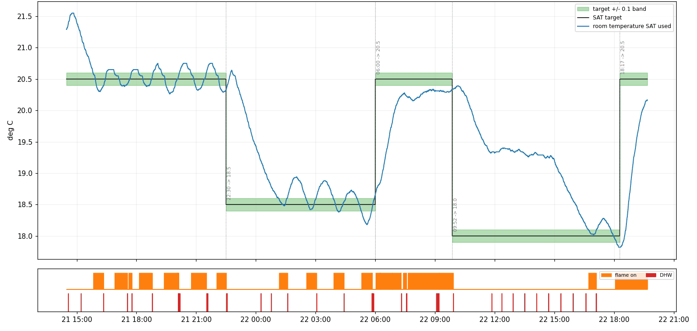
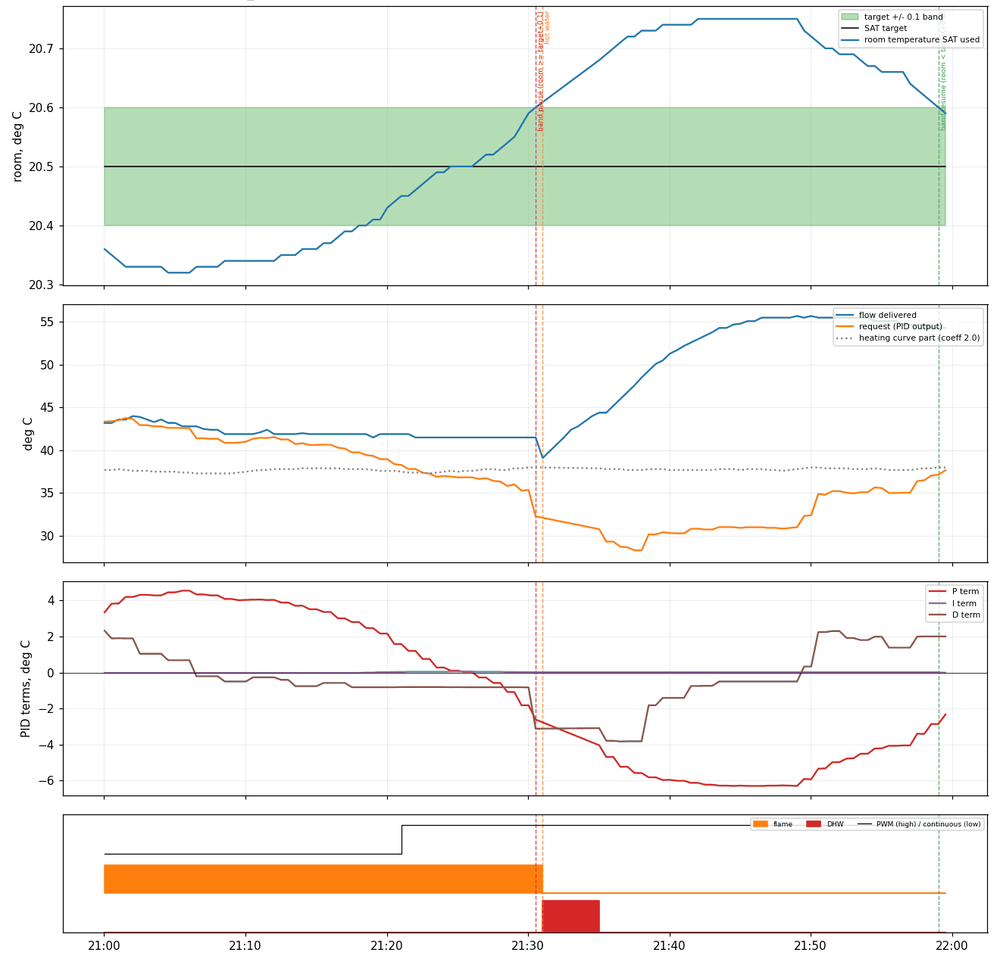
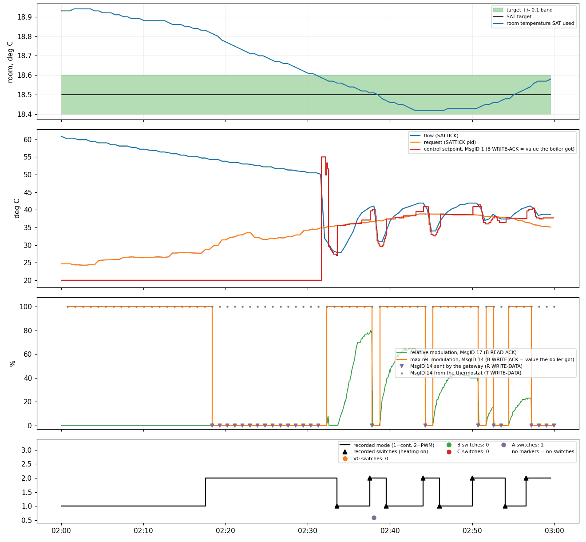
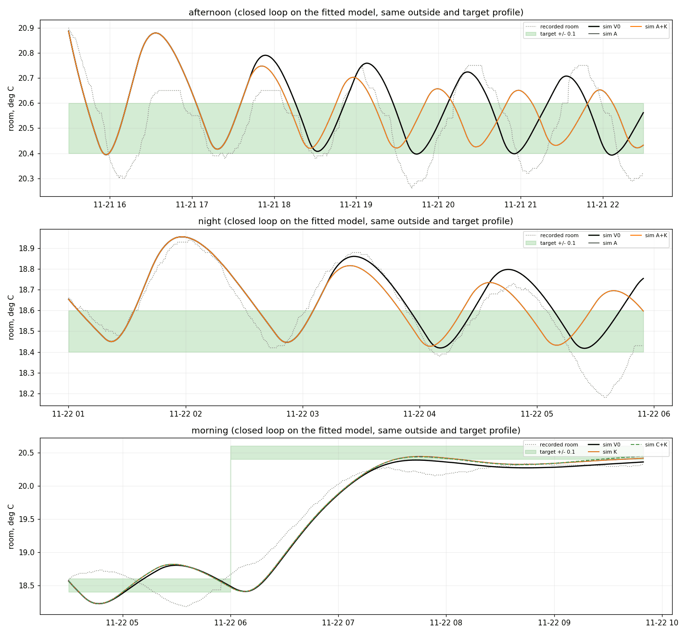
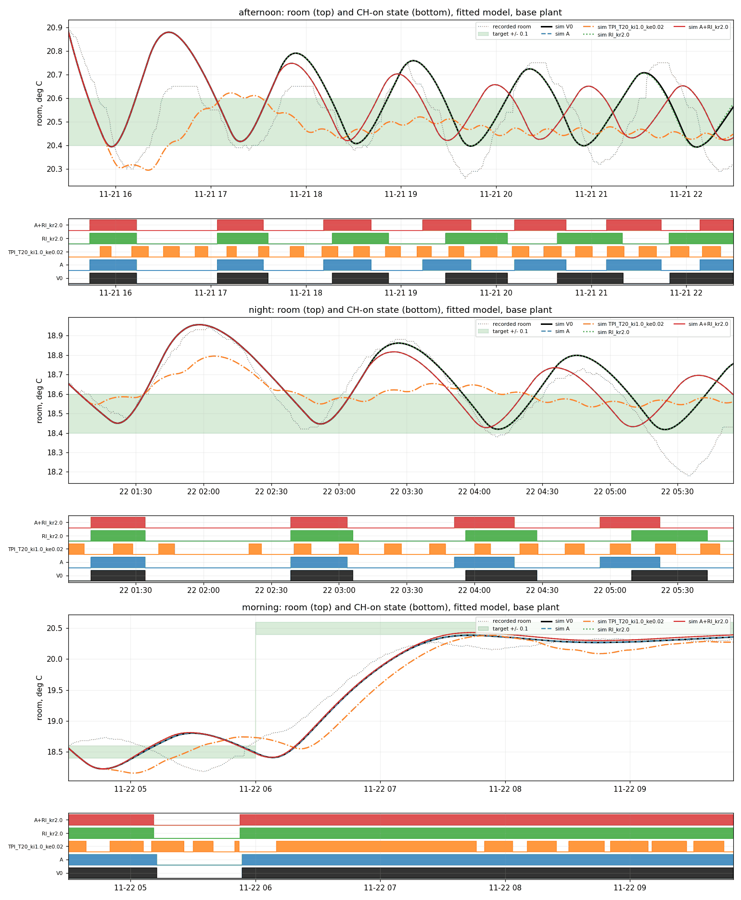

# SAT room-temperature oscillation: analysis, theory, research and simulation (2026-11-22)

**Status: proposals for Sergeant D, nothing decided.** Everything below that goes beyond the recorded log is our interpretation. Changing SAT behaviour is Sergeant D's call (see the SAT ground-truth rules; ADR-196). Entries refer to the numbered SAT decision register; ADRs are in [`docs/adr/`](../../adr/).

System under study: one field tester's installation (Viessmann Vitodens 100-W, radiators), firmware 2.0.0-beta.410, log 21 Nov 14:29 to 22 Nov 19:40.

## Contents

1. [Problem and measurements](#1-problem-and-measurements)
2. [Theory](#2-theory)
3. [What SAT auto-tunes today](#3-what-sat-auto-tunes-today)
4. [Research with sources](#4-research-with-sources)
5. [Simulation, rounds 1 and 2](#5-simulation-rounds-1-and-2)
6. [Status](#6-status)

---

## 1. Problem and measurements

*Room temperature SAT used against the SAT target (black) and the target +/- 0.1 C band (green), with flame and hot-water activity below. Time in band over the whole log: 18.3 %.*

Facts from the log; the causes are our interpretation.

1. **The band acts like a thermostat without a gap on a slow radiator system.** Heating pauses when the room reaches target + 0.1 C and restarts as soon as it is back under that same line, after the 10-minute minimum off. That minimum is never the limiting step (the offs last 22 to 57 min). So the room is held around the *top* of the band, not the middle (`SATchEnable.h:21-31, 49-53`; entries 326, 401, 402, 403).
2. **Radiator lag does the rest.** After a pause the room keeps rising for 5 to 14 min in the afternoon (16 to 27 min at night), to 20.65-20.75 C (night 18.73-18.94 C). After a restart it keeps falling for 11 to 30 min, to 20.26-20.38 C (night 18.38-18.48 C). Result: a swing of 0.35 to 0.5 C every 64 to 88 minutes. Afternoon 15:30-22:30: 25 % of the time below the band, 39 % in it, 36 % above.
3. **Not the cause:** the sun (solar gain is off, and the peaks come after dark) and the MM=0/PWM loops (the troughs are equally deep in burns with and without loops).
4. **The heating curve does not explain the afternoon** (a low curve gives undershoot, not overshoot). It does fit the morning: 07:20-09:50 the room sat 0.2 to 0.35 C under target while the I term stayed at 0, because it only acts within 0.1 C of target (`SATpid.ino:248-270`; entries 329, 333). The P term alone carried the offset. A coefficient of 2.2 adds about 1 C to the curve.

*One afternoon swing, 21 Nov 21:00-22:00 (target 20.5 C). The band pause at 21:30 is followed by about 20 minutes of further rise; the I term stays flat.*

Per window:

| Window | Target | Room (start, low/high, end) | In band |
|---|---|---|---|
| 01:00-02:00 | 18.5 C | 18.66 -> 18.48 -> 18.93 | 47 % (ends above the band after the 01:36 burn) |
| 02:00-03:00 | 18.5 C | 18.93 -> 18.42 -> 18.58 | 48 % (the dip is during 57 min with heating off before the 02:32 burn) |
| 03:30-04:30 | 18.5 C | 18.87 -> 18.38 -> 18.58 | 50 % |
| 07:00-09:30 | 20.5 C | 20.02 -> 20.28 by 07:25, then 20.15-20.33 | 0 % (0.2-0.35 C under target the whole window; boiler at low modulation, hot water 09:04-09:12) |

So at night the room stays within about 0.1 to 0.4 C of the target despite the loops; in the morning it never reaches it.

*Night, 22 Nov 02:00-03:00 (target 18.5 C): the dip during the long heating-off period, then the burn with eight continuous/PWM switches.*

## 2. Theory

**The system.** A radiator house is a slow process with dead time. Heat put in now reaches the room sensor 10 to 30 minutes later, and keeps arriving after the burner stops (hot water in the radiators, warm walls). In control terms: a first-order process with dead time. The fitted model below has about 8 minutes of dead time.

**Why it swings.** On/off control with a fixed switch line on a process with dead time always makes a *limit cycle*. The controller switches when the sensor crosses the line, but the heat already on its way keeps the room moving for one dead time. Amplitude and period follow from the dead time and the heating and cooling speed, not from the line itself. Here the stop and restart lines are the same, so there is no gap to add to it. This is classic relay-feedback behaviour; Åström and Hägglund used exactly this effect for relay auto-tuning (Automatica 20(5), 1984, pp. 645-651).

Three ideas follow from it:

- **A. Pause earlier by the learned overshoot: an "anticipator".** Old mechanical thermostats had a tiny heater next to the bimetal that made them switch off a little early, so the radiator heat still in transit lands inside the band. Learning the overshoot per house is the adaptive version: measure how far the room rises after each pause and subtract that from the switch line. In control theory it is a simple form of dead-time compensation, the idea behind the Smith predictor (O.J.M. Smith, Chemical Engineering Progress 53(5), 1957): act on where the room will be, not where it is.
- **B. Restart earlier by the learned sag.** The same anticipator on the other side. Cost: the burner may start more often, so it needs a limit.
- **C. Let the I term work slowly on a small lasting error.** A P-only controller, or P with a dead-zone integral, always leaves a steady offset when the heat demand changes: that is the morning case (room 0.2-0.35 C low for 2.5 h). The integral term is what removes a steady offset in PI control; a slow integral on errors that last avoids the overshoot a fast one would cause.

All three are standard ideas; the work is in the limits and in testing them on real logs first.

## 3. What SAT auto-tunes today

- **SAT already tunes the heating curve itself.** Every hour it checks how far the PID request sits from the curve, split into warm-up and floating phases. With 12 counted hours in its window it can move the coefficient by 0.05, and only when both phases agree (ADR-205, ADR-228, ADR-234, ADR-260; `SATcurveTune.h`, `satTuneApplyCoeff()` in `SATcontrol.ino`). It is on by default and was on in this installation.
- **On this 29 h log it did nothing.** Only 5 of 28 hours counted (13 excluded for modulation at or below the 5 % minimum, 5 for daylight, 2 for hot water, 2 for diagnostic events, 1 not SAT). The window stayed 3 hours short, and the counted evening hours disagreed (warm-up said lower, floating said higher), so it held 2.00. The morning hours that show the room stuck under target were thrown out because the boiler idled at minimum power.
- **The PID gains follow the curve** (Kp = coefficient x curve / 3).
- **Nothing tunes the on/off swing.** The band thresholds are fixed, and an hourly average cannot see a 70-minute swing.

Ideas (ours, for Sergeant D to decide):

- **A.** Learn how far the room still rises after a pause and pause that much earlier (limits: 0.15 C, 15 min, never before the 180 s minimum burn).
- **B.** Learn how deep the room sags after a restart and restart slightly earlier (watch: more burner starts).
- **C.** Let the curve tuner count the low-modulation morning hours, and let the I term work slowly for a small error that lasts (0.1-0.5 C for 30 min).

Each would first be replayed on this log, then tested on a host model fitted to it, then on the bench, then in the field.

## 4. Research with sources

Short research round (web search, four queries). Facts are from the linked sources; "Opinion" marks our reading.

### Why radiator systems overshoot

- On/off control with a fixed switch line on a process with dead time gives a limit cycle; the amplitude follows dead time x heating/cooling rate (relay feedback; Åström & Hägglund, Automatica 20(5):645-651, 1984).
- Radiant and radiator systems overshoot because the water and metal stay hot after the burner stops (Google Nest, True Radiant: <https://support.google.com/googlenest/answer/9250165>; patent US8600561B1: <https://patents.google.com/patent/US8600561>).

### A. Anticipator / learned early stop

- Classic thermostats had a heat anticipator that shuts the system off before the setpoint is reached.
- Nest True Radiant learns how long the home takes to heat up and turns the heating off early so the room does not go beyond the set temperature (<https://support.google.com/googlenest/answer/9250165>). Users still report overshoot of about 1 C (anecdotal: <https://www.googlenestcommunity.com/t5/Nest-Thermostats/Temperature-overshoot/m-p/171606>).
- An older adaptive patent revises a gain when the morning overshoot exceeds a limit (US4615380A: <https://patents.google.com/patent/US4615380>).

### B. TPI (Time Proportional and Integral)

- Used by many European room thermostats (Danfoss TP9000: selectable cycle rates, 6 cycles per hour factory setting, <https://manualshive.com/en/manual/danfoss/tp9000/3891257?page=10>; UK government research on TPI and weather compensation, <https://www.gov.uk/government/publications/heating-controls-compensation-and-time-proportional-and-integral-tpi-controls>).
- Home Assistant versatile_thermostat: `on_percent = coef_int x (target - room) + coef_ext x (target - outside)`, clamped to 0..1 and applied per cycle (defaults coef_int 0.6, coef_ext 0.01) (<https://github.com/jmcollin78/versatile_thermostat/blob/main/documentation/en/algorithms.md>).
- Trade-off: a longer cycle means fewer starts but a bigger swing (<https://www.controleng.com/articles/time-proportional-control-more-from-an-on-off-switch/>).
- Opinion: TPI replaces the hard band with a duty proportional to the error, so the heat input tapers before the target instead of switching at it; the anticipation is built in. It must respect the 180 s minimum burn and the boiler's start limits.

### C. Room influence on the heating curve (parallel shift)

- Siemens LMS14 / Albatros2: room influence 1-99 % adjusts the curve by the room deviation; it needs a room sensor and no thermostatic radiator valves in the reference room (<https://www.manualslib.com/manual/1308475/Siemens-Lms14.html?page=150>).
- Honeywell: the room factor shifts the curve in parallel; a 1 K shortfall at 100 % behaves like a curve for a 1 K higher setpoint (<https://manualslib.com/manual/949403/Honeywell-Sdc.html?page=171>).
- ATAG warns that high room factors destabilise the control and make the room swing (<https://www.manualslib.com/manual/1210931/Atag-Madq-2.html?page=34>).
- Opinion: this is a continuous proportional correction of the curve that works outside the +/- 0.1 C I-term deadband, so a candidate for the morning offset.

### Control laws taken into simulation

1. **A, learned stop lead:** pause when room + rate x lead >= target + 0.1; lead = moving average of the measured overshoot/rate, capped at 0.15 C / 15 min, never before the 180 s minimum burn.
2. **TPI on CH enable:** cycle T (10, 15, 20 min); `on_frac = clamp(ki x (target - room) + ke x (target - outside) + offset, 0, 1)`; CH on for `max(on_frac x T, 180 s)` when on_frac > 0, else off; the flow request from today's PID/curve unchanged. Tuned ki 0.3-1.0, ke 0.01-0.02.
3. **Room-influence curve shift:** curve setpoint += kr x (target - room) x (curve slope factor), kr 0.5-2, band unchanged; aimed at the morning offset.
4. **A + room influence:** the combination of 1 and 3.

## 5. Simulation, rounds 1 and 2

### Model

A model of the room, radiators and boiler was fitted to the beta.410 log (error 0.05 to 0.07 C). With today's rules it reproduces the swing (afternoon 0.37 C simulated against 0.38 C recorded) and the stuck morning. Each change was then run in closed loop on the same outside-temperature and target profile, and the ranking was repeated on 8 variants of the model (dead time, time constants and radiator gain each +/- 30 %), 9 models in total.

### Round 1: ten changes

| Variant | Afternoon swing | Time in band (afternoon) | Burner starts / h | Robustness (9 models) |
|---|---|---|---|---|
| Today (V0) | 0.37 C | 50 % | 0.83 | reference |
| **A** learned stop lead | **0.29 C** | **58 %** | 1.0 | never worse than today, mean +2.3 points; no effect at night |
| B learned restart lead, A+B | - | - | 1.5 | not robust |
| P pause at target | - | - | - | worst overall |
| K coefficient 2.2 (morning) | - | reaches the band in about 92 min | - | better in 1 of 9 models |
| C slow I term (morning) | - | helps on the fitted model | - | better in 4 of 9 models |

"-" = not reported for that variant.

*Round 1, closed loop on the fitted model: recorded room (dotted) against today's rules (V0) and the best variants.*

Round-1 conclusion: A is the best and most robust swing option; K and C help the morning only on the fitted model, which is not proof.

### Round 2: options from the research

| Variant | Swing | Burner starts / h | Morning | Robustness (9 models) |
|---|---|---|---|---|
| Today (V0) | about 0.37 C | about 1 | stuck under target | reference |
| TPI, 20 min cycle | about 0.15-0.2 C | about 2.8 | missed (no integrator) | in band less often than today on varied models |
| TPI, 10 min cycle | - | almost 6 | missed | - |
| Room influence (RI) | no effect | about 1 | helps | better than today in 2 of 9 |
| **A** learned stop lead | 0.29 C (round 1) | 1.0 (round 1) | - | never worse than today |
| **A + K** | - | - | better on the fitted model only | best overall; K never worse anywhere |

*Round 2, closed loop on the fitted model, with the CH-on state of each variant under each panel. TPI flattens the room but switches the boiler about three times as often.*

### Limits

- One house, one 18 h stretch of log.
- No hot water, sun or PWM loops in the model.
- K's morning gain shows clearly only on the fitted model; it needs a second clean morning log, ideally from another house.

### Recommendation (ours)

A (learned early stop) for 2.1.0 after a bench test, plus K (coefficient 2.2) if a second morning log confirms it. TPI is too hard on the boiler as a default (about 2.8 starts per hour against about 1 today); perhaps an optional mode later, unproven on a real unit.

## 6. Status

**Proposals for Sergeant D; nothing is decided.** Any change to the band, the I term or the curve tuner would change behaviour recorded in entries 326, 329, 333, 401, 402 and 403 and in ADR-205, ADR-228, ADR-234, ADR-250, ADR-253 and ADR-260, so it needs Sergeant D's decision first, recorded as a new entry, before any implementation.
