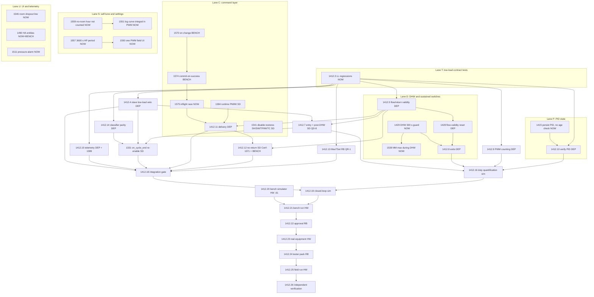

# SAT execution plan, 2026-11-03

Owner: lead session (Claude, coordinated by Robert). Scope: every open SAT task on `dev` (53, To Do and In Progress,
inventory of 2026-11-03 against origin/dev d1fe5928f). It replaces the task order in
`sat-low-load-agent-handoff-2026-10-28.md` where that file is outdated (its PID chain, 1381/1409/1425/1426/1370/1371,
1373, 1380-1385, 1419-1424, 1413, 1365 and 1412.1/.2/.6/.17 are Done). Live Backlog dependencies still win over this file.

## Rules that shape the order

- SAT behaviour changes need a recorded decision of Sergeant D (CLAUDE.md "SAT ground truth"): one question at a time,
  paced to his presence. A task waiting for him does not block the lane; the lane moves on.
- Most SAT code is in one file, `SATcontrol.ino`. Two tasks in the same function are sequential; tasks in different
  regions may be implemented in parallel worktrees and merged one at a time by the lead (rebase, rerun the tests).
- One build at a time on the machine, esp32-combo only, 4 jobs, and only with enough free memory (2026-11-02: builds were
  killed at 80 % commit). At most 3 implementation agents at once.
- Every firmware commit gets its own prerelease tag. Per-task bench on .63 (Classic + S3, PIC 6.8) before a zip, except
  where Robert orders otherwise. .61 (OT-Direct) is offline: OT-Direct bench evidence is blocked until it returns.
- A red-then-green host test on the real code is the evidence for every code task; the bench comes on top where an AC asks.

## Status classes

| Class | Meaning |
|---|---|
| NOW | implementable and host-verifiable today |
| SD | waits for a Sergeant D decision (question named) |
| RB | waits for Robert |
| BENCH | needs .63 (after the 08:00 public beta) |
| HW | needs .61, real equipment or field testers |
| DEP | waits for another open task |
| DEFER | parked by a decision |

## Graph

Separate, not in the graph: 1356, 1360, 1361, 1512, 1515 (each SD, small, independent regions); 1566 AC4 (SD, Q-1566a);
1510 (DESIGN, merge with 1566's forecast finding); 1527 AC1 and 1563 (HW / research, docs only); 1238 and 1470 (RB, ADR);
1471 (BENCH + router); 1540 (DEFER, Robert 2026-11-01 "next release").

## Waves

**Wave 1 (now, three agents, disjoint regions):**
1. 1412.3 low-load contract regressions (tests only). Unlocks the whole 1412.4-.15 band.
2. 1415 PID persistence without age check (SATcontrol.ino PID load/save, SATpid.ino).
3. 1429 DHW guard, then 1539 MM to max during a draw (same DHW tick, one agent, two commits).

Lead in parallel: 1559 + 1551 (self-tune record, small), 1575 (command layer, depends on tonight's queue lock),
the Sergeant D question queue (below), the 08:00 public beta, and the bench of beta.18-25.

**Wave 2 (after wave 1 merges):** 1412.4 and 1412.5 in parallel (entry paths vs measurement layer); 1557 then 1550 (UI);
1546; 1511; 1490 host part.

**Wave 3:** 1428 (after 1412.5), 1412.8 (after 1428/1429), 1412.9, 1412.10 (after 1415), 1412.13 (after QR-1),
1412.14, 1412.15 (after 1389).

**Wave 4:** 1412.7 (after QD-8), 1412.11 (after 1575/1384), 1412.12 (after Conf-1371, bench), 1331 (after 1412.14 and
his go), 1412.16, then 1412.18 and 1412.19.

**Not executable by the lead:** 1412.20-.26 (.61 offline, real equipment, field testers, Robert's approvals),
1527 AC1 (heat-pump capture, maarten after Thursday), 1238/1470 ADR decisions.

## Sergeant D question queue (one at a time, paced to his presence)

Order by what it unblocks: 1541 (hand-back plan, touches the command layer just changed), QD-8 (1412.7), 1384, 1515,
1356, 1361, 1360, 1512, Conf-1371 (1412.12, needs 1412.5 first), Q-1566a, then 1331's final go after 1412.14.
Each question cites the thermo-nova code at the pinned commit and is recorded in `open-questions.md`; every answer goes
into `sergeant-d-corrections.md` before code.

## Questions for Robert

QR-1 (1412.13: observe the SH= write verdict?), the ADR choices of 1238 and 1470, and the readiness approvals of
1412.22/.24. Asked one at a time with a recommendation when the task that needs them is next.

## Evidence and bench queue (.63 after the 08:00 public beta)

beta.18 (1570: on-change counts, GW=R PIC restart), beta.19-24 (queue: drip, FIFO, echo histogram -> QUEUE_ECHO_GUARD_MS,
priority slot, device/info cmdq_*, 15-char limit), beta.25 (1574 health, dropped-enqueue paths only by host test),
then each new tag of the waves.
