# SAT state machines in the 2.x firmware

| Item | Value |
|---|---|
| Date | 2026-11-05 |
| Task | TASK-1661 |
| Firmware | `dev` HEAD `acd5e6f7c` (2.0.0-beta.99) |
| Visual page | [sat-state-machine.html](sat-state-machine.html) (same diagrams, no citations) |

> **Scope.** This document describes what the firmware port does today. It is source rank 4 under
> `.claude/rules/sat-ground-truth.md` and ADR-196: it is **not** a statement of what SAT should do.
> The ground truth for SAT behaviour is Sergeant D's recorded decisions
> (`docs/sat/sergeant-d-corrections.md`) and the pinned thermo-nova code. Differences between the
> firmware and thermo-nova are in `docs/sat/sat-comparison.md`.
>
> Every claim cites a firmware `file:line`. Each citation was opened by the author of a draft and
> then checked by a second reader who tried to refute it. Results per verdict file:
> control draft: about 52 claim groups confirmed, 12 imprecise fixed, 1 wrong fixed;
> cycles and boiler drafts: 107 rows confirmed, 9 imprecise fixed, 2 wrong fixed.
> (The control reader counted claim groups, not rows, so the two counts do not add up.)
> Sergeant D entry numbers, Q-numbers and TASK numbers are copied from firmware comments next to
> the cited code.

Paths are relative to `src/OTGW-firmware/`. Short names used in citations:

| Short | File |
|---|---|
| `SCT` | `SATcontrol.ino` |
| `SC` | `SATcycles.ino` |
| `ST` | `SATtypes.h` |
| `CHE` | `SATchEnable.h` |
| `REST` | `restAPI.ino` |

Shared timing facts:

- The control tick runs on `timerSATControl`, interval `settings.sat.iControlInterval`, default 30 s, range 10 to 300 s (`ST:498`, `SCT:877`, `settingStuff.ino:1083`). Anything that runs "on the tick" resolves its timers at tick granularity.
- The timer is declared `CATCH_UP_MISSED_TICKS` (`SCT:877`), but `initSAT()` calls `CHANGE_INTERVAL_SEC` with two arguments (`SCT:5579`), which sets the type to 0 = `SKIP_MISSED_TICKS` (`safeTimers.h:96`, `:131-135`). The effective type is SKIP, as the comment at `SCT:6919-6922` says.
- Work before the tick gate runs on every loop pass, in this order: flame edge detection, cycle sample, 60 s window stats, PIC CS keepalive, no-return flood step, 3 s suppression refresh, 5 s CS resend (`SCT:6877-6906`).
- Before all of that, the loop returns early for: MQTT fallback step (`SCT:6823`), SAT disabled or flashing (`SCT:6828-6839`), safety trip (`SCT:6853`), OpenTherm link loss (`SCT:6861`), restart gate (`SCT:6864`). While it returns there, no flame edge and no cycle sample is processed.

---

## Contents

1. [How the machines fit together](#how-the-machines-fit-together)
2. [M1 SAT activity and MQTT-loss fallback](#m1-sat-activity-and-mqtt-loss-fallback)
3. [M2 Control mode](#m2-control-mode)
4. [M3 PWM duty and ON/OFF phase](#m3-pwm-duty-and-onoff-phase)
5. [M4 PWM ON-phase start-up](#m4-pwm-on-phase-start-up)
6. [M5 Cold cutoff, CH rule and command cadence](#m5-cold-cutoff-ch-rule-and-command-cadence)
7. [M6 Burn lifecycle and cycle class](#m6-burn-lifecycle-and-cycle-class)
8. [M7 Cycle phase](#m7-cycle-phase)
9. [M8 Cycle kind](#m8-cycle-kind)
10. [M9 Flame status](#m9-flame-status)
11. [M10 Curve recommendations](#m10-curve-recommendations)
12. [M11 Boiler status](#m11-boiler-status)
13. [M12 Publication](#m12-publication)
14. [Timelines](#timelines)
15. [Findings worth a look](#findings-worth-a-look)
16. [How to update this document](#how-to-update-this-document)

---

## How the machines fit together

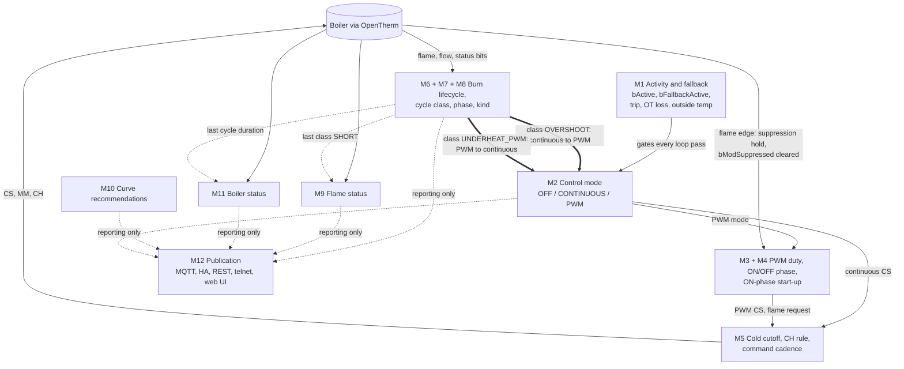

How to read it:

- Thick arrows are the only paths where a derived result feeds back into control: the class of a finished burn can switch the control mode (`SC:991-1004`).
- Dotted arrows are reporting only. Boiler status, flame status, cycle phase and both curve recommendations change no control decision. Cycle kind acts only indirectly: kind UNKNOWN turns the class into UNCERTAIN (`SC:881`), so no end-of-cycle switch happens. Evidence: the boiler status comment "Display only: nothing in the control path reads eBoilerStatus" (`SCT:948`) and a grep that finds reads only at `SCT:938`, `SCT:1105`, `networkStuff.ino:1163`; no use of class, kind, phase, flame status or curve recommendation to tune the curve, the minimum on time or PID gains was found.
- The flame edge itself (a raw boiler signal, not a machine result) does reach the PWM start-up: it stamps `_cycle_flameOnStartMs`, which times the suppression hold (`SCT:1188-1192`, `SC:1025`), and the flame-off edge clears `bModSuppressed` (`SCT:6880`).
- The sustained overshoot, underheat and saturation switches in M2 also live in `SATcycles.ino`, but they use their own timers per tick, not the cycle class (`SC:1356-1435`).

---

## M1 SAT activity and MQTT-loss fallback

Purpose: decides whether SAT controls the boiler on this pass. `satIsEnabled()` = `settings.sat.bEnabled || state.sat.bFallbackActive` (`SCT:3788-3795`). The fallback is a second source of "enabled", not an exclusive state: with it set, the path runs through the same gates and tick as a user-enabled SAT (`SCT:3791`, `SCT:6823-6839`).

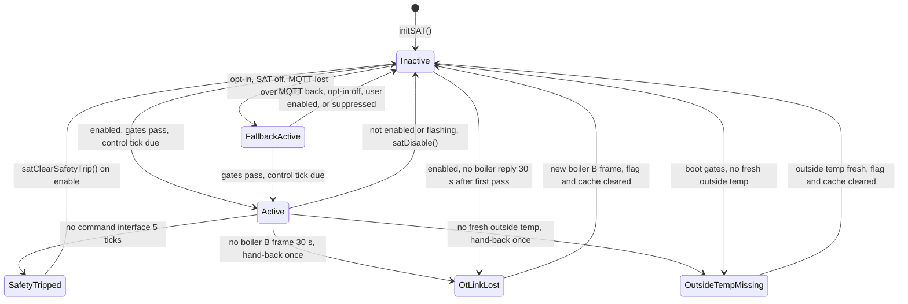

Leaving `OtLinkLost` or `OutsideTempMissing` only clears the flag and the command cache; `bActive` becomes true at the next due tick (`SCT:3945-3947`, `SCT:6925`).

### States

| State | Meaning | Stored |
|---|---|---|
| Inactive (`bActive` false) | SAT not controlling: boot, after `satDisable()` | `ST:151`; set false `SCT:3836`, `SCT:5558` |
| Active (`bActive` true) | a control tick ran with SAT enabled | `SCT:6925` |
| FallbackActive (`bFallbackActive`, `eFallbackReason`) | MQTT-loss takeover; state only, never writes `settings.sat.bEnabled` | `ST:247-249`; `SCT:6641-6643` |
| `bFallbackSuppressed` | user switched SAT off during a takeover; no new takeover this outage | `ST:248` |
| `SAT_FB_THERMOSTAT_LOST` | enum value only, never assigned | `ST:61` |
| SafetyTripped (`bSafetyTripped`) | SAT stopped until re-enabled | `ST:245` |
| OtLinkLost (`bOtLinkLost`) | OpenTherm loss: boiler handed back, SAT still enabled, sends nothing | `SCT:3942`, `SCT:3946` |
| OutsideTempMissing (`bOutsideTempMissing`) | no valid outside temperature: handed back, quiet | `SCT:4026`, `SCT:4033` |

### Transitions

| From | To | Guard / trigger | Timer / constant | Cite | Refs |
|---|---|---|---|---|---|
| boot | Inactive, mode OFF, trip cleared | `initSAT()` | none | `SCT:5557-5560` | TASK-565 |
| Active | Inactive | `!satIsEnabled() \|\| isFlashing()` with `bActive` set, then `satDisable()` | none | `SCT:6828-6830` | PERF-L2 |
| Inactive | Active | `satIsEnabled()`, not flashing, not tripped, OT link ok, restart gate passed, `DUE(timerSATControl)` | 30 s default | `SCT:6828`, `:6853`, `:6861`, `:6864`, `:6918`, `:6925` | TASK-1482, TASK-1390 |
| SAT off | FallbackActive, reason `SAT_FB_MQTT_LOST` | `bMqttFallback && !bEnabled && !bFallbackActive && !bFallbackSuppressed && mqttLost`; mqttLost = MQTT enabled, connected once, not connected now, `millis() - iLastConnectedMs > 300000` | 300 s | `SCT:6647-6656` | Task #19, TASK-1345 |
| FallbackActive | lifted (reason NONE), then `satDisable()` if `!bEnabled` | MQTT connected, MQTT disabled, opt-in off, user enabled SAT, or `bFallbackSuppressed` | none | `SCT:6661-6670` | TASK-1345 |
| `bFallbackSuppressed` | cleared | `state.mqtt.bConnected` | none | `SCT:6652` | TASK-1345 |
| Active | SafetyTripped | no OT command interface for `SAT_MAX_PIC_FAILS` consecutive ticks (`>=`), then `satDisable()` | 5 ticks (`SCT:146`) | `SCT:7324-7331` | |
| SafetyTripped | cleared | `satHandleEnabled("1")` calls `satClearSafetyTrip()` | none | `SCT:3420-3437` | TASK-1159 |
| enabled | OtLinkLost | no boiler B frame for 30 s, measured from the later of the last B frame and `_sat_otLinkBaseMs`; `satDisable()` hand-back once. Also with `bActive` false at boot: 30 s after SAT's first pass with no reply (`lastBoilerMs == 0` is not alive) | `SAT_OT_LINK_LOST_MS` 30000 | `SCT:3900`, `:3907-3912`, `:3920`, `:3935-3944` | TASK-1365, entries 39, 47, 79, 115; Q33 A, Q34 A |
| OtLinkLost | Inactive (resume next tick) | `iBoilerLastSeenMs != _sat_otLinkLostStamp`, cache reset | none | `SCT:3909`, `:3945-3949` | entry 79 |
| enabled | OutsideTempMissing | `!satOutsideTempFresh()` after the boot gates; `satDisable()` once, but not when the boot decision already handed back (`!_sat_quietHandedBack`) | outside temp younger than 1 h (log text) | `SCT:4020-4031` | entries 56, 57 |
| OutsideTempMissing | Inactive (resume next tick) | outside temp fresh, cache reset | none | `SCT:4032-4037` | entries 56, 57, 79 |
| Active with `bFallbackActive` | thermal safe setpoint this tick | `roomValid && bFallbackActive && iLastKnownRoomMs > 0 && elapsed >= SAT_THERMAL_MAX_EST_MS`: CS = min(45, effective max), MM = max, CH = 1 | 7200000 ms (2 h), safe flow 45 | `SCT:159-160`, `:432-435`, `:7038-7055` | Task #21, TASK-1536 |

---

## M2 Control mode

Purpose: selects how the CS is computed. Enum `SATControlMode` (`ST:54`), stored in `state.sat.eControlMode` (`ST:152`). The single setter is `satSetControlMode()` (`SCT:1691-1713`): a PWM request without the MsgID 3 permission becomes CONTINUOUS (`SCT:1693-1696`, entries 213-215); every real change resets PWM state and clears the sustained timers (`SCT:1700-1701`) and arms the PWM entry flag (`SCT:1710`, entry 43, TASK-1369).

PWM permission: `satPwmPermitted()` = valid MsgID 3 reply and HB bit 4 clear (`SC:1302-1305`, set by `satNoteSlaveConfig`, `SC:1294-1300`).

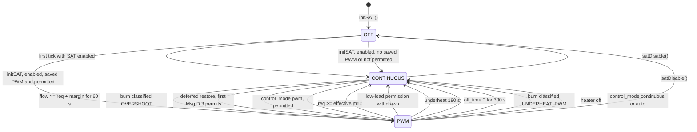

### States

| State | Meaning | Stored |
|---|---|---|
| `SAT_MODE_OFF` | SAT not controlling | `ST:54`; set `SCT:3830`, `SCT:5559` |
| `SAT_MODE_CONTINUOUS` | CS = PID output with asymmetric clamp (`satApplyContinuous`) | `SCT:2293-2319`, `SCT:7256` |
| `SAT_MODE_PWM` | CS from the PWM ON/OFF schedule (`satApplyPWM`) | `SCT:1588-1624`, `SCT:7252` |
| `iRequestedControlMode` | what the control_mode command asked: 0 auto, 1 continuous, 2 pwm; not the actual mode | `ST:209-211` |
| `_sat_pwmRestore` | 0 none, 1 waiting for the first valid MsgID 3, 2 denied | `SCT:3629-3630` |
| PWM saved flag | `/sat_pwm_state.json` `{"pwm":1}` | `SCT:3591-3619` |

### Transitions

| From | To | Guard / trigger | Timer / constant | Cite | Refs |
|---|---|---|---|---|---|
| OFF | CONTINUOUS | first due control tick with SAT enabled | tick | `SCT:6926-6929` | TASK-1367 |
| OFF (boot, enabled) | PWM | saved flag 1 and `satPwmEntryAllowed(2)`. Probably unreachable: `initSAT()` runs once in setup (`OTGW-firmware.ino:578`) and `bSlaveCfgValid` starts false (`ST:215`), as the comment at `SCT:3622-3624` says | none | `SCT:3632-3636`, `:5581-5583` | entries 121, 213, 215 |
| OFF (boot, enabled) | CONTINUOUS, restore pending | saved flag 1, not permitted, `_sat_pwmRestore = 1` | none | `SCT:3637-3638` | entries 121, 213, 215 |
| CONTINUOUS (restore 1) | PWM | first valid MsgID 3 reply with permission | every loop pass | `SCT:3642-3650`, `:6869` | entries 121, 213, 215 |
| CONTINUOUS (restore 1) | stays, restore 2 | first valid reply denies | none | `SCT:3651-3653` | |
| CONTINUOUS | PWM | `requested > satColdThreshold()`, not in the DHW guard, `flow > 0 && flow >= requested + fOvershootMargin` sustained, then `satPwmEntryAllowed(1)` | `SAT_OVERSHOOT_SUSTAIN_MS` 60000; margin default 2.0 (`ST:509`); DHW guard 300000 | `SCT:7220-7224`; `SC:33`, `:37`, `:189-193`, `:1356-1386` | Tasks #42/#43, entries 41, 86, 87, 88, 109, 213; Q43 A, Q46 B, Q47 A |
| CONTINUOUS | PWM | continuous burn ended classified `SAT_CYCLE_OVERSHOOT` and `satPwmEntryAllowed(5)` | none | `SC:991-998` | TASK-1331, entries 15, 18, 36, 37 |
| any | PWM or CONTINUOUS | `control_mode pwm` while live: `satPwmEntryAllowed(3) ? PWM : CONTINUOUS` | none | `SCT:4107-4111` | entry 213 |
| any | CONTINUOUS | `control_mode continuous` or `auto` while live | none | `SCT:4104-4106`, `:4112-4114` | TASK-205 |
| any | OFF (via enabled 0) | `control_mode off` | none | `SCT:4092-4094` | TASK-1265 |
| PWM | CONTINUOUS | `pidOutput >= satEffectiveMaxSetpoint()` | none | `SCT:7203-7207` | TASK-1591, entry 256 |
| PWM | CONTINUOUS | `!satPwmPermitted()` while PWM runs | per tick, before the overshoot check | `SCT:7211`; `SC:1336-1344` | entry 214 |
| PWM | CONTINUOUS | ON phase, not DHW guard, `flow > 0 && flow <= requested - 3.0` sustained | `SAT_UNDERHEAT_SUSTAIN_MS` 180000; `SAT_UNDERSHOOT_MARGIN_C` 3.0 | `SCT:7239-7243`; `SC:34-35`, `:1397-1420` | entries 86, 95, 108, 134; Q44 A |
| PWM | CONTINUOUS | ON phase, `satPwmLastOffTimeMs() == 0` sustained | `SAT_SATURATION_SUSTAIN_MS` 300000 | `SC:36`, `:1422-1430` | entries 86, 95 |
| PWM | CONTINUOUS | PWM burn ended classified `SAT_CYCLE_UNDERHEAT_PWM` | none | `SC:999-1003` | TASK-1331 |
| PWM | CONTINUOUS | heater off (cold cutoff once it acts, after a lit ON phase's 180 s; summer simmer; valves closed), `satPwmDisableOnHeaterOff()` | none | `SCT:1751`, `:7097`, `:7115`, `:7335` | entry 12, TASK-1362, TASK-1652 |
| any | OFF | `satDisable()` | none | `SCT:3830` | |

Sustained timers: all three starts are cleared on every mode change, on DHW ticks, boiler fault, thermal safe, summer simmer, `satDisable()`, and when requested <= cold threshold (`SC:204-230`; `SCT:1701`, `:3831`, `:7028`, `:7052`, `:7082`, `:7223`, `:7242`). `satSustainedFor` fires on the first tick at least `limitMs` after the first qualifying tick (`SC:177-184`).

Manual forcing: there is no force-PWM option (removed, entry 13, comment at `SCT:1720-1722`). A manual `pwm` request that is vetoed is not retried (`SCT:4109-4110`).

---

## M3 PWM duty and ON/OFF phase

Purpose: inside `SAT_MODE_PWM`, decides whether the flame is requested (`state.sat.bPwmFlameRequested`, `ST:206`). Runs once per control tick from `satPwmSchedule()` (`SCT:1361-1564`), only while `eControlMode == PWM && !_sat_coldCut` (`SCT:7232-7234`).

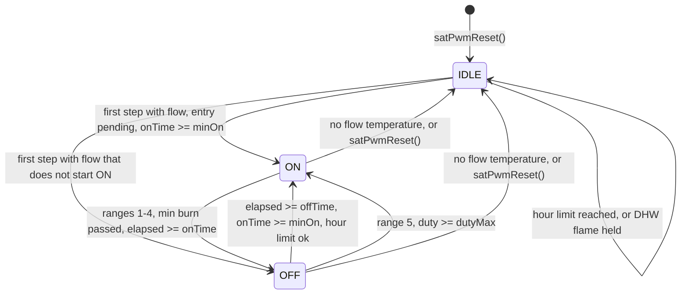

IDLE = `_pwm_idle` true; ON = `bPwmFlameRequested` true; OFF = `bPwmFlameRequested` false with `_pwm_idle` false.

### Duty computation

- `duty = (pidOutput - baseOffset) / (effectiveTemp - baseOffset)`, clamped 0..1 (`SCT:1402-1405`). baseOffset 27.2 radiators, 20.0 underfloor (`SCT:127-128`, `:438-443`).
- `effectiveTemp` = `_pwm_effectiveBoilerTemp` (BT) if seeded, else live flow; floored at base + 1 (`SCT:1398-1400`).
- `minOnMs` = 180 s gas and hybrid, 600 s heat pump (`SCT:478-481`, `:1408`). `upperMs` = period (`SCT:497-506`, `:1409`): gas 3600/3 = 1200 s or 3600/4 = 900 s (`SCT:466-473`, `ST:575`); heat pump 1800 (default), 2400, 3600 or 10800 s; hybrid 1800 or 2400 s (`ST:495`). `maxMs = 2 * upperMs` (`SCT:1410`).
- `dutyLower = minOn/upper`, `dutyUpper = 1 - dutyLower`, `dutyMin = dutyLower/2`, `dutyMax = 1 - dutyMin` (`SCT:1444-1447`).

| Range | Condition | ON time | OFF time | Cite |
|---|---|---|---|---|
| 5 | duty >= dutyMax | maxMs (reported) | 0 (saturation signal); `_pwm_atMaxDuty` gives MM = T | `SCT:1452-1471` (TASK-1581, entries 59, 242) |
| 1 | duty < dutyMin | flame on and no DHW: minOn; else 0 | maxMs - minOn, or maxMs | `SCT:1472-1482` |
| 2 | duty <= dutyLower | minOn | minOn*(1-d)/d, capped at maxMs - minOn | `SCT:1483-1487` |
| 3 | duty <= dutyUpper | d*upper, at least minOn | upper - on | `SCT:1488-1492` |
| 4 | else | minOn/(1-d) - minOn, at least minOn | minOn | `SCT:1493-1498` |

Min OFF: heat pump 600 s, else 0 (`SCT:486-489`), applied only in range 5 (`SCT:1462-1464`, TASK-1542, entry 198). In range 5 the schedule returns at `SCT:1471`, before the ON state machine: no 180 s ignition timeout, no minimum burn, no ON->OFF. Only the flame sync (`SCT:1435-1441`) runs.

### Transitions

| From | To | Guard / trigger | Timer / constant | Cite | Refs |
|---|---|---|---|---|---|
| any | IDLE (reset, duty 0) | `satGetFlowTemp() <= 0`; entry flag and DHW-flame mark kept | none | `SCT:1376-1388` | entry 43 |
| IDLE | non-idle | flow present, step runs | none | `SCT:1391-1392` | |
| OFF or IDLE | ON | not ON, `onTime >= minOn` and (entry or `elapsed >= offTime`), hour limit not reached (unless entry with flame burning), no DHW flame held | elapsed from `_pwm_lastUpdateMs` | `SCT:1527-1561` | entries 43, 89, 90, 95, 101, 105, 106; Q38, Q48 A; TASK-1369, TASK-1383 |
| IDLE | stays IDLE | hour-limit return (`SCT:1549`) or DHW-flame hold (`SCT:1556`) | | `SCT:1549`, `:1556` | |
| OFF | stays OFF | `satCycleIsHourLimitReached()`: gas count >= 3 or 4 in 60 min; heat pump never | rolling 60 min | `SCT:1541-1551`; `SC:396-403` | Task #203, entries 59, 81 |
| OFF | ON (range 5) | duty >= dutyMax, not ON, no DHW flame, not within heat-pump min OFF | min OFF 600 s heat pump | `SCT:1458-1467` | entries 59, 198 |
| ON | OFF | not synced this tick, no DHW hold, not waiting, min burn passed, `elapsed >= onTime`, `satPwmEndOn()` | min burn max(minOn, 180 s) | `SCT:1508-1526`, `:1233-1243` | entries 91, 92, 197 |
| ON | ON (clock frozen) | DHW bit during ON: `PwmDhwPhase::Draw`, then `Wait` until CH flame or 180 s after draw end | `PWM_IGNITION_TIMEOUT_MS` 180000 | `SCT:1130`, `:1248-1263`, `:1329-1357`, `:6950`, `:6977` | entries 95, 97, 103, 132, 158, 211 |
| any | IDLE | `satPwmReset()`: mode change, `satDisable()`, heater off | none | `SCT:1657-1682`, `:1700`, `:1733`, `:3832` | |

Every ON start is counted once in the hour ring, in `satPwmBeginOn()` (`SCT:1220`, `SC:387-392`).

CS per phase (`satApplyPWM`, `SCT:1588-1624`): the function first clears `bModSuppressed` (`SCT:1590`). No flow: continuous CS (`:1593-1595`). DHW or requested <= cold threshold: previous CS (`:1596-1598`). OFF phase: CS = 10, with or without overshoot protection (`:1599-1602`, entry 230). ON phase without protection: previous CS (`:1605`). ON phase with protection: see M4. MM in PWM: 0 for gas, max (or 100) for heat pump and hybrid, floor 10 for Geminox (`SCT:514-523`); MM = T at range 5 (`SCT:7305`).

---

## M4 PWM ON-phase start-up

Purpose: what happens inside one PWM ON phase (duty ranges 1-4) from its start until steady modulation suppression. State variables (`SCT:1115-1163`): `_pwm_lastUpdateMs` (phase anchor), `_pwm_waitingForFlame`, `_pwm_flameOnMs` (ignition anchor, 0 = none), `_pwm_effectiveBoilerTemp` (BT), `_pwm_flameOffHoldSetpoint`, `state.sat.bModSuppressed` (`ST:226-227`), plus `_cycle_flameOnStartMs` (real flame-on edge, `SC:126`, `SC:1025`).

Constants: `PWM_IGNITION_TIMEOUT_MS` 180000 (`SCT:1163`); `fModSupDelay` 20 s, `fModSupOffset` 1.0, `fFlameOffOffset` 18.0, `bOvershootProtection` true (`ST:510-511`, `ST:521`, `ST:524`); suppression refresh timer 3 s (`SCT:884`).

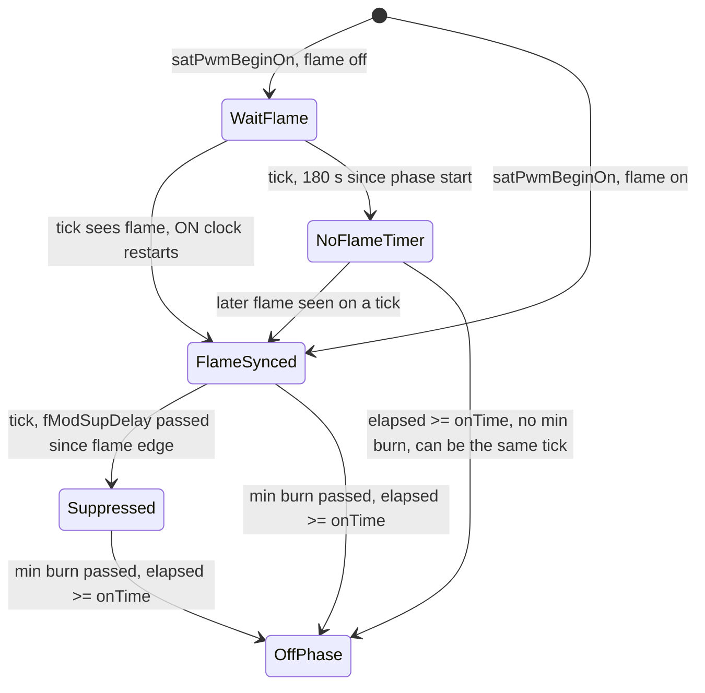

| Diagram name | Variables | Cite |
|---|---|---|
| WaitFlame | `_pwm_waitingForFlame` true | `SCT:1225-1228` |
| FlameSynced | `_pwm_flameOnMs != 0`, suppression not set this tick | `SCT:1221-1224`, `:1435-1441` |
| NoFlameTimer | waiting false, `_pwm_flameOnMs == 0` | `SCT:1512-1518` |
| Suppressed | `bModSuppressed` true, CS = flow - 1.0 | `SCT:1621-1623` |
| OffPhase | `bPwmFlameRequested` false, `bModSuppressed` false | `SCT:1233-1243`, `:1590` |

`bModSuppressed` is assigned only at `SCT:1590`, `:1622`, `:1669`, `:6880`, `:7268`, `:7299`. So it is cleared at the start of every `satApplyPWM()` call that does not reach `:1622` (OFF phase, DHW, requested <= cold, flame off, inside the hold), by `satPwmReset()` (`:1669`, with `iModSuppressionSinceMs` = 0 at `:1670`), in continuous mode (`:7268`), by the cold cutoff (`:7299`) and at a flame-off edge (`:6880`).

### Two flame-on anchors

- `_cycle_flameOnStartMs`: stamped at the flame edge, on the loop pass that sees it (`SCT:6878-6881`, `SC:1012-1025`). It times the `fModSupDelay` hold (`satPwmHoldElapsed`, `SCT:1188-1192`).
- `_pwm_flameOnMs`: stamped on the control tick that syncs to the flame (`SCT:1435-1441`), or at t0 when the flame already burns (`SCT:1221-1224`). It times the minimum burn (`SCT:1519-1521`) and the start-up EMA window (`SCT:1424-1429`).
- They differ by up to one control interval (default 30 s, `ST:498`) in every ON phase that starts with the flame off.

The full start-up timeline is under [Timelines](#timelines).

---

## M5 Cold cutoff, CH rule and command cadence

Purpose: decides heater off (CS = 10, CH = 0) when the requested setpoint is too low, with hysteresis; sets the CH bit per tick; and decides when CS, MM and CH go out.

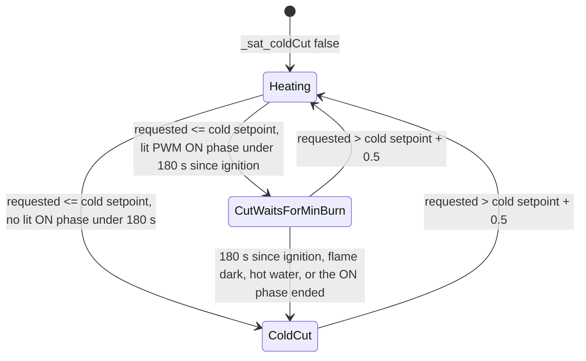

### States

| State | Meaning | Stored |
|---|---|---|
| Heating (`_sat_coldCut` false) | heating allowed | `SCT:454` |
| CutWaitsForMinBurn (`_sat_coldCut` true, `_sat_coldCutDeferred` true) | latched, but a lit PWM ON phase (no hot water) is younger than 180 s since its first ignition: the phase keeps running, CS and CH as in the ON phase; telnet narrates "Heating off waits for the 180 s minimum burn" | `SCT:457`, set `SCT:7239`, cleared `SCT:7294`; wait test `satPwmColdCutWaitsForMinBurn()` `SCT:1247-1253`; narration `SCT:7321` |
| ColdCut (`satColdCutActive()` true) | heater off: CS = 10, PWM off, CH = 0 | `SCT:454`, `SCT:460-463`, latched `SCT:7223` |

Cold setpoint: radiators 28.2, underfloor 21.0 (`SCT:133-134`, `:447-451`). Threshold (`satColdThreshold()`, `SCT:470-474`): cold + 0.5 while cut, the cold setpoint while heating, and below every requested setpoint while the cut waits for the minimum burn, so every reader (CS override, CH bit, PWM gates and exits) sees `satColdCutActive()`. The 180 s counts from the first ignition of the ON phase (`_pwm_flameOnMs`, `PWM_IGNITION_TIMEOUT_MS` 180000); a relight keeps that anchor. Deviation from thermo-nova 7beaaf5, where the cold cutoff skips `pwm.update()` and its 180 s hold (`heating_control.py:72`, `:229-233`, `:238`; `pwm.py:201-203`): maintainer entry 275, Sergeant D entries 281-283, TASK-1652.

### Transitions

| From | To | Guard | Constant | Cite | Refs |
|---|---|---|---|---|---|
| Heating | ColdCut | `requested <= cold`, once per tick, no lit ON phase under 180 s | 28.2 / 21.0 | `CHE:36-39`; `SCT:7223`, `:7239` | TASK-1547, entry 199 |
| Heating | CutWaitsForMinBurn | `requested <= cold` while `satPwmColdCutWaitsForMinBurn()` | 180 s | `SCT:7239`, `:1247-1253` | TASK-1652, entries 275, 281-283 |
| CutWaitsForMinBurn | ColdCut | the wait test turns false (180 s since ignition, flame dark, hot water, PWM left); re-checked after the schedule in the same tick | `PWM_IGNITION_TIMEOUT_MS` 180000 | `SCT:7239`, `:7294` | TASK-1652 |
| CutWaitsForMinBurn, ColdCut | Heating | `requested > cold + band` | band 0.5 | `CHE:38`; `SCT:135` | entries 199, 200 |
| ColdCut (action) | CS = 10, `satPwmDisableOnHeaterOff()`, `bModSuppressed` false | `coldCutoff` (= `satColdCutActive()`) true | `SAT_MIN_SETPOINT` 10 | `SCT:7318`, `:7332-7337` | TASK-891.2, entry 12 |

CH rule (`satChEnableDecide`, `CHE:56-62`, called at `SCT:7352`): CH = 0 if requested <= threshold; CH = 0 if PWM drives the CS and the phase is OFF; else CH = 1. `satPwmDrivesSetpoint` = flow > 0, no DHW, requested > threshold, and (protection on or not ON) (`SCT:1580-1584`). Refs: TASK-1316, TASK-1323, Sergeant D 2026-10-23.

Other heater-off paths with the same CS = 10 and CH = 0: summer simmer (`SCT:7093-7109`) and valves closed (`SCT:7111-7125`). They act at once; only the cold cutoff waits for the minimum burn.

### Command cadence

(`SCT:562-582`; TASK-1370, entry 44; ADR-203 cited at `SCT:562`.)

| Command | When it goes out | Cite |
|---|---|---|
| CS | every control tick: `satSendCS()` always sends | `SCT:650-658`, `:7309-7315` |
| CS | repeated every 5 s between ticks, timed from the last CS send of any sender | `SAT_CMD_RESEND_MS` 5000 `SCT:582`; `satCmdResend` `:732-737` |
| CS resend | paused while SlaveStatus fault or DHW bits are set (`& 0x05`), disarmed after a DHW or fault tick, needs `bActive` | `SCT:733-734`, `:6948`, `:7026` |
| MM, CH | the tick calls the senders, but they return early on an unchanged value younger than 59 s; so on change, plus a repair on the first tick at or after 59 s (60 s with a 30 s tick) | `SAT_MMCH_REPAIR_MS` 60000, slack 1000, `SCT:576-579`; `:689-720`, `:692-693`, `:713-714`; TASK-1570, entries 237, 239 |
| CS keepalive (PIC boards) | last CS >= 8 resent when no CS went out for 30 s. While the 5 s resend runs it never fires, because every resend goes through `satSendCS()`, which stamps `iLastSentCSMs`. It only acts while the resend is disarmed or blocked | `SCT:665-675`, `:671`, `:656`, `:736`; TASK-1236 |

ADR-207 (Accepted) states this cadence: CS keeps the 5 s resend and the 30 s PIC keepalive; MM, CH on change plus 60 s repair. ADR-203 (partly superseded by ADR-207) still says CS, MM and CH every 5 s. ADR-207 is not referenced in the firmware source; ADR-199 appears only at the zone cold setpoint (`SCT:3294-3295`).

---

## M6 Burn lifecycle and cycle class

Purpose: at each flame-off, decide whether the burn is kept, then classify it. This is the only derived result that can switch the control mode.

### Burn lifecycle

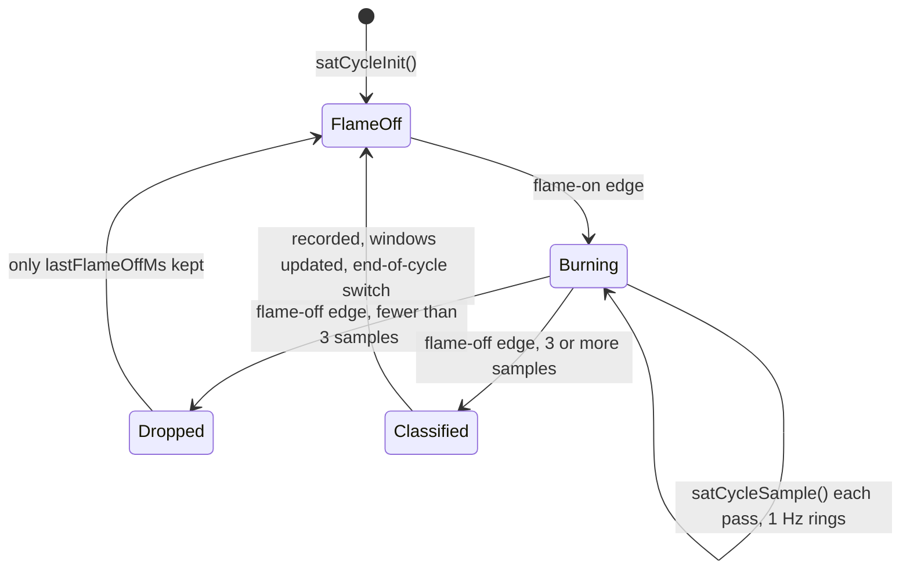

FlameOff, Burning, Dropped and Classified are descriptive names; the code holds this in `_cycle_flameOn` (`SC:125`).

| From | To | Guard | Constant | Cite | Refs |
|---|---|---|---|---|---|
| init | FlameOff | `_cycle_flameOn` false, offStart = now, off gap unknown | | `SC:288-292`, `:346-347` | |
| FlameOff | FlameOff | flame-off sample with Statusflags != 0, or simulation: off gap becomes known | | `SC:1198-1202` | entry 266 (`SC:826`) |
| FlameOff | Burning | `flameOn && !_cycle_flameOn`: off-with-demand, start time, max/min flow, `_cycle_setpointAtStart = fFinalSetpoint`, rings reset, flame-on tail sample | | `SC:1012-1073` | TASK-891.4, TASK-1588, entry 249 |
| Burning | Dropped | `_cycle_totalSamples < SAT_CYCLE_MIN_SAMPLES` | 3 | `SC:30`, `:1098-1104` | TASK-1588, entry 249 |
| Burning | Classified | otherwise: percentiles, `_cycleClassify()`, `_cycleRecord()`, 4 h and 24 h record, `satCycleApplyEndOfCycle()` last | | `SC:1105-1191` | TASK-1331 |

Off-with-demand (`fOffWithDemandSec`) counts only when not DHW, Statusflags bit 1 set, and `fFinalSetpoint > flow` (`SC:1017-1023`).

Flame source: Statusflags bit 3 (0x08) on a real boiler, `state.sat.bSimFlameOn` in simulation (`SCT:2647-2650`). The simulated boiler also calls `satCycleOnFlameChange()` directly (`SCT:5684-5696`); the double call is harmless because the function acts only on a real edge (`SC:1012`, `SC:1075`).

### Classifier inputs

| Input | How | Cite | Refs |
|---|---|---|---|
| `durationSec` | flame-off minus flame-on | `SC:1082` | |
| tail ring | 1 Hz, size `SAT_TAIL_SAMPLE_SIZE` (180 on ESP32), warm-up trimmed: samples before `min(60, 0.25*duration)` dropped | `SC:102-108`, `:676-686`, `:1108` | TASK-1584, entry 244 |
| `ctrlErrP50/P90`, `ctrlErrKnown` | interpolated percentiles of per-sample `flow - fFinalSetpoint`; a sample counts only when `sp > 0 && isfinite(flow)`; Known false when none counted | `SC:934-940`, `:938`, `:692-718`, `:1133-1134` | TASK-1405, entry 36, TASK-1586 |
| `reqSpP50`, `reqErrP90`, `reqSpKnown`, `reqErrKnown` | per-sample `_sat_requestedSetpoint` (<= 0 = none) | `SC:943-947`, `:727-762`, `:1121-1123` | TASK-1585, entry 245, Q-PARITY-5 A |
| `dhwInTail` | a DHW sample at or after `max(min(60, 0.25*dur), dur - 180)` s | `SC:1130-1132` | |
| `pwmEnabled` | `eControlMode == SAT_MODE_PWM` at flame-off | `SC:1124` | |
| `pwmIdle` | `satPwmIsIdle()` | `SC:1136`, `SCT:1747-1750` | TASK-1387 |
| `pwmOn` | `state.sat.bPwmFlameRequested` | `SC:1137` | |
| `onTimeSec` | `satPwmLastOnTimeMs()/1000` | `SC:1125`, `SCT:1743-1745` | |
| `coldSp` | 21.0 underfloor, else 28.2 | `SC:889`, `SCT:133-134`, `:447-451` | entries 7, 11 |
| overshoot margin | `fOvershootMargin`, default 2.0, range 0.5 to 5.0 | `ST:509`, `settingStuff.ino:1096` | entries 15, 37 |
| underheat margin | `SAT_UNDERSHOOT_MARGIN_C` 3.0 | `SC:34` | |
| `controlSp` | `_cycle_setpointAtStart` | `SC:1139` | Q-PARITY-6 |

`tailP90` and `tailP50` are passed in (`SC:1111-1113`, `:1138`) but not read inside `_cycleClassify()` (`SC:870-924`).

### Decision tree

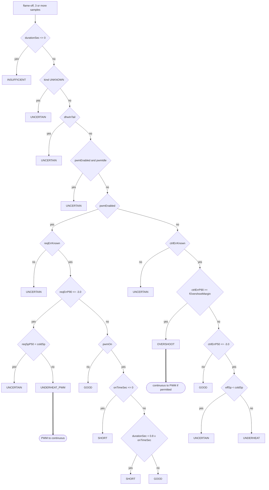

`effSp` = `reqSpP50` if known, else `controlSp` (`SC:917-920`).

### States (classes)

| State | Meaning | Stored |
|---|---|---|
| `SAT_CYCLE_NONE` | no cycle yet, or the last one is older than 6 h on the reporting paths (`now - iLastCycleEndMs > 6 h`, strict) | enum `ST:63-74`; default `ST:168`; expiry `ST:456-469` |
| `SAT_CYCLE_GOOD` | no rule fired | `SC:908`, `:923` |
| `SAT_CYCLE_OVERSHOOT` | continuous only | `SC:915` |
| `SAT_CYCLE_UNDERHEAT` | continuous underheat | `SC:921` |
| `SAT_CYCLE_UNDERHEAT_PWM` | PWM underheat | `SC:901` |
| `SAT_CYCLE_SHORT` | PWM only, ON phase still running at flame-off | `SC:905-906` |
| `SAT_CYCLE_UNCERTAIN` | data does not allow a verdict | `SC:881`, `:884`, `:887`, `:895`, `:900`, `:913`, `:920` |
| `SAT_CYCLE_INSUFFICIENT` | `durationSec <= 0` | `SC:878` |
| record | `eLastCycleClass`, `iLastCycleEndMs`, `iCycleCount++`, history ring of 16 | `SC:784-804` |

### Decisions

| # | Path | To | Guard | Constant | Cite | Refs |
|---|---|---|---|---|---|---|
| 1 | start | INSUFFICIENT | `durationSec <= 0` | | `SC:878` | TASK-1588, entry 249 |
| 2 | 1 | UNCERTAIN | `kind == SAT_CK_UNKNOWN` | | `SC:881` | |
| 3 | 2 | UNCERTAIN | `dhwInTail` | | `SC:884` | |
| 4 | 3 | UNCERTAIN | `pwmEnabled && pwmIdle` | | `SC:887` | TASK-1387 |
| 5 | PWM | UNCERTAIN | `!reqErrKnown` | | `SC:895` | |
| 6 | PWM | UNCERTAIN | `reqErrP90 <= -3.0 && reqSpP50 < coldSp` | 3.0; 28.2 / 21.0 | `SC:897-900` | |
| 7 | PWM | UNDERHEAT_PWM | `reqErrP90 <= -3.0`, not 6 | 3.0 | `SC:897`, `:901` | TASK-891.4 |
| 8 | PWM | SHORT | `pwmOn && onTimeSec <= 0` | | `SC:904-905` | |
| 9 | PWM | SHORT | `pwmOn && durationSec < onTimeSec * 0.8` | 0.8 | `SC:906` | |
| 10 | PWM | GOOD | otherwise (no OVERSHOOT for PWM) | | `SC:908` | |
| 11 | continuous | UNCERTAIN | `!ctrlErrKnown` | | `SC:913` | |
| 12 | continuous | OVERSHOOT | `ctrlErrP90 >= fOvershootMargin` | 2.0 default | `SC:915` | entries 15, 37 |
| 13 | continuous | UNCERTAIN | `ctrlErrP50 <= -3.0 && effSp < coldSp` | 3.0; 28.2 / 21.0 | `SC:917-920` | |
| 14 | continuous | UNDERHEAT | `ctrlErrP50 <= -3.0`, not 13 | 3.0 | `SC:917`, `:921` | |
| 15 | continuous | GOOD | otherwise | | `SC:923` | |

The header comment says the port follows "classifier.py exactly" per Sergeant D entry 55 (`SC:842`), with listed deviations (`SC:844-867`).

### End-of-cycle switch (the feedback into control)

| Class | Effect | Cite | Refs |
|---|---|---|---|
| `OVERSHOOT` of a continuous burn | continuous to PWM, only if `satPwmEntryAllowed(5)` (MsgID 3 HB bit 4) | `SC:991-998`, `:1191`, `:1326-1331` | TASK-1331; entries 15, 18, 36, 37, 213-215 |
| `UNDERHEAT_PWM` of a PWM burn | PWM to continuous | `SC:999-1004` | TASK-1331 |
| any other class | nothing | `SC:994`, `:1000` | |

### Aggregates (reporting)

| Aggregate | Rule | Cite |
|---|---|---|
| EMA overshoot, underheat, long | alpha 0.15; underheat counts both underheat classes; long = `durationSec > 600` | `SC:200`, `:815-821` |
| EMA duty | only when the preceding off gap is known; `duration / (now - lastFlameOff)`, capped 1.0 | `SC:827-834` |
| 4 h window | overshoot and underheat fraction per cycle; duty = sum on / 4 h | `SC:51`, `:437-479` |
| 24 h window | hourly buckets; long = `durationSec >= 600` | `SC:65-67`, `:542-548`, `:552-583` |

---

## M7 Cycle phase

Purpose: a display-only label of where the current burn is. Exposed as `sat/cycle_phase` and in the status snapshot (`SCT:4685`, `SCT:4185-4186`).

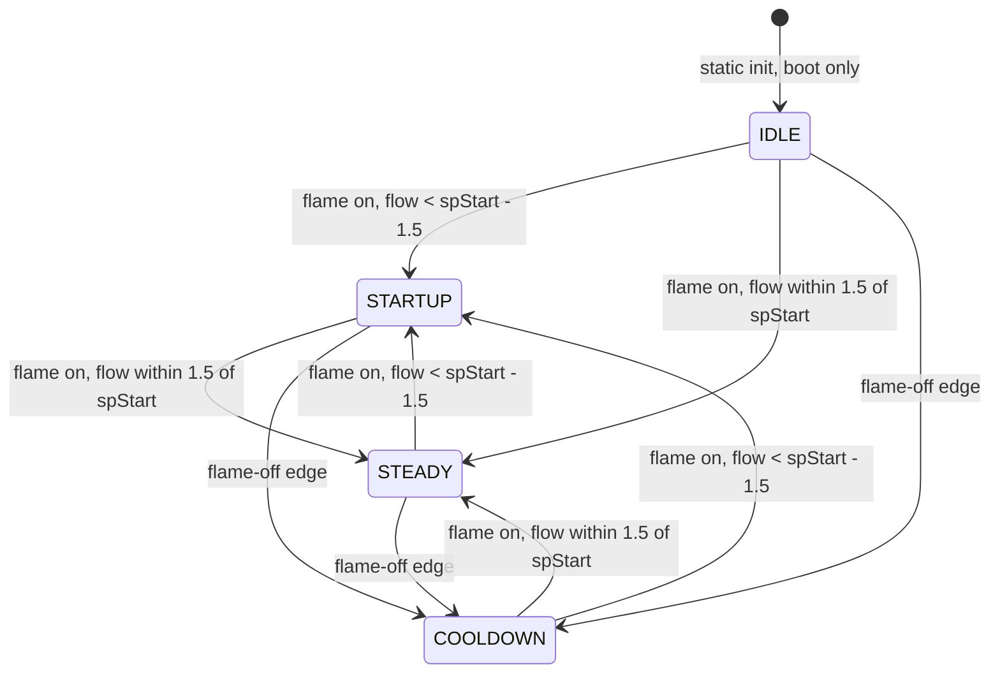

There is no way back to IDLE. A flow above `spStart + 1.5` changes nothing, so a burn that starts hot keeps its old phase, also COOLDOWN.

| State | Meaning | Stored |
|---|---|---|
| `SAT_CP_IDLE` | initial value, name "idle" (also the `default:` of the name switch) | enum `ST:78-80`; `_cycle_phase` `SC:139`; name `SC:1460` |
| `SAT_CP_STARTUP` | burning, flow more than 1.5 below the setpoint at flame-on | `SC:1273`, name `SC:1457` |
| `SAT_CP_STEADY` | burning, flow within 1.5 of the setpoint at flame-on | `SC:1275`, name `SC:1458` |
| `SAT_CP_COOLDOWN` | set at every flame-off edge | `SC:1079`, name `SC:1459` |
| phase start | `_cycle_phaseStartMs`, reported as duration in s (0 while never set) | `SC:140`, `SC:1464-1468` |

| From | To | Guard | Constant | Cite | Refs |
|---|---|---|---|---|---|
| boot | IDLE | static initialiser; `satCycleInit()` does not reset `_cycle_phase` (writes only at `SC:1079`, `:1280`) | | `SC:139`, `SC:288-358` | |
| any | COOLDOWN | flame-off edge, also for a dropped short burn (set before the drop check) | | `SC:1075-1080`, drop `SC:1098` | |
| any | STARTUP | `satCycleSample()` with flame on, `flowTemp < setpoint - band` | band 1.5; setpoint = `_cycle_setpointAtStart` | `SC:1268-1273`, `SC:1028` | Task #35 |
| any | STEADY | `fabsf(flowTemp - setpoint) <= band` | 1.5 | `SC:1274-1275` | Task #35 |
| any | unchanged | flame off: `satCycleSample()` returns before the phase logic | | `SC:1198-1203` | |
| any | unchanged | `flowTemp > setpoint + 1.5` | | `SC:1272-1277` | |
| on change | phase start = now | `newPhase != _cycle_phase` | | `SC:1279-1282` | |

Sampling: every loop pass that reaches `SCT:6888`; the 1 Hz gate at `SC:1223` covers only the sample rings.

---

## M8 Cycle kind

Purpose: label a finished burn as space heating, hot water, mixed or unknown, from 1 Hz status samples. Computed at flame-off for kept burns.

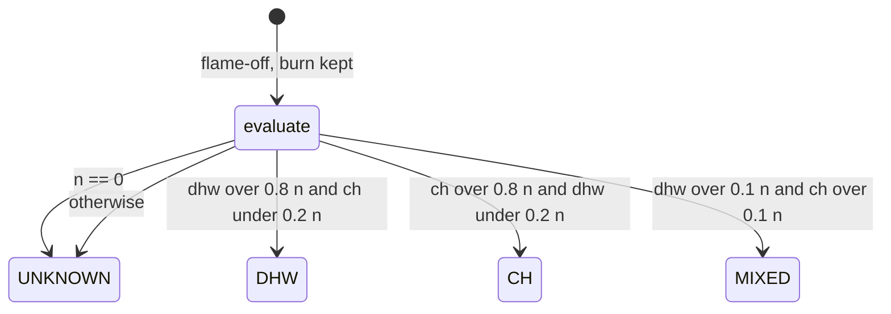

Rules are tested in that order; the first match wins.

| State | Meaning | Stored |
|---|---|---|
| `SAT_CK_UNKNOWN` | no samples, or no rule matched | enum `ST:75-77`; `eLastCycleKind` default `ST:175` |
| `SAT_CK_CH` | mostly CH enable without DHW | `SC:778` |
| `SAT_CK_DHW` | mostly DHW active | `SC:777` |
| `SAT_CK_MIXED` | both above 10 % | `SC:779` |
| history | `_cycleHistory[].eKind`, ring of 16 | `SC:29`, `:246-257`, `:790` |

| Input | Real boiler | Simulation | Cite | Refs |
|---|---|---|---|---|
| DHW sample | Statusflags bit 2 (`sf & 0x0004`) | `state.sat.bDhwActive` | `SC:961-967` | TASK-1387 |
| CH sample | Statusflags bit 8 (`sf & 0x0100`), only when not DHW | `fFinalSetpoint > 10.0` | `SC:963`, `:967`, `:970-975`, `SCT:132` | TASK-1387 |
| flame-on sample counts | `_cycleTailSample()` at the edge | | `SC:1071-1073` | TASK-1588, entry 249 |
| 1 Hz gate | `nowMs - _tail_lastSampleMs >= 1000` | | `SC:1223`, `:1228` | TASK-1269 |
| reset | at flame-on | | `SC:1057-1061` | |

| To | Guard | Cite |
|---|---|---|
| UNKNOWN | `n == 0` | `SC:773-774` |
| DHW | `dhw*5 > n*4 && ch*5 < n` | `SC:777` |
| CH | `ch*5 > n*4 && dhw*5 < n` | `SC:778` |
| MIXED | `dhw*10 > n && ch*10 > n` | `SC:779` |
| UNKNOWN | fall-through | `SC:780` |
| record | `eLastCycleKind`, `fLastCycleFractionDHW/CH` | `SC:786`, `:804-813` |

Consumers: the classifier (UNKNOWN gives UNCERTAIN, `SC:881`); otherwise reporting only (`REST:1025-1029`, MQTT `sat/cycle_attributes` `SCT:4664-4678`).

---

## M9 Flame status

Purpose: a health label for the burner, recomputed on evaluated control ticks. Reporting only.

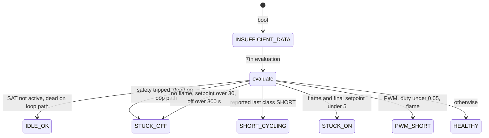

Each status is recomputed from scratch on every evaluation (only the sample counter is kept), so any state can follow any other.

| State | Meaning | Stored |
|---|---|---|
| `SAT_FS_INSUFFICIENT_DATA` | first 6 evaluations after boot | enum `ST:100-103`; `eFlameStatus` `ST:288`; `SCT:5488-5491` |
| `SAT_FS_HEALTHY` | no rule fired | `SCT:5534` |
| `SAT_FS_IDLE_OK` | SAT not active | `SCT:5496-5498` |
| `SAT_FS_STUCK_ON` | flame on while final setpoint < 5 | `SCT:5514-5516` |
| `SAT_FS_STUCK_OFF` | safety trip, or heat asked with no flame for > 5 min | `SCT:5502-5504`, `:5520-5525` |
| `SAT_FS_PWM_SHORT` | PWM with duty < 5 % and flame on | `SCT:5529-5531` |
| `SAT_FS_SHORT_CYCLING` | last class SHORT, not older than 6 h | `SCT:5508-5510`, `ST:465-469` |

| # | To | Guard | Constant | Cite | Refs |
|---|---|---|---|---|---|
| 0 | (skip) | less than 10 s since the last evaluation | 10000 ms | `SCT:5483-5486` | Task #70 |
| 1 | INSUFFICIENT_DATA | `_flame_sampleCount < 6`, then counter++; static, never reset (one write at `SCT:5489`) | 6 | `SCT:5479`, `:5488-5491` | |
| 2 | IDLE_OK | `!state.sat.bActive`. Dead on the loop path: the only caller `SCT:7120` runs after `bActive = true` at `SCT:6925`; reachable only if `satDisable()` (`SCT:3836`) runs at the same time on the async_tcp task (comment `SCT:3838`) | | `SCT:5496-5498` | |
| 3 | STUCK_OFF | `bSafetyTripped`. Dead: its one writer `SCT:7328` runs later in the same tick, and from the next pass the loop returns at `SCT:6853` | | `SCT:5502-5504` | |
| 4 | SHORT_CYCLING | `satReportedLastCycleClass() == SAT_CYCLE_SHORT` | 6 h expiry | `SCT:5508-5510`, `ST:456` | TASK-1352 |
| 5 | STUCK_ON | `flame && fFinalSetpoint < 5.0` | 5.0 | `SCT:5514-5516` | |
| 6 | STUCK_OFF | `!flame && fFinalSetpoint > 30.0 && flameOffStartMs > 0 && now - flameOffStartMs > 300000` | 30.0, 300 s | `SCT:5520-5525`, `SC:1451` | |
| 7 | PWM_SHORT | `eControlMode == PWM && fPwmDutyCycle < 0.05 && flame` | 0.05 | `SCT:5529-5531` | |
| 8 | HEALTHY | otherwise | | `SCT:5534` | |

Inputs: `satIsFlameOn()` (`SCT:5494`, `SCT:2647-2650`); "flame off since" = `_cycle_flameOffStartMs`, set to boot time by `satCycleInit()` and by each flame-off edge (`SC:292`, `SC:1078`).

Rate: called from the control tick (`SCT:7120`), throttled to once per 10 s. It is not called on ticks that return early: DHW (`SCT:6971`), boiler fault (`SCT:7029`), thermal safe (`SCT:7054`), summer simmer (`SCT:7084`), valves closed (`SCT:7100`). So INSUFFICIENT_DATA lasts 6 evaluated ticks, not 6 ticks.

---

## M10 Curve recommendations

Two separate recommendations exist. Neither is derived from cycles: both come from the room error `state.sat.fError` (= target - room, `ST:162`). Both are called only on evaluated ticks with a valid room temperature: `if (roomValid) { satUpdateCurveRecommendation(); satHCRAddSample(); }` (`SCT:7105-7106`). Advice only.

### Hourly mean error (`SATCurveRecommendation`)

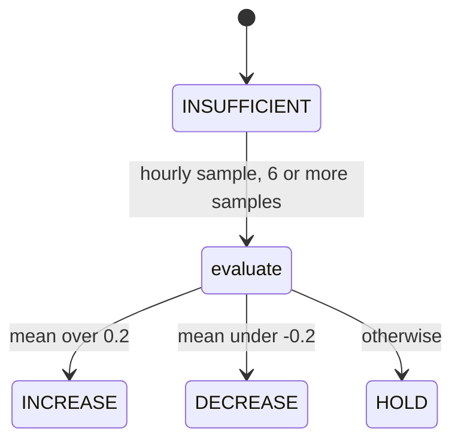

| State | Meaning | Stored |
|---|---|---|
| `SAT_CR_INSUFFICIENT` | fewer than 6 samples | enum `ST:81-83`; `eCurveRecommendation` `ST:281`; `SCT:5373-5376` |
| `SAT_CR_INCREASE` | room too cold | `SCT:5397-5398` |
| `SAT_CR_DECREASE` | room too warm | `SCT:5399-5400` |
| `SAT_CR_HOLD` | within threshold | `SCT:5401-5402` |

| From | To | Guard | Constant | Cite | Refs |
|---|---|---|---|---|---|
| any | (skip) | less than 1 h since the last sample; the first call after boot samples at once (`_cr_lastSampleMs == 0`) | 3600000 ms | `SCT:5352`, `:5358-5360`, `:5359` | Task #11 |
| any | (skip) | `!state.sat.bActive`; dead on the loop path because `bActive` is true from `SCT:6925` before every call; the sample stamp is set before this check (`SCT:5360`) | | `SCT:5363` | |
| sample | ring of 24 | | `CR_BUFFER_SIZE` 24 | `SCT:5347`, `:5365-5370` | |
| any | INSUFFICIENT | `_cr_bufferCount < 6` | 6 | `SCT:5372-5376` | |
| any | INCREASE | `mean > SAT_PID_DEADBAND * 2` | 0.1 x 2 = 0.2 | `SCT:5396-5398`, `ST:447` | entry 76 |
| any | DECREASE | `mean < -0.2` | 0.2 | `SCT:5399-5400` | |
| any | HOLD | otherwise | | `SCT:5401-5402` | |

No reset of the enum or of `_cr_*` on SAT disable: writes exist only in `SCT:5366-5402` (grep).

### Daily median (`sHeatCurveRec`, Task #228)

| From | To | Guard | Constant | Cite |
|---|---|---|---|---|
| init, disable, SAT inactive | "insufficient" | `satCycleInit()`, `satHCRReset()` (called from `satDisable()` `SCT:3843`), `!bActive` (dead on the loop path, as above, `SC:1614`) | | `SC:357`, `SC:1600-1608`, `SC:1660-1663` |
| sample | intra-day ring | each evaluated tick with a valid room; value = `-fError` | | `SCT:7106`, `SC:1612-1622` |
| first NTP-valid call after boot | day number stored, nothing committed | | | `SC:1629-1633` |
| new calendar day | commit median | NTP valid (`ts >= 1000000`), `dayNum > lastDayNum`, 2 or more samples; with fewer, nothing is committed but the recommendation is still recomputed and saved | | `SC:1625-1644`, `SC:1650-1652` |
| commit | "insufficient" | fewer than 3 daily medians | `HCR_SUSTAIN_DAYS` 3 | `SC:266`, `SC:1665-1668` |
| commit | "increase" | last 3 daily medians all `< -0.5` | `HCR_THRESHOLD_C` 0.5 | `SC:265`, `SC:1674-1684` |
| commit | "decrease" | last 3 daily medians all `> +0.5` | 0.5 | `SC:1679`, `SC:1685-1686` |
| commit | "hold" | otherwise | | `SC:1687-1689` |
| persist | `/sat/sat_hcr.json` | each new day | | `SC:268`, `SC:1652`, `SC:1508-1543` |

---

## M11 Boiler status

Purpose: a descriptive label of what the boiler is doing. Enum `SATtypes.h:104-110` (16 values). Stored in `state.sat.eBoilerStatus`, initial OFF (`ST:153`), and `bBoilerStatusKnown`, initial false (`ST:154`). Evaluator `satUpdateBoilerStatus()` (`SCT:931-1076`); its only caller is the control tick (`SCT:7123`). Display only: "nothing in the control path reads eBoilerStatus" (`SCT:948`).

The status is frozen (not re-evaluated) on ticks that return before the evaluator: DHW (`SCT:6945-6971`), boiler fault (`SCT:7024-7029`), thermal safe (`SCT:7038-7054`), summer simmer (`SCT:7071-7084`), valves closed (`SCT:7088-7100`), and every return before the timer check (`SCT:6823`, `:6838`, `:6853`, `:6861`, `:6864`, `:6918`). The `_bs_*` memory (`SCT:864-871`) is written only inside the evaluator.

### Inputs

| Input | Source | Cite |
|---|---|---|
| `flame` | `satIsFlameOn()`: Statusflags bit 3; simulation `bSimFlameOn` | `SCT:933`, `:2647-2651` |
| `mod` | `OTcurrentSystemState.RelModLevel`, raw, also in simulation | `SCT:934` |
| `boilerTemp` | `satGetFlowTemp()`: Tboiler (MsgID 25) when fresh, else 0.0; simulation `fSimFlowTemp` + noise | `SCT:935`, `:2608-2613` |
| `setpoint` | stored `fFinalSetpoint`: the previous tick's value (new one written at `SCT:7264`), or the 3 s refresh value (`SCT:1648`), or 0.0 after `satDisable()` (`SCT:3837`) | `SCT:936` |
| `bDhwActive` | simulated draw, else SlaveStatus bit 2 | `SCT:6935-6939` |
| `bModulationReliable` | false for `SAT_QUIRK_NO_REL_MOD` boilers, else `satUpdateModulationReliability()` | `SCT:7110-7114` |
| cold setpoint | 21.0 underfloor, 28.2 radiators | `SCT:447-451`, `:133-134` |
| last cycle | `satReportedLastCycleClass() != NONE` and `fLastCycleDuration` (`SC:803`) | `SCT:998-999` |

Derived: `hasDemand = setpoint > boilerTemp + 0.7` (`SCT:957`, `:924`). `tempRate = boilerTemp - _bs_prevBoilerTemp`, only when the previous value is > 0.001 and more than 0.5 s since the state entry, else 0 (`SCT:960-967`); per call, not per second (`SCT:965`). Flame edges: OFF->ON stamps `_bs_flameOnMs` and clears the overshoot latch (`SCT:941-943`, `:952-954`); ON->OFF stamps `_bs_flameOffMs` and latches overshoot when `!(prevSetpoint < coldSetpoint) && prevFlow >= prevSetpoint + 3.0` (`SCT:944-951`; entry 259, TASK-1361).

### Constants

| Name | Value | Cite |
|---|---|---|
| `BS_ANTI_CYCLE_MIN_OFF_MS` | 180 s | `SCT:920` |
| `BS_STALLED_IGNITION_MIN_MS` | 600 s floor | `SCT:921` |
| `BS_POST_CYCLE_SETTLE_MS` | 60 s | `SCT:922` |
| `BS_IGNITION_SURGE_WINDOW_MS` | 30 s | `SCT:923` |
| `BS_DEMAND_HYSTERESIS` | 0.7 C | `SCT:924` |
| `BS_AT_SETPOINT_BAND` | 1.5 C | `SCT:925` |
| `BS_PUMP_START_DELTA` | 6.0 C | `SCT:926` |
| `BS_PREHEAT_DELTA` | 6.0 C | `SCT:927` |
| `BS_IGNITION_SURGE_RATE` | 0.5 (C per tick in practice) | `SCT:928` |
| `BS_OVERSHOOT_DELTA` | 3.0 C | `SCT:929` |
| stall ratio | last cycle duration x 3.0 | `SCT:1000-1001` |
| modulation step | +/- 1.0 % | `SCT:1044-1045` |
| flow gradient step (unreliable modulation) | +/- 0.1 C per tick | `SCT:1047-1048` |

### Decision tree (first match wins)

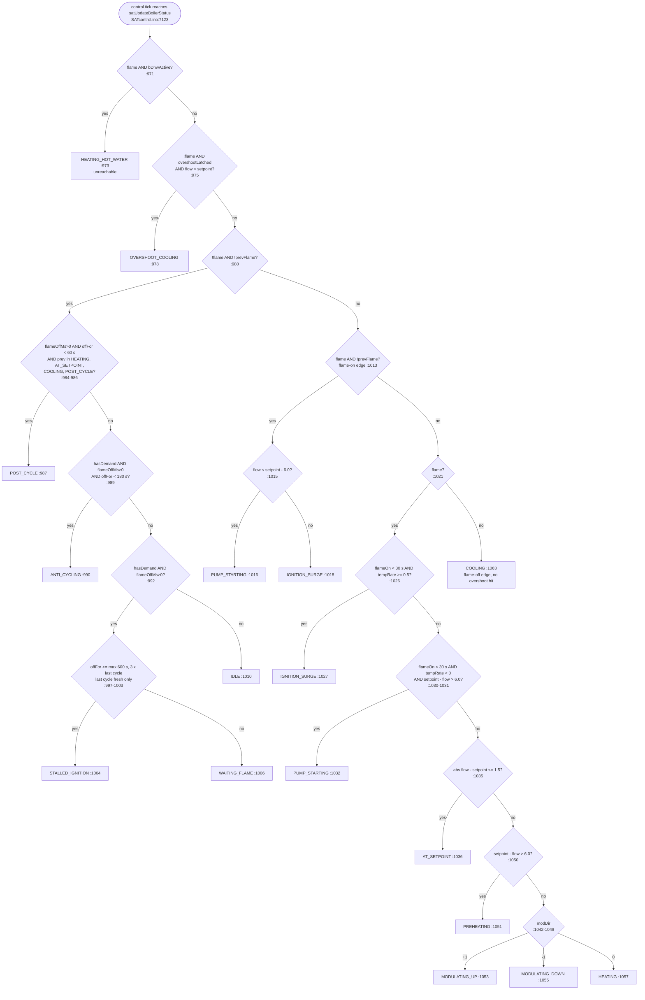

Line numbers in the nodes are `SATcontrol.ino`. `modDir` (`SCT:1042-1049`): with reliable modulation, +1 when `mod > prevMod + 1.0`, -1 when `mod < prevMod - 1.0`; without it, +1 when `tempRate > 0.1`, -1 when `tempRate < -0.1`; else 0. After the tree: on a change `_bs_stateEntryMs = now` (`SCT:1066-1068`); then the status is stored, `bBoilerStatusKnown = true` (TASK-1485) and the four `_bs_prev*` values are saved (`SCT:1070-1075`).

### Transitions the code allows

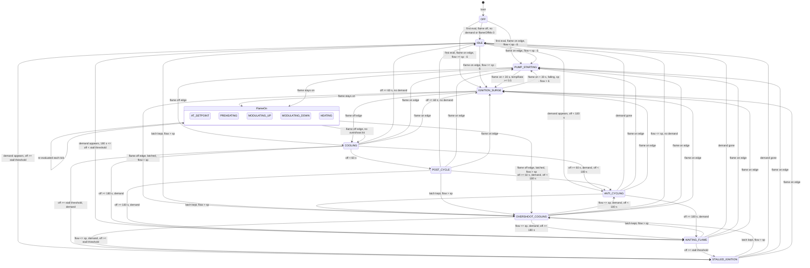

Stall threshold = max(600 s, 3 x last cycle duration), the adaptive part only with a fresh last cycle (`SCT:992-1004`). Notes, each from the cited lines:

- COOLING lasts exactly one evaluated tick: the next tick takes the `!flame && !prevFlame` branch (`SCT:980`, `:1061-1064`).
- POST_CYCLE is entered only with prev = HEATING, AT_SETPOINT, COOLING or POST_CYCLE (`SCT:985-986`). After OVERSHOOT_COOLING the 60 s settle is skipped.
- The overshoot latch is cleared only by the next flame-on edge (`SCT:952-954`), so OVERSHOOT_COOLING can come back from any flame-off state whenever flow > setpoint again (`SCT:975`). PUMP_STARTING cannot go to OVERSHOOT_COOLING: its flow is below sp - 6, while the latch needs flow >= sp + 3 (`SCT:949-950`).
- POST_CYCLE needs `off < 60 s` on the tick after the flame-off tick: reachable with the default 30 s tick, not with an interval of 60 s or more (inference from `SCT:922`, `:984`, `ST:498`; not bench-checked).
- The in-flame `< 30 s` branches (`SCT:1026`, `:1030`) need a tick less than 30 s after the flame-on tick: marginal at the default 30 s interval (inference, jitter not measured).
- A flame-on edge at the first evaluation is possible because `_bs_prevFlame` starts false (`SCT:864`).
- A missing flow reads as 0.0 (`SCT:2612`): with flame on and setpoint > 6 the result is PREHEATING (`SCT:1050-1051`); with flame off, `hasDemand` is true for any setpoint > 0.7 (`SCT:957`).

### States

| State | Value | Meaning | Assigned at |
|---|---|---|---|
| OFF | 0 | initial value only; the evaluator default is always replaced | `ST:153`, `SCT:969` |
| IDLE | 1 | flame off and was off, no post-cycle, no demand or no flame-off seen yet | `SCT:1010` |
| PREHEATING | 2 | flame on, out of band, flow more than 6.0 below setpoint | `SCT:1051` |
| AT_SETPOINT | 3 | flame on, flow within 1.5 of setpoint | `SCT:1036` |
| MODULATING_UP | 4 | flame on, out of band, not preheating, modDir +1 | `SCT:1053` |
| MODULATING_DOWN | 5 | as above, modDir -1 | `SCT:1055` |
| IGNITION_SURGE | 6 | flame-on edge with flow >= sp - 6, or flame on < 30 s with tempRate >= 0.5 | `SCT:1018`, `:1027` |
| STALLED_IGNITION | 7 | flame off, demand, off >= stall threshold | `SCT:1004` |
| ANTI_CYCLING | 8 | flame off, demand, off < 180 s | `SCT:990` |
| PUMP_STARTING | 9 | flame-on edge with flow < sp - 6, or flame on < 30 s, falling, sp - flow > 6 | `SCT:1016`, `:1032` |
| WAITING_FLAME | 10 | flame off, demand, 180 s <= off < stall threshold | `SCT:1006` |
| OVERSHOOT_COOLING | 11 | flame off, latch set, flow > setpoint | `SCT:978` |
| POST_CYCLE | 12 | flame off < 60 s after HEATING, AT_SETPOINT, COOLING or POST_CYCLE | `SCT:987` |
| HEATING | 13 | flame on, out of band, not preheating, modDir 0 | `SCT:1057` |
| COOLING | 14 | flame-off edge tick, no overshoot hit | `SCT:1063` |
| HEATING_HOT_WATER | 15 | flame on with DHW bit; assigned but unreachable | `SCT:973` |

### Conditions in evaluation order

| # | Condition | Result | Constant | Cite |
|---|---|---|---|---|
| 1 | `flame && bDhwActive` | HEATING_HOT_WATER | | `SCT:971-973` |
| 2 | `!flame && overshootLatched && flow > setpoint` | OVERSHOOT_COOLING | latch 3.0; cold 21.0 / 28.2 | `SCT:975-978`, `:949-950`, `:929` |
| 3 | `!flame && !prevFlame`, `flameOffMs > 0 && off < 60 s && prev in {HEATING, AT_SETPOINT, COOLING, POST_CYCLE}` | POST_CYCLE | 60000 | `SCT:980-987`, `:922` |
| 4 | same branch, `hasDemand && flameOffMs > 0 && off < 180 s` | ANTI_CYCLING | 180000, 0.7 | `SCT:989-990`, `:920`, `:924`, `:957` |
| 5 | same branch, `hasDemand && flameOffMs > 0 && off >= threshold` | STALLED_IGNITION | 600000, ratio 3.0 | `SCT:992-1004`, `:921` |
| 6 | same, `off < threshold` | WAITING_FLAME | as 5 | `SCT:1005-1006` |
| 7 | same branch, otherwise | IDLE | | `SCT:1009-1010` |
| 8 | `flame && !prevFlame`, `flow < setpoint - 6.0` | PUMP_STARTING | 6.0 | `SCT:1013-1016`, `:926` |
| 9 | flame-on edge, otherwise | IGNITION_SURGE | | `SCT:1017-1018` |
| 10 | flame, `flameOn < 30 s && tempRate >= 0.5` | IGNITION_SURGE | 30000, 0.5 | `SCT:1021-1027`, `:923`, `:928` |
| 11 | flame, `flameOn < 30 s && tempRate < 0 && setpoint - flow > 6.0` | PUMP_STARTING | 30000, 6.0 | `SCT:1030-1032` |
| 12 | flame, `abs(flow - setpoint) <= 1.5` | AT_SETPOINT | 1.5 | `SCT:1035-1036`, `:925` |
| 13 | flame, `setpoint - flow > 6.0` | PREHEATING | 6.0 | `SCT:1050-1051`, `:927` |
| 14 | flame, modDir > 0 | MODULATING_UP | 1.0 % or 0.1 C/tick | `SCT:1043-1053` |
| 15 | flame, modDir < 0 | MODULATING_DOWN | as 14 | `SCT:1054-1055` |
| 16 | flame, modDir == 0 | HEATING | | `SCT:1056-1057` |
| 17 | otherwise (`!flame && prevFlame`) | COOLING | | `SCT:1061-1063` |

---

## M12 Publication

| Result | Channel | Cite |
|---|---|---|
| Boiler status | MQTT `sat/boiler_status`, not retained; on change, first seen, HA-online epoch change, or heartbeat 7 to 11 min (random, first one scattered 0 to 11 min); skipped when MQTT is off or disconnected or SAT not enabled; called at the end of the tick and on the DHW, thermal safe, summer and valves returns, plus 500 ms retries after a full outbox | `SCT:4644-4645`, `:1079-1101`, `:4537-4538`, `:6970`, `:7053`, `:7083`, `:7099`, `:7377`, `:6844`; `SATmqttPublish.cpp:247-265`; `SATmqttPublish.h:57-59`, `:65-78` |
| Boiler status | HA sensor `SAT_Boiler_Status`, icon `water_boiler`, no device class or unit | `MQTTHaDiscovery.cpp:309`, `:1355` |
| Boiler status known | MQTT `sat/device_health` (retained) ON = not evaluated since boot; HA binary sensor `SAT_Device_Health`, class problem, diagnostic | `SCT:4878-4882`; `MQTTHaDiscovery.cpp:357`, `:1503` |
| Boiler status | REST `GET /api/v2/sat` and `/api/v2/sat/status` field `boiler_status`; `detail=full` adds `device_health`; `/api/v2/debug` dump | `REST:1138-1160`, `:1009-1010`, `:1065`, `:2600`, `:2627`, `:2237`, `:2417`; `SCT:4181`, `:4210` |
| Boiler status | telnet dump `boiler_status: <name>`; telnet welcome banner uses short strings (`preheat`, `mod_up`, `ign_surge`, ...) with no case for HEATING_HOT_WATER, which would print `?` | `handleDebug.ino:214-216`; `networkStuff.ino:1045-1064`, `:1162-1163` |
| Boiler status | web UI v2 SAT page "Boiler status" row, header pill Heating/Idle ("firing" unless off, idle, anti_cycling, post_cycle or overshoot_cooling), health box "Device"; polled every 5 s | `data/v2.js:4608-4622`, `:4637`, `:4654-4655`, `:4825-4830`, `:4866`, `:5013` |
| Cycle phase | `sat/cycle_phase`, status snapshot | `SCT:4685`, `SCT:4185-4186` |
| Cycle class | `sat/cycle_class`, `sat/cycle_health`, REST status and health, debug, flame status rule 4 | `SCT:4648-4654`, `:4883-4889`, `REST:1011-1023`, `handleDebug.ino:231`, `SCT:5508` |
| Cycle kind | `sat/cycle_attributes`, REST | `SCT:4664-4678`, `REST:1025-1029` |
| EMA fractions | `sat/overshoot_fraction`, `sat/duty_ratio`, status JSON | `SCT:4682-4683`, `:4246-4247` |
| Flame status | `sat/flame_status`, `sat/flame_health` (not published while INSUFFICIENT_DATA), REST health | `SCT:4714-4720`, `:4726-4733`, `REST:1005-1008` |
| Curve recommendation | `sat/curve_recommendation` + attributes | `SCT:4785-4801` |
| Daily median | `sat/heating_curve_recommendation`, REST | `SCT:4803`, `REST:1060` |

Buffers: every reader of the boiler status name copies into `char[20]`; the longest name is 17 characters; the MQTT shadow is `char last[24]`; an out-of-range index is clamped to 0 (`SCT:4157`, `:4644`, `REST:2163`, `handleDebug.ino:215`, `SATmqttPublish.h:147`, `SCT:1105-1106`).

---

## Timelines

### PWM ON-phase start-up

One ON phase in duty ranges 1-4, flame off at the start, overshoot protection on, gas boiler with a known return temperature, defaults: 30 s tick, `fModSupDelay` 20 s. In range 5 none of the wait, minimum burn or ON->OFF logic runs (`SCT:1471`).

1. **t0, control tick, OFF->ON** (`satPwmBeginOn`, `SCT:1211-1229`). `bPwmFlameRequested` = true, `_pwm_lastUpdateMs` = t0, the start is counted in the hour ring (`SCT:1220`), `_pwm_waitingForFlame` = true, `_pwm_flameOnMs` = 0 (`SCT:1225-1228`). If the flame already burns at t0: waiting = false, `_pwm_flameOnMs` = t0, BT = flow (`SCT:1221-1224`); go to step 6.
2. **t0, same tick, CS and CH.** `satApplyPWM` clears `bModSuppressed` (`SCT:1590`). The flame is off, so it returns the flame-off hold CS = return + `fFlameOffOffset` 18, clamped to [cold setpoint, max] (`SCT:1607-1613`, `:1169-1176`, `ST:521`). If the return temperature is not known yet and the boiler is not yet a no-return boiler, it returns the previous CS (`SCT:1611`; TASK-1412.12, entry 263). Without protection: previous CS (`SCT:1605`). CH = 1 because the phase is ON (`CHE:59-61`). CS is sent, MM and CH on change (`SCT:7309-7315`).
3. **t0 + 5 s, + 10 s, ...: 5 s resend** repeats the last sent CS between ticks (`SCT:732-737`; TASK-1370, entry 44). The PIC keepalive does not fire here: each resend stamps `iLastSentCSMs` (`SCT:656`, `:671`, `:736`). The 3 s refresh stays out while the flame is off (`SCT:1640`).
4. **tF, any loop pass: flame edge.** `_cycle_flameOnStartMs` = tF (`SC:1025`). Only for a no-return boiler: the start-up flood starts, 1 command per second for 20 s, even seconds CS = flame-off hold (via `satSendCS`), odd seconds PM=25, then one suppression CS (`SCT:1777-1821`; TASK-1371, entries 45, 142, 149, 151).
5. **tF to tF + 20 s.** No new CS from SAT except the 5 s resend of the hold. If a control tick falls inside this window, it syncs (step 6b) and takes the hold branch (`SCT:1615-1620`).
6. **Whichever comes first:**
   - a. **3 s refresh at or after tF + 20 s** (`satPwmSuppressionRefresh`, `SCT:1629-1651`, timer `SCT:884`, TASK-1268). It has no `_pwm_waitingForFlame` gate, so it can run before the sync tick. CS = flow - `fModSupOffset` 1.0, clamped [10, max] (`SCT:1180-1186`, `ST:511`), sent on change (`SCT:1650`). Gates: SAT enabled and active, not tripped, not thermal safe, PWM ON, protection on, no live DHW or fault bits, valves open, no summer simmer, flame on, hold elapsed, requested > cold threshold, last CS > 10 (`SCT:1632-1642`). It does **not** set `bModSuppressed`. Repeats every 3 s while the gates hold.
   - b. **tS = first control tick after tF** (`satPwmSchedule`). `flame && _pwm_waitingForFlame`: waiting = false, `_pwm_lastUpdateMs` = tS, `_pwm_flameOnMs` = tS, BT = flow, and the phase evaluation returns early (`SCT:1434-1441`, `:1510`). The ON time counts from tS, not t0. Same tick, `satApplyPWM`: if the hold has elapsed (tS - tF >= 20 s), `bModSuppressed` = true and CS = flow - 1.0 (`SCT:1621-1623`); else the hold CS (`SCT:1615-1620`). `iModSuppressionSinceMs` is stamped when the flag is first seen true (`SCT:7301-7302`).
7. **Start-up EMA window.** On each tick while the flame is on and `millis() - _pwm_flameOnMs < 180 s`: BT = 0.3*flow + 0.7*BT; after that BT is held (`SCT:1422-1429`). Not after a DHW resume.
8. **Minimum burn.** ON->OFF is blocked while `millis() - _pwm_flameOnMs < max(minOn, 180 s)`: 180 s gas and hybrid, 600 s heat pump (`SCT:1519-1521`, `:478-481`; entry 197).
9. **ON->OFF tick.** First tick with the minimum burn passed and `elapsed (from tS) >= onTime`: `satPwmEndOn` sets `bPwmFlameRequested` = false, hold 0, `_pwm_flameOnMs` = 0, `_pwm_lastUpdateMs` = now (`SCT:1522-1525`, `:1233-1243`). Same tick, `satApplyPWM` clears `bModSuppressed` (`SCT:1590`) and returns CS = 10 (`SCT:1599-1601`); CH = 0 (`CHE:60`). The flag is false from this tick, before the flame goes out.
10. **Flame-off edge.** `SCT:6880` clears `bModSuppressed` again (no-op here; it matters for a flame-out in the middle of the ON phase; entry 267).

**Branch: no flame by t0 + 180 s.** On the first tick with `millis() - t0 >= 180 s`, waiting = false and the ON timer runs from t0 (`SCT:1512-1518`; entry 80, Q35 A); nothing aborts the phase (`SCT:1161-1162`). The same tick falls through to `SCT:1520-1526`: with `_pwm_flameOnMs == 0` there is no minimum-burn block, so when `elapsed >= onTime` the phase ends ON->OFF on that very tick, without a flame. A flame that comes later sets `_pwm_flameOnMs` on its tick without moving `_pwm_lastUpdateMs` (`SCT:1416-1420`); the minimum burn then runs from that tick.

**What cancels it:** `satPwmReset()` on any mode change, `satDisable()`, heater off, or missing flow (`SCT:1657-1682`, `:1700`, `:1733`, `:3832`, `:1383`); the cold cutoff skips the schedule and forces CS = 10 (`SCT:7232`, `:7295-7300`); a DHW pause freezes the ON clock and the hold (M3; entries 95, 103, 132, 158, 211).

### Boot (SAT enabled)

1. **`initSAT()`** in setup (`OTGW-firmware.ino:578`): mode OFF, `bActive` false, trip cleared, `_sat_bootStartMs` = now (`SCT:5557-5572`); restores the mode: CONTINUOUS, or CONTINUOUS with a PWM restore pending (`SCT:5581-5583`, `:3632-3638`). No CS, MM or CH, but the boot PM chain starts when `satBootPmChainWanted()`: on a PIC board PM=3, then 15 and 48 as the boiler answers, at every boot, SAT enabled or not; on OT-Direct boards all three directly, SAT enabled only (`SCT:5589-5594`; TASK-1384, entry 261, TASK-1315).
2. **Each loop pass, in order:** MQTT fallback step (`SCT:6823`), enable gate (`SCT:6828`), trip (`SCT:6853`), OT link step (`SCT:6861`), restart step (`SCT:6864`).
3. **OT link step.** With no boiler reply, 30 s after SAT's first pass it declares OpenTherm loss and calls `satDisable()`, which sends the hand-back CS=0, CH=1, MM=T (`SCT:3910-3911`, `:3920`, `:3935-3944`). This can repeat a boot hand-back: `handedBack` checks only `bOtLinkLost` and `bOutsideTempMissing` (`SCT:3824`, `:3848`), not `_sat_quietHandedBack`.
4. **NTP wait.** While the PID file waits for NTP: send nothing, at most `SAT_BOOT_DECIDE_MS` 60 s (`SCT:3973`, `:3988-3991`).
5. **Decide once.** Valid = PID restored and outside temperature fresh (`SCT:3992`). Not valid and no OT command interface yet: wait (`SCT:3993`). Valid: nothing sent (`SCT:3996-3998`). Not valid: hand-back CS=0, CH=1, MM=T once, quiet, `_sat_quietHandedBack` = true (`SCT:3999-4006`). TC= is pushed at the decision when `bPushSetpoint` is set (`SCT:4010`; TASK-1520).
6. **Boiler reply gate.** Wait for any boiler reply since boot, not in simulation (`SCT:4015`). This wait is bounded by step 3 at 30 s.
7. **Outside temperature gate.** Missing: `bOutsideTempMissing` set; a hand-back only if the boot decision did not already hand back (`SCT:4020-4031`, `:4022`).
8. **Takeover.** First pass through all gates: the control tick is made due at once (`SCT:4043-4048`). That tick sets `bActive` and moves OFF to CONTINUOUS if needed (`SCT:6925-6929`).

References: entries 121, 126, 129, 56, 57; TASK-1482, TASK-1390.

---

## Findings worth a look

Observations from reading the code. None is claimed to be a bug; each may be intended.

| # | Observation | Cite |
|---|---|---|
| 1 | Boiler status HEATING_HOT_WATER is assigned but cannot be produced: `bDhwActive` is written only at `SCT:6936`, `:6938`, and when true the tick returns at `SCT:6971`, before the evaluator at `SCT:7123`. During a draw the status keeps its pre-draw value, and the `_bs_prev*` values are not updated either. | `SCT:971-973`, `:1072` |
| 2 | Boiler status OFF exists only before the first evaluation; the evaluator never produces it. `satDisable()` does not reset `eBoilerStatus`, so after SAT is switched off the last status stays in state and REST. `bBoilerStatusKnown` is never set back to false. | `SCT:969`, `:1070-1071`; `ST:153` |
| 3 | `SAT_FB_THERMOSTAT_LOST` is never assigned; the only fallback reason set is `SAT_FB_MQTT_LOST` (`SCT:6656`). The comment at `SCT:3762-3765` names the OTDirect thermostat-timeout setback as the fail-safe for a quiet thermostat (not opened here). | `ST:61` |
| 4 | `tailP90` and `tailP50` are computed and passed to the classifier, but only used in a trace line. | `SC:1111-1115`, `:1138`, `:870-924` |
| 5 | `SAT_PWM_MIN_ON_SEC` is defined and never used (grep: one hit). | `SCT:138` |
| 6 | Stale comments: "180 s for every source" while a heat pump gets 600 s (`SCT:1408` vs `:478-481`); "repeats the last sent values" and "Repeat the last CS, MM and CH every 5 s" while only CS repeats (`SCT:562-566`, `:6905`; the function comment at `:722-724` is right); the HCR header says "7 days" and "/sat_hcr.json" while the ring is board-defined and the file is `/sat/sat_hcr.json` (`SC:1475-1482` vs `:262-268`); `timerSATControl` is declared `CATCH_UP_MISSED_TICKS` but runs as SKIP (`SCT:877`, `:5579`). | as cited |
| 7 | Cycle phase IDLE is never re-entered after the first flame-off; a burn that starts with flow above `spStart + 1.5` shows the old phase, also `cooldown`. | `SC:139`, `:1272-1277` |
| 8 | Flame status IDLE_OK and STUCK_OFF-by-trip are unreachable on the loop path; the same dead `!bActive` guard sits in the curve recommendation and HCR sample. | `SCT:5496-5504`, `:5363`; `SC:1614` |
| 9 | "Long cycle" uses `> 600` in the EMA and `>= 600` in the 24 h window. | `SC:820`, `SC:545` |
| 10 | `satCycleCountClass()` is defined and never called (grep: definition only). | `SC:1438` |
| 11 | The flame status INSUFFICIENT_DATA counter is static and never reset, so it covers only the first 6 evaluations after boot, not a SAT re-enable. | `SCT:5479`, `:5489` |
| 12 | `_cycle_flameOffStartMs` starts at boot time, so 5 min after boot with setpoint > 30 and no flame the flame status reads STUCK_OFF (not bench-checked). | `SC:292`, `SCT:5520-5525` |
| 13 | Within one burn, phase and in-cycle overshoot seconds use the setpoint fixed at flame-on, while the classifier uses per-sample setpoints. | `SC:1028`, `SC:934-947` |
| 14 | MQTT `sat/cycle_attributes` field `sample_count` carries `iCycleCount` (number of cycles), not the samples of the last cycle. | `SCT:4671-4673` |
| 15 | Boiler status `tempRate` is a per-tick difference compared with a constant named as a per-second rate. | `SCT:928`, `:965` |
| 16 | Boiler status uses raw `RelModLevel` also in simulation, while flame and flow use simulated values. | `SCT:934`, `:2611`, `:2649` |
| 17 | The boiler status setpoint input is the previous tick's `fFinalSetpoint`, or the 3 s refresh value on a PWM tick. | `SCT:936`, `:1648`, `:7264` |
| 18 | The suppression hold and the minimum burn use two flame-on anchors that differ by up to one control interval; after a DHW draw the difference was not traced. | `SCT:1188-1192`, `:1435-1441` |
| 19 | The direct boot-to-PWM restore is probably unreachable, because MsgID 3 is not yet known when `initSAT()` runs. Whether any MsgID 3 reply can be processed before `initSAT()` was not checked. | `SCT:3622-3636`, `ST:215` |
| 20 | At boot without a boiler reply, the OpenTherm-loss path can send a second hand-back after the boot hand-back. | `SCT:3824`, `:3848`, `:3935-3944` |
| 21 | Neither curve recommendation enum nor its ring is reset on SAT disable (only the daily-median string is). | `SCT:5366-5402`, `:3843` |
| 22 | Flame edges and cycle samples are not processed while the loop returns early; an edge in that time is seen later as one edge with a late time stamp. The effect on cycle duration was not traced. | `SCT:6823-6864` |
| 23 | ADR-203 read alone says CS, MM and CH every 5 s; the code and ADR-207 say CS only, MM and CH on change plus repair. ADR-207 is not referenced in the source. | `SCT:562`, `:689-737` |

---

## How to update this document

1. Work from a backlog task. Note the `dev` HEAD hash in the status table.
2. For each machine, open the cited lines in the current tree. Line numbers drift: re-find them by function name (`satSetControlMode`, `satPwmSchedule`, `satApplyPWM`, `satCmdResend`, `_cycleClassify`, `satUpdateFlameStatus`, `satUpdateBoilerStatus`, `satRestartStep`) and fix the citations.
3. Grep before every "never", "only" or "unreachable" claim, and say in the text that a grep backs it.
4. Change the diagram and the tables together. Validate every mermaid block (for example with the Mermaid Chart validator) and copy the changed diagrams into `sat-state-machine.html`.
5. Have a second reader try to refute the changed claims, and update the counts in the scope box.
6. Keep the scope: this file describes the port. A difference with thermo-nova goes to `docs/sat/sat-comparison.md`; a question about what SAT should do goes to Sergeant D under `.claude/rules/sat-ground-truth.md`.
